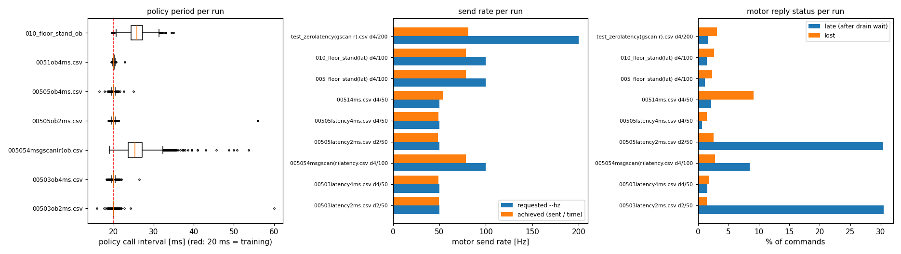

# HUPHY `archivedlogs` 실기 로그 — 실험 조건 추정과 실행 코드 추적

2026-10-13. 대상: `Human-Pygmalion/HUPHY` `biped` 브랜치 commit `a1b67b1` (2026-10-13 18:59, "1.0 서기·통신 실험 기록을 archivedlogs/ 에 남김") 의 `archivedlogs/` 16 개 CSV.
이 문서는 **각 로그가 어떤 조건에서 나왔는가** 만 다룬다. 데이터 심층 분석과 Sim↔Real 차이 원인 분석은 다음 단계다.
코드 인용은 모두 HUPHY `a1b67b1` 기준 `src/huphy/...` 경로와 줄 번호다. 로봇에서 실제로 돈 코드가 이 commit 과 같다는 것은 가정이다 (§4 질문 1).

## 0. 결론 먼저

| 항목 | 결과 | 근거 |
|---|---|---|
| 실행한 정책 | **7 개 정책 로그 전부 `config/policies/stand_bi.pt` = `rough_box_main_v11a` checkpoint 11999** (학습 쪽 최신, `deploy_asset/pyg_rough_main_20261012/policy.pt` 와 sha256 동일 `8a067c9b…`) | 기록된 입력 45 개를 후보 4 개 가중치에 넣어 기록된 출력과 비교. stand_bi.pt 만 최대 차이 2.6e-5~8.2e-5 (CSV 6 자리 반올림 수준), 나머지는 3~16 |
| 정책 계산 | **로봇 쪽 추론은 정확함.** 입력 → 출력, 출력 → 목표각, 이력 순서, `last_action` 모두 기록과 일치 | §2-3 |
| 속도 명령 | **모든 로그에서 (0, 0, 0)**. 정책은 cmd_vel 을 받은 적이 없음 | `control/stand.py:143,226` 이 `COMMAND_ZERO` 를 고정으로 넣음. 로그 `obs/cmd/*` 전 구간 0 |
| 게인 배율 | 로그에 기록되지 않음. 파일 이름 규약 (사용자 설명) 으로만 정해짐 | `--gain-scale` 값은 시작 화면에만 찍힘 (`scripts/run.py:338-359`) |
| 발목 게인 | **전체 배율 0.05 실행은 발목 Kp 가 0 으로 전송됨**, 0.1 은 1.22 (의도 2.23 의 −45 %). MIT 명령의 Kp 가 0~5000 을 12 비트로 자르기 때문 | §2-6 |
| 정책 주기 | `--hz 50` 실행은 20.0 ms 로 지켜짐. **`--hz 100` 실행은 실제 송신이 약 78 Hz 라 정책이 약 39 Hz (25.3~25.8 ms)** 로 불림 | §3, 그림 |
| 관절 관측 지연 | 정책이 보는 관절각은 **직전 주기에 받은 상태** 라 50 Hz 에서 약 20 ms, 100 Hz 송신에서 약 10~13 ms 늦음. IMU 는 정책을 부를 때의 최신값 | §2-4 |
| 안전 가드 | 모든 정책 실행에서 한계 가드가 목표의 3~10 %, 50°/주기 점프 가드가 3~10 % 를 잘랐음. **로그의 `tgt/*` 는 가드 전 값** 이라 실제 송신값과 다름 | §2-5 |

## 1. 로그별 조건

### 1-1. 정책 실행 (`huphy-run`) — 정책 로그 + 같은 실행의 지연 로그

한 번의 `huphy-run --log` 가 정책 CSV (`policy_stand_<시각>.csv`) 와 지연 CSV (`latency_stand_<시각>.csv`) 를 같이 남긴다 (`scripts/run.py:593-609, 632-635`). 보관 때 이름이 바뀌어 짝은 이름·시간 길이로 맞췄다.

| 실행 (짝) | 게인 배율 (나머지 / 발목) | 응답 대기 `--drain-ms` | 송신 `--hz` (실제) | CAN 어댑터 | 정책 구간 | 정책 주기 (중앙값 / p99) | 응답 늦음 / 유실 | 조건 (사용자) |
|---|---|---|---|---|---|---|---|---|
| `00503ob2ms` + `00503latency2ms` | 0.05 / 0.3 | 2 | 50 (49.6) | slcan (추정) | 201.6 s, 10,072 회 | 20.0 / 21.0 ms | 30.5 % / 1.4 % | 크레인 |
| `00503ob4ms` + `00503latency4ms` | 0.05 / 0.3 | 4 | 50 (49.0) | slcan (추정) | 49.4 s | 20.0 / 20.6 | 1.5 / 1.8 | 크레인 |
| `00505ob2ms` + `00505latency2ms` | 0.05 / 0.5 | 2 | 50 (48.7) | slcan (추정) | 43.7 s | 20.0 / 20.6 | 30.4 / 2.5 | 크레인 |
| `00505ob4ms` + `00505lstency4ms` | 0.05 / 0.5 | 4 | 50 (49.1) | slcan (추정) | 45.1 s | 20.0 / 20.7 | 0.7 / 1.4 | 크레인 |
| `005054msgscan(r)ob` + `...latency` | 0.05 / 0.5 | 4 | 100 (**78**) | gs_usb (candleLight) | 148.6 s | **25.3 / 33.5** | 8.5 / 2.8 | 크레인 |
| `0051ob4ms` + `00514ms` | 0.05 / 1.0 (? §4) | 4 | 50 | slcan (추정) | **1.8 s (89 회)** 에서 종료 | 20.0 / 21.0 | 2.2 / **9.1** | 크레인 |
| `010바닥서기ob` + `010바닥서기` | 0.1 전체 (? §4) | 4 | 100 (**78**) | ? | 15.7 s | **25.8 / 32.1** | 1.4 / 2.6 | 바닥 서기 |
| `005바닥 서기` (지연 로그만) | 0.05 전체 | 4 | 100 (**79**) | ? | 정책 로그 없음 | — | 1.2 / 2.3 | 바닥 서기 |

### 1-2. 동작 시험 (`huphy-test`) — 지연 로그만

| 로그 | 추정 | 대기 / 송신 (실제) | 늦음 / 유실 |
|---|---|---|---|
| `test_zerolatency(gscan r)` | `huphy-test --robot zero --log` (관절 전부 0° 유지), gs_usb 어댑터 | 4 ms / 200 Hz (**81 Hz**) | 1.6 % / 3.1 % |

`huphy-test` 는 지연 로그만 남긴다 (`scripts/selftest.py:770, 786-792`). 이름의 `zero` 와 정책 로그 부재로 추정했다.



### 1-3. 모든 정책 실행에 공통 (코드·설정에서 확정)

| 항목 | 값 | 근거 |
|---|---|---|
| 명령 | `huphy-run --robot --policy stand --ankle-space ab [--weights config/policies/stand_bi.pt] --gain-scale A B --drain-ms D --hz H --log` | `stand` 는 `--robot`·`ab`·`position` 만 허용 (`scripts/run.py:362-382`) |
| 설정 파일 | `config/robot.yaml` (= `robot_v1.0.yaml`, 내용 동일) | `scripts/commission.py:58` |
| 기본 게인 (배율 1.0) | hip_pitch·hip_roll·hip_yaw 150 / 6, knee 220 / 6, ankle_a·ankle_b 22.266 / 1.414 — 학습값과 같음 | `config/robot.yaml`; `scripts/run.py:144-163` (stand 는 yaml 게인 사용) |
| 정책 시작 | 3 s 에 걸쳐 기본 자세 (엉덩이 ±10°, 무릎 ±20°, 크랭크 ±8.3°) 로 이동 → Enter 까지 그 자세 유지 → 정책 | `scripts/run.py:192-221, 556, 610-615`. 로그 첫 줄의 관절각이 기본 자세에서 최대 5.7° 이내 |
| 캘리브레이션 | 12 관절 모두 `sign +1`, `offset 0`, 한계 = 학습 모형 가동범위. 파일 주석은 "아직 아무것도 재기 전" | `config/calibration/{left,right}_leg_v1.0.json` (commit `394f5d3`, 2026-10-12) |
| 안전 가드 | 한계에서 3° 안쪽, 한 주기 최대 50°, 통신 두절 5 주기면 정지 | `config/robot.yaml` `safety` |
| IMU | EBIMU, 100 Hz, 쿼터니언 → 중력방향, 각속도 deg/s → rad/s. **부착 회전 보정 없음** (센서 축 = 몸통 축 가정) | `sensors/ebimu/protocol.py:137-147`; `sensors/base.py:152-167`; `control/stand.py:207-210` |
| 정책 계산 | numpy 로 `.pt` 를 직접 읽음. 정규화 `(x − mean) / (std + 0.01)` | `control/rsl_rl.py:53, 152-197` |

## 2. 실행 코드 전체 경로 (한 제어 주기)

```
ControlLoop.run  (control/loop.py:345-398, 주기 = 1/--hz, 늦으면 따라잡지 않음 :447-462)
 └ step  (:295-316)
    1. obs = Biped.get_observation()      ← 직전 주기 collect() 가 받아 둔 모터 상태. 새로 읽지 않음 (robots/leg.py:392-416)
    2. action = motion(t, obs)
         held(): --hz > 50 이면 N 주기마다 한 번만 정책, 나머지는 직전 목표 반복 (control/loop.py:166-199)
         stand.step(): IMU read() (최신값) + q(t-1), q(t) − 기본자세, last_action, cmd=0 → 45 칸
                       → rsl_rl model → 12 칸 → 목표 = 기본자세 + 0.25·act (도), 학습 한계로 자름 (control/stand.py:190-278)
         PolicyLog 가 obs/act/tgt/pos 를 한 줄로 남김 (telemetry/policy_log.py:67-113)
    3. Biped.build_commands → Leg.build_commands  (robots/leg.py:529-581)
         관절마다 guards.apply(목표, 현재각=캐시 상태): 한계 −3° 클립 → 현재각 ±50° 점프 클립 (safety/guards.py:107-150)
         MitCommand(위치 raw, kp=motor.gains.kp, kd=motor.gains.kd)   ← gains 는 yaml × 배율 (scripts/bringup.py:121-129)
    4. send(): 두 다리 명령을 먼저 몰아서 전송 (motors/robstride/bus.py:207-238)
         MIT 프레임: kp 0~5000, kd 0~100 을 12 비트로 양자화 (motors/robstride/tables.py:88, 111-115; codec/mit.py:123-124)
    5. collect(): 다리마다 응답을 최대 --drain-ms 기다림, expect 개 채우면 즉시 종료 (motors/canbus.py:409-463)
         받은 모터만 상태 캐시 갱신. 못 받은 모터는 직전 상태가 그대로 남음 (motors/robstride/bus.py:274-310)
         늦게 온 응답은 다음 주기에 'late' 로 셈 (bus.py:256-271)
    6. 남은 시간 잠 (precise sleep)
```

### 2-1. 게인 배율
`--gain-scale A B` → `A` 는 ankle_a·ankle_b 를 뺀 10 개, `B` 는 ankle_a·ankle_b (`scripts/run.py:501-508`; `scripts/bringup.py:121-129`). 숫자 하나면 전체. Kp·Kd 가 같은 비율로 줄어든다 (`motors/base.py:74-77`).

### 2-2. 응답 대기 (`ob2ms`, `ob4ms`)
`--drain-ms` 는 응답을 기다리는 최대 시간이다 (`scripts/run.py:300-306`, 기본 2 ms `motors/canbus.py:104`). 대기를 넘긴 응답은 그 주기 상태에 반영되지 않고 다음 주기에 들어온다 (`late`). 끝내 안 온 응답 (`lost`) 은 그 모터의 상태가 직전 값으로 남는다. 모터 쪽은 명령을 못 받으면 직전 명령을 유지한다 (MIT 모드). 양다리는 다리마다 차례로 기다리므로 최악 2 배 (`scripts/bringup.py:109-110`).

### 2-3. 정책 계산 대조 (로그로 확인)
| 확인 | 결과 (7 개 로그) |
|---|---|
| 기록된 입력 → stand_bi.pt (HUPHY numpy 로더) → 기록된 출력 | 최대 차이 2.6e-5~8.2e-5 |
| 목표 = 기본자세 + 0.25·출력 (도) 후 한계 자름 | 최대 차이 5.6e-4° |
| 입력의 관절각 = rad(측정각 − 기본자세) | 최대 차이 5.7e-6 rad |
| `q_prev`(t) = `q`(t−1), `last_act`(t) = `act`(t−1) | 차이 0 |

### 2-4. 관측 시점
정책이 보는 관절각은 그 주기에 새로 읽은 값이 아니라 **직전 주기의 `collect()` 가 받은 응답** 이다 (`robots/leg.py:392-396`, `control/loop.py:301, 311`). MIT 응답이 명령을 받은 직후의 모터 상태라면 (RobStride 응답 시점은 코드로 확인 못 함), 관절각은 정책 호출 시점보다 약 한 송신 주기 (50 Hz 에서 약 20 ms, 실제 78 Hz 에서 약 13 ms) 늦다. IMU 는 정책을 부를 때 `read()` 로 가장 최근 값을 꺼낸다 (`control/stand.py:272`; 센서 100 Hz). 학습 시뮬은 관측 지연이 0 이었다.

### 2-5. 가드가 바꾼 목표
로그 `tgt/*` 는 정책 쪽 목표 (가드 전) 다. 실제 송신값은 `clip(clip(tgt, 한계 ±3° 안쪽), 현재각 ± 50°)` 으로 재구성할 수 있다 (현재각 = 같은 캐시 상태 = 로그 `pos/*`).

| 실행 | 한계 가드 | 점프 가드 | \|목표 − 측정각\| RMS |
|---|---|---|---|
| 00503ob2ms | 10.4 % | 10.2 % | 27.9° |
| 00503ob4ms | 9.8 | 8.4 | 26.1 |
| 005054msgscan(r)ob | 8.5 | 6.5 | 25.0 |
| 00505ob2ms | 7.6 | 6.6 | 24.2 |
| 00505ob4ms | 7.7 | 6.2 | 23.7 |
| 0051ob4ms | 7.0 | 3.3 | 18.5 |
| 010바닥서기ob | 3.2 | 3.7 | 19.4 |

정책 출력 크기 (raw) 의 99 백분위가 6~8 이다 (목표각으로 86~115° 이동에 해당). 학습 범위를 크게 벗어난 상태라는 뜻이며 원인 분석은 다음 단계다.

### 2-6. 실제로 전송된 게인 (12 비트 양자화, 내림)
`float_to_uint` 가 내림으로 정수화한다 (`codec/mit.py:83-95`). Kp 한 칸 = 5000/4095 = 1.221 N·m/rad, Kd 한 칸 = 0.0244.

| 배율 | hip Kp 150× | knee Kp 220× | ankle Kp 22.266× | hip/knee Kd 6× | ankle Kd 1.414× |
|---|---|---|---|---|---|
| 0.05 | 7.33 (−2.3 %) | 10.99 (−0.1 %) | **0.00 (−100 %)** | 0.293 | 0.049 (−31 %) |
| 0.1 | 14.65 | 21.98 | **1.22 (−45 %)** | 0.586 | 0.122 (−14 %) |
| 0.3 | 43.96 | 65.93 | 6.11 (−8.6 %) | 1.783 | 0.415 |
| 0.5 | 74.48 | 109.89 | 10.99 (−1.3 %) | 2.979 | 0.684 |
| 1.0 | 148.96 | 219.78 | 21.98 (−1.3 %) | 5.983 | 1.392 |

→ `005바닥 서기` (전체 0.05 로 추정) 는 발목 두 모터에 **Kp 0** 이 나갔다. `010바닥서기` (전체 0.1 로 추정) 는 발목 Kp 1.22.

## 3. 통신 관련 관찰 (조건 판단용, 원인 분석 아님)

- `--hz 100`, `--hz 200` 을 준 실행은 전부 실제 송신이 78~81 Hz 에 머문다. 한 주기에 약 12.5 ms 가 걸린다는 뜻이다 (응답 대기·직렬 송신·정책 계산 포함, 내역 미측정). `held()` 가 주기 수로 정책을 부르므로 정책도 같이 느려진다 (39 Hz).
- `--drain-ms 2` 는 응답의 약 30 % 가 대기 뒤에 도착했다 (late). 4 ms 는 1~2 %. 응답 지연 중앙값은 어댑터·설정과 무관하게 약 2.5 ms.
- 유실은 대부분 1.4~3 %. `00514ms` (0051 실행, 1.8 s 만에 끝남) 만 9.1 % (양다리 모두).

## 4. 확인이 필요한 것 (모호한 부분)

1. 로봇에서 돈 코드가 commit `a1b67b1` 과 같은가 — 특히 캘리브레이션 파일 (지금 저장소 값은 전부 sign +1, offset 0) 과 `stand.py` 의 명령 고정 (0,0,0).
2. `0051` 은 "나머지 0.05 / 발목 1.0" 인가, "0.05 / 0.1" 인가.
3. `010바닥서기` 는 전체 0.1 인가. `005바닥 서기` 의 정책 로그는 없는가 (지연 로그만 있음).
4. `(r)`, `gscan(r)` 의 뜻 — 오른다리 채널만 gs_usb 로 바꾼 것인가, 수신 스레드 등 다른 뜻인가. 나머지 (`gscan` 표기 없는) 실행은 slcan 인가.
5. 크레인 실험에서 발이 바닥에 닿은 구간이 있었나 (로그로는 접촉을 알 수 없음).
6. 실행 순서 (파일에 시각이 없음).

## 5. 재현 방법

```bash
# HUPHY biped 를 건드리지 않고 읽기
git -C ~/external_repos/HUPHY fetch origin biped
git -C ~/external_repos/HUPHY archive origin/biped | tar -x -C <작업폴더>
```
정책 판별·일관성 검사·요약 표는 HUPHY 의 `control/rsl_rl.py`, `control/stand.py` 를 그대로 import 해 계산했다 (이 문서의 수치).
