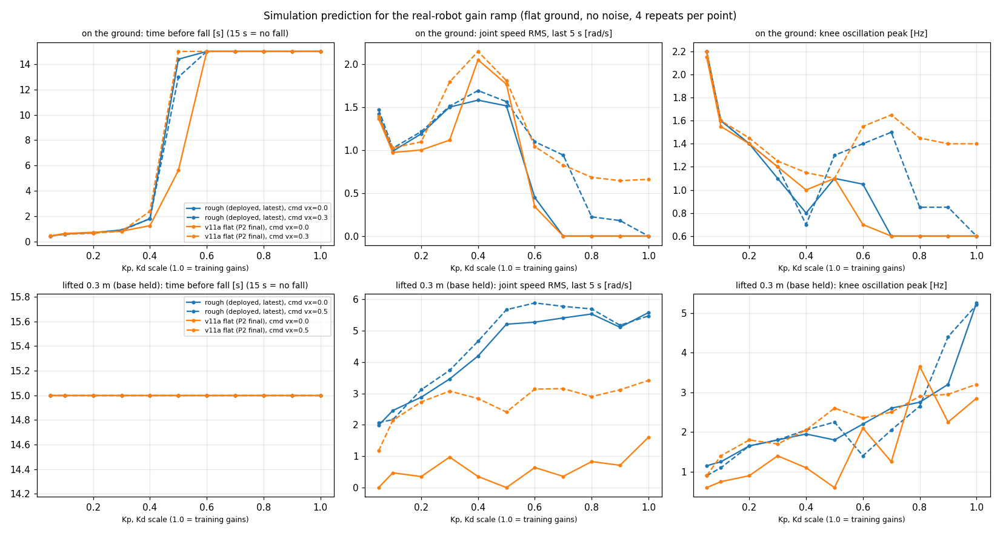

# 실기 배포 실패 (서지 못함·다리 흔들림 발산) — 원인 분석 계획과 시뮬 예측

2026-10-13. 실기 상황(사용자 보고): 정책을 배포했고 cmd_vel 을 주었으나 제대로 서지 않고 다리를 흔드는 발산 동작이 나왔다. 지금 Kp/Kd 를 크게 낮춘 뒤 1 에 가깝게 천천히 올리며 응답을 보는 중이다.

## 0. 결론 먼저 — 데이터를 받기 전에 시뮬레이션으로 확인한 것 셋

배포 정책 두 개를 시뮬레이션에서 Kp·Kd 배율 0.05~1.0 로 돌렸다 (평지, 관측 잡음 없음, 평균 행동, 배율·명령마다 4 회). 도구: `tools/sim2real/gain_scale_sweep.py`. 데이터: `docs/sim2real/data/sweep_*.json`.

1. **땅 위에서 배율 0.4 이하는 시뮬레이션에서도 1~2 초 안에 주저앉는다.** 두 정책 모두 0.6 이상에서만 넘어지지 않는다 (0.5 는 일부 넘어짐). 그러므로 땅 위에서 낮은 배율로 시작해 올리는 시험은, sim 과 실기가 완벽히 같아도 0.5 아래에서 실패한다. 이 구간의 실패는 sim2real 차이의 증거가 아니다.
2. **공중에 들면 (몸통 고정, 발이 땅에 닿지 않음) 최신 rough 정책은 모든 배율에서 다리를 크게 흔든다.** 서라는 명령 (0,0,0) 에서도 관절 속도 RMS 2~5.6 rad/s, 무릎 각도 표준편차 약 30°. 배율이 높을수록 빨라진다 (무릎 진동 1 Hz → 배율 1.0 에서 5.2 Hz). v11a 평지 정책 (P2 끝) 은 (0,0,0) 에서는 거의 가만히 있고, 걷기 명령을 주면 흔든다. 이전에 시뮬레이션에서 본 "들면 다리가 떨린다" (할 일 #9) 와 같은 현상이다.
3. **rough 정책은 0.3 m/s 명령에서 걷지 않고 서 있다** (배율 1.0, 관절 속도 RMS 0.00). 학습의 stand_still_penalty 가 0.3 m/s 이하를 "움직이라는 명령" 으로 치지 않기 때문으로 보인다 (`rewards.py:77-118`, deadband 0.3, 미검증 추정). 배포 README 의 "첫 시험 0.3~0.6 m/s" 중 0.3 은 걷기 시험이 되지 않는다.

→ **실기 시험이 "공중에 매단 상태" 였다면, 다리 흔들림은 sim 에서도 나오는 정책 자체의 동작일 가능성이 크다.** 땅 위였다면 배율 0.6 이상에서의 동작이 판단 기준이다. 시험 조건을 먼저 알아야 한다 (§3).

## 1. 받으면 좋은 데이터

한 제어 주기 (20 ms) 마다 한 줄. 이미 기록 중인 것이 있으면 그 형식 그대로 주면 맞춘다.

| 분류 | 항목 | 왜 필요한가 |
|---|---|---|
| 시간 | 주기 시작 시각, 센서 읽은 시각, 명령 보낸 시각 (단조 시계, μs) | 제어 주기·지연 측정 (§2-E) |
| 정책 입력 | 정책에 넣은 45 개 숫자 그대로 | 입력 재현 (§2-A), 분포 비교 (§2-B) |
| 정책 출력 | 12 개 raw 출력, 보낸 목표각 12 개 (rad) | §2-A, §2-D |
| 센서 원값 | 모터 위치·속도·토크(전류) 12 개 (모터 단위 그대로, 변환 전), IMU 원값 (쿼터니언·각속도·가속도, 단위·축 표기 포함) | 변환 (부호·영점·단위·축) 오류 찾기 |
| 제어 설정 | 각 관절에 보낸 Kp, Kd, 배율, 모터 모드 (MIT 등), 모터 펌웨어 쪽 제한값 | sim 과 같은 조건 재현 |
| 시험 조건 | 매달았나/땅 위인가, 명령 일정, 배포한 정책 파일 (sha), 사용한 deploy 코드 버전, 영점 보정 적용 여부 | §3 |
| 영상 | 같은 시각 기준 (시작 시 손뼉·LED 등) | 데이터와 동작 맞춰 보기 |

## 2. 해 볼 분석 (순서대로 — 앞 단계가 뒤 단계의 전제)

### A. 입력 재현 — "같은 입력이면 같은 출력인가" (배포 코드 검사)
기록한 45 개 입력을 그대로 `policy.onnx` 에 넣어 기록한 출력과 비교한다. 다르면 배포 코드 문제다 (정규화, 이력 순서 `[이전][현재]`, `last_action` 갱신 시점, 출력 → 목표각 공식 `offset + 0.25 × raw`, clip). 통과 기준: 최대 차이 1e-4 이하. 도구: `deploy_asset/.../policy_runner.py`, `tools/deploy/verify_deploy_io.py` 의 비교 부분 재사용.

### B. 입력 정합성 — "실기 입력이 sim 이 주던 입력과 같은 뜻인가"
1. **정지 검사** (로봇을 손으로 똑바로 들고 기본 자세로 고정): projected_gravity ≈ (0, 0, −1), gyro ≈ 0, `motor_pos_history` ≈ 0. 벗어나는 값 = 영점·축·부호 오류.
2. **한 관절씩 움직이기**: 한 관절만 손으로 +방향으로 돌릴 때 45 개 중 어느 칸이 어느 부호로 변하는지. sim 에서 같은 동작을 했을 때와 비교 (관절 순서·좌우·크랭크 A/B·부호). 미해결 항목: 좌우 매핑 확인 (#5), 영점 8 개 미반영 (#14, 왼무릎 9.4°).
3. **기울이기**: 로봇을 앞·옆으로 기울일 때 projected_gravity 와 gyro 의 부호·축. IMU 쿼터니언 순서 미확정 (#64).
4. **분포 비교**: 같은 조건 (같은 매달기/땅, 같은 명령) 의 sim 롤아웃에서 45 개 각각의 범위·평균과 실기를 겹쳐 본다. 학습 때 넣은 잡음 크기 (gyro ±0.2, 중력 ±0.05, 관절 ±0.01) 를 넘는 차이가 후보.

### C. 같은 조건을 sim 에서 재현 — "sim 도 그렇게 흔드는가"
실기 조건 (매달기 높이·땅, Kp·Kd 배율, 명령) 을 그대로 sim 에 걸고, 흔들림 크기 (관절 속도 RMS)·주파수·관절별 진폭을 실기와 비교한다. sim 이 같은 흔들림을 내면 정책 자체의 동작이고, 실기만 흔들면 sim2real 차이다. 도구: `gain_scale_sweep.py --hang H`, viser 뷰어의 Action scale·지형 선택.

### D. 목표각 재생 — "같은 목표각을 주면 관절이 같이 움직이는가" (모터·모델 검사)
실기에서 보낸 목표각 시계열을 sim 로봇 (몸통 고정, 같은 Kp·Kd) 에 그대로 넣고 (정책 없이), 관절 각도 응답을 실기와 겹쳐 본다. 차이가 크면 모터 모델 문제: Kp·Kd 의 의미 (MIT 모드 단위, 기어비, 출력축 기준인가), 지연, 마찰, 토크 한계, 크랭크–발목 링크. 목표각 → 실제 각도의 상호상관으로 지연을 잰다.

### E. 주기·지연 — "20 ms 주기와 지연 0 을 지키는가"
기록한 시각으로 제어 주기 분포 (평균·최대), 센서→명령 지연을 잰다. 그 값을 sim 에 넣어 (행동 지연 1~2 주기) 흔들림이 생기는지 본다. 학습은 지연 0 이었다 (audit F3).

### F. 그림자 실행 — 실기 입력으로 sim 정책을 같이 돌리기
실기 입력을 실시간으로 sim 쪽 정책에 넣어 출력만 비교한다 (pygviewer `policy_shadow` 모드, 실기로는 아무것도 보내지 않음). A 를 실시간으로 하는 셈.

### G. 민감도 훑기 — "무엇을 틀리게 하면 실기 같은 흔들림이 나오는가"
B~E 에서 후보가 나오면 sim 에서 그 오차를 일부러 넣고 실기 신호 (흔들림 주파수·진폭·어느 관절부터) 가 재현되는지 본다. 후보: 관절 영점 오차 (최대 9.4°), 관절 부호 하나 뒤집힘, IMU 축 뒤바뀜·기울기, gyro 단위 (deg/s 를 rad/s 로), 지연, Kp·Kd 의미 차이 (예: 기어 전 단위), 모터 힘 부족.

### 기존에 알려진 차이 (audit `docs/audit/2026-10-12_rough_box_main_v11a/README_ko.md` §6)
F1 실기 gain 문서값 kp 10 / kd 1 vs 학습 150~220 · F2 영점 오차 9.4° vs 학습 DR ±0.86° · F3 지연·IMU bias DR 없음 · F11 실기 모터 맵 (전부 RS03) vs 모델 (RS04 혼용). 실기 시험 전에 이 넷이 어떤 상태였는지가 분석의 출발점이다.

## 3. 먼저 확인할 것

1. 배포한 정책이 무엇인가: `pyg_rough_main_20261012` (rough, 최신) 인가 `pyg_v11a_stand01` (v11a 평지) 인가.
2. 시험할 때 로봇이 매달려 있었나, 땅 위였나 (매달았다면 발이 땅에 닿았나).
3. 배율 1.0 일 때 실기 Kp·Kd 가 학습값 (§7 표: 150~220 / 6, 크랭크 22.3 / 1.41) 과 같은가. 모터에 넣는 Kp·Kd 의 단위·기준 (출력축인가) 은 무엇인가.
4. 영점 보정 (#14) 과 좌우·부호 매핑 확인 (#5), IMU 축 확인 (#64) 은 반영했나.
5. 데이터가 어떤 형식으로 기록되어 있나 (§1 중 없는 항목).
