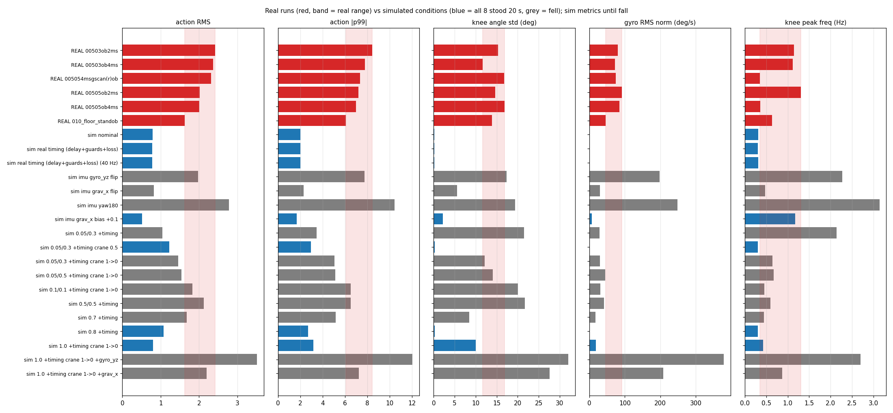

# HUPHY 실기 로그 심층 분석 — 무엇이 Sim↔Real 차이를 만드는가

2026-10-13. 앞 문서 [실험 조건 추적](2026-10-13_huphy_archivedlogs_conditions.md) 의 다음 단계.
대상 정책: `rough_box_main_v11a` checkpoint 11999 (로봇의 `stand_bi.pt` 와 같은 파일). 시뮬레이션은 공유 브랜치 `vibecoded-audit-20261012` 의 순정 mjlab 패키지 (`Pygmalion-Velocity-Flat-P2` play 설정, 평지, 속도 명령 0) 로 돌렸다.

## 0. 결론 먼저

| # | 질문 | 답 | 근거 |
|---|---|---|---|
| 1 | 통신·타이밍 차이 (관절 관측 한 주기 지연, 39 Hz 정책, 안전 가드, 응답 유실 2 %) 가 원인인가 | **아니다.** 게인 1.0 에서 넷을 모두 켜도 8/8 이 20 초 동안 서 있고 지표가 학습 조건과 같다 | §3 표 1 |
| 2 | 실기의 다리 흔들림·발산은 게인 배율 때문인가 | **대부분 그렇다.** 0.05~0.1 배율은 시뮬레이션에서도 바닥에서 0.5~0.7 초 안에 넘어지고, 크레인으로 받쳐 주면 실기와 같은 크기의 흔들림 (행동 RMS 1.5~1.8, 무릎 표준편차 12~20°) 을 낸다. **이 정책은 배율 0.8 미만에서 서는 법을 배운 적이 없다** | §3 표 2, 그림 |
| 3 | IMU 는 맞는가 | **중력방향의 x 성분 (앞뒤 기울기) 부호가 뒤집혀 정책에 들어간다.** 원인은 **EBIMU 자세 좌표계와 자이로·가속도 좌표계의 차이를 HUPHY 가 변환하지 않은 것** (데이터시트: 두 좌표계는 X 가 같고 Y·Z 가 반대, 둘 다 오른손 법칙). HUPHY `gravity_from_quat` 은 쿼터니언을 자이로와 같은 좌표계·위쪽이 +z 인 세계로 보고 계산하는데, 이 차이를 넣어 계산하면 자세와 상관없이 **정확히 중력 x 만 반대**가 된다 (무작위 자세 10,000 개, 오차 1e-15). 자이로는 맞다 | §4 |
| 4 | 그 부호 오류가 얼마나 치명적인가 | **게인 1.0 에서도 못 선다.** 중력 x 반전으로 2.2 초 (바닥), 3.2 초 (크레인을 내리며) 안에 8/8 이 넘어진다 | §3 표 1·3 |
| 5 | 시작 자세의 기울기 | 실기 시작 시 정책이 본 중력 x 는 +0.06~+0.12. 부호를 바로잡으면 **−0.06~−0.12 = 몸통 (또는 센서) 이 3.5~7° 뒤로 젖혀진 상태**다. 시뮬레이션의 서 있는 자세는 0.002. 정책이 본 값 (+) 만으로 출력이 2 → 4~5 로 커졌다. 바로잡은 값 (−0.1) 은 시뮬레이션에서 무해하다 (0/8, 무릎 0.3°) | §2, §3 |
| 6 | 정책이 켜지자마자 행동이 커지는 이유 | 로봇이 아직 움직이기 전 (자이로 0) 에도 행동이 0.1 초 동안 1.1 → 4.2 로 자란다. **직전 행동 입력이 되먹임되는 정상 동작**이고, 게인이 충분하면 관절이 따라가서 멈춘다. 게인이 낮으면 관절이 따라가지 못해 계속 자란다 | §2 |

**권고 (실기 순서)**: ① HUPHY 에서 자세 좌표계 → 자이로 좌표계 변환을 넣고 (새 브랜치, 결과적으로 중력 x 부호 반전), 모터를 끈 채 손으로 기울여 §4-3 표와 대조 → ② 그 뒤 **배율 1.0** (또는 0.8 이상) 으로, 크레인이 몸무게를 받친 상태에서 정책을 켜고 크레인을 천천히 내림. 시뮬레이션에서 이 순서는 8/8 이 섰다 (표 3 `1.0 +timing crane 1->0`). 배율을 0.05 에서 올려 가는 방식은 정책의 학습 범위 밖이라 실기 결과를 해석할 수 없다.

## 1. 실기 로그의 특징

같은 정의로 실기와 시뮬레이션을 잰다 (`tools/sim2real/huphy_log_signature.py`). 무릎은 오른 무릎, 주파수는 무릎각의 0.3~12 Hz 최대 성분.

| 실행 | 길이 (s) | 행동 \|p99\| | 행동 RMS | 처음 \|행동\|>3 (s) | 무릎 표준편차 (°) | 무릎 주파수 (Hz) | 자이로 RMS x/y/z (°/s) | 한계 가드 % | 점프 가드 % | 시작 중력 (x, y, z) |
|---|---|---|---|---|---|---|---|---|---|---|
| 00503ob2ms | 201.6 | 8.42 | 2.42 | 0.04 | 15.4 | 1.14 | 47/34/55 | 10.4 | 10.2 | 0.091, 0.026, −0.996 |
| 00503ob4ms | 49.4 | 7.77 | 2.36 | 0.04 | 11.7 | 1.11 | 46/28/48 | 9.8 | 8.4 | 0.111, 0.020, −0.994 |
| 005054msgscan(r)ob | 148.6 | 7.33 | 2.32 | 0.07 | 16.7 | 0.35 | 53/24/47 | 8.5 | 6.5 | 0.116, 0.006, −0.993 |
| 00505ob2ms | 43.7 | 7.21 | 2.01 | 0.06 | 14.6 | 1.30 | 56/35/64 | 7.6 | 6.6 | 0.102, 0.002, −0.995 |
| 00505ob4ms | 45.1 | 7.00 | 2.01 | 0.12 | 16.8 | 0.35 | 54/30/57 | 7.7 | 6.2 | 0.062, 0.017, −0.998 |
| 0051ob4ms | 1.8 | 7.21 | 1.91 | 0.86 | 15.2 | 0.56 | 26/28/129 | 7.0 | 3.3 | 0.030, 0.008, −1.000 |
| 010바닥서기ob | 15.7 | 6.06 | 1.62 | 6.65 | 13.9 | 0.64 | 19/19/37 | 3.2 | 3.7 | 0.059, 0.012, −0.998 |

시뮬레이션의 정상 서기 (게인 1.0) 는 행동 \|p99\| 2.0, 행동 RMS 0.79, 무릎 표준편차 0.1°, 자이로 RMS 1°/s 이하다. 실기는 모든 실행에서 행동이 3~4 배, 흔들림이 100 배 이상 크다.

다리별로 보면 무릎 표준편차가 가장 크고 (11.6~18.3°), 그다음이 발목 크랭크와 엉덩이 롤·요 (9.9~14.8°) 다. 자이로는 피치 (y) 가 가장 작고 롤 (x)·요 (z) 가 크다 — 크레인 줄이 피치를 일부 붙잡고 몸통이 줄에 매달려 비틀린 것으로 보인다 (확인 안 됨).

IMU 값이 직전 호출과 똑같은 행은 0.5~5.5 % (010 은 18 %, 대부분 자이로가 정확히 0 인 정지 구간). 센서 정지는 원인으로 보이지 않는다.

## 2. 정책 출력이 무엇 때문에 커지는가 (기록된 입력으로 다시 계산)

`tools/sim2real/huphy_obs_attribution.py`: 기록된 45 칸 입력을 로봇과 같은 numpy 계산으로 정책에 넣고, 한 묶음씩 서 있을 때의 값으로 바꿔 행동 RMS 가 얼마나 바뀌는지 본다.

| 입력 묶음을 바꿈 | 첫 0.5 초 행동 RMS (7 실행 범위) | 전 구간 |
|---|---|---|
| 기록 그대로 | 0.70~1.87 | 1.62~2.42 |
| 직전 행동 → 0 | **0.37~0.46** | **0.69~0.99** |
| 관절각 (현재) → 기본 자세 | 1.23~1.87 | 1.66~2.09 |
| 관절각 (한 주기 전) → 기본 자세 | 0.49~2.21 | 1.83~3.57 |
| 중력 → (0, 0, −1) | 0.64~1.75 | 1.54~2.28 |
| 자이로 → 0 | 0.71~1.87 | 1.60~2.36 |

행동을 키우는 것은 **직전 행동의 되먹임**이다. 관절이 정책의 목표를 따라가지 못하면 (게인이 낮음, 발목 Kp 가 0 으로 전송됨, 크레인이 붙잡음) 정책은 같은 방향으로 더 크게 명령한다. 그 결과 행동이 학습 범위를 벗어나고 가드가 목표의 3~10 % 를 자른다.

**세상을 멈춰 놓고** (관절·IMU 를 첫 행 값으로 고정, 직전 행동만 갱신) 40 주기를 돌리면:

| 시작 입력 | 40 주기 뒤 \|행동\| 최대 |
|---|---|
| 시뮬레이션의 서 있는 입력 (중력 (0,0,−1), 관절 = 기본 자세) | 2.04 (왼 발목 크랭크 A) |
| 실기 첫 행 (7 실행) | 2.20~5.15 |
| 실기 첫 행, 중력만 (0,0,−1) 로 | 1.69~2.23 |
| 실기 첫 행, 관절만 기본 자세로 | 2.18~4.16 |

시뮬레이션에서 서 있는 정책도 발목 크랭크 A 에 행동 ±1.8 (약 26°) 을 계속 낸다 — 관절은 기본 자세 근처에 있고, 위치 오차 × Kp 로 발목 토크를 만드는 방식이다. 발목 게인이 낮으면 이 토크가 나오지 않는다. 실기에서 행동을 2 이상으로 더 키운 것은 **시작 시 중력 x +0.06~+0.12** 다.

시뮬레이션에서 서 있을 때의 중력은 (0.002, 0.003, −1.000) 이다. 실기는 사용자가 "골반 수평" 으로 맞춘 상태에서 정책에 +0.06~+0.12 (앞으로 3.5~7° 숙임) 를 넣었다. §4 의 부호 오류를 바로잡으면 실제는 −0.06~−0.12 (뒤로 젖힘) 이다 — 몸통이 실제로 젖혀 있었거나 센서가 그만큼 기울어 붙었다. 정책은 "앞으로 넘어지고 있다" 고 보고 반대로 밀었고, 이 방향은 실제 기울기를 키우는 쪽이다.

## 3. 시뮬레이션에서 실기 조건을 하나씩 켜기

`tools/sim2real/real_condition_sim.py`. 조건마다 8 회, 20 초, 넘어지면 그 시점까지만 잰다. 구현:

- **게인**: 몸통·발목 배율을 곱한 뒤 로봇의 MIT 12 비트 인코딩과 같은 버림 (`int(kp/5000·4095)`) 을 거친다. 배율 0.05 에서 발목 Kp 는 0 이 된다.
- **지연**: 정책이 보는 관절각 이력을 한 정책 주기 늦춘다.
- **가드**: 목표를 모델 한계 −3° 로, 다시 (관측된) 현재각 ±50° 로 자른다. 관찰의 직전 행동은 자르기 전의 값이다 (로봇과 같음).
- **유실**: 관절마다 2 % 확률로 관측 관절각을 갱신하지 않는다.
- **IMU**: 자이로 y·z 반전 / 중력 x 반전 / 180° 부착 (자이로 x·y 와 중력 x·y 반전) / 중력 x 에 +0.1 을 더하고 정규화.
- **크레인**: 몸통에 위쪽 힘 = 비율 × 로봇 무게 (모델 질량 23.6 kg). 일정 비율, 또는 15 초 동안 1 → 0 으로 줄임.
- **40 Hz**: `--decimation 5` (25 ms) 로 따로 돌림.

`+timing` 은 지연·가드·유실 세 가지를 다 켠 것.

### 표 1. 게인 1.0 (학습값) 에서 한 가지씩

| 조건 | 넘어짐 | 버틴 시간 (s) | 행동 \|p99\| | 행동 RMS | 무릎 표준편차 (°) | 자이로 RMS x/y/z (°/s) |
|---|---|---|---|---|---|---|
| 학습 조건 | 0/8 | 20.0 | 2.00 | 0.79 | 0.1 | 1/1/0 |
| 관절 관측 지연 | 0/8 | 20.0 | 2.03 | 0.79 | 0.1 | 1/1/0 |
| 가드 | 0/8 | 20.0 | 2.05 | 0.78 | 0.1 | 1/1/0 |
| 유실 2 % | 0/8 | 20.0 | 2.01 | 0.79 | 0.1 | 1/1/0 |
| 지연+가드+유실 | 0/8 | 20.0 | 1.99 | 0.78 | 0.1 | 1/1/0 |
| 지연+가드+유실, 40 Hz | 0/8 | 20.0 | 1.99 | 0.78 | 0.1 | 1/1/0 |
| **자이로 y·z 반전** | **8/8** | **0.5** | 7.73 | 1.98 | 17.3 | 30/192/30 |
| **중력 x 반전** | **8/8** | **2.2** | 2.29 | 0.82 | 5.5 | 11/27/8 |
| **IMU 180° 부착** | **8/8** | **0.3** | 10.45 | 2.78 | 19.4 | 82/215/46 |
| 중력 x +0.1 (시작 기울기) | 0/8 | 20.0 | 1.66 | 0.52 | 2.2 (1.18 Hz) | 5/4/3 |
| 중력 x −0.1 | 0/8 | 20.0 | 2.34 | 0.95 | 0.3 | 1/2/1 |

### 표 2. 실기의 게인 설정 (모두 지연+가드+유실 포함)

| 조건 | 넘어짐 | 버틴 시간 (s) | 행동 \|p99\| | 행동 RMS | 무릎 표준편차 (°) | 무릎 주파수 (Hz) | 자이로 RMS x/y/z | 한계/점프 가드 % |
|---|---|---|---|---|---|---|---|---|
| 0.05/0.3 바닥 | 8/8 | 0.5 | 3.44 | 1.04 | 21.5 | 2.14 | 4/29/2 | 0.0/2.1 |
| 0.05/0.5 바닥 | 8/8 | 0.5 | 3.28 | 1.04 | 22.7 | 2.05 | 5/29/4 | 0.0/2.2 |
| 0.05/1.0 바닥 | 8/8 | 0.7 | 3.19 | 1.00 | 21.5 | 1.57 | 7/28/5 | 0.0/1.0 |
| 0.1/0.1 바닥 | 8/8 | 0.6 | 3.94 | 1.23 | 19.6 | 1.61 | 6/23/8 | 0.0/6.2 |
| 0.05/0.3 크레인 50 % 고정 | 0/8 | 20.0 | 2.96 | 1.23 | 0.2 | — | 0/1/0 | 0.0/0.3 |
| 0.05/0.3 크레인 90 % 고정 | 0/8 | 20.0 | 2.56 | 0.91 | 4.9 | 0.69 | 9/6/11 | 1.4/0.2 |
| **0.05/0.3 크레인 1→0** | 8/8 | 9.1 | 4.90 | 1.27 | 9.0 | 0.66 | 18/12/14 | 2.1/2.5 |
| **0.05/0.5 크레인 1→0** | 8/8 | 7.2 | 5.13 | 1.55 | 14.0 | 0.67 | 30/17/28 | 2.1/2.4 |
| **0.1/0.1 크레인 1→0** | 8/8 | 6.9 | 6.50 | 1.82 | 20.0 | 0.45 | 17/18/18 | 4.1/6.0 |
| 0.05/0.3 크레인 1→0, 지연 등 없이 | 8/8 | 8.3 | 4.94 | 1.53 | 13.1 | 0.56 | 23/17/22 | — |
| 0.5/0.5 바닥 | 8/8 | 2.7 | 6.51 | 2.12 | 21.7 | 0.59 | 25/17/28 | 4.0/10.6 |
| 0.7 바닥 | 1/8 | 19.6 | 5.17 | 1.67 | 8.4 | 0.44 | 11/7/11 | 1.9/7.1 |
| 0.8 바닥 | 0/8 | 20.0 | 2.69 | 1.08 | 0.3 | 0.30 | 1/1/0 | 0.0/0.0 |
| 실기 (참고) | 크레인 | 2~200 | 6.1~8.4 | 1.6~2.4 | 11.7~16.8 | 0.35~1.30 | 19~56 / 19~35 / 37~129 | 3.2~10.4 / 3.3~10.2 |

40 Hz 로 돌린 같은 표 (`data/2026-10-13_rc_dec5.json`) 도 모든 행이 ±10 % 안에서 같다.

- 크레인을 내리는 동안의 저게인 시뮬레이션이 실기의 크기 (행동 \|p99\| 5~6.5 대 6~8, 무릎 9~20° 대 12~17°, 가드 2~6 % 대 3~10 %) 를 대체로 재현한다. **지연·가드·유실을 빼도 결과가 같다** (0.05/0.3 크레인 1→0 두 행).
- 실기가 조금 더 크다 (자이로 RMS 가 1.5~3 배). 크레인 모형이 위쪽 힘뿐이라 줄의 흔들림·비틀림을 넣지 않은 것, 발바닥 EVA 폼과 실제 마찰, 그리고 §4 의 IMU 문제가 후보다.
- 몸무게의 절반을 받치면 0.05/0.3 에서도 선다. 크레인을 내릴수록 무너진다 — 정책이 아니라 **다리가 몸무게를 버티지 못하는** 것이다 (엉덩이 Kp 7.3, 무릎 11.0, 발목 0~6.7 Nm/rad).

### 표 3. 권고하는 시작 방식과, 거기서 IMU 가 틀렸을 때

| 조건 (지연+가드+유실 포함) | 넘어짐 | 버틴 시간 (s) | 행동 \|p99\| | 무릎 표준편차 (°) | 자이로 RMS x/y/z |
|---|---|---|---|---|---|
| **1.0, 크레인 1→0** | **0/8** | 20.0 | 3.16 | 10.0 (크레인이 줄어드는 동안 자세가 바뀜) | 13/4/13 |
| 0.7, 크레인 1→0 | 0/8 | 20.0 | 4.01 | 8.8 | 11/4/11 |
| 1.0, 크레인 1→0, 중력 x +0.1 | 0/8 | 20.0 | 3.76 | 11.4 | 23/8/30 |
| 1.0, 크레인 1→0, 자이로 y·z 반전 | 8/8 | 0.7 | 12.05 | 32.0 | 133/303/165 |
| 1.0, 크레인 1→0, 중력 x 반전 | 8/8 | 3.2 | 7.25 | 27.6 | 108/73/159 |

크레인은 부호 오류를 구해 주지 못한다.



## 4. IMU 부호

### 4-0. 시뮬레이션 쪽 규약 (확인함)

`tools/sim2real/sim_imu_convention.py`: 학습 모델의 몸통을 알려진 각도로 돌려 놓고 IMU 센서값을 직접 읽었다. IMU 위치 `imu_in_base` 는 `base_link` 에 회전 없이 (쿼터니언 (1, 0, 0, 0)) 붙어 있다. 정책 입력의 중력 = −(위쪽 벡터).

| 몸통 자세·움직임 | 정책 입력 중력 | 정책 입력 자이로 |
|---|---|---|
| 수평 | (0, 0, −1) | 0 |
| 앞으로 10° 숙임 | (**+0.174**, 0, −0.985) | 0 |
| 오른쪽으로 10° 기울임 | (0, **−0.174**, −0.985) | 0 |
| 앞으로 숙는 중 1 rad/s | (0, 0, −1) | (0, **+1**, 0) |
| 오른쪽으로 기우는 중 1 rad/s | (0, 0, −1) | (**+1**, 0, 0) |
| 왼쪽으로 도는 중 1 rad/s | (0, 0, −1) | (0, 0, **+1**) |

표준 규약 (몸통 x 앞, y 왼쪽, z 위, $g = R^\top(0,0,-1)$) 그대로이고, 자이로와 중력이 $\dot g = g \times \omega$ 로 서로 맞는다. **시뮬레이션 구성은 문제가 아니다.**

### 4-1. 로그 안에서의 모순

몸통 좌표의 중력방향 $g$ 와 각속도 $\omega$ 는 $\dot g = g \times \omega$ 를 만족해야 한다 (센서 축과 몸통 축이 같고 부호가 맞을 때). 정책 로그에서 $\dot g$ 를 차분으로 구해 비교하면:

| 성분 | 근사 | 상관 (7 실행) | 판정 |
|---|---|---|---|
| x | $\dot g_x \approx +\omega_y$ ($g_z \approx -1$) | **−0.6 ~ −0.9** | 반대 부호 |
| y | $\dot g_y \approx -\omega_x$ | +0.4 ~ +0.7 | 맞음 |

(2026-10-13 정정: 처음 판에 x 근사를 $-\omega_y$ 로 잘못 적었다. 상관값은 전체 식 $g \times \omega$ 로 계산한 것이라 바뀌지 않는다.)

전체를 한 식으로 맞추면 그대로는 결정계수 −0.084, 자이로 y·z 를 뒤집거나 중력 x 를 뒤집으면 둘 다 0.341 이다. **피치 축 하나에서 자이로와 중력이 서로 반대로 움직인다.** 이 식만으로는 둘 중 어느 쪽인지 가를 수 없다.

### 4-1a. HUPHY 자체 검사 도구로 다시 판정 (재검증)

HUPHY 에 같은 검사를 하는 도구가 있다: `tools/imu_viewer.py check` (commit `7f333de`, 2026-10-13 00:26). 정책 입력의 자이로와 중력이 $\dot g = -\omega \times g$ 로 서로 맞는지, 자이로 부호 8 조합을 바꿔 가며 판정한다. 이 도구의 `analyze()` 를 **고치지 않고 그대로** 불러 실기 정책 로그의 입력 0-5 칸에 돌렸다.

| 실행 | 움직인 구간 수 | 그대로 (1,1,1) 상대오차 / 상관 | 최적 조합 | 최적 상대오차 / 상관 |
|---|---|---|---|---|
| 00503ob2ms | 2937 | 0.96 / +0.29 | **(1, −1, −1)** | 0.51 / +0.86 |
| 00503ob4ms | 655 | 0.90 / +0.44 | **(1, −1, −1)** | 0.43 / +0.90 |
| 005054msgscan(r)ob | 2056 | 0.88 / +0.48 | **(1, −1, −1)** | 0.72 / +0.69 |
| 00505ob2ms | 833 | 0.90 / +0.43 | **(1, −1, −1)** | 0.43 / +0.90 |
| 00505ob4ms | 808 | 0.90 / +0.44 | **(1, −1, −1)** | 0.60 / +0.80 |
| 010바닥서기ob | 139 | 1.00 / +0.02 | **(1, −1, −1)** | 0.54 / +0.84 |

6 실행 모두 도구가 "y, z 축이 중력과 반대" 로 판정한다. 이 도구를 지금 로봇에서 손으로 돌리며 실행하면 같은 판정이 나올 것으로 예측한다.

자이로 (1, −1, −1) 과 중력 x 반전은 수학적으로 같은 해다. 거울 반사 $x \to -x$ 에서 보통 벡터 (중력) 는 x 만 바뀌고, 각속도 같은 축벡터는 y·z 가 바뀐다. 즉 **정책이 받는 중력과 자이로가 서로 거울상 좌표계에 있다.** 센서를 어떤 방향으로 돌려 붙여도 (회전) 거울상은 만들어지지 않으므로, 부착 방향으로는 설명되지 않는다.

**"중력 하방이 맞게 나온다" 는 확인과 모순이 아니다.** 수평에서 z = −1, 좌우 기울기 (y) 도 맞다. 틀린 것은 앞뒤 기울기 (x) 의 부호 하나다. 화면의 roll/pitch 도 같은 쿼터니언에서 계산하므로 같이 틀려 눈으로는 안 보인다.

### 4-1b. 어느 쪽인가 — 중력 x. 증거 세 가지

1. **2026-09-20 정지 측정 ([docs/151](../151_imu_quaternion_order_check.md))**: 쿼터니언에서 푼 중력 x 가 +0.0588, 같은 센서의 가속도계는 −0.0609. y·z 는 일치. 24 가지 순서 × 켤레를 전부 시험하면 **보낸 순서 그대로 `(w, x, y, z)` 가 가속도계와 0.15°** 로 맞고, HUPHY 의 `(z, y, x, w)` 는 6.87° 어긋난다.
2. **순서를 잘못 읽은 결과의 계산**: 앞으로 5°·옆으로 3° 기울인 자세를 요 각 0°, 30°, 90°, 180°, −120° 에서 만들어 `(w, x, y, z)` 로 보내고 HUPHY 처럼 읽으면, 모든 경우에 중력이 (0.087, −0.052, −0.995) → (**−0.087**, −0.052, −0.995) 가 된다. **x 만, 정확히 부호만** 바뀐다.
3. **이번 실기 로그**: 4-1 의 모순이 피치 축에만 있고, 중력 x 를 뒤집으면 풀린다. 반대로 "중력이 맞고 자이로가 틀렸다" 고 보려면 같은 센서 안에서 자이로 (y·z) 와 가속도계 (x) 가 각각 다른 축으로 자세 계산과 어긋나야 해서 맞지 않는다.

따라서 **자이로와 가속도계는 맞고, 쿼터니언에서 만든 중력이 틀렸다.**

### 4-1c. 원인 확정 — 데이터시트의 좌표계 정의 (사용자 확인 2026-10-13)

사용자가 EBIMU 데이터시트에서 확인한 내용: **자세 (오일러·쿼터니언) 좌표계와 자이로·가속도 좌표계는 Roll (X) 축이 같고 Pitch (Y)·Yaw (Z) 축이 반대다. 회전 방향은 모두 오른손 법칙 (엄지가 축의 + 방향).** 즉 자세 좌표계 = 센서 좌표계를 X 축으로 180° 돌린 것이다. 수평일 때 가속도 z 가 위를 향하므로, 자세 좌표계의 z 와 그 기준 세계의 z 는 아래를 향한다.

HUPHY `gravity_from_quat` 은 $g = R^\top (0, 0, -1)$ 로, 쿼터니언이 **자이로와 같은 좌표계**이고 **세계 z 가 위**라고 가정한다. 데이터시트의 관계를 넣어 계산하면:

$$g_{\text{HUPHY}} = \operatorname{diag}(-1, 1, 1)\, g_{\text{센서}}$$

무작위 자세 10,000 개에서 이 식과의 최대 차이 $1.1 \times 10^{-15}$ (계산 오차), 변환 없이 같다고 볼 때의 최대 차이 2.0. **앞의 세 증거가 모두 이 한 가지로 설명된다.** 두 번의 부호 반전 (Y·Z 축 반대, 세계 z 아래) 이 z·y 에서는 상쇄되고 x 에서만 남기 때문에, 수평에서 z = −1 과 좌우 기울기는 맞게 나온다.

**docs/151 의 "순서가 틀렸다" 가설은 정정한다.** `(w, x, y, z)` 로 읽으면 가속도계와 맞았던 것은, 순서를 바꿔 읽는 것 자체가 중력 x 를 뒤집기 때문에 (§4-1b 2번) 좌표계 차이와 우연히 상쇄된 것이다. 쿼터니언 순서는 데이터시트에 적힌 대로 두고, **좌표계 변환을 명시적으로** 넣는 것이 맞는 수정이다:

- 센서 좌표계의 중력 = (−$g_x$, $g_y$, $g_z$) (지금 계산값 기준), 또는 $\operatorname{diag}(1,-1,-1)\, R^\top (0, 0, +1)$
- 자이로는 이미 센서 좌표계라 그대로
- 화면의 roll/pitch/yaw 는 자세 좌표계 값이라 pitch·yaw 부호가 자이로와 반대로 보인다 (정책 경로는 아님)

남는 것: **센서 좌표계가 로봇 몸통 (x 앞, y 왼쪽, z 위) 과 같은 방향으로 붙어 있는지.** 위 검사들은 센서 안의 일관성만 보므로 부착 방향은 확인하지 못한다. z 는 위 (수평에서 가속도) 로 맞고, x 가 앞인지는 §4-3 의 손 기울이기로 확인한다.

### 4-1d. 확인 도구

HUPHY `protocol.py` 는 처음 드라이버 commit `6493bb3` 이후 바뀌지 않았다. HUPHY 의 커미셔닝 (`sensors/ebimu/commissioning.py`) 이 이 오류를 잡을 수 있는 검사 (쿼터니언 중력 대 가속도계, 두 축을 9° 이상 기울여서) 를 갖고 있으니, 고친 뒤 그 검사를 돌리면 확인된다.

### 4-2. 다리 기구학으로 가르기 — 결론 안 남

`tools/sim2real/imu_sign_check.py`: 시뮬레이션에서 발이 바닥에 붙은 채 밀린 정책으로 "관절각 → 중력 x·y", "관절속도 → 자이로 x·y" 선형 모형을 맞추고 (검증 결정계수 중력 x 0.757, y 0.888, 자이로 x 0.379, 자이로 y −0.468), 실기 관절각에 적용해 IMU 와 비교했다. 상관이 중력 x −0.14~+0.38, 자이로 x −0.26~+0.25 로 약하고 섞여 있다. 크레인이 몸통을 잡고 발이 평평하지 않으면 관절각이 몸통 기울기를 정하지 못하므로, 이 방법은 실기 로그에 맞지 않는다.

### 4-3. 확인 방법 — 고친 뒤 손 기울이기 시험 (모터 꺼짐, 약 1 분)

시뮬레이션 규약 (몸통 x 앞, y 왼쪽, z 위; $g = R^\top (0,0,-1)$, HUPHY `gravity_from_quat` 와 같은 식) 에서 기대하는 부호:

| 동작 | 중력 (정지 후) | 자이로 (움직이는 동안) |
|---|---|---|
| 앞으로 숙임 (머리 쪽이 내려감) | **x > 0** | **y > 0** |
| 뒤로 젖힘 | x < 0 | y < 0 |
| 오른쪽으로 기울임 (오른쪽이 내려감) | **y < 0** | **x > 0** |
| 왼쪽으로 기울임 | y > 0 | x < 0 |
| 위에서 봐서 반시계로 돌림 (왼쪽으로 돎) | 변화 없음 | **z > 0** |

`huphy-imu` 로 값을 보면서 다섯 동작을 하고, 하나라도 다르면 그 축을 고친다. 지금 코드 그대로면 첫 두 줄의 중력 x 부호만 표와 반대로 나올 것이다. 수평계로 골반을 맞춘 상태에서 중력 x 가 0 근처인지도 같이 본다 — 고친 뒤에도 −0.06~−0.12 가 나오면 센서가 뒤로 기울어 붙은 것이므로 부착각 보정이 필요하다.

## 5. 정리 — 어떤 차이가 얼마나 중요한가

| 차이 | 영향 (시뮬레이션) | 다음 조치 |
|---|---|---|
| IMU 중력 x 부호 (자세 좌표계 → 센서 좌표계 변환 누락) | 게인 1.0 에서도 2~3 초 안에 넘어짐 | HUPHY 에 변환 추가 + §4-3 시험 (부착 방향). **가장 먼저** |
| 게인 배율 ≤ 0.7 | 바닥에서 넘어짐, 크레인으로 받치면 실기와 같은 흔들림 | 배율 1.0 (또는 ≥0.8) 에서 크레인으로 받치고 시작 |
| 발목 Kp 의 12 비트 버림 | 0.05 에서 발목 Kp 0 | 배율 1.0 이면 무관 (22.266 → 22.222) |
| 시작 기울기 (바로잡으면 중력 x −0.06~−0.12) | 넘어지지 않음 (−0.1: 0/8) | 고친 뒤 수평에서 다시 재고, 남으면 부착각 보정 |
| 관절 관측 한 주기 지연 | 영향 없음 | — |
| 39~40 Hz 정책 (`--hz 100`) | 영향 없음 | `--hz 50` 이 학습과 같음 |
| 안전 가드 | 게인 1.0 에서 잘리지 않음 | — |
| 응답 유실 2 % | 영향 없음 | 0051 (9.1 %) 은 따로 확인 |

## 6. 이 분석의 한계

- 크레인은 몸통에 거는 위쪽 힘으로만 넣었다. 줄의 진자 운동·비틀림·피치 구속은 없다. 실기의 요 (z) 자이로가 큰 것은 재현하지 못했다.
- 평지·강체 발바닥. EVA 폼, 실제 마찰, 모터 마찰·백래시·토크 한계의 실기 값은 넣지 않았다.
- 시뮬레이션 모델 질량은 23.6 kg 이다. 실기 질량과 맞는지 확인하지 않았다.
- 실기 로그에는 게인 배율이 기록되지 않아 파일 이름 규약에 의존한다 (앞 문서 §1).
- 실행 순서와 각 실행 중 크레인 높이는 기록이 없다.

## 7. 재현

```bash
H=<HUPHY biped a1b67b1 checkout>; F=<vibecoded-audit-20261012>
python tools/sim2real/huphy_obs_attribution.py --huphy $H
CUDA_VISIBLE_DEVICES=0 MUJOCO_GL=egl <mjlab python> tools/sim2real/real_condition_sim.py --pkg $F \
    --checkpoint $F/checkpoints/rough_main_model_11999.pt --reps 8 --seconds 20 [--decimation 5] [--only "<조건,...>"] --out rc.json
python tools/sim2real/huphy_log_signature.py --logs $H/archivedlogs \
    --sim docs/sim2real/data/2026-10-13_rc_{dec0,dec5,imu,bringup}.json --fig docs/sim2real/img/2026-10-13_real_vs_sim_conditions.png
<mjlab python> tools/sim2real/imu_sign_check.py --pkg $F --checkpoint $F/checkpoints/rough_main_model_11999.pt --logs $H/archivedlogs
```

결과 파일: `docs/sim2real/data/2026-10-13_rc_dec0.json` (50 Hz), `_rc_dec5.json` (40 Hz), `_rc_imu.json` (IMU 가설), `_rc_bringup.json` (권고 시작 방식). 3090 (10.8.0.14) 에서 `~/pyg_share/venv_fresh` 로 돌렸다.
