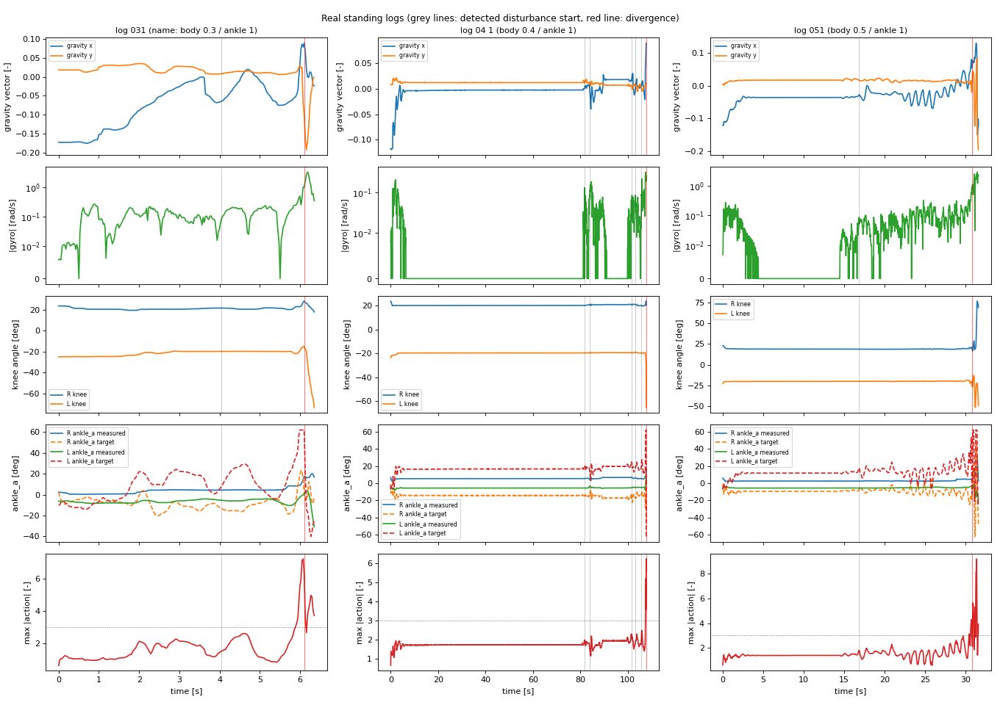
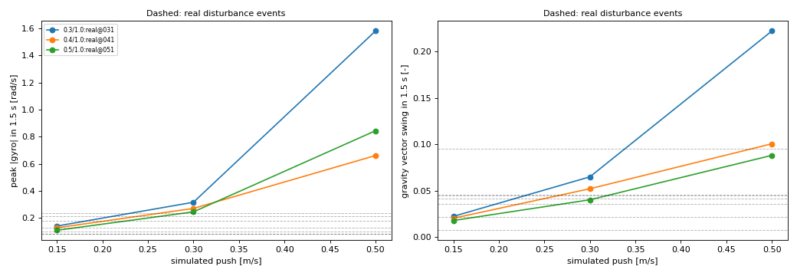
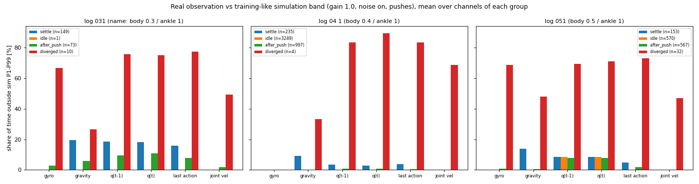
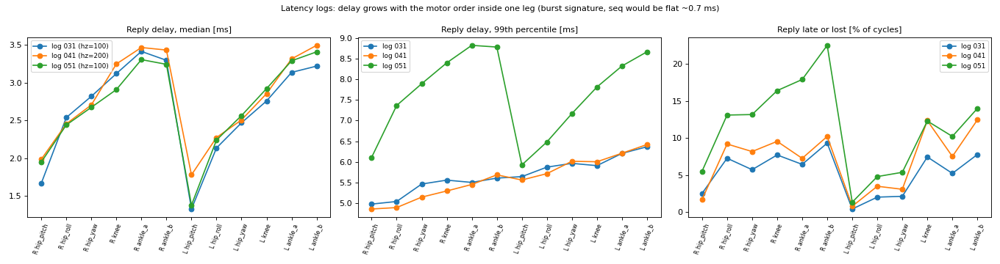
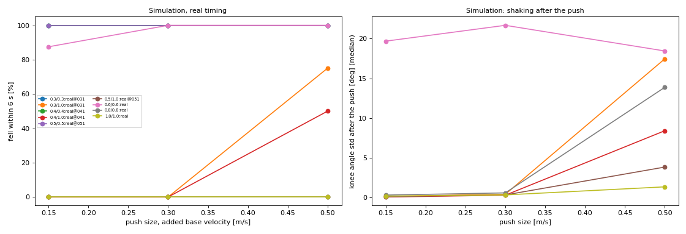
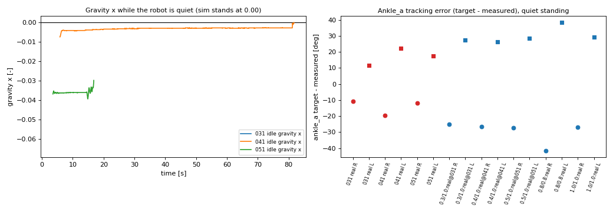

# 실기 서기 로그 031 · 04 1 · 051 분석 — 게인 부족인가, 학습 범위 밖인가 (2026-10-17)

**질문 (작업 152)**: 관성 측정 장치를 고친 뒤 로봇이 선다. 그러나 조금만 밀면 정책이 발산한다. 원인이 낮은 게인인가, 학습 범위 밖 관측인가?
**자료**: HUPHY `biped` 브랜치 커밋 `2fdc139` (2026-10-16 17:22)의 `archivedlogs/` 파일 6개. 정책 기록 3개와 지연 기록 3개다. 읽기 전용으로 분석했다. 로봇과 HUPHY 저장소는 건드리지 않았다.
**정책**: `rough_box_main_v11a` 체크포인트 11999. 기록된 관측 45개를 배포 패키지의 정책 파일(ONNX 형식)에 넣어 행동 12개를 다시 계산했다. 기록과 비교했다. 최대 차이가 2.6e-5 이하다. 로봇이 같은 정책을 돌렸다.

## 0. 결론 먼저

| 판정 | 근거 | 결과 |
|---|---|---|
| (가) 게인이 낮아서 | 같은 게인 배율, 같은 타이밍의 시뮬레이션은 조용히 서고 0.3 m/s 밀기까지 넘어지지 않는다 | **단독 원인이 아니다.** 게인은 여유를 줄인다. 그러나 실기가 발산한 밀기 크기에서 시뮬레이션은 넘어지지 않는다 |
| (나) 학습 범위 밖 관측 | 밀기 전 조용히 서 있는 구간의 관측은 학습 구간 안에 있다 (1번째~99번째 백분위수 밖 비율 0~8 %) | **주원인이 아니다.** 예외가 둘 있다. 시작 때의 앞쏠림과 오른 발목 크랭크 A의 각도 치우침이다 |
| (다) 시뮬레이션에 없는 실기 차이 | 실기는 밀기 뒤 2 초 안에 발산하고 시뮬레이션은 같은 크기의 밀기를 견딘다 | **가장 잘 맞는 설명이다.** 단, 원인 항목을 이 자료만으로는 가를 수 없다 |

- **게인 배율의 뜻을 바로잡는다.** 파일 이름 `031` · `04 1` · `051`은 "몸통 0.3 · 0.4 · 0.5 / 발목 1.0"이다. "0.31 · 0.41 · 0.51"이 아니다. 근거는 §2에 있다.
- **서기는 발목 게인이 결정한다.** 발목 게인을 몸통과 같이 낮추면 시뮬레이션이 밀기 전에 넘어진다. 발목 게인 1.0에서는 몸통 게인 0.3까지 선다.
- **실기가 발산한 밀기는 작다.** 관성 측정 장치의 각속도 최대값이 0.085~0.24 rad/s였다. 시뮬레이션의 0.15~0.3 m/s 밀기와 같은 크기다. 이 크기에서 시뮬레이션은 48개 환경 중 0개가 넘어졌다.
- **결정적 실험은 아직 없다.** 몸통 게인 0.8 이상의 실기 기록이 필요하다. 시뮬레이션은 0.8 이상에서 견딘다고 예측한다 (§7).

## 1. 용어 정의

| 용어 | 뜻 |
|---|---|
| 몸통 게인 / 발목 게인 | `--gain-scale` 의 첫째 숫자(엉덩이·무릎·엉덩이 비틀기)와 둘째 숫자(발목 크랭크 A·B). 숫자 하나만 주면 둘이 같다 |
| 게인 배율 | 설계 위치 게인과 속도 게인에 곱하는 수. 1.0이 학습 값이다 |
| 위치 게인 | 목표 각도와 실제 각도의 차이 1 rad 당 내는 토크 (N·m/rad) |
| 속도 게인 | 관절 각속도 1 rad/s 당 내는 감쇠 토크 (N·m·s/rad) |
| 정책 주기 | 정책 기록 한 행과 다음 행 사이의 시간. 학습 값은 20 ms다 |
| 송신 주기 | 모터 명령을 보내는 주기 (`--hz`). 정책은 송신 주기와 관계없이 50 Hz 목표로 불린다 |
| 중력 벡터 | 몸통 좌표계에서 본 중력 방향의 단위 벡터. 똑바로 서면 (0, 0, −1)이다. x가 −0.12면 몸통이 약 6.9° 기울었다 |
| 밀기 | 시뮬레이션에서 몸통 수평 속도에 한 번 더하는 속도 (m/s). 학습 때 최대 0.7 m/s였다 |
| 외란 사건 | 실기 기록에서 각속도 크기가 0.08 rad/s를 넘기 시작한 때. 밀기가 기록되지 않아서 이것으로 대신한다 |
| 발산 | 0.3 초 구간 각속도 제곱평균 제곱근이 0.5 rad/s를 넘거나, 무릎이 기본 각도에서 12° 넘게 벗어난 때 |
| 학습 구간 | 시뮬레이션에서 구한 관측 채널별 1번째~99번째 백분위수 사이. 학습 때의 잡음(각속도 ±0.2, 중력 ±0.05, 관절 ±0.01)을 넣었다 |
| 같은 게인 구간 | 실기와 같은 게인 배율·타이밍으로 돌린 시뮬레이션의 같은 백분위수 구간 |
| 늦음 / 유실 | 모터 응답이 기다림 시간(4 ms)을 넘겨 다음 주기에 온 것 / 끝내 오지 않은 것 |
| 오래된 값 비율 | 늦음 + 유실. 그 주기에 정책이 이전 주기의 관절 각도를 본다 |
| 송신 방식 | `burst` 는 모터 6개에 명령을 연달아 보내고 응답을 모은다. `seq` 는 한 모터씩 보내고 응답을 받는다 |

## 2. 로그별 조건

기록에는 게인 배율, 송신 방식, 밀기가 적혀 있지 않다. 아래 값은 파일 이름, 지연 기록 머리글, 코드에서 추정했다.

| 항목 | 031 | 04 1 | 051 |
|---|---|---|---|
| 게인 배율 (몸통 / 발목) | 0.3 / 1.0 | 0.4 / 1.0 | 0.5 / 1.0 |
| 송신 주기 (`--hz`), 기다림 | 100 Hz, 4 ms | 200 Hz, 4 ms | 100 Hz, 4 ms |
| 정책 기록 길이, 행 수 | 6.3 초, 233행 | 107.8 초, 4485행 | 31.6 초, 1322행 |
| 정책 주기 평균 / 95번째 / 최대 | 27.4 / 31.9 / 33.9 ms | 24.0 / 29.4 / 66.0 ms | 23.9 / 31.4 / 48.5 ms |
| 30 ms 넘는 주기 비율 | 12.9 % | 4.1 % | 7.5 % |
| 송신 방식 | `burst` 로 추정 | `burst` 로 추정 | `burst` 로 추정 |
| 속도 명령 | 전 구간 (0, 0, 0) | 같음 | 같음 |
| 시작 때 중력 x | **−0.173** (10.0°) | **−0.117** (6.7°) | **−0.120** (6.9°) |
| 시작 뒤 조용한 구간 | 없음 | 5.8~81.7 초 | 3.6~16.8 초 |
| 조용한 구간의 중력 x | — | −0.003 | −0.036 (2.1°) |
| 외란 사건 시각 | 4.0 초 | 81.7 · 83.8 · 101.8 · 103.2 · 105.8 초 | 16.8 초 뒤 진동이 커짐 |
| 발산 시각 | 6.1 초 | 107.8 초 | 30.8 초 |

**게인 배율을 이렇게 읽은 근거**
- 앞선 기록의 이름 규칙이 있다. `00503` 은 몸통 0.05 · 발목 0.3, `0051` 은 몸통 0.05 · 발목 1.0, `010` 은 둘 다 0.1이다. 같은 규칙으로 `031` 은 0.3 · 1.0이다.
- 시뮬레이션이 이 읽기를 지지한다. 몸통과 발목을 같이 0.3 · 0.4 · 0.5로 낮추면 78개 환경 전부가 밀기 전에 넘어진다. 실기는 4~80 초를 조용히 섰다.
- 발목 크랭크 A의 목표와 실제 각도의 차이가 실기에서 12~22°이고 시뮬레이션(발목 게인 1.0)에서 25~28°다. 발목 게인 0.3~0.5라면 차이가 2~3배(50° 이상)여야 한다.
- 기록에 토크 열이 없어서 유효 위치 게인을 직접 맞추지는 못했다.

**송신 방식을 이렇게 읽은 근거 (그림 6)**
- 지연 기록의 중앙값이 한 다리 안에서 모터 순서대로 1.3 ms에서 3.5 ms로 늘어난다. `seq` 의 기록은 0.7 ms 근처에서 평평하다고 HUPHY 문서에 적혀 있다.
- 유실이 4.2 · 6.3 · 4.5 %다. `seq` 는 0 %로 문서에 적혀 있다.
- `seq` 가 기본값이 된 커밋 `456d5cb` 는 이 기록을 올린 커밋 `2fdc139` 보다 4분 앞선다. 기록은 그 전에 찍혔을 가능성이 크다.

**지연 기록과 정책 기록은 시간이 맞지 않는다.** 지연 기록 길이가 26.6 · 25.9 · 54.9 초이고 정책 기록 길이가 6.3 · 107.8 · 31.6 초다. 이름으로만 짝을 지었다. 그래서 지연 수치는 "그 설정의 대표값"으로만 쓴다.

*그림 1. 위에서부터 중력 벡터, 각속도 크기, 무릎 각도, 발목 크랭크 A의 목표와 측정, 행동 크기. 회색 선은 외란 사건, 빨간 선은 발산이다.*

## 3. 밀기가 있었는가

밀기는 기록되지 않았다. 각속도와 중력 벡터의 갑작스러운 변화로 찾았다.

| 기록 | 사건 시각 (초) | 각속도 최대 (rad/s) | 중력 x 변동 | 관절 속도 최대 (rad/s) | 결과 |
|---|---|---|---|---|---|
| 031 | 4.0 | 0.238 | 0.095 | 0.47 | 진동이 커져 2 초 뒤 발산 |
| 04 1 | 81.7 | 0.129 | 0.007 | 0.08 | 회복 |
| 04 1 | 83.8 | 0.181 | 0.045 | 0.25 | 회복 |
| 04 1 | 101.8 | 0.085 | 0.042 | 0.12 | 회복 |
| 04 1 | 103.2 | 0.085 | 0.022 | 0.20 | 회복 |
| 04 1 | 105.8 | 0.214 | 0.036 | 0.32 | 2 초 뒤 발산 |
| 051 | 16.8 | 0.101 | 0.046 | 0.16 | 14.5 초부터 진동이 천천히 커져 30.8 초에 발산 |

- 031 은 시작부터 조용하지 않았다. 처음 4 초의 무릎 표준편차가 0.9°와 2.2°이다. 시뮬레이션의 같은 구간은 0.07°다.
- 04 1 은 5.8초부터 81.7 초까지 각속도가 0.002 rad/s 근처로 거의 정지했다. 행동 크기의 99번째 백분위수가 1.74다. 시뮬레이션은 1.9다.
- 051 은 뚜렷한 밀기 없이 진동이 커졌다. 각속도 제곱평균 제곱근이 14 초 근처 0.02에서 24 초 근처 0.14, 30 초 근처 1.2 rad/s로 늘었다. 손이 닿았는지는 기록으로 알 수 없다.
- 세 기록 모두 마지막 1.5 초의 무릎 진동 주파수가 0.66~0.71 Hz다. 앞선 저게인 기록(0.05 배율)은 1.1~1.3 Hz였다.
- 실기 사건의 크기를 시뮬레이션 밀기에 대응시켰다 (그림 2). 각속도 최대 0.085~0.24 rad/s, 중력 변동 0.007~0.095는 0.15~0.3 m/s 밀기의 값(각속도 0.11~0.32, 중력 변동 0.02~0.065)이다.

*그림 2. 시뮬레이션 밀기 크기별 각속도 최대와 중력 변동. 점선은 실기 외란 사건이다. 사건이 0.15~0.3 m/s 구간에 있다.*

## 4. 관측이 학습 구간을 벗어났는가

기준은 두 가지다. 하나는 학습 구간(게인 1.0, 이상적 타이밍, 학습 잡음, 밀기 0.1~0.7 m/s 시뮬레이션, 관측 17,000개)이다. 다른 하나는 같은 게인 구간이다. 정책 자체의 정규화 통계(걷기까지 포함한 학습 전체)로도 확인했다.

| 구간 | 기록 | 구간 밖 시간 비율 (학습 구간) | 가장 벗어난 채널 (비율, 표준편차 배수) |
|---|---|---|---|
| 시작 안정화 (밀기 전) | 031 | 중력 19.5 %, 관절 위치 18 % | 중력 x 58 % (5.4배), 오른 엉덩이 비틀기 58 % (3.4배), 오른 발목 A 56 % (5.5배) |
| | 04 1 | 중력 9.2 %, 관절 3 % | 중력 x 28 % (3.6배), 오른 발목 A 23 % (3.5배) |
| | 051 | 중력 13.7 %, 관절 8.6 % | 오른 발목 A 97 % (4.0배), 중력 x 41 % (3.7배) |
| 조용히 선 구간 (밀기 전) | 04 1 | **0.0 %** (전 채널) | 없음 |
| | 051 | 관절 위치 8.3 %, 나머지 0 % | 오른 발목 A 위치 100 % (3.7배) 하나뿐 |
| 외란 사건 뒤 (발산 전) | 031 | 관절 위치 10 %, 행동 8 % | 왼 발목 A 36 % (6.1배), 오른 발목 B 29 % |
| | 04 1 | 관절 위치 0.7 %, 나머지 0.5 % 이하 | 왼 발목 A 4 % (10.7배) |
| | 051 | 관절 위치 7.8 %, 나머지 2 % 이하 | 오른 발목 A 86 % (4.0배) |
| 발산 중 | 031 · 04 1 · 051 | 각속도 0~69 %, 관절 위치 69~90 %, 행동 73~83 % | 왼 다리 행동 22~39배 |

- **정책의 정규화 통계 기준으로 조용한 구간의 관측은 모두 안에 있다.** 표준편차 배수의 최대가 1.1~1.5다. 외란 사건 뒤에는 3.2~5.2배다 (가장 큰 채널은 왼 발목 A의 행동).
- **중력 x**: 시작 때 −0.12와 −0.17은 관성 측정 장치 치우침이 아니라 몸통의 앞쏠림이다. 정책이 2~5 초 안에 −0.003(04 1)으로 돌려놓았다. 치우침이라면 값이 그대로 남는다. 051 은 −0.036(2.1°)이 남는다. 이것이 몸통 기울기인지 장치 치우침인지는 가릴 수 없다.
- **오른 발목 크랭크 A 각도**: 조용한 구간에서 기본 각도보다 −2.9°(04 1), −5.6°(051), −5.7°(031 시작)이다. 왼쪽은 +2.6°, +2.6°, +1.5°로 거울 대칭이다. 시뮬레이션은 ±1° 안이다. 학습의 관절 영점 치우침 범위는 ±0.86°다. 보정 파일은 "아직 아무것도 재기 전"이다. 자세 차이인지 영점 치우침인지는 가릴 수 없다.
- **관절 속도 잡음**: 정책은 관절 속도를 입력으로 받지 않는다. 두 이력 프레임의 차이로 본 값이 조용한 구간에서 0.09 rad/s 이하이고 구간 밖 비율이 0 %다. 잡음이 크지 않다.
- **행동 포화**: 행동 크기가 3을 넘는 시간 비율이 1.1 % (031), 0.07 % (04 1), 0.3 % (051)다. 모두 발산 구간 안에 있다. 목표가 학습 가동 범위 한계에 닿은 비율은 0.25 · 0.02 · 0.1 %다.
- **안전 가드**: 가드가 남긴 기록은 없다. 기록의 목표와 측정으로 다시 계산했다. 한계 가드가 자른 비율은 0.36 · 0.03 · 0.14 %, 50° 점프 가드는 0.5 · 0.04 · 0.23 %다. 발산 구간 말고는 걸리지 않았다.

*그림 3. 채널 묶음별 구간 밖 시간 비율. 조용한 구간(주황)은 04 1에서 0 %이고, 발산(빨강)에서 커진다.*

## 5. 지연과 유실 (지연 기록)

| 기록 | 늦음 | 유실 | 오래된 값 비율이 가장 큰 모터 | 모터별 응답 지연 중앙값 | 99번째 백분위수 |
|---|---|---|---|---|---|
| 031 | 1.2 % | 4.2 % | 오른 발목 B 9.3 % | 1.3~3.4 ms | 5.0~6.4 ms |
| 04 1 | 0.9 % | 6.3 % | 왼 발목 B 12.4 % | 1.8~3.5 ms | 4.9~6.4 ms |
| 051 | 6.9 % | 4.5 % | 오른 발목 B 22.5 %, 오른 발목 A 17.9 % | 1.4~3.4 ms | 5.9~8.8 ms |

- 051 만 늦음이 6.9 %로 많다. 오른 다리 응답 99번째 백분위수가 8.8 ms까지 간다. 기다림 4 ms를 넘긴다.
- 지연이 한 다리 안에서 모터 순서대로 늘고 왼 엉덩이 피치가 가장 짧다. 몰아서 보내기(`burst`)의 특징이다.
- 정책 주기 평균은 20 ms가 아니라 23.9~27.4 ms다. 송신과 응답 모으기에 시간이 더 드는 탓으로 추정한다. 확인하지 못했다.

*그림 4. 모터별 응답 지연 중앙값과 99번째 백분위수, 늦거나 유실된 비율.*

## 6. 같은 게인에서 시뮬레이션과 실기 비교

시뮬레이션은 `tools/sim2real/real_log_vs_sim.py sim` 으로 돌렸다. 중앙처리장치만 썼다. 조건은 다음과 같다.
- 5 초 서기, 몸통 수평 속도에 한 번 밀기(0.15 · 0.3 · 0.5 m/s, 네 방향 각 2회), 6 초 관찰.
- 게인은 로봇의 12비트 부호화를 거친다.
- "실기 타이밍"은 관절 관측 한 주기 지연, 로그별로 잰 모터별 오래된 값 비율, HUPHY 안전 가드, 정책 주기 25 ms다.

| 조건 (몸통 / 발목) | 밀기 전 넘어짐 | 0.15 m/s | 0.3 m/s | 0.5 m/s | 조용한 구간 무릎 표준편차 | 0.5 m/s 밀기 뒤 무릎 표준편차 |
|---|---|---|---|---|---|---|
| 0.3 / 1.0 (031 타이밍) | 0/26 | 0/8 | 0/8 | **6/8** | 0.07° | 17.5° |
| 0.4 / 1.0 (04 1 타이밍) | 0/26 | 0/8 | 0/8 | **4/8** | 0.05° | 8.4° |
| 0.5 / 1.0 (051 타이밍) | 0/26 | 0/8 | 0/8 | 0/8 | 0.06° | 3.8° |
| 0.3 / 0.3 | **26/26** | — | — | — | — | — |
| 0.4 / 0.4 | **26/26** | — | — | — | — | — |
| 0.5 / 0.5 | **26/26** | — | — | — | — | — |
| 0.6 / 0.6 (오래된 값 2 %) | **22/26** | 7/8 | 8/8 | 8/8 | 6.2° | 18.5° |
| 0.8 / 0.8 | 0/26 | 0/8 | 0/8 | 0/8 | 0.02° | 13.9° |
| 1.0 / 1.0 | 0/26 | 0/8 | 0/8 | 0/8 | 0.03° | 1.3° |

(넘어짐 수는 밀기 전에 넘어진 환경을 포함한다. 몸통 0.6 이하 같은 배율 조건은 대부분 밀기 전에 넘어졌다.)

**실기와 시뮬레이션을 같은 게인(발목 1.0)에서 견준다.**

| 항목 | 실기 031 · 04 1 · 051 | 시뮬레이션 (같은 게인) | 같은가 |
|---|---|---|---|
| 조용히 서기 | 031 없음 / 04 1 75 초 / 051 13 초 | 모두 조용함 | 031 은 다름 |
| 조용한 구간 행동 크기 99번째 백분위수 | 1.74 (04 1), 1.42 (051) | 1.9~2.0 | 비슷 |
| 조용한 구간 무릎 표준편차 | 0.01° | 0.05~0.07° | 비슷 (둘 다 아주 작음) |
| 발목 크랭크 A 목표−측정 (오른 / 왼) | −19.5 / +22.2 (04 1), −11.9 / +17.6 (051) | −26 / +26, −27 / +29 | 실기가 15~56 % 작음 |
| 0.1~0.3 m/s 상당 외란 뒤 | 031 · 04 1 발산 (2 초 안), 051 진동 증가 | 넘어짐 0/48, 무릎 표준편차 0.06~0.4° | **다름** |
| 발산 진동 주파수 | 0.66~0.71 Hz | 넘어진 경우 0.4~0.8 Hz | 비슷 |
| 발산 때 행동 크기 99번째 백분위수 | 5.0~7.6 | 4.9~5.7 | 비슷 |

- 같은 시뮬레이션이 발산 모양(주파수, 행동 크기)은 재현한다. 발산이 **언제 시작하는가** 만 다르다. 시뮬레이션은 0.5 m/s에서, 실기는 0.1~0.3 m/s 상당에서 시작한다.
- 정책 주기를 20 · 25 · 30 ms로 바꿔도 결과가 같다 (0.5 m/s 넘어짐 수가 6/8 · 2~4/8 · 0/8로 거의 같다). 시뮬레이션의 균일한 주기는 원인이 아니다. 실기의 주기 흔들림(95번째 백분위수 29~32 ms, 최대 66 ms)은 따로 넣지 않았다.
- 몸통 게인은 여유를 준다. 0.5 m/s 밀기에서 0.3은 6/8, 0.4는 4/8, 0.5는 0/8이 넘어진다. 이 여유는 실기 사건이 요구하는 0.15~0.3 m/s보다 큰 곳에서 줄어든다.
- 발목 크랭크 A의 영점 치우침을 시뮬레이션에 넣었다 (몸통 0.4, 오른쪽 ∓ 왼쪽 거울 부호). 넘어짐 수는 0.5 m/s 밀기에서 −4°: 6/8, +4°: 1/8, −8°: 6/8이다. −8°는 0.3 m/s에서도 2/8이 넘어진다. 치우침은 여유를 줄인다. 그러나 한 번의 0.15 m/s 사건을 설명하지는 못한다.

*그림 5. 시뮬레이션의 밀기 크기별 넘어짐 비율(왼쪽)과 밀기 뒤 무릎 표준편차(오른쪽). 몸통과 발목을 같이 낮춘 조건(0.3 · 0.4 · 0.5 / 같은 값)은 100 %로 위에 겹친다.*

*그림 6. 왼쪽은 조용한 구간의 중력 x. 오른쪽은 발목 크랭크 A 목표−측정 (빨강 실기, 파랑 시뮬레이션, 동그라미 오른쪽, 네모 왼쪽).*

## 7. 판정과 빠진 자료

**(다)가 가장 잘 맞는다. 후보 항목은 아직 가려내지 못했다.**

| 후보 | 이 자료가 말하는 것 |
|---|---|
| 몰아서 보내기의 응답 유실 (4~6 %, 051 은 늦음 포함 최대 22 %) | 시뮬레이션에 모터별 비율로 넣었다. 단독으로 발산을 만들지 못했다. 응답이 연달아 빠지는 상관 구조는 넣지 못했다 |
| 발목 크랭크 A 영점 치우침 (3~6°) | 여유를 줄인다. 단독으로는 부족하다 |
| 정책 주기 흔들림 (최대 66 ms) | 넣지 못했다. 균일한 주기 변화는 영향이 없었다 |
| 실기 발목 토크 부족, 마찰, 뒤틈 | 발목 오차가 시뮬레이션보다 작아서 토크 부족은 아닌 듯하다. 마찰과 뒤틈은 가릴 수 없다 |
| 밀기가 기록된 각속도보다 크거나 오래 가함 | 가릴 수 없다 |
| 몸통 게인이 낮다 | 실기 한계는 낮출 수 있으나 시뮬레이션 여유보다 먼저 무너진다 |

**빠진 자료 (우선순위 순)**
1. 몸통 게인 0.8~1.0, 발목 1.0의 서기 기록. 시뮬레이션은 0.8 이상에서 0.5 m/s 밀기도 견딘다. 실기가 여기서도 작은 밀기에 발산하면 게인이 원인이 아니다.
2. 기록 머리글에 게인 배율, 송신 방식(`--send-mode`), 밀기 방법. 지금은 모두 추정이다.
3. 모터가 돌려주는 토크와 속도 열. 있으면 관절별 유효 위치 게인을 맞출 수 있다.
4. `seq` 송신으로 돌린 같은 게인의 기록. 유실이 0 %가 되면 응답 유실 가설을 가릴 수 있다.
5. 발목 크랭크 A·B 영점 측정. 그리고 로봇이 크레인이나 손에 일부 지지되었는지의 기록.
6. 밀기의 방향과 세기 (힘 측정기나 영상).

## 8. 재현

- 스크립트: `tools/sim2real/real_log_vs_sim.py` (`conds` · `sim` · `compare`).
- 실기 기록 읽기 전용 분석: 중앙처리장치만, `nice -n 10`.
- 결과 수치: `docs/sim2real/data/2026-10-17_real_stand_logs_vs_sim.json`.
- 시뮬레이션 실행 인자: 패키지 `vibecoded-audit-20261012`, 체크포인트 `rough_main_model_11999.pt`, 정책 주기 20 · 25 · 30 ms, 환경 수 78~170, 시드 7.
- 앞선 기록: `2026-10-15_push_divergence_check.md` (몸통과 발목이 같은 배율일 때 0.8 이상이 견딘다). 이번 결과는 그 표를 발목 1.0 조건으로 넓힌 것이다.

## 부록. 앞선 저게인 기록과의 비교 (게인 사다리)

| 기록 | 몸통 / 발목 | 길이 | 정책 주기 평균 | 시작 중력 x | 행동 99번째 백분위수 | 무릎 최대 이탈 | 판정 |
|---|---|---|---|---|---|---|---|
| 00503ob2ms | 0.05 / 0.3 | 201.6 초 | 20.0 ms | +0.09 | 8.4 | 68° | 발산, 관성 센서 축 오류 이전 |
| 00505ob4ms | 0.05 / 0.5 | 45.1 초 | 20.0 ms | +0.06 | 7.0 | 66° | 발산 |
| 005054msgscan(r)ob | 0.05 / 0.5 | 148.6 초 | 25.6 ms | +0.12 | 7.3 | 76° | 발산 |
| 0051ob4ms | 0.05 / 1.0 | 1.8 초 | 20.0 ms | +0.03 | 7.2 | 58° | 1.8 초에 종료 |
| 010바닥서기ob | 0.1 / 0.1 | 15.7 초 | 25.9 ms | +0.06 | 6.1 | 74° | 발산 |
| 031 | 0.3 / 1.0 | 6.3 초 | 27.4 ms | −0.17 | 3.1 | 53° | 4 초 근처 사건 뒤 발산 |
| 04 1 | 0.4 / 1.0 | 107.8 초 | 24.0 ms | −0.12 | 1.9 | 45° | 75 초 조용히 섬 |
| 051 | 0.5 / 1.0 | 31.6 초 | 23.9 ms | −0.12 | 2.0 | 56° | 13 초 조용히 섬 |

- 몸통 0.05~0.1 기록은 모두 처음부터 흔들렸다 (행동 99번째 백분위수 6~8, 무릎 표준편차 14~18°).
- 몸통 0.3~0.5와 발목 1.0부터 서기가 시작된다. 행동 99번째 백분위수가 2 근처로 떨어진다.
- 앞선 기록의 시작 중력 x가 +0.03~+0.12이고 이번 기록이 −0.12~−0.17이다. 부호가 바뀐 것은 센서 축 부호 수정(커밋 `bb558c6`)과 맞는다.
