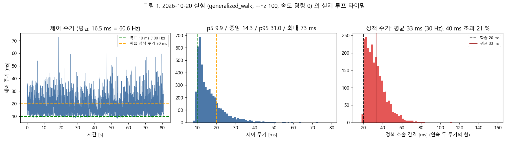
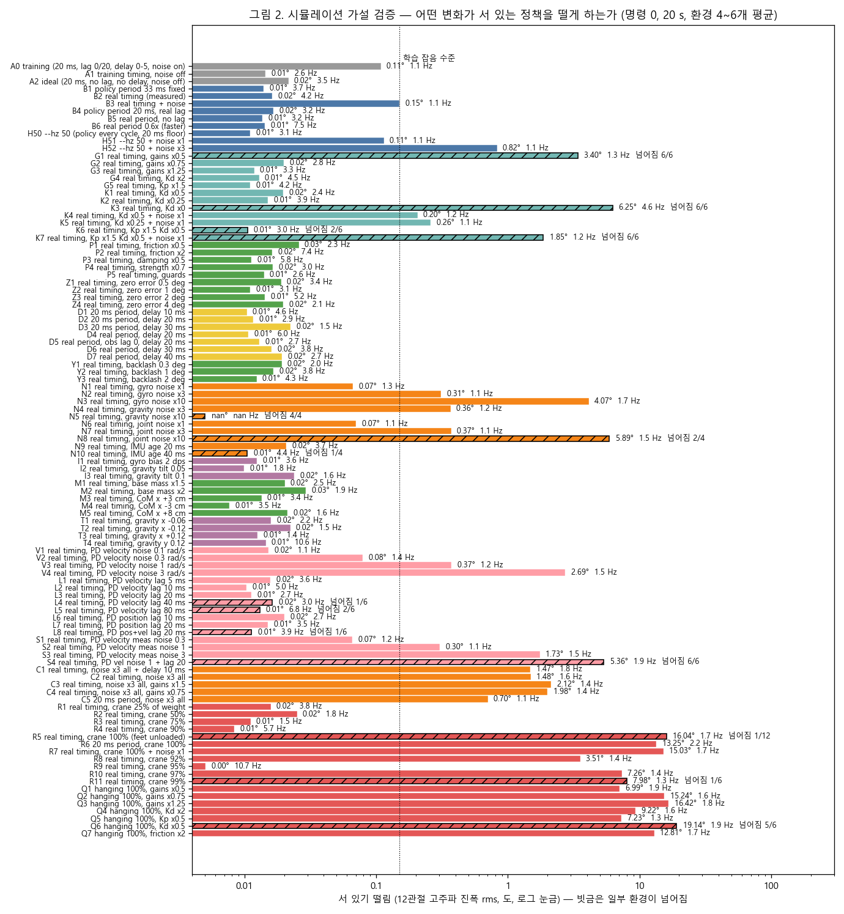
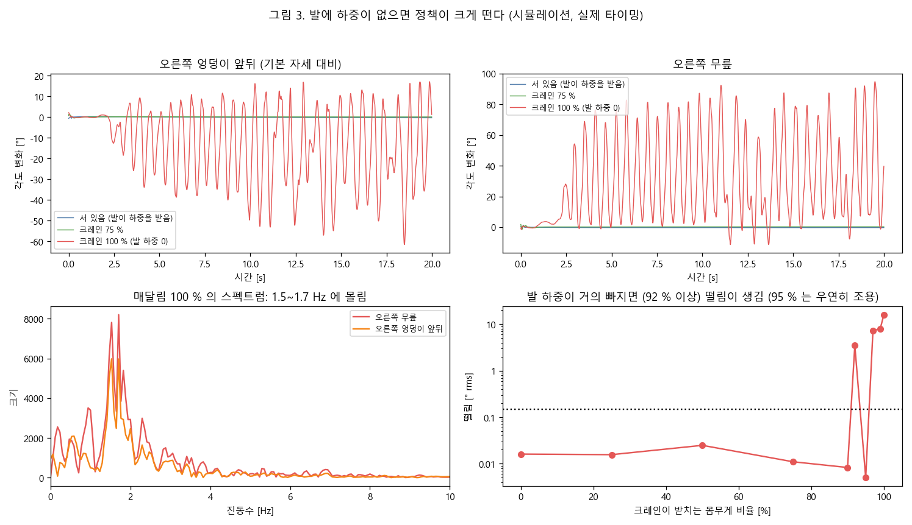
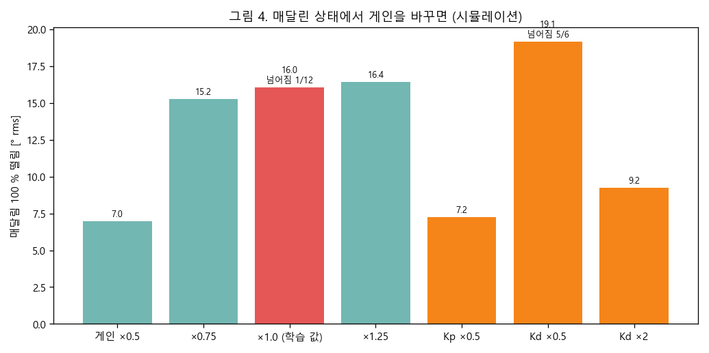

# generalized_walk 서기 떨림 — 원인 분석 (2026-10-21)

**질문**: 속도 명령 0 으로 `generalized_walk` 를 실기에서 돌렸더니 계속 떨린다. 게인은 학습 값 100 % 다. 원인이 무엇인가?
**자료**: `1020generalizedwalk00.csv` (모터 응답 지연 기록, 80.7 초, `--hz 100 --drain-ms 4`). HUPHY `biped` 최신 (`eaa706c`, 2026-10-21). 학습 패키지 `maido-39/HuphyChan-dev` `vibecoded-audit-20261012` (`ebeec10`). 체크포인트 `terrain10_2048_model_37400.pt` (sha256 `7bbd5cbc…`, 실기 파일과 같음).
**방법**: 로봇 코드와 학습 계약을 읽고, 실기 타이밍을 넣은 시뮬레이션으로 가설 약 100 조건을 하나씩 시험했다. 모든 시뮬레이션 수치는 시뮬레이션 값이다. 실기 값이 아니다.

## 0. 결론 먼저

1. **받은 CSV 에는 관절각·행동·IMU 가 없다.** 모터 응답 시각과 지연만 있다. 그래서 이 CSV 로 "무엇이 떨게 하는가" 를 직접 볼 수 없다. 같은 실행의 정책 기록 `logs/policy_generalized_walk_*.csv` 가 있으면 아래 §6 의 판정을 실제 값으로 확정할 수 있다.
2. **실기 루프는 100 Hz 를 못 지킨다.** 평균 60.6 Hz (주기 16.5 ms, 표준편차 6.6 ms, 최대 76 ms) 다. 정책은 두 주기에 한 번 불리므로 호출 간격이 평균 33 ms (표준편차 10 ms, 최대 111 ms) 다. 학습은 20 ms 고정이다.
3. **그러나 이 타이밍만으로는 서 있는 정책이 떨지 않는다.** 시뮬레이션에서 실제 타이밍을 넣어도 떨림은 0.01°다 (그림 2). 센서 잡음이 있을 때 떨림을 약 2 배로 키울 뿐이다.
4. **PD 게인이 높아서 떠는 것도 아니다 (땅에 선 상태).** 게인을 1.25 배, Kp 를 1.5 배, Kd 를 2 배 올려도 떨림이 없다. 낮추면 오히려 위험하다 (0.5 배는 6/6 넘어짐).
5. **시뮬레이션에서 큰 떨림을 만든 것은 "발에 하중이 없는 상태" 하나다.** 크레인이 몸무게의 92 % 이상을 받치면 모든 관절이 1.5~1.7 Hz 로 3~16° 크게 떤다 (그림 3). 땅에 내리면 사라진다. 20 ms 주기에서도 같다. 이전 실기 서기 기록의 떨림 (1.1~1.3 Hz) 과 같은 종류다. **가장 유력한 후보다. 단, 실험에서 발이 하중을 받았는지는 내가 모른다.**
6. 발이 완전히 하중을 받는데도 떨리면 원인은 시뮬레이션에 없는 것이다. 후보는 §6 에 있다. 가려내려면 정책 기록과 모터 속도·토크 기록이 필요하다.

## 1. 받은 자료가 말해 주는 것

| 항목 | 값 |
|---|---|
| 기록 길이 | 80.7 초 (정책이 도는 구간만) |
| 제어 주기 | 4,893 주기. 평균 16.50 ms (60.6 Hz), 중앙 14.6 ms, p5 10.0, p95 29.7, p99 39.3, 최대 76 ms |
| 주기 안에서 | 응답 12 개가 첫 응답 뒤 평균 6.6 ms 안에 모두 도착. 다리 둘이 거의 같은 시각 |
| 응답 지연 | 중앙 0.58 ms, 평균 0.86 ms, 최대 60.9 ms. 늦은 응답 0 개 (상태 전부 `ontime`) |
| 정책 호출 간격 (연속 두 주기 합) | 평균 33.0 ms, 표준편차 10.4, p5 20.8, p95 53.0, 최대 111 ms. 40 ms 초과 21 %, 60 ms 초과 2 % |
| 규칙성 | 긴 주기는 무작위로 나온다 (다음도 길 확률 5 % = 기본 비율). 주기적 패턴은 없다 |



**코드에서 확인한 것**: `huphy-run --hz 100` 은 `control.held(inner_hz=50, outer_hz=100)` 를 쓴다. 정책은 **주기 횟수** 로 두 번에 한 번 불린다. 시간 기준이 아니다. 그래서 루프가 느려지면 정책 호출 간격이 그만큼 늘어난다.
**아직 모르는 것**: 한 주기 16.5 ms 중 응답 구간은 6.6 ms 이고 나머지 약 10 ms 는 통신 밖이다. 정책 추론은 1.4 ms 정도다 (정책을 부르는 주기가 부르지 않는 주기보다 1.4 ms 길다). 나머지 약 8~9 ms 가 어디에 쓰이는지는 이 자료로 알 수 없다 (잠 깨움 오차, 기록, 원격 전송 후보). 프로파일링이 필요하다.

## 2. 시뮬레이션 방법

- 환경: 학습 패키지의 `Pygmalion-Velocity-Generalized-Terrain10-2kResume19700`, 평지 한 장, 속도 명령 (0, 0). 게인은 학습 값 (엉덩이 135/6, 요 75/4, 무릎 130/6, 크랭크 60/2.7). 12 비트 MIT 양자화를 거쳐 넣었다.
- 물리 5 ms 걸음. **정책 호출 시각을 환경마다 따로 정한다.** 실기 CSV 의 주기 순서를 그대로 이어 붙여 (원형, 무작위 시작) 호출 간격을 만든다. 관절각은 호출 시점보다 `직전 주기 길이 - 3.3 ms` 만큼 오래된 값을 본다. 이전 호출의 값이 q(t-1) 이다. 이는 `generalized_walk.observation_vector` 와 같다.
- 정책 출력은 마지막 호출 값을 다음 호출까지 유지한다 (`held`). 지연은 5 ms 단위 선입선출로 넣는다.
- 지표: 12 관절의 고주파 진폭 (0.5 초 이동평균 제거한 rms), 서 있기 중 최대 움직임, 지배 진동수, 행동 변화량, 넘어짐.
- 정책 추론은 HUPHY 의 numpy 모델과 학습 쪽 torch 모델이 같음을 확인했다 (무작위 입력 500 개, 최대 차이 3.8e-6). 기준 자세와 게인도 학습과 같다.
- 도구: `tools/sim2real/gw_jitter_sim.py`. 결과: `docs/sim2real/data/2026-10-21_gw_jitter_r1..r7.json` (r2 의 D2·D3 는 지연 큐를 고치기 전 실행이라 무효. r3 가 유효본).

## 3. 가설과 판정

판정은 시뮬레이션 기준이다. "변화 없음" 은 떨림 0.03° 이하다 (학습 잡음 수준 0.11°).

| # | 가설 | 시험 (조건 이름) | 결과 | 판정 |
|---|---|---|---|---|
| H1 | 정책 호출 간격이 학습보다 길고 들쭉날쭉 (33±10 ms) | B1 고정 33 ms, B2 실측 타이밍, B4/B5/B6, H50 (`--hz 50`) | 모두 0.01~0.02°. 실측 타이밍이 서 있기를 해치지 않는다 | 단독 원인 **아님** |
| H1b | 타이밍 × 센서 잡음 | C2 (잡음 3 배) 실측 1.48° / C5 (20 ms) 0.70° / H52 (`--hz 50`) 0.82° | 잡음이 있을 때 실측 타이밍이 떨림을 약 2 배로 키운다. `--hz 50` 이 절반을 회복한다 | **증폭 요인** |
| H2 | PD 게인이 너무 높다 | G3 ×1.25, G5 Kp ×1.5, G4 Kd ×2 | 땅에 선 상태: 변화 없음. 낮추면 G1 ×0.5 는 6/6 넘어짐, G2 ×0.75 는 서지만 자세가 4° 기운다 | 땅에서는 **아님** (§4 매달림은 다름) |
| H3 | 감쇠가 부족 (Kd, 속도 필터 지연) | K1~K3 Kd ×0.5/0.25/0, L1~L8 PD 속도·위치 지연 5~80 ms | Kd ×0.25 와 PD 속도 지연 40 ms 까지 변화 없음. Kd 0 은 6/6 넘어짐 (4.6 Hz). Kp ×1.5 + Kd ×0.5 는 2/6 넘어짐 | 여유가 크다. 한계에 가깝지는 않음 |
| H4 | 마찰·점성·모터 힘 차이 | P1~P4 (마찰 ×0.5/×2, 감쇠 ×0.5, 힘 ×0.7), P5 안전 가드 | 변화 없음 | **아님** |
| H5 | 질량·무게중심 차이 | M1~M5 (베이스 ×1.5/×2, 무게중심 ±3·+8 cm) | 변화 없음. 자세만 기운다 (최대 3°) | **아님** |
| H6 | 영점 오차 | Z1~Z4 (관절마다 ±0.5~4° 무작위) | 변화 없음 | **아님** |
| H7 | 감속기 백래시 (엔코더 값이 벌어짐) | Y1~Y3 (0.3~2°) | 변화 없음 | **아님** |
| H8 | 명령이 늦게 닿음 | D1~D7 (10~40 ms) | 변화 없음 (40 ms 도 서 있음) | **아님** |
| H9 | IMU 편향·기울어진 장착·IMU 나이 | I1~I3, T1~T4 (중력 x ±0.12, y 0.12), N9·N10 (20·40 ms) | 변화 없음. 몸이 기울 뿐이다 (7.6~16.8° 기움) | **아님** |
| H10 | 관측 잡음 증폭 | N1~N8 (학습 잡음 ×1/3/10), C1~C5 | ×3: 0.3~0.4°, ×10: 4~6° 와 넘어짐 | 증폭은 있음. **실기 잡음이 학습 잡음보다 훨씬 작음** (아래) |
| H11 | 모터 속도 측정 잡음·지연 | V1~V4, S1~S4 | 속도 잡음 1 rad/s: 0.3°, 3 rad/s: 1.7~2.7°. 잡음 1 rad/s + 지연 20 ms: **6/6 넘어짐** | 실측 필요 |
| H12 | 발에 하중이 없다 (매달림, 크레인이 받침) | R1~R12, Q1~Q7 | 하중 75 % 이하 변화 없음. **92 % 이상 받치면 1.5~1.7 Hz 로 3.5~16° 크게 떤다** | **유력 (그림 3)** |

**실기 서기 잡음 (이전 서기 정책 기록 `04 1 stand ob`·`051stand ob`, 조용한 구간)**: 각속도 0.002~0.004 rad/s (앞의 기록은 0 에 가까워 센서가 갱신되지 않았을 가능성도 있다), 중력 1e-4~5e-4, 관절각 1e-4 rad. 학습 잡음 (균등 ±0.2, ±0.05, ±0.01 의 표준편차 0.115, 0.029, 0.0058) 의 1/30~1/100 이다. 그래서 H10 은 땅에 선 정지 상태의 원인으로는 가능성이 낮다. 단 이 값은 다른 정책 실행에서 나왔다. 이번 실행의 값은 아니다.



## 4. 가장 큰 효과: 발의 하중



- 크레인이 몸무게 (시뮬레이션 모델 23.6 kg) 의 92 % 이상을 받치면 정책이 1.5~1.7 Hz 로 흔들린다. 모든 관절에서 일어난다 (무릎 최대 106°, 엉덩이 앞뒤 79~101° 진폭).
- 95 % 는 우연히 조용했다 (6 개 환경 모두). 92 %, 97 %, 99 %, 100 % 는 떨렸다. 경계는 매끈하지 않다.
- 크레인을 100 % 에서 15 초 동안 0 으로 내리면 (R12) 하중이 돌아온 뒤 떨림이 사라진다.
- **이유 (추정)**: 다리가 허공에서 자유롭게 흔들릴 때 엉덩이 앞뒤·좌우의 감쇠비는 0.18 이다 (docs/169 §10-1, 고유진동수 1.3 Hz). 정책은 발이 닿는 상황에서만 학습했다 (범위 밖 입력). 다리 흔들림과 정책 되먹임이 같은 진동수에서 만난다.
- 게인 영향 (매달림 100 %): 게인을 낮추면 진폭이 줄고 (×0.5: 7°), 올리면 조금 커진다 (×1.25: 16.4°). Kd 를 2 배로 올리면 9.2° 로 줄고 Kd 를 0.5 배로 낮추면 5/6 넘어진다. 즉 **"게인이 높아서 떤다" 는 직관은 매달린 상태에서만 맞고, 감쇠를 키우는 쪽이 더 효과적이다.** 그래도 사라지지는 않는다.
- 시간을 맞추면 (R6, 20 ms 주기) 같은 크기로 떤다. 타이밍을 고쳐도 매달림은 안 고쳐진다.



## 5. 확인된 것과 아닌 것

| 구분 | 내용 |
|---|---|
| 확인된 것 (실기) | 루프 60.6 Hz, 정책 호출 간격 평균 33 ms ± 10. 응답은 모두 제때 옴. `--hz 100` 의 정책 호출 방식 (주기 횟수 기준) |
| 확인된 것 (코드) | 게인·기준 자세·정책 가중치·관측 순서가 학습과 같다. HUPHY numpy 정책 = torch 정책 |
| 시뮬레이션만 | 모든 가설 판정 |
| 모름 | 실험 때 발이 하중을 얼마나 받았나. 실제 떨림의 진동수·진폭. 모터 속도 잡음. IMU 부착 위치 (`robot.yaml` 은 `mount: right_leg`, 이전 분석은 골반을 시사). 마찰 접촉·발목 연결의 헐거움 |

## 6. 실기에서 가를 방법 (순서대로)

1. **정책 기록을 가져온다.** `logs/policy_generalized_walk_<날짜>.csv`. 열: `obs/…`, `act/…`, `tgt/…`, `pos/…`. 여기서 아래를 본다.
   - 관절각 진동수: 1~2 Hz 에 몰리고 진폭이 수 도 이상이면 H12. 5 Hz 이상이고 작으면 H10·H11.
   - 한쪽 다리에만 있는가, 양쪽에 있는가.
   - 시작 순간의 중력 (똑바로 서면 z ≈ -1) 과 자이로 평균.
2. **하중 확인.** 크레인 줄을 완전히 풀고 (줄이 몸무게를 받지 않게) 같은 시험을 한다. 떨림이 사라지면 H12 가 확정이다. 저울이나 로드셀로 발 하중을 같이 기록하면 가장 좋다.
3. **`--hz 50`.** `--hz 100` 대신 50 으로 돌린다. 정책이 매 주기 불린다. 시뮬레이션은 잡음이 있을 때 떨림이 절반이 된다고 예측한다. 기록의 정책 호출 간격이 20 ms 근처로 돌아오는지 본다.
4. **모터 속도·토크 기록.** MIT 응답에 속도와 토크가 있다. 서 있는 구간의 속도 잡음이 0.3 rad/s 를 넘으면 H11 이다.
5. **게인 쓸기 (땅에 선 상태, 영상 녹화).** 0.75 → 1.0 으로 올린다. 시뮬레이션은 서 있기에서 이 범위에 차이가 없다고 예측한다. 차이가 보이면 모델에 없는 요인이다.
6. 위가 모두 아니면 모델에 없는 요인이다: IMU 부착 위치 (몸통 대 다리), 접촉 (발바닥 강성), 발목 연결 헐거움, MIT 모드 PD 의 실제 단위 (docs/172 의 무게추 시험).

## 7. 한계

- 이 CSV 는 타이밍만 담고 있다. 떨림의 모양은 시뮬레이션에서 가정한 것이다.
- 시뮬레이션 모델은 하체 23.6 kg 이다. 실제 로봇이 더 무거우면 "발이 하중을 잃는" 경계가 이동한다.
- 매달림 결과는 크레인을 베이스 위쪽으로 당기는 힘 하나로 흉내 낸 것이다. 실제 줄은 각도와 흔들림이 있다.
- 모터 안쪽 PD 의 속도 필터는 RobStride 문서에서 찾지 못했다. L·S 조건은 가정이다.
- 환경 4~6 개 평균이다. 한 환경이 우연히 조용한 경우가 있다 (R9).
- 코드 변경은 하지 않았다. HUPHY 저장소와 로봇에는 아무것도 보내지 않았다.

## 8. 재현

```bash
# 3090 (ssh syaro@10.8.0.14), 패키지 ~/pyg_share/gw_20261021, 순정 mjlab 환경
cd ~/pyg_share/sim2real && unset PYTHONPATH
CUDA_VISIBLE_DEVICES=0 MUJOCO_GL=egl ~/pyg_share/venv_fresh/bin/python gw_jitter_sim.py \
  --pkg ~/pyg_share/gw_20261021 \
  --checkpoint ~/pyg_share/gw_20261021/deploy/generalized_walk/checkpoints/terrain10_2048_model_37400.pt \
  --timing 2026-10-20_gw_cycle_start_ms.npy --only "B2,R" --reps 6 --seconds 20 --out out.json
# 조건 목록: --list
```

| 파일 | 내용 |
|---|---|
| `tools/sim2real/gw_jitter_sim.py` | 시뮬레이션 도구 (조건 정의가 안에 있음) |
| `docs/sim2real/data/2026-10-20_gw_cycle_start_ms.npy` | 실기 CSV 에서 뽑은 주기 시작 시각 [ms] |
| `docs/sim2real/data/2026-10-21_gw_jitter_r1..r7.{json,log}` | 결과 |
| `docs/sim2real/img/2026-10-21_gw_*.png` | 그림 |
