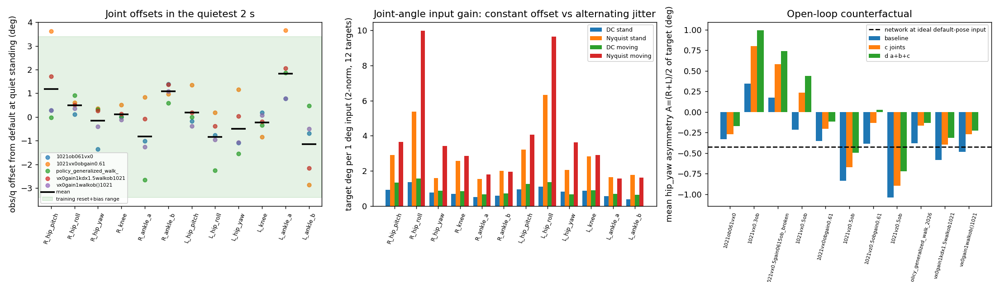

# generalized_walk 정책 재생 검사와 민감도 (2026-10-22)

**질문**: 실기가 정말 `terrain10_2048_model_37400.pt` 를 기록된 입력으로 돌렸는가? 정책은 입력의 어떤 편차에 반응하는가? 한쪽으로 휘는 증상 (veering) 을 입력 편향이 설명하는가?
**자료**: `Expr_Data/*.csv` 의 정책 기록 15개 (44개 입력 11개 + 45개 입력 4개). 모터 지연 기록 (`laten*`, `1020generalizedwalk00.csv`) 은 정책 값이 없어서 제외했다.
**범위**: 이 문서는 정책 쪽 점검이다. 스펙트럼과 주기 분석은 하지 않는다 (다른 문서가 맡는다).
**정정 (2026-10-22 오후)**: 처음 판을 낸 뒤 조정자가 IMU 값이 멈춘다는 점을 지적했다. 확인해 보니 맞다. §3-1b 에 정정한 수치와 새 점검이 있다. 정정 전 각속도 편향 1e-5 rad/s 와 기울기 0.41도는 폐기한다.
**주의**: 로봇은 걷는 동안 손으로 가볍게 잡혀 있었다. 모든 반사실 결과는 **열린 고리 (open loop)** 이다. 기록된 센서 값만 바꿔서 신경망을 다시 돌린 것이고, 로봇은 반응하지 않는다.
**도구**: `tools/sim2real/walk/policy_replay_check.py`. 수치 원본: `docs/sim2real/data/2026-10-22_policy_replay_and_sensitivity.json`.



그림 1. 왼쪽: 가장 조용한 2초 구간의 관절 오프셋 (녹색 띠 = 학습 초기화 범위). 가운데: 관절각 입력의 이득 (상수 오프셋 대 번갈아 흔들리는 떨림). 오른쪽: 엉덩이 요 (hip_yaw) 비대칭의 반사실 결과. 여덟 번째 막대 (`1021vz0.5ob`) 는 발바닥 붙임 기록이다.

## 0. 결론 먼저

1. **실기는 이 체크포인트를 기록된 입력으로 그대로 돌렸다.** 44개 입력 기록 11개 전부에서 재생과 기록된 행동의 차이가 최대 3.2e-5 (행동 단위) 이다. 기록 숫자가 유효숫자 6자리라서 생기는 크기다. 목표각으로 바꾸면 최대 4.5e-4 도이다. 입력 정규화 값을 빼면 차이가 2.2~5.7 로 커진다. 한 행 어긋나게 비교해도 1.8~6.3 으로 커진다. 그래서 이 검사는 민감하다.
2. **45개 입력 기록 4개 (`1019*`) 는 다른 정책이다.** 여분 열은 `obs/cmd/vy` 이다. 이전 `stand` 정책 규격 (45입력, `[vx, vy, wz]`) 이다. 이 체크포인트로 재생하면 차이가 최대 3.2~3.9 이다. 이 4개는 이 체크포인트의 증거가 아니다. 이후 분석에서 뺐다.
3. **정지 구간에서 IMU 각속도는 자주 멈춰 있다 (정정).** 정지 명령 파일 5개에서 각속도 3값이 직전 행과 정확히 같은 행이 4.6~20.6% 이다. 최장 138행 (약 8.7초) 이다. 멈춘 값은 전부 (0, 0, 0) 이다. 걷는 파일 6개에는 멈춘 행이 0개이다. 멈춘 행에서 관절은 호출당 0.07도 이하로만 움직인다. 처음에 고른 '가장 조용한 2초 구간' 5개 중 4개는 각속도 행이 100% 멈춘 행이었다. 그래서 먼저 낸 값 (각속도 편향 1e-5 rad/s, 기울기 0.41도) 은 의미가 없다. **정정한 추정**: 멈춘 행을 빼고 관절이 호출당 0.1도 이하로 정지한 행만 쓴다. 각속도 편향 (x, y, z) = (−0.0008, −0.0005, +0.0017) rad/s, 기울기 0.57도 (피치 +0.16도, 롤 +0.55도) 이다. 파일 사이 흩어짐은 각속도 0.0006~0.0019 rad/s, 중력 x 0.0154 (0.9도) 이다. 행 수는 파일당 각속도 211~675행, 중력 232~782행이다. 편향이 작다는 결론은 그대로다.
4. **관절 오프셋은 학습 범위 안이다.** 조용한 구간의 평균 오프셋 최대는 L_ankle_a +1.83도, R_ankle_b +1.08도, R_hip_pitch +1.17도, L_ankle_b −1.15도 이다. 학습 초기화 범위는 ±3.4도 (재설정 ±2.9도 + 인코더 편향 ±0.57도) 이다. 파일 사이 흩어짐 (표준편차 0.2~1.4도) 이 평균만큼 크다. 일정한 영점 오차의 모양이 아니다.
5. **한쪽 편향이 휘는 증상을 설명한다는 증거는 없다.** 측정된 크기의 편향은 엉덩이 요/롤 비대칭을 0.1~0.2도밖에 못 만든다. 정지 서기에서 일관되게 보이는 요 비대칭 (−0.33~−0.58도) 은 각속도·중력·관절 오프셋을 모두 빼면 −0.12~−0.32도로 약 절반 줄고 부호는 같다 (§5). 모든 입력이 이상적인 기준 자세 입력일 때 신경망 값은 −0.42도이다. 일부는 신경망 자체의 값으로 보인다.
6. **정책 호출 간격이 학습의 2.5~3배이다.** 기록된 정책 호출 간격 중앙값이 50~63 ms 이다 (학습 20 ms, 1020 기록만 31 ms). 신경망은 `q(t) − q(t−1)` 로 관절 속도를 읽는다. 같은 관절 속도에서 이 차이가 2.5~3배 크게 보인다. 엉덩이 롤 (hip_roll) 입력은 번갈아 흔들리는 성분에 대해 이득이 가장 크다 (§4).

7. **걷는 중에 IMU 값이 낡거나 멈추면 목표각이 3도 이상 달라진다 (§6, 열린 고리).** 각속도와 중력을 5, 20, 100 호출 전 값으로 바꾸면 12개 목표의 평균 절대 변화가 3.4~3.5도이다. 엉덩이 요와 롤은 오른쪽과 왼쪽 각각 2.4~3.5도 변한다. 좌우 비대칭 A 의 평균 변화는 작다 (요 −0.02~−0.14도, 롤 −0.05~−0.10도). 오른쪽과 왼쪽이 반대 방향으로 같은 크기만큼 움직이기 때문이다. 파일별로는 A_yaw 가 최대 +0.77도 (실패한 vx 0.5 파일, k=5) 이다. 실제 기록에는 관절이 움직이는 동안 IMU 가 멈춘 행이 없다. 이 항목은 가정 시험이다.

## 1. 기록 파일 분류

| 종류 | 파일 | 입력 수 | 이 체크포인트 |
|---|---|---|---|
| 정책 기록 (이 문서 대상) | `*ob*.csv`, `policy_generalized_walk_20261020_185916.csv`, `vx0gain1kdx1.5walkob1021.csv`, `vx0gain1walkob(진동확인용)1021.csv` (11개) | 44 | 일치 |
| 옛 정지 정책 기록 | `1019gain0.8 stand.csv`, `1019gain1stand1..3.csv` (4개) | 45 (`obs/cmd/vy` 열이 더 있음) | 불일치 (다른 정책) |
| 모터 지연 기록 | `*laten*.csv`, `1020generalizedwalk00.csv` | 해당 없음 | 정책 값 없음 |

명령 값: `vx0*` 파일은 명령 (0, 0) 이다. `vx0.3`, `vx0.5` 파일은 vx = 0.3, 0.5 m/s 이다. `vz0.5*` 파일은 열 이름 `obs/cmd/wz` 가 0.5 rad/s 이고 vx 는 0 이다. 즉 파일 이름의 `vz` 는 요 속도 명령 wz 이다.

## 2. 재생 (과제 1)

방법: rsl_rl 의 `EmpiricalNormalization` (`(x − mean) / (std + 0.01)`) 을 체크포인트에서 읽어서 쓴다. 이어서 ELU 활성화 함수를 쓰는 44-512-256-128-12 완전연결망을 돌린다. 결정적 평균 출력이다. HUPHY 의 numpy 실행기 (`rsl_rl.py`) 도 같은 식이다 (`NORM_EPS = 1e-2`, ELU). 체크포인트에 정규화기가 **있고**, 반복 횟수 37,400, 정규화 개수 2,806,726,656 이다.

| 파일 | 행 수 | 최대 절대 차이 | 평균 절대 차이 | 정규화 없이 최대 차이 | 한 행 어긋남 최대 차이 |
|---|---|---|---|---|---|
| 1021ob061vx0 | 751 | 1.61e-05 | 4.0e-07 | 2.60 | 3.17 |
| 1021vx0.3ob | 66 | 9.98e-06 | 1.6e-06 | 2.23 | 2.06 |
| 1021vx0.5gain0615ob_broken | 86 | 3.15e-05 | 2.1e-06 | 5.70 | 6.31 |
| 1021vx0.5ob | 91 | 1.61e-05 | 1.4e-06 | 2.48 | 1.81 |
| 1021vx0obgain0.61 | 1,223 | 1.60e-05 | 5.1e-07 | 5.36 | 5.30 |
| 1021vz0.5ob | 708 | 1.64e-05 | 1.5e-06 | 2.58 | 2.29 |
| 1021vz0.5obgain0.61 | 882 | 2.29e-05 | 1.3e-06 | 2.54 | 2.34 |
| 1021vz0.5ob발바닥 붙임 | 409 | 1.51e-05 | 1.5e-06 | 2.54 | 2.50 |
| policy_generalized_walk_20261020_185916 | 2,447 | 1.77e-05 | 3.6e-07 | 2.52 | 3.34 |
| vx0gain1kdx1.5walkob1021 | 1,883 | 1.68e-05 | 3.7e-07 | 4.94 | 6.18 |
| vx0gain1walkob(진동확인용)1021 | 3,852 | 6.85e-06 | 3.5e-07 | 2.77 | 2.10 |
| (참고) 1019 4개 | 29~234 | 3.24~3.90 | 0.38~0.50 | - | - |

기록 규약 점검 (11개 전부 같은 결과):

- `last_act[t+1] == act[t]` 가 행의 100% 에서 성립한다. 기록된 "직전 행동" 은 신경망의 날 출력이다.
- `q_prev[t+1] == q[t]` 가 행의 100% 에서 성립한다. 정책 호출이 하나도 빠지지 않았고, 이력 두 프레임은 연속한 두 정책 호출의 값이다.
- `tgt == clip(기본자세 + 0.25 × act, 한계)` 가 성립한다. 한계로 자른 뒤 최대 편차는 0.001도이다. HUPHY 의 기본자세 표가 기록과 일치한다.
- 이 기록들에서 기본자세 표가 **학습의 기본자세와 같은지** 는 이 검사로 확인할 수 없다. 이전 문서 (`2026-10-21_generalized_walk_jitter_analysis.md`) 가 같다고 확인했다. 그 확인을 그대로 믿는다.

## 3. 입력 점검 (과제 2)

기준: 체크포인트의 정규화기 평균과 표준편차는 학습 중 입력의 실제 분포이다 (잡음 포함, 걷기 명령 섞임). "z" 는 (실제 평균 − 학습 평균) / 학습 표준편차 이다. 모든 입력의 전체 표는 도구 출력에 있다.

### 3-1. 가장 조용한 2초 구간 (정정 전 방법. 각속도·중력 열은 폐기, 정정은 §3-1b)

| 파일 | 명령 | 각속도 평균 (rad/s) | 기울기 피치/롤/전체 (도) | 첫 행 기울기 (도) |
|---|---|---|---|---|
| 1021ob061vx0 | 0,0 | 0, 0, 0 | +0.88 / +0.27 / 0.92 | 6.64 |
| 1021vx0obgain0.61 | 0,0 | 0, 0, 0 | −0.79 / −1.05 / 1.31 | 1.35 |
| policy_generalized_walk_20261020 | 0,0 | 0, 0, 0 | +0.25 / +0.65 / 0.69 | 6.63 |
| vx0gain1kdx1.5walkob1021 | 0,0 | −1e-4, +2e-4, 0 | +0.34 / −0.05 / 0.34 | 14.68 |
| vx0gain1walkob(진동확인용)1021 | 0,0 | 0, 0, 0 | +1.34 / +0.54 / 1.44 | 2.61 |

- 위 5개 구간은 관절 흔들림 0.01~0.03도이고, 각속도 행의 100% (한 파일 97%) 가 정확히 0 이다. 이 구간은 거의 전부 "멈춘 행" 이다 (§3-1b). 이 표의 각속도 평균과 기울기는 폐기 대상이다. 정정한 값은 §3-1b 에 있다.
- 각속도는 0.01 deg/s 단위로 양자화되어 있다.
- 학습 잡음은 각속도 ±0.2 rad/s, 중력 ±0.05, 관절 ±0.01 rad 이다. 정지 구간의 실제 잡음은 이보다 100배 이상 작다 (중력 표준편차 최대 3e-4, 각속도 0). 신경망은 학습 중 한 번도 이렇게 깨끗한 입력을 연속으로 본 적이 없다. 입력이 "범위 밖" 은 아니다 (잡음 분포 안에 0 이 있다).
- 걷는 파일 (명령이 0 이 아님) 의 "가장 조용한 구간" 은 조용하지 않다 (관절 흔들림 4.6~8.1도). 그 값은 편향 추정에 쓰지 않았다.
- 정정 전 기준값 (조용한 5개 구간 평균, 멈춘 행 포함): 각속도 (−1.0e-5, +3.0e-5, +1.0e-5) rad/s, 기울기 0.41도. 폐기한다.
- 기록 시작 첫 행의 기울기가 6.6도 (두 파일), 14.7도 (한 파일) 이다. 정책이 켜질 때 몸이 기울어 있었다. 정정한 추정에서 관절 정지 행의 기울기는 파일별 0.4~1.7도이다. 정지 중 중력 x 편차 (파일 사이 흩어짐 ±0.7도) 는 센서 편향이라기보다 손으로 잡은 자세 차이로 보인다.

### 3-1b. IMU 가 멈춘 행과 정정한 편향 추정

멈춘 행의 정의: 각속도 3값 (또는 따로 중력 3값) 이 직전 행과 정확히 같은 행. 조정자가 먼저 지적한 비율 (20.7, 13.0, 12.1, 5.6, 4.6%) 을 모두 재현했다.

| 파일 | 행 수 | 각속도 멈춤 | 최장 연속 (행) | 멈춘 값이 (0,0,0) | 각속도가 멈춘 행 중 중력은 바뀜 | 중력 멈춤 | 최장 연속 (행) | 각속도 멈춘 행의 관절 걸음 중앙값 / 최대 (도/호출) | 나머지 행의 관절 걸음 중앙값 (도) |
|---|---|---|---|---|---|---|---|---|---|
| 1021ob061vx0 | 751 | 20.6% | 138 | 100% | 15% | 17.8% | 48 | 0.022 / 0.022 | 0.18 |
| 1021vx0obgain0.61 | 1,223 | 13.0% | 49 | 100% | 48% | 7.4% | 26 | 0.022 / 0.066 | 0.26 |
| policy_generalized_walk_20261020 | 2,447 | 4.6% | 110 | 100% | 20% | 3.9% | 15 | 0.022 / 0.022 | 0.42 |
| vx0gain1kdx1.5walkob1021 | 1,883 | 12.1% | 25 | 100% | 71% | 4.3% | 5 | 0.022 / 0.066 | 0.22 |
| vx0gain1walkob(진동확인용)1021 | 3,852 | 5.6% | 44 | 100% | 56% | 2.8% | 8 | 0.022 / 0.066 | 0.86 |
| 걷는 파일 6개 (vx 0.3, 0.5, 0.5 실패, vz 0.5 세 개) | 66~882 | 0% | 0 | - | - | 0% | 0 | - | 3.4~5.0 |

- 멈춘 행의 값은 항상 (0, 0, 0) 이다. 0 이 아닌 값에 멈춘 행은 하나도 없다.
- 멈춘 행에서 관절은 거의 움직이지 않는다 (호출당 최대 0.066도, 중앙값 0.022도). 나머지 행의 중앙값은 0.18~0.86도이다. 이 기록들에서는 로봇이 움직이는 동안 IMU 가 멈춘 경우가 **없다**.
- 각속도가 멈춘 행 중 15~71% 에서 중력은 바뀐다. IMU 패킷 전체가 멈췄다면 중력도 같이 멈춰야 한다. 최장 연속도 각속도 (138행) 가 중력 (48행) 보다 길다. 그래서 "패킷 전체가 멈춤" 설명은 맞지 않는다. 가능한 설명은 센서나 드라이버가 정지 상태에서 각속도를 0 으로 고정하는 것이다. 이 자료로는 이 설명과 "로봇이 정지해 있어서 우연히 0" 을 가를 수 없다. IMU 드라이버 설정이 필요하다.
- 이 때문에 조용한 구간 5개는 각속도 행의 100% (한 파일 95%) 가 멈춘 행이다. 비멈춤 행은 구간당 0~2개이다 (중력은 2~13개).

정정한 추정: 멈춘 행을 빼고, 직전 호출보다 어느 관절도 0.1도 넘게 움직이지 않은 행 (관절로 고르므로 각속도로 고르는 순환이 없다) 만 쓴다.

| 파일 | 관절 정지 행 | 각속도 비멈춤 행 | 각속도 평균 x,y,z (rad/s) | 각속도 표준편차 x,y,z | 중력 비멈춤 행 | 중력 평균 x,y,z | 기울기 피치/롤/전체 (도) |
|---|---|---|---|---|---|---|---|
| 1021ob061vx0 | 366 | 211 | −0.0008, −0.0017, +0.0008 | 0.007, 0.036, 0.020 | 232 | −0.0264, +0.0139, −0.9969 | −1.51 / +0.80 / 1.71 |
| 1021vx0obgain0.61 | 521 | 362 | +0.0003, −0.0022, +0.0035 | 0.009, 0.028, 0.029 | 431 | +0.0085, +0.0070, −0.9994 | +0.49 / +0.40 / 0.63 |
| policy_generalized_walk_20261020 | 498 | 386 | −0.0013, −0.0015, +0.0043 | 0.016, 0.028, 0.089 | 403 | +0.0071, +0.0118, −0.9998 | +0.40 / +0.68 / 0.79 |
| vx0gain1kdx1.5walkob1021 | 861 | 634 | −0.0015, +0.0025, +0.0006 | 0.008, 0.016, 0.023 | 780 | +0.0053, +0.0037, −0.9999 | +0.30 / +0.21 / 0.37 |
| vx0gain1walkob(진동확인용)1021 | 890 | 675 | −0.0005, +0.0004, −0.0006 | 0.008, 0.016, 0.033 | 782 | +0.0196, +0.0114, −0.9995 | +1.12 / +0.65 / 1.30 |

- 평균 (파일 평등 가중): 각속도 편향 (−0.00077, −0.00049, +0.00173) rad/s. 파일 사이 흩어짐 0.0006, 0.0017, 0.0019 rad/s.
- 평균 중력 (+0.0028, +0.0096, −0.9991). 기울기 피치 +0.16도, 롤 +0.55도, 전체 0.57도. 파일 사이 흩어짐 x 0.0154 (0.9도), y 0.0037 (0.2도).
- 이전 값 대비: 각속도 편향 60배 커졌지만 (1e-5 → 최대 0.0017) 여전히 0.01 rad/s 보다 작다. 기울기는 0.41 → 0.57도.
- 파일 하나 (1021ob061vx0) 만 피치 −1.5도이고 나머지는 +0.3~+1.1도이다. 피치의 부호가 파일마다 다르다. 손으로 잡은 자세 차이로 보인다.

### 3-2. 관절 오프셋 (obs/q, 도)

이 절의 값은 IMU 가 아니라 인코더 값이라서 정정 대상이 아니다. 같은 2초 구간을 썼으며, 그 구간이 정지였다는 근거는 관절 걸음 0.07도 이하이다.

| 관절 | 5개 구간 평균 | 파일 사이 표준편차 | 구간별 최대 절대값 |
|---|---|---|---|
| R_hip_pitch | +1.17 | 1.37 | 3.62 |
| R_hip_roll | +0.50 | 0.27 | 0.92 |
| R_hip_yaw | −0.16 | 0.66 | 1.37 |
| R_knee | +0.11 | 0.21 | 0.51 |
| R_ankle_a | −0.83 | 1.17 | 2.65 |
| R_ankle_b | +1.08 | 0.29 | 1.38 |
| L_hip_pitch | +0.20 | 0.61 | 1.35 |
| L_hip_roll | −0.83 | 0.81 | 2.25 |
| L_hip_yaw | −0.50 | 0.98 | 1.55 |
| L_knee | −0.22 | 0.37 | 0.85 |
| L_ankle_a | +1.83 | 1.06 | 3.66 |
| L_ankle_b | −1.15 | 1.20 | 2.87 |

- 어느 값도 학습 범위 ±3.4도를 넘지 않는다. 평균이 가장 큰 값은 약 1.8도이다.
- 발목 크랭크 (ankle_a − ankle_b) 오프셋: 오른쪽 −1.91도, 왼쪽 +2.98도. 기본자세에서 오른쪽은 +16.7도, 왼쪽은 −16.7도이다. 두 다리 모두 크랭크 각이 0 쪽으로 약 2~3도 이동해 있다. 같은 방향의 이동이라서 좌우 비대칭이 아니다.
- 엉덩이 요 오프셋 평균은 R −0.16도, L −0.50도이다. 같은 부호 공통 성분 (비대칭 성분, 정의는 §4) 은 −0.33도이다.
- 파일마다 부호와 크기가 바뀐다. 예를 들어 R_hip_pitch 는 −0.03~+3.62도이다. 영점 오차 (파일과 무관하게 일정) 라면 이렇게 흩어지지 않는다. 정지 마찰이나 잡은 자세 때문일 가능성이 높다. 이 자료만으로 둘을 가를 수는 없다.

### 3-3. 입력 묶음별 분포 (정지 5개 파일 10,156행 / 이동 6개 파일 2,242행)

| 묶음 | 실제 (정지) | 실제 (이동) | 학습 | 판정 |
|---|---|---|---|---|
| 각속도 | 평균 ≈ 0, 표준편차 0.18~0.38 rad/s, 극값 −7.8~+6.3 | 표준편차 0.44~0.76, 극값 −10.0~+3.7 | 표준편차 0.45~0.70 | 평균 z < 0.4. 극값은 기록 시작·끝의 급한 움직임 |
| 중력 | x +0.0016, y +0.0122, z −0.9987 | x −0.043, y +0.003, z −0.9976 | x −0.029, y −0.001, z −0.997 | z < 0.5. 범위 안. 이동 중 x −0.043 (기울기 2.5도) 는 걷기 자세의 앞뒤 기울기이며 학습 평균 −0.029 와 같은 방향이다 |
| 관절 q, q_prev | 전부 \|z\| < 1 | 전부 \|z\| < 0.5 | - | 범위 안 |
| 직전 행동 | 평균이 학습보다 작다 (예: R_knee +0.01 대 +0.85) | \|z\| ≤ 0.3 | 표준편차 0.5~1.1 | 범위 안. 정지에서는 걷기 때의 큰 행동이 없는 것이 정상 |
| 명령 | (0, 0) | vx ≤ 0.5, wz ≤ 0.5 | vx −1~2, wz −1~1 | 학습 범위 안 |

범위를 벗어난 입력은 **없다** (평균 \|z\| > 2 인 입력 0개). 학습 평균 ±3 표준편차를 넘는 행의 비율은 대부분 입력에서 1% 미만이고, 가장 큰 값은 grav_x (정지) 1.7%, gyro_z (이동) 1.6% 이다.

## 4. 민감도 (과제 3)

### 4-1. 기울기 행렬 (Jacobian) 의 크기

방법: `torch.func.jacrev` 로 정규화기 포함 전체 망의 d(행동)/d(입력) 을 실제 행마다 계산한다 (float64). 유한 차분과 비교해서 일치함을 확인했다 (도구 안의 assert). 목표각 변화는 0.25 rad × 57.3 = 14.3 도/행동 으로 바꾼다. 아래 "블록 크기" 는 12×(입력 수) 블록의 프로베니우스 노름 (목표각 도 / 입력 단위) 이다. 단위: 각속도 rad/s, 중력과 관절 rad (= 도/도), 행동과 명령 1.

| 입력 묶음 | 입력 수 | 블록 크기 (정지) | 블록 크기 (이동) | 학습 잡음이 만드는 목표각 rms (정지 / 이동, 도) |
|---|---|---|---|---|
| 각속도 | 3 | 21.1 | 23.4 | 0.70 / 0.78 |
| 중력 | 3 | 126.8 | 172.3 | 1.06 / 1.44 |
| q_prev (이전 관절각) | 12 | 304.7 | 472.2 | 0.51 / 0.79 |
| q (현재 관절각) | 12 | 352.7 | 538.7 | 0.59 / 0.90 |
| 직전 행동 | 12 | 40.6 | 42.8 | - |
| 명령 | 2 | 30.7 | 23.2 | - |

- 관절각 입력 (q, q_prev) 이 가장 민감하다. 그 다음은 중력, 각속도 순이다.
- 학습 잡음만으로 목표각이 0.5~1.4도 rms 흔들린다. 각 묶음의 합성은 잡음 독립 가정이다.
- 관절 하나당 가장 민감한 입력: **엉덩이 롤 (hip_roll) q**. 1도 오차에 목표각 (12개 2-노름) 이 정지 3.2~3.4도, 이동 5.3~5.5도 변한다. 그 다음은 q_prev 의 hip_roll (정지 2.3~3.0도, 이동 4.5도) 이다. 정지에서는 명령 vx (0.1 변화에 2.8도), 직전 행동 hip_pitch (0.1 변화에 2.5도), 중력 x (1도에 1.7도) 가 뒤를 잇는다.

### 4-2. 상수 편향이 엉덩이 요/롤 비대칭에 주는 영향 (재실행, 열린 고리, 행 평균, 목표각 도)

비대칭 성분 정의: A = (오른쪽 + 왼쪽) / 2. 근거: 빌드 파일 (`build_robot.py`, 발목 방식이 다른 이전 모델) 에서 두 다리의 hip_yaw 와 hip_roll 축 부호가 같다. 학습 정규화기의 직전 행동 평균도 오른쪽 = −왼쪽 이다 (hip_yaw +0.168 / −0.165, hip_roll +0.274 / −0.274). 그래서 좌우 거울 대칭 걸음에서는 A = 0 이다. A 가 0 이 아니면 두 엉덩이가 같은 물리 방향으로 같이 움직인다. 이것이 휘는 증상의 모양이다.

| 편향 | 정지: A_yaw | 정지: A_roll | 이동: A_yaw | 이동: A_roll |
|---|---|---|---|---|
| 각속도 z +0.01 rad/s | +0.019 | −0.009 | +0.026 | −0.011 |
| 각속도 z +0.05 rad/s | +0.095 | −0.044 | +0.131 | −0.055 |
| 중력 피치 +1도 (x) | −0.029 | +0.028 | −0.027 | +0.035 |
| 중력 피치 +2도 (x) | −0.056 | +0.050 | −0.052 | +0.067 |
| 중력 롤 +1도 (y) | −0.088 | −0.382 | −0.346 | −0.212 |
| 중력 롤 +2도 (y) | −0.181 | −0.801 | −0.698 | −0.423 |
| 관절 R_hip_pitch +1도 | −0.100 | −0.044 | −0.170 | −0.046 |
| 관절 R_hip_yaw +1도 | −0.140 | −0.036 | +0.134 | +0.048 |
| 관절 L_hip_roll +1도 | −0.030 | +0.008 | −0.095 | +0.086 |
| 관절 L_hip_yaw +1도 | −0.079 | +0.002 | +0.050 | +0.009 |

(관절 오프셋은 q 와 q_prev 에 같이 더했다. 12개 관절 전부와 부호 반대 값은 JSON 에 있다. 값은 모두 목표각 도이다.)

- 각속도 z 편향 0.01 / 0.05 rad/s 는 두 엉덩이 요를 **같은 방향으로** 0.02 / 0.1도 (정지) 또는 0.03 / 0.13도 (이동) 밀고, 엉덩이 피치를 −0.05 / −0.23도 민다. 크기는 작다. 게다가 정정한 실제 편향은 최대 0.0017 rad/s 이다.
- 중력 롤 오차가 단위당 가장 크다. 1도에 A_roll −0.38도 (정지), A_yaw −0.35도 (이동) 이다. 중력 피치 오차는 비대칭을 거의 만들지 않는다 (±0.03~0.07도). 대신 발목 크랭크가 가장 크게 변한다 (정지, 중력 x +1도 기준 R_ankle_a +0.79도).
- 관절 오프셋 1도의 비대칭 효과는 0.0~0.17도이다. 가장 큰 것은 R_hip_pitch (이동 A_yaw −0.17도) 이다.
- 측정된 크기를 곱하면: 정지 파일별 중력 롤 편차는 +0.21~+0.80도이다. 평균 +0.55도이므로 효과는 A_roll 약 0.2도 (정지), A_yaw 약 0.2도 (이동) 이다. 정지 구간 관절 오프셋 (≤ 3.7도) 은 §5 에서 직접 재실행했다.
- 결론: 신경망은 상수 편향에 약하게 반응한다. 휘는 증상을 만들려면 중력 롤 오차 수 도 이상이 필요하다. 측정된 편향은 그보다 한 자리 작다.

### 4-3. 떨림 (jitter) 에 관계된 이득

관절각 채널: 신경망은 q(t) 와 q(t−1) 두 값을 본다. 상수 오프셋은 둘에 같이 들어간다 (직류 이득 = |J_q + J_q_prev|). 한 호출마다 부호가 바뀌는 떨림은 반대 부호로 들어간다 (나이퀴스트 이득 = |J_q − J_q_prev|, 신경망이 쓰는 유한 차분 속도 신호). 단위: 관절각 1도 외란당 목표각 도 (12개 목표의 2-노름).

| 관절 | 직류 (정지) | 나이퀴스트 (정지) | 직류 (이동) | 나이퀴스트 (이동) |
|---|---|---|---|---|
| R_hip_pitch | 0.90 | 2.89 | 1.34 | 3.66 |
| R_hip_roll | 1.34 | **5.36** | 1.57 | **9.99** |
| R_hip_yaw | 0.76 | 1.59 | 0.86 | 3.41 |
| R_knee | 0.67 | 2.57 | 0.85 | 2.85 |
| R_ankle_a / b | 0.50 / 0.57 | 1.53 / 1.99 | 0.66 / 0.71 | 1.79 / 1.95 |
| L_hip_pitch | 0.95 | 3.20 | 1.25 | 4.05 |
| L_hip_roll | 1.11 | **6.33** | 1.36 | **9.66** |
| L_hip_yaw | 0.82 | 2.04 | 0.66 | 3.62 |
| L_knee | 0.86 | 2.81 | 0.89 | 2.89 |
| L_ankle_a / b | 0.56 / 0.38 | 1.64 / 1.77 | 0.69 / 0.62 | 1.57 / 1.62 |

- 모든 관절에서 번갈아 흔들리는 성분의 이득이 상수 성분의 2~7배이다. 엉덩이 롤 (hip_roll) 이 가장 크다 (이동 중 약 10배 / 도).
- 관절각 1도 번갈아 떨림이 엉덩이 롤 입력에서 이동 중 약 10도의 목표각 변화 (12개 목표 합성) 로 이어진다. 실제 떨림이 몇 도라면 신경망이 이를 증폭한다.
- 정책 호출 간격이 학습의 2.5~3배이므로, 같은 관절 속도에서 q − q_prev 가 그만큼 커진다. 이 입력이 만드는 목표각 변화도 그만큼 커진다. 반사실 (e) 에서 간격을 20 ms 로 환산하면 전체 목표각이 평균 0.41도 달라진다 (§5).
- 직전 행동 되먹임 (신경망 혼자, 로봇 없이): 행렬 12×12 의 스펙트럼 반지름이 정지에서 중앙값 0.39 (1.0 초과 행 1.0%), 이동에서 중앙값 0.75 (1.0 초과 행 27.6%, p95 1.52, 최대 2.93) 이다. 이동 중에는 행의 4분의 1 이상에서 신경망 자체의 되먹임이 1 을 넘는다. 이는 지역 선형화이다. 로봇의 물리 응답이 빠졌으므로 불안정의 증거는 아니고 점검 후보이다.

## 5. 반사실 재생 (과제 4, 열린 고리)

제거한 값 (§3-1b 의 정정한 추정과 §3-2 의 관절 오프셋, 모든 파일에 같은 값 적용): (a) 각속도 z 편향 +0.00173 rad/s. (b) 중력을 [0.0028, 0.0096, −0.9991] → [0, 0, −1] 로 0.57도 회전. (c) 관절별 오프셋 (§3-2 평균, q 와 q_prev 모두). (d) a+b+c. (e) 추가: q_prev 를 `q − (q − q_prev) × 0.02 / 실제 간격` 으로 바꿔 관절 속도 신호를 20 ms 간격 기준으로 환산. (f) 추가: 모든 관절이 기본자세, 중력 [0, 0, −1], 각속도 0, 명령 0 인 이상적 입력에서 직전 행동을 고정점까지 반복.

### 5-1. 엉덩이 요 (hip_yaw) 비대칭 A (목표각 도, 파일 평균)

| 파일 | 명령 | 정책 간격 중앙 (ms) | 기준 | (a) | (b) | (c) | (d) | (e) |
|---|---|---|---|---|---|---|---|---|
| 1021ob061vx0 | 0,0 | 63 | −0.332 | −0.335 | −0.263 | −0.269 | −0.172 | −0.341 |
| 1021vx0obgain0.61 | 0,0 | 55 | −0.354 | −0.357 | −0.279 | −0.205 | −0.115 | −0.365 |
| policy_generalized_walk_20261020 | 0,0 | 31 | −0.381 | −0.384 | −0.358 | −0.167 | −0.134 | −0.377 |
| vx0gain1kdx1.5walkob1021 | 0,0 | 53 | −0.582 | −0.585 | −0.522 | −0.395 | −0.315 | −0.586 |
| vx0gain1walkob(진동확인용)1021 | 0,0 | 53 | −0.485 | −0.489 | −0.454 | −0.268 | −0.227 | −0.471 |
| 1021vx0.3ob | 0.3,0 | 55 | +0.345 | +0.340 | +0.545 | +0.804 | +0.994 | +0.244 |
| 1021vx0.5gain0615ob_broken | 0.5,0 | 54 | +0.176 | +0.172 | +0.355 | +0.583 | +0.739 | +0.476 |
| 1021vx0.5ob | 0.5,0 | 56 | −0.218 | −0.222 | +0.011 | +0.233 | +0.439 | −0.026 |
| 1021vz0.5ob | 0,0.5 | 50 | −0.837 | −0.841 | −0.648 | −0.672 | −0.495 | −0.877 |
| 1021vz0.5obgain0.61 | 0,0.5 | 50 | −0.385 | −0.390 | −0.209 | −0.131 | +0.024 | −0.290 |
| 1021vz0.5ob발바닥 붙임 | 0,0.5 | 51 | −1.040 | −1.044 | −0.855 | −0.898 | −0.724 | −1.021 |

(f) 이상적 입력: hip_yaw 오른쪽 +1.055도, 왼쪽 −1.902도, **A = −0.424도**. hip_roll 오른쪽 +5.21도, 왼쪽 −4.24도, A = +0.481도. 고정점으로 수렴했다.

### 5-2. 엉덩이 롤 (hip_roll) 비대칭 A (목표각 도)

| 파일 | 명령 | 기준 | (a) | (b) | (c) | (d) | (e) |
|---|---|---|---|---|---|---|---|
| 1021ob061vx0 | 0,0 | −0.214 | −0.212 | −0.021 | −0.340 | −0.158 | −0.230 |
| 1021vx0obgain0.61 | 0,0 | −0.008 | −0.006 | +0.177 | −0.088 | +0.085 | −0.001 |
| policy_generalized_walk_20261020 | 0,0 | +0.089 | +0.091 | +0.290 | +0.091 | +0.285 | +0.084 |
| vx0gain1kdx1.5walkob1021 | 0,0 | +0.179 | +0.180 | +0.395 | +0.168 | +0.371 | +0.167 |
| vx0gain1walkob(진동확인용)1021 | 0,0 | −0.097 | −0.096 | +0.108 | −0.061 | +0.134 | −0.104 |
| 1021vx0.3ob | 0.3,0 | +0.205 | +0.207 | +0.313 | +0.349 | +0.449 | −0.081 |
| 1021vx0.5gain0615ob_broken | 0.5,0 | +0.280 | +0.282 | +0.334 | +0.404 | +0.444 | +0.256 |
| 1021vx0.5ob | 0.5,0 | +0.531 | +0.533 | +0.661 | +0.716 | +0.833 | +0.380 |
| 1021vz0.5ob | 0,0.5 | −0.789 | −0.787 | −0.644 | −0.603 | −0.474 | −0.884 |
| 1021vz0.5obgain0.61 | 0,0.5 | +0.969 | +0.972 | +1.072 | +1.084 | +1.162 | +1.068 |
| 1021vz0.5ob발바닥 붙임 | 0,0.5 | −0.791 | −0.790 | −0.655 | −0.584 | −0.461 | −0.824 |

### 5-3. 모든 파일 행 가중 합계

| 변형 | hip_yaw R | hip_yaw L | A_yaw | hip_roll R | hip_roll L | A_roll | 12개 목표의 평균 절대 변화 (도, 기준 대비) |
|---|---|---|---|---|---|---|---|
| 기준 | +0.925 | −1.879 | −0.477 | +2.868 | −2.857 | +0.006 | 0 |
| (a) 각속도 z | +0.921 | −1.882 | −0.481 | +2.870 | −2.855 | +0.007 | 0.003 |
| (b) 중력 | +1.008 | −1.826 | −0.409 | +3.184 | −2.796 | +0.194 | 0.194 |
| (c) 관절 오프셋 | +1.261 | −1.820 | −0.280 | +4.147 | −4.090 | +0.028 | 0.530 |
| (d) a+b+c | +1.335 | −1.742 | −0.203 | +4.439 | −4.029 | +0.205 | 0.582 |
| (e) 간격 20 ms | +0.934 | −1.867 | −0.466 | +2.789 | −2.793 | −0.002 | 0.409 |

- (a) 는 효과가 거의 없다. 정정한 편향 0.0017 rad/s 도 요 비대칭을 0.004도밖에 바꾸지 못한다.
- (b) 중력 0.57도 회전은 요 비대칭을 −0.477 → −0.409도로 0.07도 줄이고, 롤 비대칭을 +0.006 → +0.194도로 키운다. 정지 파일 롤 비대칭이 모두 양의 방향으로 +0.10~+0.20도 움직인다. 이는 정정한 롤 기울기 +0.55도 (정지 파일 +0.21~+0.80도) 가 신경망에 롤 쪽 비대칭 입력으로 들어갔다는 뜻이다. 이 기울기가 센서 편향인지 손으로 잡은 자세인지는 모른다.
- (c) 는 요 비대칭을 −0.477 → −0.280도로 0.20도 줄인다. 정지 파일 5개에서는 일관되게 0.06~0.22도 줄인다. 걷는 짧은 파일 3개 (vx 0.3, 0.5) 에서는 비대칭이 커지거나 부호가 바뀐다.
- (d) 는 정지 파일 5개의 요 비대칭을 −0.33~−0.58 → −0.12~−0.32도로 0.16~0.27도 (약 절반) 줄인다. 0 이 되지는 않는다. 같은 부호가 남는다. 걷는 vx 파일 3개는 (d) 후 +0.44~+0.99도로 오히려 커진다. 일관된 개선이 아니다.
- 이상적 입력 (f) 의 요 비대칭 −0.42도는 (d) 후 남는 −0.12~−0.32도와 같은 부호이다. 합쳐서 해석하면 "입력 편향이 절반 정도, 나머지는 신경망 쪽" 이다. 두 몫을 정확히 가르려면 닫힌 고리 시뮬레이션이 필요하다.
- 학습 정규화기의 직전 행동 평균은 거의 대칭이다 (A_yaw 0.02도). 걷기 전체를 평균하면 대칭인데 기본자세 부근에서는 −0.42도다. 학습 중 이 비대칭이 물리적으로 상쇄되었는지는 이 검사로 알 수 없다 (시뮬레이션 필요).
- 짧은 vx 파일 (66~91행, 3.7~5.0초) 의 비대칭은 일관되지 않는다 (요 +0.35, +0.18, −0.22도). 롤은 세 개 모두 양수 (+0.2~+0.5도) 이다. 시작 과도 구간을 포함하고 표본이 적다.
- 요 속도 명령 wz = 0.5 파일은 A_yaw 가 모두 음수 (−0.4~−1.0도) 이다. 명령이 양쪽을 비대칭으로 만드는 것이 정상이다. 실제 요 속도 평균은 +0.21~+0.29 rad/s 로 명령 0.5 의 절반 정도이다.
- 직진 vx 파일의 전체 평균 요 속도: 0.3 → −0.008, 0.5 → +0.001, "broken" 0.5 → −0.200 rad/s. 정상 두 개는 0 에 가깝다.

## 6. IMU 값이 낡거나 멈췄을 때 (열린 고리, 걷는 파일만)

실제 기록에는 관절이 움직이는 동안 IMU 가 멈춘 행이 없다 (§3-1b). 이 절은 "그런 일이 생기면 신경망은 무엇을 내는가" 를 묻는 가정 시험이다.

방법: 변형 lag-k 는 행 i 의 각속도 또는 중력 (또는 둘 다) 을 행 i−k 의 값으로 바꾼다 (처음 k행은 행 0 값). 변형 hold-k 는 값을 k행마다 한 번만 갱신한다 (표본 유지). 기록된 행동 (= 기준 재생) 과 비교한다. 각 k 에 대해 행 수가 2k 이상인 걷는 파일만 쓴다. 정책 주기가 약 55 ms 이므로 k=5 는 0.3초, k=20 은 1.1초, k=100 은 5.5초이다. k=100 은 행 수 200 이상인 vz 파일 3개만 해당한다 (vx 파일은 66~91행).

| 변형 | 채널 | k | 파일 (행) | 12개 목표 평균 절대 변화 (도) | 평균 절대 변화 hip_yaw R / L | 평균 절대 변화 hip_roll R / L | 부호 있는 평균 변화 hip_yaw R / L | 부호 있는 평균 변화 hip_roll R / L | A_yaw 변화 | A_roll 변화 |
|---|---|---|---|---|---|---|---|---|---|---|
| lag | 각속도 | 5 | 6 (2242) | 3.04 | 2.76 / 2.33 | 3.00 / 2.56 | −0.238 / +0.382 | −0.237 / +0.173 | +0.072 | −0.032 |
| lag | 각속도 | 20 | 6 (2242) | 3.05 | 2.89 / 2.38 | 2.95 / 2.70 | −0.158 / +0.324 | −0.125 / +0.123 | +0.083 | −0.001 |
| lag | 각속도 | 100 | 3 (1999) | 2.92 | 2.82 / 2.21 | 2.80 / 2.64 | −0.339 / +0.164 | −0.317 / +0.226 | −0.087 | −0.046 |
| lag | 중력 | 5 | 6 (2242) | 1.31 | 1.24 / 0.79 | 1.32 / 1.23 | −0.396 / +0.012 | −0.609 / +0.489 | −0.192 | −0.060 |
| lag | 중력 | 20 | 6 (2242) | 1.54 | 1.36 / 0.91 | 1.40 / 1.37 | −0.357 / +0.123 | −0.488 / +0.418 | −0.117 | −0.035 |
| lag | 중력 | 100 | 3 (1999) | 1.55 | 1.37 / 0.91 | 1.39 / 1.33 | −0.238 / +0.110 | −0.379 / +0.350 | −0.064 | −0.014 |
| lag | 둘 다 | 5 | 6 (2242) | 3.37 | 3.11 / 2.51 | 3.45 / 3.01 | −0.567 / +0.384 | −0.814 / +0.614 | −0.091 | −0.100 |
| lag | 둘 다 | 20 | 6 (2242) | 3.49 | 3.27 / 2.61 | 3.45 / 3.20 | −0.423 / +0.379 | −0.599 / +0.474 | −0.022 | −0.062 |
| lag | 둘 다 | 100 | 3 (1999) | 3.38 | 3.24 / 2.35 | 3.24 / 3.12 | −0.503 / +0.230 | −0.657 / +0.555 | −0.137 | −0.051 |
| hold | 각속도 | 5 | 6 (2242) | 2.46 | 2.33 / 1.87 | 2.31 / 2.19 | −0.045 / +0.041 | +0.018 / −0.006 | −0.002 | +0.006 |
| hold | 각속도 | 20 | 6 (2242) | 2.78 | 2.75 / 2.15 | 2.68 / 2.54 | +0.007 / +0.298 | −0.261 / +0.242 | +0.153 | −0.009 |
| hold | 각속도 | 100 | 3 (1999) | 2.82 | 2.89 / 2.22 | 2.69 / 2.74 | −0.319 / +0.260 | +0.282 / +0.479 | −0.029 | +0.381 |
| hold | 중력 | 5 | 6 (2242) | 0.78 | 0.73 / 0.45 | 0.78 / 0.77 | −0.303 / +0.035 | −0.384 / +0.323 | −0.134 | −0.031 |
| hold | 중력 | 20 | 6 (2242) | 1.26 | 1.12 / 0.76 | 1.17 / 1.12 | −0.283 / −0.021 | −0.335 / +0.303 | −0.152 | −0.016 |
| hold | 중력 | 100 | 3 (1999) | 1.29 | 1.08 / 0.73 | 1.09 / 1.05 | −0.280 / +0.083 | −0.417 / +0.337 | −0.099 | −0.040 |
| hold | 둘 다 | 5 | 6 (2242) | 2.62 | 2.51 / 1.92 | 2.51 / 2.41 | −0.308 / +0.063 | −0.323 / +0.276 | −0.122 | −0.024 |
| hold | 둘 다 | 20 | 6 (2242) | 3.17 | 3.11 / 2.35 | 3.10 / 2.93 | −0.179 / +0.268 | −0.564 / +0.511 | +0.045 | −0.027 |
| hold | 둘 다 | 100 | 3 (1999) | 3.12 | 3.19 / 2.33 | 2.99 / 3.02 | −0.490 / +0.377 | −0.083 / +0.839 | −0.056 | +0.378 |

파일별 (변형 lag, 채널 둘 다): 12개 목표 평균 절대 변화 (도), 괄호 안은 A_yaw / A_roll 변화.

| 파일 | k=5 | k=20 | k=100 |
|---|---|---|---|
| 1021vx0.3ob | 3.49 (+0.06 / +0.00) | 3.21 (+0.15 / −0.04) | - |
| 1021vx0.5gain0615ob_broken | 4.70 (+0.77 / +0.43) | 4.91 (+0.70 / −0.22) | - |
| 1021vx0.5ob | 3.45 (+0.23 / −0.04) | 3.44 (+0.71 / −0.25) | - |
| 1021vz0.5ob | 3.68 (+0.07 / −0.04) | 3.89 (+0.03 / −0.04) | 3.80 (+0.05 / +0.10) |
| 1021vz0.5obgain0.61 | 2.81 (−0.34 / −0.21) | 2.87 (−0.28 / −0.09) | 2.81 (−0.42 / −0.20) |
| 1021vz0.5ob발바닥 붙임 | 3.71 (−0.11 / −0.11) | 3.89 (+0.09 / +0.02) | 3.86 (+0.15 / +0.01) |

- 낡은 값의 영향은 크기가 크다. 둘 다 5, 20, 100 호출 낡으면 12개 목표가 평균 3.4~3.5도 바뀐다. §4-2 의 어떤 상수 편향 (≤ 0.4도) 보다 한 자리 크다. 각속도가 주된 원인이다 (각속도만 2.9~3.0도, 중력만 1.3~1.6도).
- 엉덩이 요와 롤은 오른쪽과 왼쪽 각각 평균 2.4~3.5도 바뀐다. 변화는 **좌우 반대 방향으로 거의 같은 크기**이다 (k=20, 둘 다: 요 −0.42 / +0.38도, 롤 −0.60 / +0.47도). 합 (비대칭 A) 의 평균 변화는 요 −0.02~−0.14도, 롤 −0.05~−0.10도로 작다. 걷는 중 낡은 IMU 는 평균적으로 좌우 대칭인 오차를 만든다. 한쪽으로 휘는 평균 편향을 만들지는 않는다.
- 파일 하나씩 보면 비대칭이 크게 나오는 경우가 있다. 실패한 vx 0.5 파일 (A_yaw +0.70~+0.77도), vx 0.5 정상 파일 (k=20 +0.71도), vz 0.5 (게인 0.61) 파일 (−0.28~−0.42도). 부호가 파일마다 다르다. 걸음 위상에 따라 달라지므로 일정한 방향성이 아니다.
- 표본 유지 (hold) 는 같은 k 의 lag 보다 변화가 약간 작다 (평균 낡은 정도가 k/2 이기 때문이다).
- k=5 는 걸음 주기와 비슷한 길이이다. 이 경우 낡은 값은 위상이 어긋난 신호로 들어간다. 로봇이 반응하는 닫힌 고리에서는 결과가 다를 수 있다.
- 정지 구간의 멈춘 행은 값이 (0,0,0) 이고 실제 각속도도 거의 0 (비멈춤 행 표준편차 0.007~0.09 rad/s) 이라서 이 시험의 영향 범위 밖이다.

## 7. 한계와 미해결

- 열린 고리이다. 입력을 바꾸면 로봇 자세가 달라지고 다음 입력도 달라진다. 이 문서는 신경망의 입출력 관계만 보여 준다. 휘는 움직임의 크기는 닫힌 고리 시뮬레이션이 필요하다.
- 편향 추정은 5개 파일 (정지 명령, 손으로 잡힘) 의 관절 정지 행에서 나왔다. 걷는 상태의 센서 편향 (몸 흔들림에 의한 가속도 오염 등) 은 추정하지 못했다.
- 각속도가 0 에 고정되는 원인은 모른다 (센서 또는 드라이버의 정지 상태 0 고정, 또는 우연한 0). IMU 드라이버 설정 확인이 필요하다. 이 기록들에서는 로봇이 움직이는 동안 멈춘 행은 없었다.
- 중력 기울기 +0.55도 (롤) 가 센서 편향인지 잡은 자세인지는 가르지 못했다. 파일 사이 피치 흩어짐이 0.9도이다.
- 휘는 증상이 어느 파일에 있는지 (몸이 실제로 어느 쪽으로 돌았는지) 는 이 기록에 위치/방향이 없어서 확인하지 못했다. 각속도 z 의 평균만 있다.
- 기본자세 표가 학습과 같은지는 이 문서에서 직접 확인하지 않았다 (이전 문서 인용).
- 정책 간격이 50~63 ms 인 이유 (손실 호출인지 주기 설정인지) 는 주기 분석 문서가 맡는다. 이 문서는 간격이 길다는 사실과 그 신경망 쪽 영향 (속도 신호 2.5~3배, 나이퀴스트 이득) 만 다룬다.
- 정지 기준 요 비대칭 −0.42도가 학습 환경에서도 있었는지는 시뮬레이션에서 같은 입력으로 확인해야 한다.

## 8. 재현

```bash
cd /home/syaro/MikuchanRemote/Human-Pygmalion
mkdir -p /tmp/ckpt
git show origin/vibecoded-audit-20261012:vibecoded-audit-20261012/deploy/generalized_walk/checkpoints/terrain10_2048_model_37400.pt > /tmp/ckpt/terrain10_2048_model_37400.pt
sha256sum /tmp/ckpt/terrain10_2048_model_37400.pt   # 7bbd5cbc1431fb8085b6533f457b4cbb7eb20b960f4c033a6907c3e7fe0fbe00
CUDA_VISIBLE_DEVICES="" mujoco-sim/mjlab/.venv/bin/python3 tools/sim2real/walk/policy_replay_check.py \
  --ckpt /tmp/ckpt/terrain10_2048_model_37400.pt --logs Expr_Data \
  --json docs/sim2real/data/2026-10-22_policy_replay_and_sensitivity.json \
  --png docs/sim2real/img/2026-10-22_policy_replay_and_sensitivity.png > out.md
```

실행 시간은 CPU 에서 약 2분이다. 표준 출력이 이 문서의 모든 표 (전체 입력 44개 분포 표 포함) 이다.
