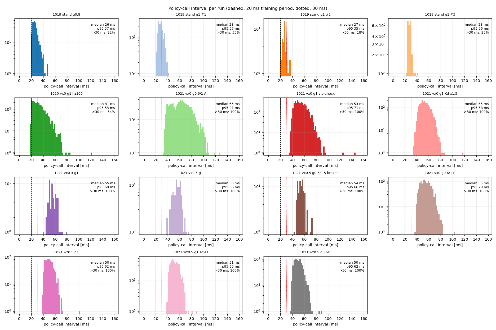
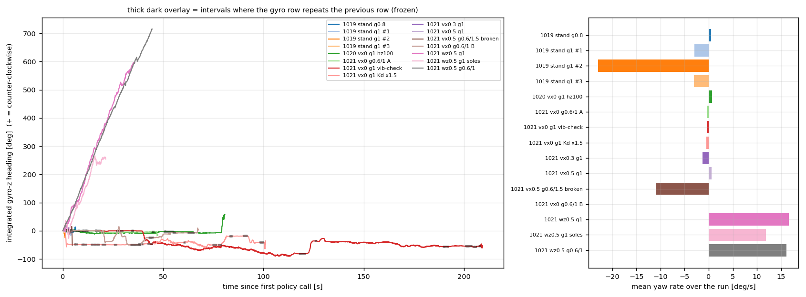
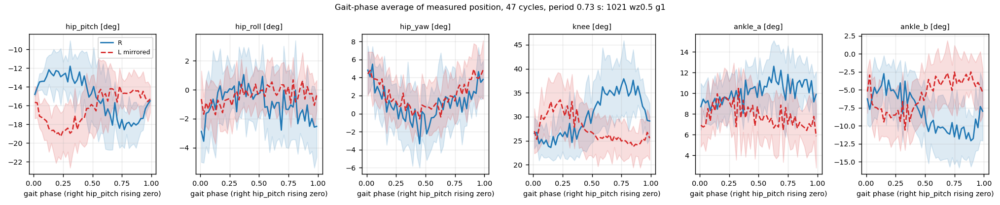
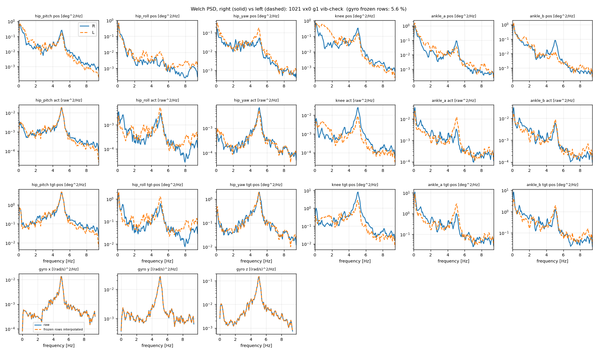
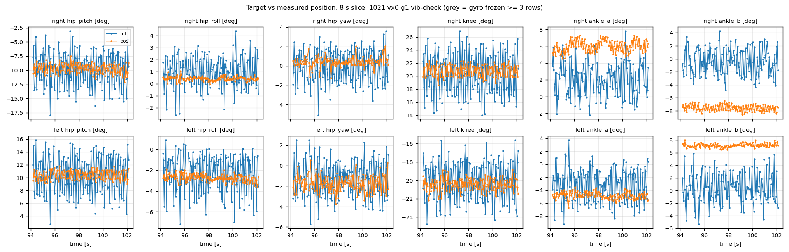

# 실기 보행 기록 수치 분석 (2026-10-22)

**목적**: 사용자가 보고한 세 증상을 실기 기록의 숫자로 나눈다. (S1) 로봇이 한쪽으로 계속 휜다. (S2) 걸음이 시뮬레이터와 다르다. (S3) 떨린다.
**범위**: 이 문서는 숫자만 낸다. 원인 판정은 하지 않는다.
**도구**: `tools/sim2real/walk/real_walk_analyze.py` (실행 명령은 §9). 모든 숫자는 이 도구가 `docs/sim2real/data/2026-10-22_real_walk_metrics.json` 과 `.md` 에 쓴 값이다. 괄호 안의 비율은 그 숫자에서 계산한 값이다.
**자료**: `Expr_Data/` 의 정책 기록 15개와 지연 기록 11개. 원본은 읽기만 했다. zip 은 같은 파일의 사본이다.

## 0. 먼저 읽을 결과

1. **정책 호출 간격이 학습의 2.5~3배다.** 1021 의 실행 11개에서 중앙값이 49.7~62.6 ms 다. 학습은 20 ms 다. 가장 짧은 간격도 33.0 ms 다 (1021 vx0 g0.6/1 A). 그래서 30 ms 를 넘은 호출이 100 % 다.
2. **제어 루프가 설정 속도의 3분의 1만 돈다.** `--hz 200` 설정에서 평균 63.4~79.3 Hz 다. `--hz 100` 설정 (1020) 에서 60.6 Hz 다.
3. **기록 파일은 내부적으로 일관된다.** `obs/q_prev(k) = obs/q(k-1)`, `obs/last_act(k) = act(k-1)` 이 15개 파일 모두 오차 0 이다. `pos(k)` 는 `obs/q(k)` 와 같은 표본이다 (최대 차이 0.00028°). 더 새로운 읽기값은 아니다.
4. **휘는 방향은 한쪽으로 일관되지 않는다.** 서 있기 (vx0) 실행 5개 (1020 이후) 의 평균 요 속도는 −0.49~+0.70 deg/s 이고 부호가 섞인다 (음수 3개, 양수 2개). 앞으로 걷기 (vx 0.3, 0.5) 실행은 3.7 s, 5.0 s 뿐이다. 요 속도는 −1.33 와 +0.58 deg/s 다.
5. **서 있기에서 5 Hz 떨림이 보인다.** `1021 vx0 g1 vib-check` 에서 12개 관절 모두에 5.09 Hz 봉우리가 있다. 정책 출력과 IMU 각속도의 코히런스가 그 주파수에서 11개 관절 0.91~0.99 다. hip_pitch 의 목표 − 측정 rms 는 2.3° 로 측정각 rms 0.84° 의 2.7배다.
6. **발목 크랭크의 목표와 측정이 항상 어긋난다.** 목표 − 측정의 평균이 크랭크 4개에서 1.9~7.8° 다 (부호는 좌우 거울 대칭). 추적 오차를 계산한 10개 실행 (1019 서기 2개 포함) 모두에서 나타난다.
7. **IMU 값이 멈추는 구간이 있다 (§4-2).** 서 있기 (vx0) 실행 5개에서 각속도 3축이 앞 행과 정확히 같은 행이 4.6~20.6 % 이고, 멈춘 값은 전부 0 이다. 가장 긴 멈춤은 138 행 (8.1 s) 이다. 걷는 실행 (vx 0.3, 0.5, wz 0.5) 에는 멈춤이 0 개다. 멈춘 행에서 관절은 거의 움직이지 않는다 (행당 0.001~0.005° 대 0.17~0.35°). 그래서 방위 적분은 걷는 실행에서 멈춤의 영향이 없다.

## 1. 실행 표

파일 이름 규칙은 사용자 설명을 따랐다. 속도 명령은 기록 파일의 `obs/cmd` 에서 읽었다 (이름과 모두 일치). "게인" 은 `몸통 배율/발목 배율` 이다. 이름에 게인이 없는 파일은 1 로 가정했다 (표에 `가정` 표시).

| 약칭 (도구 라벨) | 정책 기록 파일 | 날짜 | 명령 | 게인 | Kd 배율 | 길이 [s] | 행 수 | 루프 설정 [Hz] |
|---|---|---|---|---|---|---|---|---|
| 1019 stand g0.8 | `1019gain0.8 stand.csv` | 10-19 | vx 0 | 0.8 / 미표기 | 1 | 6.37 | 234 | 지연 기록 없음 |
| 1019 stand g1 #1 | `1019gain1stand1.csv` | 10-19 | vx 0 | 1 / 1 | 1 | 4.03 | 142 | 없음 |
| 1019 stand g1 #2 | `1019gain1stand2.csv` | 10-19 | vx 0 | 1 / 1 | 1 | 1.04 | 39 | 없음 |
| 1019 stand g1 #3 | `1019gain1stand3.csv` | 10-19 | vx 0 | 1 / 1 | 1 | 0.80 | 29 | 없음 |
| 1020 vx0 g1 hz100 | `policy_generalized_walk_20261020_185916.csv` | 10-20 | vx 0 | 1 / 1 (가정) | 1 | 80.75 | 2447 | 100 |
| 1021 vx0 g0.6/1 A | `1021ob061vx0.csv` | 10-21 | vx 0 | 0.6 / 1 | 1 | 47.36 | 751 | 200 |
| 1021 vx0 g1 vib-check | `vx0gain1walkob(진동확인용)1021.csv` | 10-21 | vx 0 | 1 / 1 | 1 | 209.22 | 3852 | 200 |
| 1021 vx0 g1 Kd x1.5 | `vx0gain1kdx1.5walkob1021.csv` | 10-21 | vx 0 | 1 / 1 | 1.5 | 101.07 | 1883 | 200 |
| 1021 vx0.3 g1 | `1021vx0.3ob.csv` | 10-21 | vx 0.3 | 1 / 1 (가정) | 1 | 3.66 | 66 | 200 |
| 1021 vx0.5 g1 | `1021vx0.5ob.csv` | 10-21 | vx 0.5 | 1 / 1 (가정) | 1 | 5.00 | 91 | 200 |
| 1021 vx0.5 g0.6/1.5 broken | `1021vx0.5gain0615ob_broken.csv` | 10-21 | vx 0.5 | 0.6 / 1.5 | 1 | 4.68 | 86 | 200 |
| 1021 vx0 g0.6/1 B | `1021vx0obgain0.61.csv` | 10-21 | vx 0 | 0.6 / 1 | 1 | 67.57 | 1223 | 200 |
| 1021 wz0.5 g1 | `1021vz0.5ob.csv` | 10-21 | wz 0.5 rad/s | 1 / 1 (가정) | 1 | 35.84 | 708 | 200 |
| 1021 wz0.5 g1 soles | `1021vz0.5ob발바닥 붙임.csv` | 10-21 | wz 0.5 rad/s | 1 / 1 (가정) | 1 | 21.33 | 409 | 200 |
| 1021 wz0.5 g0.6/1 | `1021vz0.5obgain0.61.csv` | 10-21 | wz 0.5 rad/s | 0.6 / 1 | 1 | 44.42 | 882 | 200 |

- `1021 vx0 g0.6/1` 은 두 번 있다. 이름의 `061` (A, 04:20 저장) 과 `gain0.61` (B, 05:11 저장) 이다. 도구는 A, B 로 구분했다.
- 1019 파일 4개는 열이 82개다. 추가 열은 `obs/cmd/vy` (열 번호 44) 다. 값은 모든 행에서 0 이다. 옛 서기 정책의 관측 계약 (45개, `[vx, vy, wz]`) 이다. 1020, 1021 파일은 81개 열이다.
- 1019 실행은 정책이 다르다. 그래서 1019 와 1020/1021 의 숫자를 같은 표에 놓되, 같은 조건의 비교로 읽지 않는다.
- `broken` 은 사용자가 실패로 표시한 실행이다. 표에는 넣었다.

### 정책 기록과 지연 기록의 짝 확인

방법은 두 가지다. 첫째, 행 수 × N 이 주기 수와 2 이내로 맞는지 본다 (N = 루프 설정 / 50, 200 Hz 에서 4, 100 Hz 에서 2). 둘째, 정책 호출 간격이 연속한 N개 주기 길이의 합과 맞는지 본다. 어긋남의 기준으로 같은 열을 7 호출 밀어 넣은 값 (null) 과 비교했다.

| 짝 | 정책 행 수 × N → 주기 수 | 길이 차 [s] | 간격 합 평균 절대 오차 [ms] | null 오차 [ms] |
|---|---|---|---|---|
| 1020 vx0 g1 hz100 | 2447×2 → 4893 | −0.016 | 3.54 | 10.84 |
| 1021 vx0 g0.6/1 A | 751×4 → 3002 | +0.010 | 3.64 | 16.92 |
| 1021 vx0 g1 vib-check | 3852×4 → 15407 | +0.028 | 1.56 | 8.98 |
| 1021 vx0 g1 Kd x1.5 | 1883×4 → 7530 | +0.013 | 1.29 | 8.11 |
| 1021 vx0.3 g1 | 66×4 → 264 | +0.040 | 0.97 | 8.00 |
| 1021 vx0.5 g1 | 91×4 → 362 | +0.017 | 1.18 | 6.08 |
| 1021 vx0.5 g0.6/1.5 broken | 86×4 → 344 | +0.034 | 1.14 | 6.93 |
| 1021 vx0 g0.6/1 B | 1223×4 → 4890 | +0.013 | 1.53 | 8.77 |
| 1021 wz0.5 g1 | 708×4 → 2832 | +0.033 | 0.95 | 6.39 |
| 1021 wz0.5 g1 soles | 409×4 → 1633 | −0.001 | 1.45 | 7.26 |
| 1021 wz0.5 g0.6/1 | 882×4 → 3527 | +0.025 | 1.05 | 6.75 |

11개 짝 모두 최적 정렬이 오프셋 0 (첫 정책 호출 = 첫 주기) 이고, 오차가 null 의 절반보다 작다. 도구의 판정은 11개 모두 `paired` 다. 두 기록의 시계는 따로라서 (지연 기록의 `t` 는 14.8~103.0 s 에서 시작) 절대 시각은 맞추지 못했다.

## 2. 타이밍 (항목 1)

그림: 

| 실행 | 정책 호출 간격 중앙 [ms] | p5 | p95 | 최대 | 30 ms 초과 비율 | 루프 주기 중앙 [ms] | 루프 평균 속도 [Hz] |
|---|---|---|---|---|---|---|---|
| 1019 stand g0.8 | 26.3 | 21.5 | 37.1 | 47.2 | 0.219 | - | - |
| 1019 stand g1 #1 | 28.1 | 22.5 | 37.0 | 41.7 | 0.326 | - | - |
| 1019 stand g1 #2 | 27.3 | 22.0 | 34.6 | 36.4 | 0.184 | - | - |
| 1019 stand g1 #3 | 27.8 | 24.2 | 35.7 | 41.3 | 0.250 | - | - |
| 1020 vx0 g1 hz100 | 30.9 | 20.7 | 52.5 | 121 | 0.544 | 14.3 | 60.6 |
| 1021 vx0 g0.6/1 A | 62.6 | 39.3 | 91.5 | 126 | 1.000 | 13.4 | 63.4 |
| 1021 vx0 g1 vib-check | 53.0 | 41.9 | 71.0 | 145 | 1.000 | 12.4 | 73.6 |
| 1021 vx0 g1 Kd x1.5 | 52.8 | 42.0 | 68.0 | 117 | 1.000 | 12.6 | 74.5 |
| 1021 vx0.3 g1 | 54.8 | 46.3 | 68.3 | 79.3 | 1.000 | 13.6 | 71.0 |
| 1021 vx0.5 g1 | 55.9 | 43.9 | 65.9 | 75.1 | 1.000 | 13.5 | 71.9 |
| 1021 vx0.5 g0.6/1.5 broken | 54.4 | 47.4 | 65.5 | 72.2 | 1.000 | 13.2 | 72.7 |
| 1021 vx0 g0.6/1 B | 54.7 | 42.6 | 70.1 | 104 | 1.000 | 12.9 | 72.3 |
| 1021 wz0.5 g1 | 50.0 | 42.1 | 62.0 | 101 | 1.000 | 11.9 | 78.9 |
| 1021 wz0.5 g1 soles | 51.2 | 42.1 | 65.0 | 88.8 | 1.000 | 12.2 | 76.5 |
| 1021 wz0.5 g0.6/1 | 49.7 | 41.0 | 62.1 | 88.8 | 1.000 | 11.8 | 79.3 |

- 1019 실행의 간격은 18.4~32.6 % 가 30 ms 를 넘는다. 20 ms 학습 주기와 가장 가까운 기록이다.
- 평균 간격에서 본 나이퀴스트 주파수는 1021 에서 약 9.4 Hz (53 ms), 1020 에서 약 16 Hz (31 ms) 다. 이 값이 §5 스펙트럼의 한계다.
- 1021 실행의 루프 평균 속도 63.4~79.3 Hz 는 평균 주기 12.6~15.8 ms 다. 4개를 곱하면 50~63 ms 이고 정책 호출 간격 평균과 맞는다 (N = 4).
- 한 주기 안에서 12개 응답이 모두 도착하는 데 걸리는 시간 (첫 응답과 마지막 응답의 차) 은 `vib-check` 에서 중앙값 5.5 ms 다.
- `vib-check` 루프 주기는 p95 22.2 ms, p99 27.8 ms, 최대 106.5 ms 다.

### 응답 지연 (지연 기록)

| 실행 | 오른쪽 중앙 [ms] | 왼쪽 중앙 | 오른쪽 p99 | 왼쪽 p99 | 제때 오지 않은 비율 |
|---|---|---|---|---|---|
| 1020 vx0 g1 hz100 | 0.594 | 0.571 | 8.05 | 5.03 | 0 |
| 1021 vx0 g0.6/1 A | 0.595 | 0.567 | 7.64 | 5.08 | 0 |
| 1021 vx0 g1 vib-check | 0.653 | 0.653 | 5.62 | 5.07 | 0 |
| 1021 vx0 g1 Kd x1.5 | 0.665 | 0.668 | 4.52 | 4.18 | 4.4e-05 (late 1, lost 1) |
| 1021 vx0.3 g1 | 0.667 | 0.677 | 3.49 | 2.96 | 0 |
| 1021 vx0.5 g1 | 0.680 | 0.670 | 3.27 | 2.86 | 0 |
| 1021 vx0.5 g0.6/1.5 broken | 0.665 | 0.662 | 3.12 | 3.27 | 0 |
| 1021 vx0 g0.6/1 B | 0.674 | 0.673 | 5.82 | 5.68 | 0 |
| 1021 wz0.5 g1 | 0.620 | 0.614 | 3.47 | 3.16 | 0 |
| 1021 wz0.5 g1 soles | 0.632 | 0.632 | 4.09 | 3.66 | 0 |
| 1021 wz0.5 g0.6/1 | 0.623 | 0.620 | 3.69 | 3.35 | 0 |

- 중앙 지연은 모든 실행에서 0.57~0.68 ms 이고 좌우 차이는 0.03 ms 이하다.
- 관절별로 보면 엉덩이 앞뒤 (hip_pitch) 의 p99 가 가장 크다. `vib-check` 에서 오른쪽 8.6 ms, 왼쪽 8.2 ms 이고 다른 관절은 2.6~5.7 ms 다.
- 응답이 잃거나 늦은 경우는 전체에서 2개뿐이다 (Kd x1.5 실행, 90,360 응답 중).

## 3. 기록 자체의 일관성 (항목 2)

15개 파일 모두 같은 결과다.

| 점검 | 결과 (15개 중 최대) |
|---|---|
| `obs/q_prev(k)` 와 `obs/q(k-1)` | 최대 차이 0 rad |
| `obs/last_act(k)` 와 `act(k-1)` | 최대 차이 0 |
| `pos(k) − 기본자세` 와 `deg(obs/q(k))` | 최대 차이 0.00028° (Kd x1.5 가 0.00019°, B 가 0.00028°) |
| `pos(k) − 기본자세` 와 `deg(obs/q(k+1))` | 최대 차이 8.9~35.4° (다른 표본) |
| 더 새로운 읽기값 | `pos(k)` 는 `obs/q(k)` 와 같은 표본이다. `obs/q(k+1)` 이 더 새로운 것이 아니다 |
| `tgt` 와 `클립(기본자세 + 0.25·act)` | 최대 차이 0.0006° (클립 안 된 표본은 0.00013° 이하) |
| 행 시각 `t` | 모든 파일에서 단조 증가 |
| 중력 벡터 크기 | 0.99999~1.00000 |

- 단위: `pos`, `tgt` 는 도(°) 다. `obs/q` 는 rad 다. 위 일치가 이를 확인한다.
- 기본자세 (기록에서 `pos − deg(obs/q)` 의 중앙값): 오른쪽 hip_pitch −10.03°, knee +20.05°, ankle_a +8.25°, ankle_b −8.43°. 왼쪽은 +10.03°, −20.05°, −8.24°, +8.42° 다. hip_roll 과 hip_yaw 는 0 이다. 학습 코드의 기본자세 (hip 0.175 rad, knee 0.35 rad) 와 맞는다.
- 목표 클립 범위는 `# limits` 줄과 같다 (예: 오른쪽 knee 6~114°). 학습 코드의 `ACTION_CLIP` 도 같은 값이다.

### 목표 클립 빈도 (`tgt` 가 한계에 걸린 표본)

| 실행 | 클립된 비율 (관절) |
|---|---|
| 1019 stand g0.8 | 왼쪽 knee 0.030, 오른쪽 knee 0.013, 발목 0.004 |
| 1019 stand g1 #1 | 왼쪽 knee 0.007 |
| 1019 stand g1 #2 | 왼쪽 knee 0.128 |
| 1019 stand g1 #3 | 왼쪽 knee 0.172 |
| 1020 vx0 g1 hz100 | 왼쪽 knee 0.004, 오른쪽 knee 0.003 |
| 1021 vx0.5 g0.6/1.5 broken | 왼쪽 knee 0.058, 왼쪽 hip_roll 0.035, 오른쪽 hip_roll 0.023, 오른쪽 knee 0.023, 왼쪽 hip_yaw 0.023, 발목 0.012 |
| 1021 vx0.3 g1 | 왼쪽 knee 0.030 |
| 그 밖의 실행 | 0.007 이하 |

- 클립이 걸린 관절은 대부분 knee 다. 클립 한계는 무릎이 곧게 펴지는 쪽 (오른쪽 6°, 왼쪽 −6°) 이다.
- 한계에서 3° 이내인 `tgt` 의 비율 (0.05 초과만) 은 1019 #2, #3 의 왼쪽 knee 가 0.15, 0.17 이고 g0.8 과 broken 의 왼쪽 knee 가 0.06 이다.

## 4. 휘는 방향 (S1, 항목 3)

**가정**: IMU 좌표계는 x 앞, y 왼쪽, z 위다 (직립에서 중력 z = −1). 요 속도는 `obs/gyro/z` 이고 + 는 위에서 볼 때 반시계다. 기울기 `앞으로` = atan2(gx, −gz), `왼쪽으로` = atan2(gy, −gz) 다 (+ 가 각각 앞으로, 왼쪽으로 기움). 이 가정은 wz 실행의 부호로 확인했다 (아래). `robot.yaml` 의 IMU 장착 위치는 `right_leg` 로 되어 있어 몸통과 다를 수 있다.

**방법**: 자이로 z 를 정책 호출 시각마다 사다리꼴 적분한다. 이는 절대 방위가 아니라 자이로 적분이다. 영점 편향 b 가 있으면 b·T 가 더해진다. 자이로는 정책 호출 때만 표본이 잡힌다 (약 50 ms 간격). 아래 표의 방위 변화는 원값 (raw) 이다. 멈춤 (앞 행과 정확히 같은 행) 을 처리한 값은 §4-2 에 있다. 조용한 2 s 구간은 멈춘 행을 뺀 뒤에 찾았다.

그림: 

| 실행 | 명령 | 길이 [s] | 방위 변화 raw [°] | 평균 요 속도 [deg/s] | 조용한 2 s 의 자이로 z 평균 [deg/s] | 같은 구간 표준편차 [deg/s] | 자이로 z rms [deg/s] |
|---|---|---|---|---|---|---|---|
| 1019 stand g0.8 | vx 0 | 6.4 | +3.3 | +0.52 | −2.90 (조용하지 않음) | 36.6 | 52.5 |
| 1019 stand g1 #1 | vx 0 | 4.0 | −11.9 | −2.95 | −1.41 (조용하지 않음) | 22.9 | 48.1 |
| 1019 stand g1 #2 | vx 0 | 1.0 | −23.8 | −22.9 | 구간 없음 | - | 68.3 |
| 1019 stand g1 #3 | vx 0 | 0.8 | −2.5 | −3.11 | 구간 없음 | - | 55.1 |
| 1020 vx0 g1 hz100 | vx 0 | 80.8 | +56.1 | +0.70 | −0.041 | 1.17 | 21.9 |
| 1021 vx0 g0.6/1 A | vx 0 | 47.4 | −15.3 | −0.32 | +0.014 | 0.085 | 8.0 |
| 1021 vx0 g1 vib-check | vx 0 | 209.2 | −57.7 | −0.28 | −0.023 | 0.436 | 23.3 |
| 1021 vx0 g1 Kd x1.5 | vx 0 | 101.1 | −49.0 | −0.49 | +0.013 | 0.256 | 25.4 |
| 1021 vx0.3 g1 | vx 0.3 | 3.7 | −4.9 | −1.33 | +2.64 (조용하지 않음) | 25.0 | 45.5 |
| 1021 vx0.5 g1 | vx 0.5 | 5.0 | +2.9 | +0.58 | −4.45 (조용하지 않음) | 33.6 | 42.1 |
| 1021 vx0.5 g0.6/1.5 broken | vx 0.5 | 4.7 | −51.6 | −11.0 | +1.27 (조용하지 않음) | 23.0 | 73.6 |
| 1021 vx0 g0.6/1 B | vx 0 | 67.6 | +2.4 | +0.03 | +0.085 | 0.369 | 18.5 |
| 1021 wz0.5 g1 | wz 0.5 | 35.8 | +597 | +16.7 | +17.2 (돌고 있음) | 35.8 | 48.5 |
| 1021 wz0.5 g1 soles | wz 0.5 | 21.3 | +254 | +11.9 | +15.0 (돌고 있음) | 31.1 | 55.5 |
| 1021 wz0.5 g0.6/1 | wz 0.5 | 44.4 | +716 | +16.1 | +14.9 (돌고 있음) | 20.8 | 32.7 |

- **vx0 (서 있기) 실행**: 1020 이후 5개의 평균 요 속도가 −0.49~+0.70 deg/s 이고 3개가 음수다. 10 s 창으로 나눈 값은 −4.9~+5.5 deg/s 사이에서 부호가 바뀐다. 한 방향으로 쌓이는 경향은 없다.
- **큰 변화는 10 s 창 하나에 모여 있다.** 1020 의 +56° 중 마지막 10 s 창이 +5.5 deg/s (약 +55°) 이다. 앞의 70 s 는 −0.5~+0.7 deg/s 다. `vib-check` 는 40~50 s 창이 −3.5 deg/s, 120~130 s 창이 +5.4 deg/s 다. 표본 하나 (50 ms) 사이의 최대 변화는 vx0 실행 5개에서 5.9~14.4° 다 (Kd x1.5 의 14.4° 는 시작 1.2 s 근처). 계단 모양은 아니다. 손으로 잡은 효과인지 알 수 없다.
- **vx 0.3, 0.5 (앞으로 걷기)**: 길이가 3.7 s 와 5.0 s 다. 방위 변화가 −4.9° 와 +2.9° 다. 부호가 서로 다르다. 이 길이로는 휨의 방향을 정할 수 없다. `broken` 은 −51.6° (−11.0 deg/s) 다.
- **wz 0.5 rad/s (= 28.6 deg/s) 명령**: 반시계 (+) 로 돈다. 명령과 같은 부호이므로 자이로 z 의 + 가 반시계라는 가정이 맞다. 달성한 평균 요 속도는 16.7 deg/s (명령의 58 %), 발바닥 붙임 11.9 deg/s (42 %), 게인 0.6/1 은 16.1 deg/s (56 %) 다. 10 s 창별 값은 13.2~20.1 deg/s 다. 이 세 실행에는 멈춘 행이 0 개라서 (§4-2) 값이 멈춤에 영향받지 않는다.
- **자이로 영점 편향**: 멈춘 행을 뺀 조용한 2 s 구간에서 vx0 실행 5개의 z 평균은 −0.041~+0.085 deg/s 다 (표준편차 0.085~1.17 deg/s). 이 구간에는 살아 있는 행이 18~33 개뿐이다 (구간 안 전체 행은 21~39 개). 걷는 실행의 "조용한" 구간은 표준편차가 21~36 deg/s 라서 편향을 잴 수 없다.
- **시작 0.3 s 의 자이로 z**: −12.6~+21.9 deg/s 로 실행마다 크게 다르다 (예: wz g0.6/1 +21.9, 1019 #2 −12.6). 접근 동작의 영향이 섞여 있다.

### 몸통 기울기 (중력 투영)

조용한 구간과 실행 평균에서 중력이 앞 행과 같은 행은 뺐다.

| 실행 | 조용한 2 s: 앞으로 [°] | 왼쪽으로 [°] | 실행 전체 평균: 앞으로 [°] | 왼쪽으로 [°] |
|---|---|---|---|---|
| 1020 vx0 g1 hz100 | +0.22 | +0.68 | +0.48 | +0.61 |
| 1021 vx0 g0.6/1 A | +0.92 | +0.27 | −1.54 | +1.13 |
| 1021 vx0 g1 vib-check | +1.32 | +0.56 | +0.73 | +1.02 |
| 1021 vx0 g1 Kd x1.5 | +0.43 | +0.00 | −0.49 | +0.39 |
| 1021 vx0 g0.6/1 B | −0.77 | −1.03 | −1.23 | +0.30 |
| 1021 vx0.3 g1 | −1.52 | +0.64 | −1.90 | −0.20 |
| 1021 vx0.5 g1 | −3.67 | +0.21 | −2.39 | −0.58 |
| 1021 wz0.5 g1 | −2.10 | +2.39 | −2.03 | +0.67 |
| 1021 wz0.5 g1 soles | −2.97 | +0.55 | −2.34 | +1.07 |
| 1021 wz0.5 g0.6/1 | −2.48 | −0.12 | −2.94 | −0.38 |

- 서 있기 실행의 실행 평균 왼쪽 기울기는 5개 중 5개가 +쪽이다 (+0.30~+1.13°). 조용한 구간은 5개 중 4개가 +쪽이고 B 는 −1.03° 다.
- 걷는 실행 (vx 0.3/0.5, wz) 의 실행 평균 앞으로 기울기는 −1.9~−2.9° 다. 가정한 부호로는 뒤로 기운다.
- 접근 구간 때문에 시작 직후 기울기는 큰 값이 있다 (1020 시작 0.3 s +7.3°, Kd x1.5 +13.2°).

## 4-2. IMU 값 멈춤 (2026-10-22 추가)

**정의**: 행 k 의 값이 행 k−1 과 정확히 같으면 "멈춤" 이다. 각속도와 중력은 3축이 모두 같을 때, 관절각 `obs/q` 는 12개가 모두 같을 때다. 새 표본이 없었다는 뜻이다. 값이 실제로 같았을 가능성은 부동소수점 값에서 사실상 없다. 도구: `freeze()`, `heading()` (`real_walk_analyze.py`).

| 실행 | 각속도 멈춤 행 비율 | 가장 긴 멈춤 [행] | 가장 긴 멈춤 [s] (시작 시각 [s]) | 중력 멈춤 행 비율 | 관절각 멈춤 행 비율 | 멈춤 구간 시간 비율 |
|---|---|---|---|---|---|---|
| 1019 stand g1 #1 | 0.007 | 1 | 0.03 (0.0) | 0.007 | 0 | 0.009 |
| 1020 vx0 g1 hz100 | 0.046 | 110 | 3.36 (51.3) | 0.039 | 0.024 | 0.042 |
| 1021 vx0 g0.6/1 A | 0.206 | 138 | 8.13 (4.5) | 0.178 | 0.015 | 0.190 |
| 1021 vx0 g1 vib-check | 0.056 | 44 | 2.33 (27.3) | 0.028 | 0.007 | 0.055 |
| 1021 vx0 g1 Kd x1.5 | 0.121 | 25 | 1.31 (16.0) | 0.043 | 0.012 | 0.114 |
| 1021 vx0 g0.6/1 B | 0.130 | 49 | 2.49 (36.0) | 0.074 | 0.015 | 0.127 |
| 그 밖의 9개 (1019 g0.8, #2, #3, vx 0.3/0.5, broken, wz 3개) | 0 | 0 | 0 | 0 | 0 | 0 |

- **멈춘 값은 전부 0 이다.** 각속도가 멈춘 행의 100 % 가 3축 모두 0 이다 (5개 실행 모두).
- **걷는 실행에는 멈춤이 없다.** 멈춤은 명령이 vx 0 인 실행에서만 나온다 (1019 #1 의 1 행 포함). 단 vx 0.3, 0.5, broken 은 길이가 3.7~5.0 s 라서 "없다" 의 근거가 약하다. wz 3개는 21~44 s 에서 0 이다.
- **각속도 멈춤은 중력 멈춤과 겹친다.** 중력이 멈춘 행의 80~98 % 가 각속도도 멈춘 행이다. 각속도가 멈춘 행의 28~85 % 에서 중력도 멈춘다. 같은 IMU 패킷이 갱신되지 않은 것으로 보인다. 관절각 멈춤과는 거의 겹치지 않는다 (각속도 멈춤 행 중 3~6 % 가 관절각도 멈춤. 1020 만 45 %).

### 멈춤과 움직임이 겹치는가

멈춘 행은 움직임이 없는 행이다.

| 실행 | 행당 관절 변화 평균 [°] 멈춤 / 살아 있음 | 멈춘 행 중 변화가 살아 있는 행의 중앙값보다 큰 비율 | 행당 중력 방향 변화 [°] 멈춤 / 살아 있음 |
|---|---|---|---|
| 1020 vx0 g1 hz100 | 0.001 / 0.210 | 0.00 | 0.011 / 0.283 |
| 1021 vx0 g0.6/1 A | 0.004 / 0.172 | 0.00 | 0.016 / 0.296 |
| 1021 vx0 g1 vib-check | 0.005 / 0.345 | 0.00 | 0.014 / 0.540 |
| 1021 vx0 g1 Kd x1.5 | 0.005 / 0.229 | 0.00 | 0.016 / 0.374 |
| 1021 vx0 g0.6/1 B | 0.004 / 0.336 | 0.00 | 0.014 / 0.502 |

- 5개 실행 모두에서 멈춘 행의 관절 변화가 살아 있는 행의 1/43~1/210 이다. 비율 0.00 은 멈춘 행 중 하나도 살아 있는 행의 중앙값보다 크게 움직이지 않았다는 뜻이다. 중력이 살아 있는 멈춘 행에서도 중력 방향 변화가 1/18~1/39 이다.
- 그래서 "움직이는 동안 멈춤" 은 이 5개 실행에서 나타나지 않는다. 멈춘 구간은 로봇이 거의 정지한 구간과 겹친다. 센서가 정지를 0 으로 고정하는지 (정지 판정이나 데드밴드), 통신이 끊긴 것인지는 이 자료로 가를 수 없다. 둘 다 정책에는 "각속도 0, 중력 고정" 으로 들어간다.
- 이 값은 학습 잡음 (각속도 ±0.2 rad/s 균등) 과 다른 입력 분포다. 멈춘 행에서 정책이 받은 각속도 잡음은 정확히 0 이다.

### 방위 적분에 미치는 영향

멈춘 간격 (행 k−1 → k 중 행 k 가 멈춤) 의 기여가 0 이다. 아래는 세 가지 값이다. raw 는 모든 간격의 합, live 는 멈춘 간격을 0 으로 둔 합 (같은 값), 보정은 살아 있는 간격의 평균 요 속도를 전체 길이에 곱한 값이다.

| 실행 | raw [°] | live 간격만 [°] | 멈춘 간격 기여 [°] | 보정 (live 평균 속도 × 길이) [°] | 멈춘 시간 비율 |
|---|---|---|---|---|---|
| 1020 vx0 g1 hz100 | +56.1 | +56.1 | 0.0 | +58.6 | 0.042 |
| 1021 vx0 g0.6/1 A | −15.3 | −15.3 | 0.0 | −18.9 | 0.190 |
| 1021 vx0 g1 vib-check | −57.7 | −57.7 | 0.0 | −61.1 | 0.055 |
| 1021 vx0 g1 Kd x1.5 | −49.0 | −49.0 | 0.0 | −55.4 | 0.114 |
| 1021 vx0 g0.6/1 B | +2.4 | +2.4 | 0.0 | +2.7 | 0.127 |

- 두 값의 차이는 최대 6.4° (Kd x1.5) 다. 부호는 바뀌지 않는다.
- 멈춘 구간에서 관절과 중력이 정지해 있으므로 (위 표) 실제 요 속도도 작았을 가능성이 높다. 이 판단은 간접이다.
- **wz 0.5, vx 0.3, 0.5, broken 의 방위 변화는 멈춤의 영향이 없다.** 이 실행들에 멈춘 행이 0 개다. 자이로가 돌고 있는 동안 멈춰서 방위를 덜 센 일은 이 기록에서 일어나지 않았다.
- **독립 방위 추정은 불가능하다.** 중력 벡터에는 요 정보가 없다. 관절각에는 발 접촉과 미끄러짐 모델 없이 몸통 방위를 구할 방법이 없다. `track_live` 파일의 IMU 방위 (roll, pitch, yaw) 가 있으면 비교할 수 있다. 이 자료에는 없다.
- 10 s 창별 값에도 멈춘 시간 비율 (`frozen_time_frac`) 과 멈춘 구간을 뺀 요 속도를 적었다 (JSON `heading.windows_10s`). 예: A 의 첫 창은 멈춘 시간이 0.62 이다.

### 영점 편향 추정과 스펙트럼

- **편향**: 멈춘 행을 뺀 조용한 2 s 에서 구했다 (§4 표). 이전 분석 (멈춘 행 포함) 의 "평균 0, 표준편차 0" 은 멈춘 값이었다. 뺀 뒤의 z 평균은 −0.041~+0.085 deg/s 다.
- **스펙트럼**: 멈춘 행을 이웃한 살아 있는 행 사이의 선형 보간으로 바꿔 다시 계산했다 (`gyro_live`, `pos_live`). 각속도 3–6 Hz 비율이 raw → 보간 순으로 1020 0.671 → 0.671, A 0.133 → 0.134, vib-check 0.778 → 0.777, Kd x1.5 0.584 → 0.577, B 0.383 → 0.372 다. 0–1 Hz 비율은 A 0.669 → 0.666, Kd x1.5 0.181 → 0.187, B 0.264 → 0.282 다. 위치 (관절각) 대역 비율은 소수 셋째 자리까지 같다. 최대 봉우리 주파수도 같다 (Kd x1.5 의 x 축 셋째 봉우리만 0.89 → 0.44 Hz 로 바뀜).
- 그래서 §6 의 5 Hz 봉우리와 대역 결론은 멈춤 때문에 생긴 것이 아니다. 낮은 주파수 쪽 변화는 최대 0.018 (비율 차) 이다.
- 그림 `psd_*` 의 4번째 줄에 각속도 raw 와 보간본을 같이 그렸다. 그림 `tgt_vs_pos_*` 의 회색 띠는 3행 이상 멈춘 구간이다. 그림 `heading` 의 굵은 어두운 선은 멈춘 간격이다.

## 5. 걸음 (S2, 항목 4)

**방법**:
- 오른쪽/왼쪽 거울 부호는 관절 종류마다 구한다. `# limits` 헤더에서 왼쪽 한계가 오른쪽 한계의 부호 반전인지 본다 (hip_pitch, hip_roll, knee: −1). 한계가 대칭이면 기본자세 부호로 정한다 (ankle_a, ankle_b: −1). 둘 다 안 되면 −1 (hip_yaw). 이 값은 15개 파일 모두 6개 관절 종류에서 −1 이다.
- `ankle_a`, `ankle_b` 는 크랭크 모터 둘이다. 기본자세가 a ≈ −b 이므로 (a−b)/2 를 피치 비슷한 양, (a+b)/2 를 롤 비슷한 양으로 따로 적었다. 이는 가정이다.
- 비대칭 지수 = (rms 왼쪽 − rms 오른쪽) / 평균 rms. rms 는 실행 평균을 뺀 값이다.
- 거울 오프셋 = 평균(−왼쪽) − 평균(오른쪽) [°]. 대칭 걸음이면 0 이다.
- 걸음 주파수는 오른쪽 hip_pitch `pos` 의 Lomb–Scargle 최대 봉우리 (0.3 Hz ~ 나이퀴스트, 불균일 시각 그대로) 다.
- 오른쪽-왼쪽 위상은 hip_pitch (왼쪽은 거울 부호 적용) 의 교차 스펙트럼 위상이다. 0° 는 같은 위상, ±180° 는 반대 위상이다.
- 걸음 위상 평균은 오른쪽 hip_pitch 의 상승 영점 교차 (이력 0.1 σ) 로 주기를 나누고 50 칸으로 평균한 값이다.

### 걸음 주파수와 좌우 위상

| 실행 | 걸음 주파수 [Hz] (오른쪽 hip_pitch) | 주기 수 (영점 교차) | 평균 주기 [s] | 주기 변동계수 | 오른쪽-왼쪽 위상 [°] | 상호상관 최대 | 거울 부호 상관 (지연 0) |
|---|---|---|---|---|---|---|---|
| 1020 vx0 g1 hz100 | 0.85 | 32 | 0.98 | 0.92 | +72 | 0.73 | +0.51 |
| 1021 vx0 g1 vib-check | 5.10 | 79 | 0.65 | 1.18 | +158 | 0.03 | −0.41 |
| 1021 vx0 g1 Kd x1.5 | 0.34 | 21 | 1.17 | 0.99 | −98 | 0.39 | +0.29 |
| 1021 vx0 g0.6/1 B | 0.36 | 12 | 2.03 | 0.60 | +32 | 0.07 | +0.04 |
| 1021 vx0.3 g1 | 1.08 | (영점 교차 4개 미만) | - | - | −145 | 0.32 | −0.42 |
| 1021 vx0.5 g1 | 0.79 | 5 | 0.74 | 0.41 | −144 | 0.52 | −0.65 |
| 1021 wz0.5 g1 | 1.33 | 47 | 0.73 | 0.47 | −171 | 0.17 | −0.70 |
| 1021 wz0.5 g1 soles | 1.54 | 26 | 0.77 | 0.45 | −173 | 0.29 | −0.60 |
| 1021 wz0.5 g0.6/1 | 1.28 | 55 | 0.77 | 0.30 | −122 | 0.54 | −0.33 |

- 서 있기 (vx0) 실행의 "걸음 주파수" 는 걸음이 아니다. 지배적인 진동이다. 평균 주기의 변동계수가 0.6~1.2 로 크다.
- wz 0.5 실행에서 평균 주기가 0.73~0.77 s 다. 다리 하나의 걸음 주파수가 1.3~1.4 Hz 다 (1 / 0.73 s = 1.37 Hz). Lomb–Scargle 최대는 1.28~1.54 Hz 다.
- wz 0.5 실행의 오른쪽-왼쪽 위상이 −171°, −173° (g1) 로 반대 위상에 가깝다. g0.6/1 은 −122° 다.
- vx 0.3, 0.5 는 위상이 −145°, −144° 다. 길이가 짧아 (주기 4~5개) 신뢰구간을 구하지 않았다.
- vx 0.5 의 걸음 주파수가 Lomb–Scargle 0.79 Hz 와 영점 교차 주기 0.74 s (1.35 Hz) 로 두 값이 다르다. knee 의 Lomb–Scargle 는 1.25 Hz 다. 5 s 길이의 한계다.

### 관절 평균·진폭의 좌우 차이 (위치 `pos`)

그림 (걸음 위상 평균): 

값은 `거울 오프셋 [°] / rms 비대칭 지수` 다. 전체 표는 JSON 의 `gait.per_type` 에 있다.

| 실행 | hip_pitch | hip_roll | hip_yaw | knee | ankle_a | ankle_b |
|---|---|---|---|---|---|---|
| 1020 vx0 g1 hz100 | +0.3 / −0.16 | +1.2 / −0.10 | +1.1 / −0.20 | +0.1 / −1.00 | +0.7 / −0.20 | −0.8 / +0.15 |
| 1021 vx0 g1 vib-check | −0.3 / +0.15 | +1.0 / +0.45 | +1.1 / +0.21 | +0.1 / +0.16 | −0.2 / +0.30 | −0.2 / +0.06 |
| 1021 vx0 g1 Kd x1.5 | −1.4 / +0.12 | −0.0 / +0.15 | +0.6 / +0.11 | −0.1 / −0.09 | −1.0 / −0.06 | +0.7 / +0.30 |
| 1021 vx0 g0.6/1 B | −0.2 / −0.35 | +0.8 / −0.09 | +1.1 / +0.01 | −0.7 / −0.47 | −0.7 / +0.29 | −0.2 / −0.19 |
| 1021 vx0.3 g1 | **+5.0** / −0.57 | −0.1 / −0.01 | −0.5 / −0.14 | −0.2 / +0.33 | +1.2 / −0.22 | −1.7 / −0.03 |
| 1021 vx0.5 g1 | +0.5 / +0.08 | +0.8 / +0.01 | +1.4 / −0.48 | −0.7 / +0.17 | −0.8 / +0.07 | −1.4 / −0.10 |
| 1021 wz0.5 g1 | −1.2 / −0.09 | +0.6 / −0.38 | +0.9 / −0.19 | **−2.8** / −0.22 | **−2.4** / +0.07 | **+2.3** / −0.10 |
| 1021 wz0.5 g1 soles | −1.1 / −0.03 | +0.6 / −0.38 | +1.2 / −0.16 | **−3.4** / −0.24 | **−2.8** / +0.18 | **+2.9** / −0.03 |
| 1021 wz0.5 g0.6/1 | −0.9 / +0.00 | **+2.5** / −0.11 | **+3.3** / −0.64 | +1.6 / +0.07 | **−2.7** / +0.33 | **−3.5** / −0.15 |

- **가장 큰 거울 오프셋**: vx0.3 의 hip_pitch +5.0°, wz0.5 g0.6/1 의 ankle_b −3.5° 와 hip_yaw +3.3°, soles 의 knee −3.4°. 같은 부호의 일관된 값은 vx0 실행 5개 (1020, A, vib-check, Kd x1.5, B) 에서 hip_yaw +0.6~+2.2° (5개 모두) 와 hip_roll +0.8~+1.2° (5개 중 4개, Kd x1.5 는 −0.0°) 다.
- **가장 큰 rms 비대칭**: 1020 의 knee −1.00 (오른쪽 rms 2.76°, 왼쪽 0.92°). vx0.3 의 hip_pitch −0.57 (6.32°, 3.51°). wz0.5 g0.6/1 의 hip_yaw −0.64 (3.77°, 1.95°). 이 값들은 오른쪽이 더 크게 움직인 경우다.
- knee 의 rms 비대칭 지수 부호가 vx 실행 (vx0.3 +0.33, vx0.5 +0.17) 과 wz g1 실행 (−0.22, 발바닥 붙임 −0.24) 에서 반대다.
- 목표 `tgt` 의 거울 오프셋은 같은 방향이면서 값이 더 크다 (예: wz g1 knee −3.8°, ankle_a −3.3°, ankle_b +3.3°). 정책 출력도 같은 방향으로 비대칭이다.
- ankle (a+b)/2 의 위치 오프셋이 −3.1° (wz g0.6/1), −1.1° (vx0.5) 인 반면 JSON 에 있는 다른 실행은 ±0.5° 이내다 (1020 −0.04, vib-check −0.18, Kd x1.5 −0.17, B −0.42, vx0.3 −0.27, wz g1 −0.02).

### 위치와 목표의 어긋남 (발목 크랭크)

목표 − 측정의 평균 [°] (같은 정책 호출의 `tgt(k) − pos(k)`):

| 실행 | 오른쪽 ankle_a | 오른쪽 ankle_b | 왼쪽 ankle_a | 왼쪽 ankle_b | 오른쪽 hip_roll |
|---|---|---|---|---|---|
| 1019 stand g0.8 | −3.5 | +3.6 | +5.9 | −3.9 | +2.1 |
| 1019 stand g1 #1 | −2.1 | +2.6 | +3.7 | −1.9 | +1.7 |
| 1020 vx0 g1 hz100 | −3.5 | +7.8 | +2.4 | −6.9 | +1.3 |
| 1021 vx0 g0.6/1 A | −3.7 | +4.8 | +3.8 | −4.8 | +3.4 |
| 1021 vx0 g1 vib-check | −4.5 | +7.5 | +2.7 | −6.5 | +1.3 |
| 1021 vx0 g1 Kd x1.5 | −5.0 | +5.6 | +2.6 | −3.8 | +2.7 |
| 1021 vx0 g0.6/1 B | −4.7 | +5.5 | +2.5 | −4.2 | +3.9 |
| 1021 wz0.5 g1 | −2.8 | +3.7 | +3.8 | −4.7 | +4.5 |
| 1021 wz0.5 g1 soles | −2.4 | +3.0 | +3.2 | −3.4 | +4.5 |
| 1021 wz0.5 g0.6/1 | −5.7 | +3.4 | +2.7 | −5.4 | +8.8 |

- 크랭크 4개의 어긋남은 부호가 좌우 거울 대칭이고 (오른쪽 a −, b +; 왼쪽 a +, b −) 크기가 2.1~7.8° 다. 크기는 실행에 따라 달라지고, 가장 큰 값은 오른쪽 ankle_b +7.8° (1020) 다.
- `Kp = 60 N·m/rad` 가 그대로 작용한다고 가정하면 7.5° (0.131 rad) 는 약 7.9 N·m 에 해당한다. 모터 안쪽 PD 의 실제 단위는 확인하지 않았다 (docs/172 의 무게추 시험 항목).
- 원인 (하중, 마찰, 영점 오차) 은 이 자료로 가를 수 없다.

## 6. 떨림 (S3, 항목 5)

**방법**: 정책 호출 시각이 불균일하므로 두 방식을 함께 썼다.
- **Welch 파워 스펙트럼**: 각 실행의 중앙 간격 (예: 53 ms) 으로 선형 보간해 균일 격자에 올린다. Hann 창, `nperseg = min(256, N/2)`, 50 % 겹침, 선형 추세 제거. 1021 vib-check 는 256 표본 (13.6 s), 구간 29개, 주파수 간격 0.074 Hz 다. 1021 A 는 구간 4개 (16.0 s), wz g1 은 4개 (12.8 s), wz soles 는 3개 (208 표본, 10.6 s) 다. 1019 g0.8 은 121 표본 (3.2 s) 구간 3개, #1 은 72 표본 (2.0 s) 구간 3개로 주파수 간격이 0.31, 0.49 Hz 다. 각 실행의 설정은 JSON 의 `jitter.method` 에 있다. 대역 전력은 0–1, 1–3, 3–6, 6–나이퀴스트 Hz 를 PSD 합으로 구했다.
- **Lomb–Scargle**: 불균일한 원래 시각 그대로, 0.3 Hz 부터 나이퀴스트 (와 별도로 2배 나이퀴스트) 까지.
- 행 수가 128 미만인 실행 (1019 #2, #3, vx 0.3/0.5/broken) 은 스펙트럼을 건너뛰었다. 1019 #1 (142행) 과 g0.8 (234행) 은 구간이 적다.
- 나이퀴스트를 넘는 봉우리 (별칭 위험): `vib-check` 는 2배 나이퀴스트까지 찾아도 최대 봉우리가 5.1 Hz 로 같다. 다른 실행에서 17.7~19 Hz 근처에 보이는 낮은 봉우리 (정규화 전력 0.06 이하) 는 표본 추출 주파수 (1 / 53 ms ≈ 18.9 Hz) 의 상이다.

그림 (가장 긴 실행, 서 있기 게인 1): 

그림 (목표 대 측정 8 s 구간): 

### 대역별 위치 변동 비율과 봉우리 (모든 관절 합)

| 실행 | 위치 총 분산 [deg²] | 0–1 Hz | 1–3 Hz | 3–6 Hz | 6 Hz–나이퀴스트 | 합산 PSD 최대 봉우리 [Hz] | 3 Hz 이상 최대 봉우리 [Hz] |
|---|---|---|---|---|---|---|---|
| 1019 stand g0.8 | 94.4 | 0.507 | 0.257 | 0.151 | 0.084 | 1.57 | 5.34 |
| 1019 stand g1 #1 | 40.7 | 0.215 | 0.215 | 0.302 | 0.268 | 6.92 | 6.92 |
| 1020 vx0 g1 hz100 | 1.1 | 0.499 | 0.098 | 0.298 | 0.106 | 0.38 | 5.56 |
| 1021 vx0 g0.6/1 A | 9.0 | 0.985 | 0.014 | 0.001 | 0.0001 | 0.44 | 3.12 |
| 1021 vx0 g1 vib-check | 5.4 | 0.620 | 0.178 | 0.191 | 0.012 | **5.09** | 5.09 |
| 1021 vx0 g1 Kd x1.5 | 6.3 | 0.877 | 0.081 | 0.040 | 0.002 | 0.44 | 4.96 |
| 1021 vx0 g0.6/1 B | 55.6 | 0.777 | 0.189 | 0.032 | 0.002 | 0.64 | 3.14 |
| 1021 wz0.5 g1 | 165 | 0.230 | 0.684 | 0.078 | 0.008 | 1.41 | 3.12 |
| 1021 wz0.5 g1 soles | 176 | 0.237 | 0.680 | 0.075 | 0.008 | 1.50 | 3.10 |
| 1021 wz0.5 g0.6/1 | 118 | 0.145 | 0.804 | 0.047 | 0.004 | 1.26 | 3.69 |

- `vib-check` 는 위치 분산이 5.4 deg² 로 작다 (예: hip_pitch rms 0.84°, knee 0.96°). 그러나 3–6 Hz 에 19.1 % 가 몰려 있고 5.09 Hz 에서 뚜렷한 봉우리가 있다. 다른 서 있기 실행 (A, B, Kd x1.5) 은 0–1 Hz 에 78~99 % 가 있고 지배 봉우리가 0.44~0.64 Hz 다.
- 게인 0.6 서 있기 실행 B 의 위치 분산은 55.6 deg² 로 `vib-check` 의 10.4배다. 0–1 Hz 에 77.7 % 가 있다 (hip_pitch rms 3.35°, knee 4.64°).
- 1020 (hz 100, 간격 31 ms) 에서도 3 Hz 이상 최대 봉우리가 5.56 Hz 다. 간격이 31 ms 에서 53 ms 로 1.7배 늘었는데 봉우리는 5.56 → 5.09 Hz 로 0.92배다. 표본 간격에 비례해 움직이지 않는다.

### 각속도 (IMU) 대역과 봉우리

| 실행 | 3–6 Hz 비율 (3축 합) | x 봉우리 [Hz] | y 봉우리 | z 봉우리 |
|---|---|---|---|---|
| 1020 vx0 g1 hz100 | 0.671 | 5.69 | 5.69 | 5.56 |
| 1021 vx0 g0.6/1 A | 0.133 | 0.44 | 0.31 | 0.37 |
| 1021 vx0 g1 vib-check | 0.778 | 5.01 | 5.09 | 5.09 |
| 1021 vx0 g1 Kd x1.5 | 0.584 | 4.96 | 0.52 | 4.96 |
| 1021 vx0 g0.6/1 B | 0.383 | 2.50 | 0.29 | 0.29 |
| 1021 wz0.5 g1 | 0.498 | 3.59 | 6.25 | 3.67 |
| 1021 wz0.5 g1 soles | 0.470 | 3.94 | 5.82 | 3.47 |
| 1021 wz0.5 g0.6/1 | 0.527 | 1.26 | 3.69 | 5.19 |

- 서 있기 실행 3개 (1020, vib-check, Kd x1.5) 에서 각속도의 3–6 Hz 비율이 0.58~0.78 이다. 봉우리는 4.96~5.69 Hz 다.
- 게인 0.6 실행 (B) 은 이 비율이 0.38 이고 봉우리가 낮은 주파수로 옮겨 간다.
- 걷는 실행의 각속도 rms (z) 는 32.7~73.6 deg/s (wz 3개 32.7~55.5, vx 0.3/0.5 45.5/42.1, broken 73.6), 서 있기 (1020 이후) 는 8.0~25.4 deg/s 다. 1019 서기 실행은 48.1~68.3 deg/s 다.

### 추적 오차 (목표 − 측정) 와 정책 출력 변화

`vib-check` 의 오차 rms [°]: 오른쪽 hip_pitch 2.3, hip_roll 2.0, hip_yaw 1.6, knee 2.7, ankle_a 5.3, ankle_b 7.9. 왼쪽 2.3, 1.8, 1.6, 2.0, 3.9, 6.9. 평균은 3.37° 다.
- 다른 실행의 평균 추적 오차 rms: 1020 3.46°, A 4.16°, Kd x1.5 4.00°, B 5.09°, wz g1 7.63°, soles 7.69°, wz g0.6/1 7.20°.
- 1 호출 지난 목표와 비교한 오차 (`tgt(k−1) − pos(k)`) 는 `vib-check` 에서 1.4~7.9° 로 같은 크기다.
- 정책 출력 변화 rms (`act(k) − act(k−1)`, 12 출력 평균): 1020 0.148, A 0.114, vib-check 0.157, Kd x1.5 0.183, B 0.197, wz g1 0.487, soles 0.495, wz g0.6/1 0.351. 학습에서 `action_rate_l2` 로 벌점을 준 양이다.
- `vib-check` 의 목표각은 ±5° 안팎으로 거의 매 표본 부호를 바꾸는데 (위 그림) 측정각은 ±1° 만 따라간다.

### 정책 출력과 몸의 연결 (코히런스)

`vib-check`, 5.09 Hz 에서:
- 정책 출력 `act` 와 같은 관절의 `pos` 의 코히런스: 오른쪽 hip_pitch 0.98, knee 0.98, hip_yaw 0.93, ankle_b 0.90. 왼쪽 hip_pitch 0.99, knee 0.95, hip_yaw 0.95. hip_roll (오른쪽 0.41) 과 ankle_a (0.71, 0.75) 가 낮다.
- 정책 출력 `act` 와 IMU 각속도 (3축 중 최대) 의 코히런스: 관절 11개가 0.91~0.99 이다. 오른쪽 ankle_a 만 0.67 이다.
- 같은 두 코히런스가 다른 서 있기 실행에서는 낮다. Kd x1.5 의 오른쪽 hip_pitch act-pos 코히런스는 0.64 (0.44 Hz), 1020 은 0.60 (0.38 Hz) 이다.
- wz 0.5 (g1) 에서 act-pos 코히런스는 걸음 주파수 부근에서 0.66~0.99 다. act-gyro (3축 중 최대) 는 0.42~0.78 다.

## 7. 주파수 응답 추정 tgt → pos (항목 6)

**방법**: H = Pxy / Pxx (x = `tgt`, y = `pos`, 각각 자기 시각으로 보간). Welch 설정은 §6 과 같다.
**주의**: 정책이 `pos` 를 보고 `tgt` 를 만든다. 그래서 닫힌 루프다. H 는 모터와 몸의 응답에 정책의 되먹임이 섞인 값이다. 로봇의 응답 (플랜트) 이 아니다. 코히런스가 낮은 값 (0.5 미만) 은 믿지 않는다.

| 실행 | 주파수 [Hz] | 관절 | \|H\| | 위상 [°] | 코히런스 |
|---|---|---|---|---|---|
| vib-check | 5.09 (떨림 봉우리 = 걸음 주파수 점) | 오른쪽 hip_pitch | 0.27 | −111 | 0.98 |
| | | 왼쪽 hip_pitch | 0.21 | −116 | 0.99 |
| | | 오른쪽 knee | 0.25 | −171 | 0.98 |
| | | 왼쪽 knee | 0.30 | +136 | 0.95 |
| | | 오른쪽 hip_yaw | 0.19 | +164 | 0.93 |
| | | 오른쪽 ankle_b | 0.24 | −82 | 0.90 |
| wz0.5 g1 | 1.32~1.41 (걸음 주파수 부근) | 오른쪽 hip_pitch | 0.71 | −34 | 0.92 |
| | | 왼쪽 hip_pitch | 0.73 | −34 | 0.91 |
| | | 오른쪽 knee | 0.79 | −41 | 0.99 |
| | | 왼쪽 knee | 0.80 | −44 | 1.00 |
| | | 오른쪽 hip_yaw | 1.09 | −13 | 0.90 |
| | | 오른쪽 ankle_b | 0.49 | −30 | 0.96 |
| wz0.5 g0.6/1 | 1.26~1.28 | 오른쪽 hip_pitch | 0.77 | −8 | 0.94 |
| | | 왼쪽 hip_pitch | 1.55 | −24 | 0.95 |
| | | 오른쪽 knee | 0.58 | −53 | 0.98 |
| 1021 vx0 g0.6/1 B | 0.64 (지배 봉우리) | 오른쪽 hip_pitch | 0.88 | −21 | 0.98 |
| | | 왼쪽 knee | 0.86 | −38 | 0.95 |

- 5.09 Hz 에서 hip_pitch 와 knee 의 \|H\| 가 0.2~0.3 이고 위상이 −111° ~ −171° (또는 +136°) 다. 이 주파수에서 측정각이 목표각의 진폭 4분의 1 정도만 움직인다. 코히런스는 0.95 이상이다.
- 느린 걸음 주파수 (1.3 Hz) 에서 hip_pitch 와 knee 의 \|H\| 는 0.58~0.80 이고 (g0.6/1 왼쪽 hip_pitch 1.55 제외) 위상은 −8° ~ −53° 다. 코히런스는 0.9 이상이다. 한 번의 정책 간격 (50 ms) 이 1.3 Hz 에서 23° 에 해당한다 (계산: 0.05 s × 1.3 Hz × 360°).
- 지연 때문에 위상이 늘어나는지, 모터 안쪽 PD 와 관성 때문인지는 이 추정으로 구분되지 않는다.

## 8. 조건 비교 (항목 7)

비교 쌍과 모든 지표는 `docs/sim2real/data/2026-10-22_real_walk_metrics.md` 의 `contrast` 절에 있다. 아래는 그중 중요한 숫자다. "→" 앞이 기준 (a), 뒤가 비교 (b) 다.

### 게인 1 대 0.6 (몸통), 명령 vx 0

| 지표 | vib-check (g1) | B (g0.6/1) | A (g0.6/1) |
|---|---|---|---|
| 위치 총 분산 [deg²] | 5.4 | 55.6 | 9.0 |
| 지배 봉우리 [Hz] | 5.09 | 0.64 | 0.44 |
| 3–6 Hz 위치 변동 비율 | 0.191 | 0.032 | 0.001 |
| hip_pitch rms [°] | 0.84 | 3.35 | 1.82 |
| knee rms [°] | 0.96 | 4.64 | 3.02 |
| 추적 오차 rms 평균 [°] | 3.37 | 5.09 | 4.16 |
| 정책 출력 변화 rms | 0.157 | 0.197 | 0.114 |
| 정책 호출 간격 중앙 [ms] | 53.0 | 54.7 | 62.6 |
| 평균 요 속도 [deg/s] | −0.28 | +0.03 | −0.32 |

- 게인을 0.6 으로 낮추면 서 있기의 느린 흔들림 (0.4~0.6 Hz) 이 커지고 5 Hz 봉우리가 사라진다. 두 번의 0.6 실행 (A, B) 이 같은 방향이다. 분산 차이는 크기가 달라서 (9.0, 55.6) 한 번의 시험으로 배율을 정할 수 없다. A 는 호출 간격 중앙이 62.6 ms 로 다른 실행보다 9.6 ms 길었다.

### Kd 1 대 1.5, 명령 vx 0

| 지표 | Kd ×1 (vib-check) | Kd ×1.5 |
|---|---|---|
| 지배 봉우리 [Hz] | 5.09 | 0.44 |
| 위치 총 분산 [deg²] | 5.4 | 6.3 |
| 각속도 3–6 Hz 비율 | 0.778 | 0.584 |
| 각속도 x, z 봉우리 [Hz] | 5.01, 5.09 | 4.96, 4.96 |
| 추적 오차 rms 평균 [°] | 3.37 | 4.00 |
| 정책 출력 변화 rms | 0.157 | 0.183 |

- Kd ×1.5 에서도 각속도 5 Hz 봉우리가 남는다 (4.96 Hz). 위치의 5 Hz 봉우리는 지배적이지 않게 된다 (3 Hz 이상 최대 4.96 Hz).
- 위치 변동 총량은 비슷하다 (5.4 대 6.3 deg²). 길이가 다르다 (209 s 대 101 s).

### 게인 1 대 0.6 / 발바닥 붙임, 명령 wz 0.5

| 지표 | g1 | g0.6/1 | g1 + 발바닥 붙임 |
|---|---|---|---|
| 달성 평균 요 속도 [deg/s] (명령 28.6) | 16.7 | 16.1 | 11.9 |
| 걸음 주파수 [Hz] (Lomb–Scargle) | 1.33 | 1.28 | 1.54 |
| 위치 총 분산 [deg²] | 165 | 118 | 176 |
| 추적 오차 rms 평균 [°] | 7.63 | 7.20 | 7.69 |
| 정책 출력 변화 rms | 0.487 | 0.351 | 0.495 |
| 오른쪽-왼쪽 hip_pitch 위상 [°] | −171 | −122 | −173 |
| 발목 거울 오프셋 ankle_a [°] | −2.4 | −2.7 | −2.8 |
| knee 거울 오프셋 [°] | −2.8 | +1.6 | −3.4 |

- 발바닥 붙임이 요 속도를 낮춘다 (16.7 → 11.9 deg/s, 길이가 35.8 s 와 21.3 s 로 다름). 걸음 주파수는 1.33 → 1.54 Hz 로 오른다.
- 게인 0.6 은 분산을 28 % 줄이고 (165 → 118) 정책 출력 변화를 28 % 줄인다 (0.487 → 0.351). 요 속도는 거의 같다 (16.7, 16.1).

### 속도 명령 vx

| 지표 | vx 0 (vib-check) | vx 0.3 | vx 0.5 | wz 0.5 |
|---|---|---|---|---|
| hip_pitch rms [°] | 0.84 | 4.91 | 4.29 | 3.12 |
| knee rms [°] | 0.96 | 6.31 | 6.52 | 6.15 |
| hip_pitch 위치 평균 [°] (오른쪽) | −9.80 | −17.69 | −14.57 | −15.05 |
| knee 위치 평균 [°] (오른쪽) | 20.39 | 29.13 | 28.92 | 30.27 |
| 기울기 앞으로 (실행 평균) [°] | +0.74 | −1.90 | −2.39 | −2.03 |
| 오른쪽-왼쪽 위상 [°] | +158 (진동) | −145 | −144 | −171 |

- vx 가 0 에서 0.3 으로 오르면 오른쪽 hip_pitch 평균이 7.9° 더 굽는다 (−9.80 → −17.69). 0.5 에서는 −14.57° 다. 이 값은 3.7 s 와 5.0 s 실행에서 나왔다.
- vx 0.3 과 0.5 의 knee rms 는 6.3°, 6.5° 로 거의 같다.

### 루프 설정 100 Hz (1020) 대 200 Hz (1021 vib-check), 둘 다 vx 0, 게인 1

| 지표 | 1020 (hz 100) | 1021 vib-check (hz 200) |
|---|---|---|
| 정책 호출 간격 중앙 [ms] | 30.9 | 53.0 |
| 루프 평균 속도 [Hz] | 60.6 | 73.6 |
| 3 Hz 이상 최대 봉우리 [Hz] | 5.56 | 5.09 |
| 위치 총 분산 [deg²] | 1.1 | 5.4 |
| 정책 출력 변화 rms | 0.148 | 0.157 |

- 1020 이 위치 분산이 5분의 1이다 (1.1 대 5.4 deg²). 정책 호출 간격이 1.7배 짧다. 같은 조건에서 하나만 다른 비교가 아니다 (날짜가 다르다).

## 9. 이 자료가 보여 주지 않는 것

- **휨 (S1) 의 원인과 방향**: 앞으로 걷는 실행이 3.7 s, 5.0 s 뿐이다. `broken` 은 4.7 s 다. 서 있기 실행의 요 속도는 부호가 섞인다. 휨을 판정할 만큼의 걷기 데이터가 없다.
- **절대 방위**: 자이로 적분만 있다. 서 있기 실행의 영점 편향은 멈춘 행을 뺀 뒤에도 살아 있는 행이 18~33 개뿐인 구간에서만 잰다. 걷는 실행에서는 편향을 잴 수 없다. `track_live` 파일 (IMU 자체 방위) 이 없다. 중력과 관절각으로 요를 독립 추정할 수 없다 (§4-2).
- **멈춤의 원인**: IMU 값 멈춤 (§4-2) 이 센서의 정지 판정인지 통신 손실인지 이 자료로 가르지 못한다. 멈춤은 vx 0 실행에서만 보였고 걷는 실행은 짧거나 (3.7~5.0 s) 멈춤이 0 이다.
- **IMU 좌표계**: x 앞, y 왼쪽, z 위는 가정이다. wz 부호와 중력 z = −1 은 이 가정과 맞지만, x, y 축의 방향은 이 자료로 확인하지 않았다. 장착 위치가 몸통인지 다리인지도 모른다.
- **손으로 잡은 효과**: 로봇을 손으로 가볍게 잡았다. 하중, 방위 변화, 5 Hz 진동 중 어느 것이 손의 영향인지 가르지 못한다. 하중 기록 (저울, 로드셀) 이 없다.
- **시뮬레이터와의 비교**: 이 문서는 실기 숫자만 담는다. 같은 지표를 시뮬레이터 기록에 적용한 값은 별도다 (도구가 같은 형식의 CSV 를 받는다).
- **걸음 주파수·위상의 신뢰구간**: 걷는 실행이 짧아서 (vx 0.3 은 영점 교차 주기 4개 미만, vx 0.5 는 5개) 구하지 않았다. 서 있기 실행의 "걸음" 값은 걸음이 아니다.
- **스펙트럼의 상한**: 정책 호출 간격 약 53 ms 에서 나이퀴스트가 9.4 Hz 다. 그 위의 진동은 보이지 않거나 표본 추출 주파수 (18.9 Hz) 의 상과 섞인다. 모터 속도, 토크 기록은 없다.
- **모터 안쪽 PD 의 단위**: 발목 어긋남의 토크 환산 (7.9 N·m) 은 Kp = 60 N·m/rad 가정이다.
- **게인 가정**: 이름에 게인이 없는 파일은 1 로 가정했다. `1019gain0.8` 의 발목 배율은 이름에 없어 `미표기` 로 두었다. 게인 0.6 이 실제로 모터에 반영됐는지 기록으로는 확인하지 못했다.
- **조건 비교의 한계**: 대부분 한 번씩 측정했다. 길이와 날짜가 다르다. 반복 간 산포를 구하지 않았다.
- **다른 정책**: 1019 기록은 다른 서기 정책 (45개 관측) 이다.

## 10. 재현

```bash
cd /home/syaro/MikuchanRemote/Human-Pygmalion
# 도구 자체 점검 (합성 기록으로 주파수, 요 속도, 일관성 검사)
mujoco-sim/mjlab/.venv/bin/python3 tools/sim2real/walk/real_walk_analyze.py --selftest

# 전체 분석 (약 100 s, GPU 불필요)
CUDA_VISIBLE_DEVICES="" nice -n 10 mujoco-sim/mjlab/.venv/bin/python3 tools/sim2real/walk/real_walk_analyze.py \
  --manifest tools/sim2real/walk/real_walk_runs_expr_data.json \
  --out docs/sim2real/data/2026-10-22_real_walk_metrics.json \
  --fig-prefix docs/sim2real/img/2026-10-22_real_walk_

# 임의 파일 (시뮬레이터 기록 포함, 같은 CSV 형식)
mujoco-sim/mjlab/.venv/bin/python3 tools/sim2real/walk/real_walk_analyze.py \
  --run simR1=path/policy.csv --out /tmp/sim_metrics.json --fig-prefix /tmp/sim_
```

| 파일 | 내용 |
|---|---|
| `tools/sim2real/walk/real_walk_analyze.py` | 분석 도구 |
| `tools/sim2real/walk/real_walk_runs_expr_data.json` | 실행 목록, 조건, 비교 쌍 |
| `docs/sim2real/data/2026-10-22_real_walk_metrics.json` | 모든 숫자 (실행별, 비교 포함) |
| `docs/sim2real/data/2026-10-22_real_walk_metrics.md` | 요약 표와 비교 표 |
| `docs/sim2real/img/2026-10-22_real_walk_*.png` | 그림 13개 |
