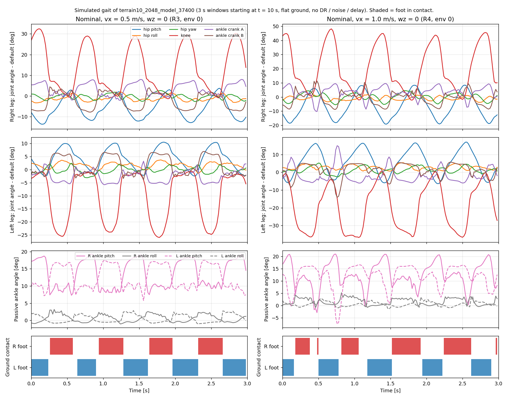
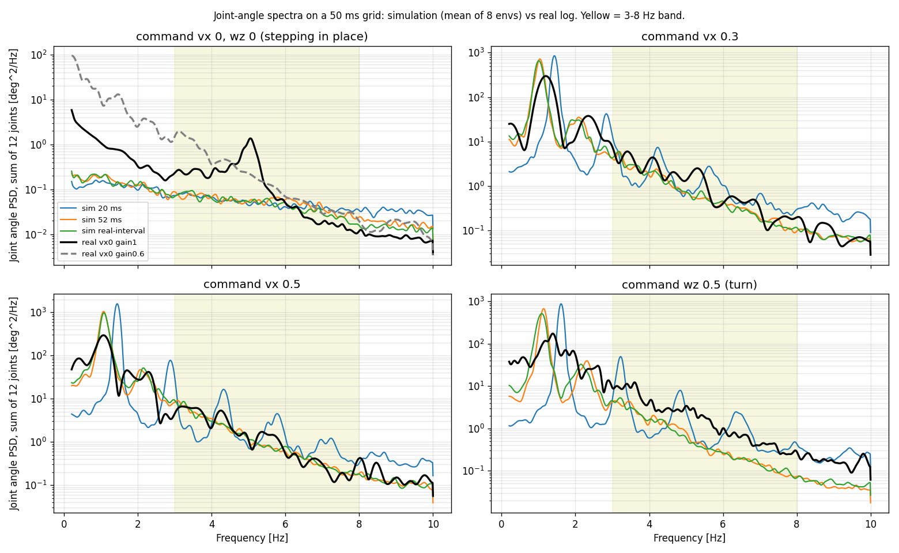
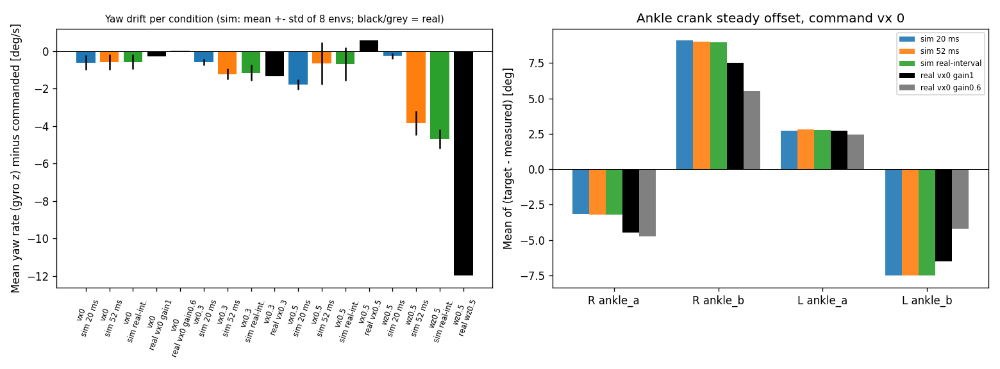

# 보행 policy 시뮬레이션 기준 데이터 (generalized_walk, 2026-10-22)

**목적**: 실기에서 도는 보행 policy 의 시뮬레이션 응답을 기록한다. 실기 기록과 같은 코드로 비교한다.
**Policy**: `terrain10_2048_model_37400.pt` (SHA-256 `7bbd5cbc…`). Task: `Pygmalion-Velocity-Generalized-Terrain10-2kResume19700`.
**환경**: 순정 mjlab `20f10e96` + 브랜치 `vibecoded-audit-20261012` (`ebeec10`) 의 패키지. CPU 로 돌렸다. Policy 는 결정적 평균 행동을 쓴다.
**모든 수치는 시뮬레이션 값이다.** 실기 값은 "real" 열에만 있다.

## 0. 결론 먼저

**(a) 시뮬레이션에서 5 Hz 성분이 보이는가?** 보이지 않는다.
- 실기 vx 0 기록은 5.1 Hz 선이 하나 뚜렷하다. 3–8 Hz 대역 전력은 1.06 deg² 이다.
- 시뮬레이션 vx 0 은 제자리에 **서 있다.** 두 발이 100 % 땅에 있다. 관절 진폭은 0.2–0.6° 이다. 3–8 Hz 전력은 0.25–0.27 deg² 이고 선이 없다 (20 ms, 52 ms, 실기 간격 모두 같다).
- 시뮬레이션 걷기 (vx 0.3, 0.5, wz 0.5) 에서 3 Hz 이상 최대 봉우리는 걸음 주파수의 3 배 조화파다. 20 ms 에서 3.9–4.3 Hz, 52 ms 에서 3.3–3.4 Hz 다 (약 3 배). 5 Hz 에 고정된 선이 아니다.
- 실기 걷기 기록의 3–8 Hz 최대 봉우리는 3.0–3.6 Hz 다. 시뮬레이션 52 ms 와 비슷하다.
- 호출 간격 (20 ms, 52 ms, 실기 간격) 을 바꿔도 5 Hz 선은 생기지 않는다. 실기의 5.1 Hz 는 이 시뮬레이션에 없는 원인이 만든다.

**(b) 52 ms 간격은 20 ms 와 무엇이 다른가?** (vx 0.5, 시뮬레이션 8 환경 평균)

| 항목 | 20 ms | 52 ms | 실기 간격 | 실기 로그 (vx 0.5) |
|---|---|---|---|---|
| 걸음 주파수 f_gait [Hz] | 1.43 | 1.07 | 1.08 | 0.80 (위상 평균 주기로는 1.35) |
| 발 닿기 횟수 (두 발 합) [Hz] | 2.98 | 2.36 | 2.30 | 측정 불가 (접촉 기록 없음) |
| 몸 앞쪽 속도 [m/s] (명령 0.5) | 0.374 | 0.308 | 0.296 | 기록 없음 |
| 행동 변화 RMS (호출당, 12 관절 평균) | 0.218 | 0.439 | 0.458 | 0.453 |
| 엉덩이 pitch 진폭 [deg] | 5.3 | 5.3 | 5.2 | 4.1 |
| 엉덩이 roll 진폭 [deg] | 1.4 | 2.4 | 2.6 | 2.0 |
| 무릎 진폭 R / L [deg] | 10.9 / 9.7 | 9.1 / 11.5 | 8.9 / 11.5 | 6.0 / 7.1 |

- 52 ms 는 걸음 주파수를 약 25 % 낮춘다. 행동 변화량을 두 배로 만든다. 실기 로그의 행동 변화량 (0.453) 과 맞는다.
- 52 ms 와 실기 간격 (평균 55 ms) 은 거의 같은 결과다. 간격의 들쭉날쭉함은 중요하지 않다. 평균 간격이 중요하다.
- vx 1.0 에서 52 ms 는 8 환경 중 2 개가 넘어진다 (R7). 20 ms 는 0 개다.

**(c) 시뮬레이션 yaw 드리프트** (몸 방향 yaw 의 기울기, 8 환경 평균 ± 환경 간 표준편차)
- 20 ms, vx 0.5: 시드 0, 1, 2 에서 −1.81 ± 0.26, −1.60 ± 0.20, −1.85 ± 0.25 deg/s. **시드와 환경에 관계없이 같은 부호와 크기다.** vx 1.0 (시드 0) 은 −2.56 ± 0.62 deg/s 다.
- 52 ms, vx 0.5: −0.21 ± 0.75, +0.26 ± 0.55, −0.47 ± 1.20 deg/s. 실기 간격: −0.54 ± 1.17, −0.26 ± 0.85, −0.62 ± 1.23 deg/s. **드리프트가 약해지고 부호가 환경마다 달라진다.** 간격에 의존한다.
- 52 ms, vx 1.0: +3.6 ± 2.4 deg/s (반대 부호). 7 환경만 유효하다.
- vx 0 (제자리): 간격과 무관하게 −0.7 ~ −0.8 deg/s (환경 간 편차 0.05–0.15). vx 0.3: −0.5 (20 ms), −1.2 (52 ms), −0.9 (실기 간격).
- 실기 gyro 적분: vx 0 −0.28, vx 0.3 −1.33, vx 0.5 +0.58 deg/s. 실기 걷기 기록은 3.7 s 와 5.0 s 뿐이다. 신뢰도가 낮다.
- wz 0.5 명령 (28.6 deg/s): 시뮬레이션은 20 ms 에서 명령을 따른다 (오차 −0.2 deg/s). 52 ms 는 −3.8, 실기 간격은 −4.7 deg/s 낮다. 실기는 −12.0 deg/s 낮다.

**(d) 발목 crank 의 (목표 − 측정) 평균** (vx 0, deg)

| 관절 | 시뮬레이션 (세 간격 모두 같음) | 실기 gain 1 | 실기 gain 0.6 |
|---|---|---|---|
| R ankle_a | −3.2 | −4.5 | −4.7 |
| R ankle_b | +9.1 | +7.5 | +5.5 |
| L ankle_a | +2.7 | +2.7 | +2.5 |
| L ankle_b | −7.5 | −6.5 | −4.2 |

- 시뮬레이션도 같은 부호와 비슷한 크기의 정상 오프셋을 가진다. 이 오프셋은 호출 간격과 무관하다. 정적 하중이 PD 오차를 만드는 것이다 (Kp 60 N·m/rad 에서 9° ≈ 9.4 N·m).
- 서 있을 때 평균 (측정 − 기준자세) 도 시뮬레이션과 실기가 비슷하다 (§3.1 표).
- 걸을 때는 실기 오프셋이 더 작다 (vx 0.5: ankle_b 실기 +1.3 / −2.4, 시뮬레이션 +7.8 / −7.4). 실기 vx 0.5 기록은 5 s 뿐이다.

## 1. 만든 것

| 파일 | 내용 |
|---|---|
| `tools/sim2real/walk/sim_walk_record.py` | 기록 도구. 환경을 만들고 npz + JSON 을 쓴다. |
| `tools/sim2real/walk/sim_walk_metrics.py` | 기준 수치와 걸음 그림. |
| `tools/sim2real/walk/sim_walk_export_csv.py` | 실기 로그와 같은 CSV 배치로 내보낸다 (81 열). |
| `tools/sim2real/walk/sim_vs_real_tables.py` | `real_walk_analyze.py` 로 시뮬레이션 CSV 와 실기 CSV 를 같은 코드로 분석한다. |
| `mujoco-sim/mjlab/analysis/out/s2r_walk/<run>.npz` / `.json` | 데이터와 설명 (모든 키, 단위, 관절 순서, 명령 일정, 시드, DR 설정). 작업 폴더 밖에 커밋하지 않았다 (349 MB). |
| `mujoco-sim/mjlab/analysis/out/s2r_walk/csv/<run>_env<k>.csv` | 실기 배치 CSV (환경 8 개 × 24 run). |
| `mujoco-sim/mjlab/analysis/out/s2r_walk/baseline_tables.md`, `baseline_metrics.json`, `sim_vs_real.md`, `sim_vs_real.json` | 모든 수치. |

기록한 양 (npz): 관측 44 차원 (network 에 넣은 그대로), 원시 행동, 처리된 관절 목표 (rad), 관절 q 와 qd (모터 12 + 수동 발목 pitch/roll 4), 모터별 적용 토크, 몸 위치·자세·yaw·속도 (월드, 몸), 투영 중력, 발 접촉 (개수, 힘), 발 위치. 200 Hz 물리 걸음마다 q, qd, 목표, 토크도 기록했다. 50 Hz 자료의 Nyquist 는 25 Hz 이다. 25 Hz 위는 200 Hz 자료로 본다. 관절 순서는 오른쪽 다리 먼저, 다리마다 hip_pitch, hip_roll, hip_yaw, knee, ankle_a (= crank A), ankle_b (= crank B) 이다.

### 1.1 Run 목록 (환경 8 개, 시드 0, 평지)

| Run | 명령 | 길이 | 호출 간격 | DR·잡음·지연 |
|---|---|---|---|---|
| R1 | vx 0.5 (0–5 s) → 1.0 (5–10 s) | 10 s | 20 ms | 모두 끔 (nominal) |
| R2 | R1 과 같음 | 10 s | 20 ms | 학습 때와 같이 켬 (push 만 끔) |
| R3, R4 | vx 0.5, vx 1.0 | 20 s | 20 ms | nominal |
| R9, R10 | vx 0.5, vx 1.0 | 20 s | 20 ms | 학습 조건 |
| R6, R7 | vx 0.5, vx 1.0 | 20 s | 52 ms 고정 | nominal + 간격 모형 (§1.2) |
| R8 | vx 0.5 | 20 s | 실기 간격 | 같음 |
| V0, V3, W5 `_20ms` / `_52ms` / `_real` | vx 0, vx 0.3, wz 0.5 | 20 s | 20 ms / 52 ms / 실기 | nominal (52 ms 와 실기는 간격 모형) |
| R3, R6, R8 의 `_s1`, `_s2` | vx 0.5 | 20 s | 20 / 52 / 실기 | 시드 1, 2 |

- R5 (HUPHY 설정 게인 시험) 는 하지 않았다. `config/robot_v1.0.yaml` 의 게인이 학습 게인과 같다 (hip 135/6, yaw 75/4, knee 130/6, crank 60/2.7).
- Terrain10 전체 혼합 지형은 돌리지 않았다. 10 m 조각은 5 m 걷고 끝난다. 대신 Terrain10 의 평지 조각과 같은 접촉 설정으로 60 × 60 m 한 장을 썼다.
- 시작: 기본 자세, 관절 ±0.05 rad, 몸 속도 ±0.2 m/s (학습 reset 과 같음). 시작 위치와 방향은 0 으로 고정했다.
- 학습 조건 (R2, R9, R10): 링크 관성 0.9–1.1, 몸통 무게중심 ±3 cm, Kp·Kd ×0.9–1.1, 모터 힘 ×0.8–1.2, 마찰·감쇠 ×0.8–1.2, 발 마찰 0.3–1.2, 엔코더 편향 ±0.01 rad, 관측 잡음, 관측 지연 0–1 걸음, 구동 지연 0–5 ms.

### 1.2 간격 모형 (R6–R8, V·W 의 52 ms 와 실기 간격)

`gw_jitter_sim.py` 의 방법을 따랐다.
- 환경 걸음을 5 ms 로 한다. Policy 는 예정 시각이 지나면 부른다. 5 ms 격자라서 52 ms 는 50 ms 와 55 ms 가 번갈아 나온다 (평균 52.0).
- 호출 사이에는 행동을 유지한다. 관측의 "이전 행동" 은 마지막 호출의 원시 출력이다.
- 명령이 모터에 닿는 데 5 ms 걸린다. Kp/Kd 는 12 비트 MIT 양자화를 거친다.
- 관절 각도는 호출 시각보다 10 ms 오래된 값이다 (`--obs-age-ms`, 가정). `q_prev` 는 이전 호출 때 본 각도다.
- 실기 간격은 `Expr_Data/vx0gain1walkob(진동확인용)1021.csv` 의 열 `t` 의 차이다 (중앙 53 ms, p5 42, p95 71, 최대 145 ms). 환경마다 무작위 시작점에서 원형으로 읽는다.
- 이 run 에는 잡음, DR, push 가 없다.

## 2. 기준 수치 (시뮬레이션)

정의: 앞쪽 속도 = 처음 방향으로의 이동 거리 / 창 길이. yaw 드리프트 = 풀어 쓴 yaw 의 기울기. 가로 드리프트 = 처음 방향에 수직인 이동 거리 (+ 왼쪽). 발 닿기 = 접촉 신호의 상승 (60 ms 이하 공중 틈은 이어 붙임). 걸음 길이 = 한 발이 닿는 순간 두 발 사이의 앞쪽 거리. 비대칭 = (R − L) / 평균 × 100 %. 창은 시작 후 2 s 를 뺀다. 열 이름의 ± 는 환경 8 개의 표준편차다.
`vx 0` 명령은 제자리에 서므로 걸음 길이와 비대칭은 의미가 없다 (0 으로 나누기).

### 2.1 모든 수치 표

#### Deployment profile (vx 0.5 for 5 s, then 1.0 for 5 s): nominal (R1) and training noise/DR/lag/delay (R2)

| metric | R1 vx0.5 | R1 vx1.0 | R2 vx0.5 | R2 vx1.0 |
|---|---|---|---|---|
| policy call interval mean / median [ms] | 20.0 / 20.0 | 20.0 / 20.0 | 20.0 / 20.0 | 20.0 / 20.0 |
| valid envs (of 8, no fall) | 8/8 | 8/8 | 8/8 | 8/8 |
| command vx [m/s] | 0.50 | 1.00 | 0.50 | 1.00 |
| forward speed [m/s] | 0.378 ± 0.008 | 0.776 ± 0.031 | 0.361 ± 0.030 | 0.788 ± 0.041 |
| body-frame vx, mean [m/s] | 0.380 ± 0.008 | 0.809 ± 0.011 | 0.362 ± 0.030 | 0.802 ± 0.040 |
| yaw drift [deg/s] | -1.872 ± 0.814 | -2.467 ± 1.238 | 0.003 ± 0.738 | -2.267 ± 1.537 |
| heading change over window [deg] | -5.6 ± 2.2 | -7.3 ± 3.6 | -0.0 ± 1.6 | -7.2 ± 4.9 |
| lateral drift over window [m] (+left) | -0.073 ± 0.064 | -0.594 ± 0.262 | 0.008 ± 0.085 | -0.276 ± 0.296 |
| step rate, both feet [Hz] | 2.98 ± 0.20 | 2.77 ± 0.15 | 2.85 ± 0.24 | 2.85 ± 0.24 |
| stance fraction R / L | 0.52 / 0.53 | 0.53 / 0.44 | 0.53 / 0.53 | 0.51 / 0.45 |
| double-support fraction | 0.07 ± 0.02 | 0.03 ± 0.01 | 0.07 ± 0.02 | 0.03 ± 0.01 |
| stance time R / L [s] | 0.339 / 0.367 | 0.359 / 0.319 | 0.370 / 0.374 | 0.346 / 0.312 |
| swing time R / L [s] | 0.314 / 0.320 | 0.327 / 0.399 | 0.327 / 0.321 | 0.343 / 0.367 |
| step length R / L [m] | 0.149 / 0.117 | 0.252 / 0.281 | 0.144 / 0.113 | 0.254 / 0.257 |
| step-length asymmetry [%] | +23.8 | -11.0 | +24.2 | -0.8 |
| stance-time asymmetry [%] | -8.1 | +12.0 | -1.1 | +10.5 |
| action RMS | 0.738 | 0.989 | 0.725 | 0.990 |
| action-rate RMS (per policy call) | 0.227 | 0.280 | 0.272 | 0.320 |
| base height [m] | 0.883 ± 0.001 | 0.880 ± 0.001 | 0.884 ± 0.002 | 0.879 ± 0.003 |

#### Steady walk, nominal, 20 ms policy step (R3 vx 0.5, R4 vx 1.0) and with training DR/noise/lag/delay (R9, R10)

| metric | R3 vx0.5 | R4 vx1.0 | R9 vx0.5 DR | R10 vx1.0 DR |
|---|---|---|---|---|
| policy call interval mean / median [ms] | 20.0 / 20.0 | 20.0 / 20.0 | 20.0 / 20.0 | 20.0 / 20.0 |
| valid envs (of 8, no fall) | 8/8 | 8/8 | 8/8 | 8/8 |
| command vx [m/s] | 0.50 | 1.00 | 0.50 | 1.00 |
| forward speed [m/s] | 0.353 ± 0.009 | 0.716 ± 0.044 | 0.354 ± 0.034 | 0.667 ± 0.096 |
| body-frame vx, mean [m/s] | 0.374 ± 0.006 | 0.815 ± 0.009 | 0.361 ± 0.026 | 0.788 ± 0.039 |
| yaw drift [deg/s] | -1.810 ± 0.261 | -2.563 ± 0.619 | -0.688 ± 1.033 | -2.390 ± 1.415 |
| heading change over window [deg] | -32.5 ± 4.0 | -46.4 ± 12.1 | -10.0 ± 15.4 | -45.9 ± 22.8 |
| lateral drift over window [m] (+left) | -1.889 ± 0.407 | -5.661 ± 1.473 | -0.427 ± 0.973 | -5.613 ± 2.913 |
| step rate, both feet [Hz] | 2.98 ± 0.07 | 2.98 ± 0.10 | 2.88 ± 0.13 | 2.75 ± 0.16 |
| stance fraction R / L | 0.52 / 0.52 | 0.50 / 0.45 | 0.53 / 0.53 | 0.51 / 0.45 |
| double-support fraction | 0.06 ± 0.01 | 0.03 ± 0.00 | 0.07 ± 0.01 | 0.03 ± 0.01 |
| stance time R / L [s] | 0.350 / 0.347 | 0.328 / 0.309 | 0.366 / 0.364 | 0.367 / 0.330 |
| swing time R / L [s] | 0.323 / 0.322 | 0.326 / 0.381 | 0.329 / 0.328 | 0.357 / 0.399 |
| step length R / L [m] | 0.147 / 0.110 | 0.233 / 0.270 | 0.140 / 0.112 | 0.263 / 0.276 |
| step-length asymmetry [%] | +29.0 | -14.7 | +22.9 | -4.7 |
| stance-time asymmetry [%] | +1.0 | +5.9 | +0.5 | +10.6 |
| action RMS | 0.737 | 0.996 | 0.728 | 0.990 |
| action-rate RMS (per policy call) | 0.226 | 0.279 | 0.275 | 0.319 |
| base height [m] | 0.884 ± 0.000 | 0.880 ± 0.000 | 0.883 ± 0.002 | 0.879 ± 0.002 |

#### Policy called every 52 ms (R6 vx 0.5, R7 vx 1.0) and with the real call intervals (R8 vx 0.5); nominal otherwise

| metric | R6 vx0.5 52ms | R7 vx1.0 52ms | R8 vx0.5 real |
|---|---|---|---|
| policy call interval mean / median [ms] | 52.0 / 50.0 | 52.0 / 50.0 | 55.4 / 55.0 |
| valid envs (of 8, no fall) | 8/8 | 7/8 | 8/8 |
| command vx [m/s] | 0.50 | 1.00 | 0.50 |
| forward speed [m/s] | 0.285 ± 0.048 | 0.483 ± 0.294 | 0.290 ± 0.008 |
| body-frame vx, mean [m/s] | 0.308 ± 0.014 | 0.830 ± 0.020 | 0.296 ± 0.008 |
| yaw drift [deg/s] | -0.207 ± 0.750 | 3.635 ± 2.367 | -0.544 ± 1.173 |
| heading change over window [deg] | -6.1 ± 14.2 | 73.0 ± 55.7 | -12.0 ± 19.5 |
| lateral drift over window [m] (+left) | -0.889 ± 1.828 | 7.968 ± 4.192 | -0.806 ± 0.735 |
| step rate, both feet [Hz] | 2.36 ± 0.09 | 2.38 ± 0.10 | 2.30 ± 0.07 |
| stance fraction R / L | 0.55 / 0.55 | 0.52 / 0.45 | 0.56 / 0.55 |
| double-support fraction | 0.12 ± 0.01 | 0.03 ± 0.00 | 0.13 ± 0.01 |
| stance time R / L [s] | 0.474 / 0.457 | 0.427 / 0.379 | 0.482 / 0.481 |
| swing time R / L [s] | 0.379 / 0.375 | 0.391 / 0.465 | 0.374 / 0.389 |
| step length R / L [m] | 0.158 / 0.100 | 0.324 / 0.310 | 0.153 / 0.095 |
| step-length asymmetry [%] | +44.8 | +4.5 | +46.7 |
| stance-time asymmetry [%] | +3.6 | +12.0 | +0.3 |
| action RMS | 0.779 | 1.131 | 0.776 |
| action-rate RMS (per policy call) | 0.442 | 0.674 | 0.462 |
| base height [m] | 0.885 ± 0.000 | 0.875 ± 0.002 | 0.885 ± 0.000 |

#### Command set for the real-log comparison, 20 ms / 52 ms / real intervals

| metric | V0 vx0 20ms | V0 vx0 52ms | V0 vx0 real | V3 vx0.3 20ms | V3 vx0.3 52ms | V3 vx0.3 real | W5 wz0.5 20ms | W5 wz0.5 52ms | W5 wz0.5 real |
|---|---|---|---|---|---|---|---|---|---|
| policy call interval mean / median [ms] | 20.0 / 20.0 | 52.0 / 50.0 | 55.4 / 55.0 | 20.0 / 20.0 | 52.0 / 50.0 | 55.4 / 55.0 | 20.0 / 20.0 | 52.0 / 50.0 | 55.4 / 55.0 |
| valid envs (of 8, no fall) | 8/8 | 8/8 | 8/8 | 8/8 | 8/8 | 8/8 | 8/8 | 8/8 | 8/8 |
| command vx [m/s] | 0.00 | 0.00 | 0.00 | 0.30 | 0.30 | 0.30 | 0.00 | 0.00 | 0.00 |
| forward speed [m/s] | -0.004 ± 0.000 | -0.004 ± 0.001 | -0.004 ± 0.000 | 0.186 ± 0.003 | 0.158 ± 0.003 | 0.151 ± 0.007 | 0.001 ± 0.003 | -0.003 ± 0.004 | -0.005 ± 0.005 |
| body-frame vx, mean [m/s] | -0.004 ± 0.000 | -0.004 ± 0.001 | -0.004 ± 0.000 | 0.188 ± 0.002 | 0.158 ± 0.005 | 0.151 ± 0.008 | -0.006 ± 0.003 | -0.003 ± 0.006 | -0.001 ± 0.006 |
| yaw drift [deg/s] | -0.785 ± 0.051 | -0.714 ± 0.146 | -0.707 ± 0.107 | -0.491 ± 0.124 | -1.222 ± 0.476 | -0.917 ± 0.733 | 28.690 ± 0.213 | 25.228 ± 0.559 | 24.483 ± 0.404 |
| heading change over window [deg] | -13.3 ± 2.1 | -12.4 ± 3.4 | -12.0 ± 2.6 | -9.1 ± 2.0 | -23.4 ± 7.0 | -19.0 ± 8.0 | 515.4 ± 3.4 | 452.5 ± 11.5 | 440.3 ± 8.1 |
| lateral drift over window [m] (+left) | -0.012 ± 0.012 | -0.009 ± 0.008 | -0.011 ± 0.013 | -0.480 ± 0.188 | -0.281 ± 0.270 | -0.233 ± 0.222 | 0.019 ± 0.036 | -0.012 ± 0.095 | 0.004 ± 0.078 |
| step rate, both feet [Hz] | 0.05 ± 0.03 | 0.10 ± 0.06 | 0.03 ± 0.03 | 2.91 ± 0.09 | 2.15 ± 0.06 | 2.11 ± 0.11 | 3.23 ± 0.03 | 2.29 ± 0.05 | 2.18 ± 0.08 |
| stance fraction R / L | 1.00 / 1.00 | 1.00 / 1.00 | 1.00 / 1.00 | 0.52 / 0.55 | 0.55 / 0.56 | 0.55 / 0.57 | 0.51 / 0.52 | 0.55 / 0.54 | 0.55 / 0.54 |
| double-support fraction | 1.00 ± 0.00 | 0.99 ± 0.00 | 1.00 ± 0.00 | 0.07 ± 0.01 | 0.12 ± 0.01 | 0.13 ± 0.01 | 0.04 ± 0.00 | 0.09 ± 0.01 | 0.10 ± 0.01 |
| stance time R / L [s] | 12.220 / nan | 9.470 / 6.670 | 9.180 / 9.380 | 0.355 / 0.375 | 0.504 / 0.535 | 0.529 / 0.529 | 0.317 / 0.319 | 0.479 / 0.471 | 0.503 / 0.500 |
| swing time R / L [s] | 0.087 / 0.080 | 0.080 / 0.083 | 0.080 / 0.080 | 0.334 / 0.309 | 0.419 / 0.409 | 0.433 / 0.400 | 0.300 / 0.298 | 0.396 / 0.399 | 0.411 / 0.415 |
| step length R / L [m] | -0.004 / 0.005 | -0.004 / 0.001 | -0.004 / 0.005 | 0.084 / 0.050 | 0.110 / 0.041 | 0.112 / 0.027 | 0.013 / -0.009 | -0.005 / 0.001 | -0.008 / 0.004 |
| step-length asymmetry [%] | -2641.7 | +412.6 | -1498.1 | +50.5 | +91.1 | +121.4 | +1158.5 | +285.1 | +564.9 |
| stance-time asymmetry [%] | +nan | +34.7 | -2.2 | -5.2 | -6.1 | -0.1 | -0.6 | +1.7 | +0.4 |
| action RMS | 0.255 | 0.261 | 0.260 | 0.629 | 0.664 | 0.667 | 0.601 | 0.601 | 0.602 |
| action-rate RMS (per policy call) | 0.046 | 0.090 | 0.088 | 0.195 | 0.358 | 0.373 | 0.187 | 0.322 | 0.336 |
| base height [m] | 0.890 ± 0.000 | 0.890 ± 0.000 | 0.890 ± 0.000 | 0.887 ± 0.000 | 0.887 ± 0.000 | 0.887 ± 0.000 | 0.889 ± 0.000 | 0.890 ± 0.000 | 0.890 ± 0.000 |

#### Seed repeats (seeds 1 and 2) of R3, R6, R8

| metric | R3 vx0.5_s1 | R6 vx0.5 52ms_s1 | R8 vx0.5 real_s1 | R3 vx0.5_s2 | R6 vx0.5 52ms_s2 | R8 vx0.5 real_s2 |
|---|---|---|---|---|---|---|
| policy call interval mean / median [ms] | 20.0 / 20.0 | 52.0 / 50.0 | 53.8 / 50.0 | 20.0 / 20.0 | 52.0 / 50.0 | 55.9 / 55.0 |
| valid envs (of 8, no fall) | 8/8 | 8/8 | 8/8 | 8/8 | 8/8 | 8/8 |
| command vx [m/s] | 0.50 | 0.50 | 0.50 | 0.50 | 0.50 | 0.50 |
| forward speed [m/s] | 0.355 ± 0.005 | 0.308 ± 0.008 | 0.297 ± 0.016 | 0.348 ± 0.005 | 0.300 ± 0.018 | 0.278 ± 0.039 |
| body-frame vx, mean [m/s] | 0.375 ± 0.003 | 0.307 ± 0.008 | 0.303 ± 0.009 | 0.374 ± 0.004 | 0.310 ± 0.010 | 0.298 ± 0.016 |
| yaw drift [deg/s] | -1.600 ± 0.200 | 0.262 ± 0.546 | -0.262 ± 0.852 | -1.848 ± 0.248 | -0.474 ± 1.198 | -0.623 ± 1.227 |
| heading change over window [deg] | -28.6 ± 3.3 | 0.1 ± 10.6 | -4.3 ± 12.0 | -32.2 ± 5.3 | -4.7 ± 20.7 | -12.7 ± 19.9 |
| lateral drift over window [m] (+left) | -1.905 ± 0.359 | 0.059 ± 0.540 | -0.403 ± 1.119 | -2.186 ± 0.247 | -0.123 ± 1.457 | -1.112 ± 1.503 |
| step rate, both feet [Hz] | 2.96 ± 0.08 | 2.37 ± 0.08 | 2.37 ± 0.06 | 2.93 ± 0.06 | 2.33 ± 0.07 | 2.31 ± 0.08 |
| stance fraction R / L | 0.52 / 0.53 | 0.56 / 0.55 | 0.56 / 0.54 | 0.52 / 0.52 | 0.55 / 0.55 | 0.58 / 0.54 |
| double-support fraction | 0.07 ± 0.01 | 0.13 ± 0.01 | 0.12 ± 0.01 | 0.06 ± 0.01 | 0.12 ± 0.02 | 0.13 ± 0.01 |
| stance time R / L [s] | 0.349 / 0.361 | 0.459 / 0.471 | 0.475 / 0.451 | 0.358 / 0.354 | 0.463 / 0.480 | 0.495 / 0.472 |
| swing time R / L [s] | 0.319 / 0.324 | 0.362 / 0.382 | 0.376 / 0.374 | 0.323 / 0.326 | 0.380 / 0.384 | 0.368 / 0.393 |
| step length R / L [m] | 0.148 / 0.112 | 0.155 / 0.095 | 0.162 / 0.084 | 0.148 / 0.115 | 0.157 / 0.107 | 0.156 / 0.095 |
| step-length asymmetry [%] | +27.8 | +48.5 | +63.1 | +25.6 | +37.8 | +49.0 |
| stance-time asymmetry [%] | -3.3 | -2.4 | +5.2 | +1.3 | -3.7 | +4.7 |
| action RMS | 0.738 | 0.775 | 0.774 | 0.740 | 0.779 | 0.772 |
| action-rate RMS (per policy call) | 0.227 | 0.442 | 0.448 | 0.229 | 0.440 | 0.457 |
| base height [m] | 0.883 ± 0.000 | 0.885 ± 0.000 | 0.885 ± 0.000 | 0.883 ± 0.000 | 0.885 ± 0.000 | 0.885 ± 0.000 |

#### Per-joint tables, steady nominal 20 ms (R3, R4)

RMS of (target - q) per joint [deg], 200 Hz rows (target = the position target the PD law used), mean over envs

| joint | R3 vx0.5 | R4 vx1.0 |
|---|---|---|
| R_hip_pitch_joint | 3.88 | 7.06 |
| R_hip_roll_joint | 9.47 | 10.03 |
| R_hip_yaw_joint | 4.58 | 6.27 |
| R_knee_joint | 7.54 | 10.30 |
| R_crank_A_joint | 6.47 | 10.08 |
| R_crank_B_joint | 11.74 | 13.84 |
| L_hip_pitch_joint | 3.55 | 6.85 |
| L_hip_roll_joint | 9.09 | 9.43 |
| L_hip_yaw_joint | 4.23 | 5.76 |
| L_knee_joint | 7.04 | 8.98 |
| L_crank_A_joint | 6.95 | 9.84 |
| L_crank_B_joint | 11.56 | 12.35 |

Joint-angle PSD peaks [Hz], 50 Hz rows (top 3 by power, separated by 0.4 Hz; resolution in JSON)

| joint | R3 vx0.5 | R4 vx1.0 |
|---|---|---|
| R_hip_pitch_joint | 1.44, 2.86, 4.27 | 1.42, 0.59, 4.15 |
| R_hip_roll_joint | 1.44, 2.88, 0.61 | 2.81, 1.39, 4.13 |
| R_hip_yaw_joint | 1.44, 2.88, 0.29 | 1.39, 2.81, 0.56 |
| R_knee_joint | 1.44, 2.86, 0.49 | 1.42, 2.81, 4.15 |
| R_crank_A_joint | 1.44, 2.88, 4.27 | 1.42, 2.81, 5.49 |
| R_crank_B_joint | 1.44, 2.88, 4.25 | 1.42, 2.81, 4.25 |
| L_hip_pitch_joint | 1.44, 2.88, 4.25 | 1.39, 2.81, 4.15 |
| L_hip_roll_joint | 1.44, 2.86, 0.85 | 2.81, 1.39, 0.95 |
| L_hip_yaw_joint | 2.88, 1.44, 0.59 | 1.42, 2.81, 0.56 |
| L_knee_joint | 1.44, 2.88, 4.30 | 1.42, 4.15, 0.68 |
| L_crank_A_joint | 1.44, 2.88, 4.35 | 1.42, 2.81, 4.15 |
| L_crank_B_joint | 1.44, 4.35, 2.88 | 1.39, 2.81, 4.15 |

Joint-angle PSD at 200 Hz: top 3 peaks [Hz] over 0.2-100 Hz / fraction of the angle variance above 25 Hz [%] / strongest peak in 25-100 Hz

| joint | R3 vx0.5 | R4 vx1.0 |
|---|---|---|
| R_hip_pitch_joint | 1.46, 2.83, 4.30 / 0.00 / 48.5 | 1.37, 0.59, 4.20 / 0.00 / 48.6 |
| R_hip_roll_joint | 1.46, 2.83, 0.59 / 0.08 / 26.1 | 2.83, 1.37, 4.10 / 0.09 / 25.5 |
| R_hip_yaw_joint | 1.46, 2.83, 0.78 / 0.02 / 25.5 | 1.37, 2.83, 0.59 / 0.01 / 25.5 |
| R_knee_joint | 1.46, 2.83, 0.49 / 0.00 / 25.4 | 1.37, 2.83, 4.20 / 0.00 / 25.2 |
| R_crank_A_joint | 1.46, 2.83, 4.30 / 0.12 / 26.9 | 1.37, 2.83, 5.47 / 0.17 / 25.6 |
| R_crank_B_joint | 1.46, 2.83, 4.30 / 0.11 / 26.0 | 1.37, 2.83, 4.20 / 0.12 / 26.0 |
| L_hip_pitch_joint | 1.46, 2.83, 4.30 / 0.00 / 48.5 | 1.37, 2.83, 4.10 / 0.00 / 48.6 |
| L_hip_roll_joint | 1.46, 2.83, 0.88 / 0.11 / 25.4 | 2.83, 1.37, 0.59 / 0.10 / 25.5 |
| L_hip_yaw_joint | 2.83, 1.46, 0.59 / 0.05 / 25.2 | 1.37, 2.83, 0.59 / 0.02 / 25.3 |
| L_knee_joint | 1.46, 2.83, 4.30 / 0.00 / 25.1 | 1.37, 4.10, 0.68 / 0.00 / 26.7 |
| L_crank_A_joint | 1.46, 2.93, 4.30 / 0.20 / 26.3 | 1.37, 2.83, 4.20 / 0.13 / 26.9 |
| L_crank_B_joint | 1.46, 4.30, 2.93 / 0.14 / 25.2 | 1.37, 2.83, 4.10 / 0.14 / 28.2 |

Applied torque per joint [N*m]: RMS / peak (200 Hz)

| joint | R3 vx0.5 | R4 vx1.0 |
|---|---|---|
| R_hip_pitch_joint | 5.3 / 20.1 | 11.1 / 48.2 |
| R_hip_roll_joint | 21.8 / 78.7 | 23.2 / 79.9 |
| R_hip_yaw_joint | 5.5 / 21.8 | 7.6 / 27.7 |
| R_knee_joint | 8.2 / 40.3 | 13.2 / 49.5 |
| R_crank_A_joint | 6.2 / 27.2 | 9.3 / 37.3 |
| R_crank_B_joint | 12.3 / 40.9 | 13.6 / 49.7 |
| L_hip_pitch_joint | 5.3 / 19.1 | 11.1 / 54.8 |
| L_hip_roll_joint | 21.1 / 61.1 | 22.0 / 71.3 |
| L_hip_yaw_joint | 5.1 / 17.7 | 6.5 / 24.5 |
| L_knee_joint | 8.0 / 43.1 | 11.4 / 56.0 |
| L_crank_A_joint | 6.9 / 31.3 | 8.8 / 38.9 |
| L_crank_B_joint | 12.1 / 37.9 | 12.1 / 48.1 |


그림 1. Nominal 걸음. 위쪽 두 줄: 다리별 관절각 − 기본 자세. 셋째 줄: 수동 발목 pitch/roll. 아래: 발 접촉 (색칠 = 닿음). 환경 0, t = 10–13 s.


## 3. 실기 대 시뮬레이션

같은 코드 (`real_walk_analyze.py`) 로 시뮬레이션 CSV (환경 8 개 각각) 와 실기 로그를 분석했다. 시뮬레이션 열은 8 환경 평균 ± 표준편차다. 실기 열은 로그 하나다.
실기 로그: vx 0 gain 1 = `vx0gain1walkob(진동확인용)1021.csv` (209 s), vx 0 gain 0.6 = `1021vx0obgain0.61.csv` (68 s), vx 0.3 = `1021vx0.3ob.csv` (3.7 s), vx 0.5 = `1021vx0.5ob.csv` (5.0 s), wz 0.5 = `1021vz0.5ob.csv` (36 s). 시뮬레이션은 모두 20 s 다.
3–8 Hz 대역은 같은 방법으로 계산했다: 12 모터의 pos [deg] 를 50 ms 격자로 보간하고 (Nyquist 10 Hz), Welch (Hann, 200 점, 50 % 겹침, 직선 추세 제거) 로 PSD 를 구해 12 관절을 더하고 3–8 Hz 를 적분했다. "true 200 Hz" 줄은 시뮬레이션의 실제 200 Hz 관절각으로 같은 대역을 본 값이다 (호출 간격의 제한이 없다).
"heading 변화" 는 gyro z 적분이다 (실기와 같은 방법). 절대 방향이 아니다.
관절 표의 칸: 진폭 (pos 의 표준편차, deg) / (tgt − pos) 의 RMS (deg) / (tgt − pos) 의 평균 (deg).



그림 2. 관절각 PSD (12 관절 합). 노란 띠 = 3–8 Hz. 실기 vx 0 (검은 선) 에만 5.1 Hz 선이 있다.



그림 3. 왼쪽: (평균 yaw 율 − 명령 yaw 율). 오른쪽: vx 0 에서 발목 crank 의 (목표 − 측정) 평균.

### 3.1 command vx 0, wz 0 (stepping in place)

| metric | sim 20 ms | sim 52 ms | sim real-interval | real vx0 gain1 | real vx0 gain0.6 |
|---|---|---|---|---|---|
| policy interval median / p95 [ms] | 20.0 / 20.0 | 50.0 / 55.0 | 54.4 / 71.2 | 53.0 / 71.0 | 54.7 / 70.1 |
| gait frequency f_gait [Hz] | 0.70 ± 0.32 | 0.62 ± 0.35 | 0.53 ± 0.17 | 5.10 | 0.36 |
| stride period, phase average [s] | 1.145 ± 0.370 | 1.209 ± 0.497 | 1.049 ± 0.310 | 0.652 | 2.032 |
| dominant frequency of summed joint PSD [Hz] | 1.2 ± 0.4 | 0.9 ± 0.4 | 0.9 ± 0.5 | 5.1 | 0.6 |
| strongest peak above 3 Hz [Hz] | 4.2 ± 0.6 | 3.8 ± 0.6 | 3.9 ± 0.6 | 5.1 | 3.1 |
| 3-8 Hz peak of summed PSD [Hz] | 3.7 ± 0.7 | 3.6 ± 0.3 | 4.1 ± 0.8 | 5.0 | 3.1 |
| 3-8 Hz band power, sum of 12 joints [deg^2] | 0.255 ± 0.028 | 0.266 ± 0.044 | 0.245 ± 0.037 | 1.063 | 1.767 |
| 3-8 Hz share of joint variance (0.2-10 Hz) | 0.397 ± 0.022 | 0.384 ± 0.025 | 0.366 ± 0.019 | 0.278 | 0.043 |
| sim only: 3-8 Hz share, true 200 Hz angle (0.2-25 Hz) | 0.349 ± 0.028 | 0.437 ± 0.027 | 0.418 ± 0.036 | n/a | n/a |
| action step RMS (mean of 12 joints, per call) | 0.044 ± 0.002 | 0.094 ± 0.006 | 0.093 ± 0.008 | 0.157 | 0.197 |
| heading change over the log [deg] (gyro integral) | -12.0 ± 7.9 | -11.6 ± 8.2 | -11.4 ± 8.0 | -57.7 | 2.4 |
| mean yaw rate [deg/s] | -0.60 ± 0.39 | -0.58 ± 0.41 | -0.57 ± 0.40 | -0.28 | 0.03 |
| mean yaw rate minus commanded [deg/s] | -0.60 ± 0.39 | -0.58 ± 0.41 | -0.57 ± 0.40 | -0.28 | 0.03 |
| log length [s] | 20.0 ± 0.0 | 20.0 ± 0.0 | 20.0 ± 0.0 | 209.2 | 67.6 |

Per joint: amplitude (std of pos, deg) / RMS of (tgt - pos) (deg) / mean of (tgt - pos) (deg)

| joint | sim 20 ms | sim 52 ms | sim real-interval | real vx0 gain1 | real vx0 gain0.6 |
|---|---|---|---|---|---|
| right_leg/hip_pitch | 0.2 / 0.5 / +0.2 | 0.2 / 0.7 / +0.2 | 0.2 / 0.7 / +0.2 | 0.8 / 2.3 / +0.1 | 3.9 / 4.3 / +0.3 |
| right_leg/hip_roll | 0.4 / 0.9 / +0.1 | 0.4 / 1.1 / +0.1 | 0.4 / 1.1 / +0.1 | 0.6 / 2.0 / +1.3 | 1.7 / 5.3 / +3.9 |
| right_leg/hip_yaw | 0.2 / 0.5 / -0.0 | 0.2 / 0.7 / -0.0 | 0.3 / 0.7 / -0.0 | 0.6 / 1.6 / +0.1 | 1.7 / 3.2 / +1.8 |
| right_leg/knee | 0.3 / 0.4 / -0.0 | 0.3 / 1.0 / -0.0 | 0.3 / 1.0 / -0.0 | 0.9 / 2.7 / -0.2 | 5.7 / 4.7 / -0.6 |
| right_leg/ankle_a | 0.5 / 3.4 / -3.2 | 0.6 / 3.7 / -3.2 | 0.6 / 3.7 / -3.2 | 0.9 / 5.3 / -4.5 | 1.7 / 6.7 / -4.7 |
| right_leg/ankle_b | 0.6 / 9.1 / +9.1 | 0.7 / 9.1 / +9.0 | 0.7 / 9.1 / +9.0 | 0.8 / 7.9 / +7.5 | 2.4 / 7.5 / +5.5 |
| left_leg/hip_pitch | 0.3 / 0.5 / +0.2 | 0.3 / 0.5 / +0.2 | 0.3 / 0.6 / +0.2 | 0.9 / 2.3 / +0.2 | 2.8 / 4.1 / +0.4 |
| left_leg/hip_roll | 0.4 / 0.8 / +0.0 | 0.4 / 1.0 / -0.0 | 0.4 / 1.0 / -0.0 | 0.9 / 1.8 / -0.5 | 1.5 / 5.3 / -3.1 |
| left_leg/hip_yaw | 0.2 / 0.4 / -0.0 | 0.3 / 0.7 / -0.0 | 0.3 / 0.8 / -0.0 | 0.7 / 1.6 / +0.0 | 1.8 / 3.2 / -1.5 |
| left_leg/knee | 0.2 / 0.7 / +0.6 | 0.3 / 0.9 / +0.6 | 0.3 / 0.9 / +0.6 | 1.0 / 2.0 / +0.5 | 3.6 / 5.1 / +1.7 |
| left_leg/ankle_a | 0.5 / 3.0 / +2.7 | 0.6 / 3.3 / +2.8 | 0.6 / 3.3 / +2.8 | 1.3 / 3.9 / +2.7 | 2.3 / 5.3 / +2.5 |
| left_leg/ankle_b | 0.5 / 7.5 / -7.5 | 0.6 / 7.6 / -7.5 | 0.6 / 7.6 / -7.5 | 0.9 / 6.9 / -6.5 | 2.0 / 6.4 / -4.2 |

Mean of (pos - default pose) per joint [deg], standing command

| joint | sim 20 ms | sim 52 ms | sim real-interval | real vx0 gain1 | real vx0 gain0.6 |
|---|---|---|---|---|---|
| right_leg/hip_pitch | +0.0 | -0.0 | -0.0 | +0.2 | +0.3 |
| right_leg/hip_roll | +2.1 | +2.0 | +2.0 | +0.7 | -0.3 |
| right_leg/hip_yaw | +0.4 | +0.4 | +0.4 | +0.2 | -0.8 |
| right_leg/knee | -0.2 | -0.2 | -0.2 | +0.3 | +1.6 |
| right_leg/ankle_a | -2.1 | -2.1 | -2.1 | -1.9 | -0.6 |
| right_leg/ankle_b | -1.0 | -0.9 | -0.9 | +1.1 | +2.1 |
| left_leg/hip_pitch | +0.6 | +0.6 | +0.6 | +0.1 | -0.2 |
| left_leg/hip_roll | -1.6 | -1.6 | -1.6 | -1.7 | -0.5 |
| left_leg/hip_yaw | -1.3 | -1.3 | -1.3 | -1.3 | -0.3 |
| left_leg/knee | -0.5 | -0.5 | -0.5 | -0.4 | -0.9 |
| left_leg/ankle_a | +1.2 | +1.2 | +1.2 | +2.1 | +1.3 |
| left_leg/ankle_b | +1.1 | +1.0 | +1.0 | -0.9 | -1.9 |

### 3.2 command vx 0.3

| metric | sim 20 ms | sim 52 ms | sim real-interval | real vx0.3 |
|---|---|---|---|---|
| policy interval median / p95 [ms] | 20.0 / 20.0 | 50.0 / 55.0 | 54.4 / 71.2 | 54.8 / 68.3 |
| gait frequency f_gait [Hz] | 1.44 ± 0.03 | 1.02 ± 0.04 | 1.00 ± 0.03 | 1.05 |
| stride period, phase average [s] | 0.695 ± 0.015 | 0.946 ± 0.016 | 0.974 ± 0.044 | nan |
| dominant frequency of summed joint PSD [Hz] | 1.4 ± 0.1 | 1.0 ± 0.0 | 1.0 ± 0.1 | nan |
| strongest peak above 3 Hz [Hz] | 4.2 ± 0.1 | 3.3 ± 0.2 | 3.4 ± 0.3 | nan |
| 3-8 Hz peak of summed PSD [Hz] | 3.5 ± 0.6 | 3.2 ± 0.1 | 3.2 ± 0.1 | 3.0 |
| 3-8 Hz band power, sum of 12 joints [deg^2] | 7.840 ± 1.298 | 5.470 ± 0.293 | 5.540 ± 0.526 | 8.138 |
| 3-8 Hz share of joint variance (0.2-10 Hz) | 0.042 ± 0.008 | 0.026 ± 0.002 | 0.026 ± 0.003 | 0.046 |
| sim only: 3-8 Hz share, true 200 Hz angle (0.2-25 Hz) | 0.048 ± 0.013 | 0.037 ± 0.002 | 0.040 ± 0.004 | n/a |
| action step RMS (mean of 12 joints, per call) | 0.186 ± 0.004 | 0.348 ± 0.008 | 0.365 ± 0.014 | 0.480 |
| heading change over the log [deg] (gyro integral) | -11.9 ± 3.4 | -24.4 ± 5.8 | -22.9 ± 8.5 | -4.9 |
| mean yaw rate [deg/s] | -0.60 ± 0.17 | -1.22 ± 0.29 | -1.15 ± 0.42 | -1.33 |
| mean yaw rate minus commanded [deg/s] | -0.60 ± 0.17 | -1.22 ± 0.29 | -1.15 ± 0.42 | -1.33 |
| log length [s] | 20.0 ± 0.0 | 20.0 ± 0.0 | 20.0 ± 0.0 | 3.7 |

Per joint: amplitude (std of pos, deg) / RMS of (tgt - pos) (deg) / mean of (tgt - pos) (deg)

| joint | sim 20 ms | sim 52 ms | sim real-interval | real vx0.3 |
|---|---|---|---|---|
| right_leg/hip_pitch | 3.7 / 2.6 / -0.3 | 3.7 / 2.9 / -0.5 | 3.7 / 3.0 / -0.5 | 6.3 / 6.1 / -0.6 |
| right_leg/hip_roll | 1.1 / 9.0 / +5.9 | 1.9 / 10.1 / +5.6 | 2.1 / 10.3 / +5.6 | 2.4 / 9.8 / +5.2 |
| right_leg/hip_yaw | 0.6 / 3.9 / +2.6 | 1.2 / 4.1 / +2.2 | 1.4 / 4.3 / +2.2 | 2.2 / 6.3 / +2.3 |
| right_leg/knee | 8.0 / 6.8 / -0.6 | 7.4 / 7.1 / -0.5 | 7.4 / 7.2 / -0.5 | 5.3 / 7.7 / -1.3 |
| right_leg/ankle_a | 2.9 / 5.1 / -2.8 | 3.2 / 6.9 / -3.5 | 3.4 / 7.0 / -3.5 | 3.4 / 7.2 / -2.6 |
| right_leg/ankle_b | 4.0 / 9.9 / +6.5 | 3.8 / 11.1 / +7.3 | 3.8 / 11.1 / +7.2 | 4.7 / 9.3 / +4.1 |
| left_leg/hip_pitch | 3.0 / 2.5 / -0.4 | 3.7 / 2.9 / -0.5 | 3.7 / 3.0 / -0.5 | 3.5 / 5.8 / -0.1 |
| left_leg/hip_roll | 1.1 / 9.2 / -6.3 | 1.7 / 10.0 / -5.7 | 1.8 / 10.2 / -5.8 | 2.4 / 10.3 / -4.9 |
| left_leg/hip_yaw | 0.7 / 3.7 / -2.6 | 1.1 / 4.3 / -2.3 | 1.2 / 4.6 / -2.3 | 1.9 / 4.8 / -2.1 |
| left_leg/knee | 7.3 / 6.2 / +0.2 | 9.2 / 7.9 / -0.2 | 9.2 / 8.1 / -0.2 | 7.4 / 10.8 / +1.1 |
| left_leg/ankle_a | 2.2 / 4.8 / +2.6 | 2.3 / 6.9 / +3.7 | 2.3 / 7.3 / +4.0 | 2.7 / 6.5 / +2.6 |
| left_leg/ankle_b | 3.9 / 10.8 / -7.5 | 3.8 / 10.6 / -6.7 | 3.9 / 10.5 / -6.6 | 4.5 / 7.2 / -3.8 |

### 3.3 command vx 0.5

| metric | sim 20 ms | sim 52 ms | sim real-interval | real vx0.5 |
|---|---|---|---|---|
| policy interval median / p95 [ms] | 20.0 / 20.0 | 50.0 / 55.0 | 54.4 / 71.2 | 55.9 / 65.9 |
| gait frequency f_gait [Hz] | 1.43 ± 0.03 | 1.07 ± 0.03 | 1.08 ± 0.07 | 0.80 |
| stride period, phase average [s] | 0.694 ± 0.007 | 0.909 ± 0.019 | 0.914 ± 0.030 | 0.741 |
| dominant frequency of summed joint PSD [Hz] | 1.4 ± 0.1 | 1.1 ± 0.0 | 1.1 ± 0.1 | nan |
| strongest peak above 3 Hz [Hz] | 4.3 ± 0.1 | 3.4 ± 0.2 | 3.4 ± 0.2 | nan |
| 3-8 Hz peak of summed PSD [Hz] | 3.5 ± 0.6 | 3.2 ± 0.1 | 3.1 ± 0.1 | 3.2 |
| 3-8 Hz band power, sum of 12 joints [deg^2] | 12.071 ± 0.914 | 8.969 ± 0.520 | 8.966 ± 0.467 | 9.841 |
| 3-8 Hz share of joint variance (0.2-10 Hz) | 0.039 ± 0.003 | 0.028 ± 0.002 | 0.029 ± 0.002 | 0.048 |
| sim only: 3-8 Hz share, true 200 Hz angle (0.2-25 Hz) | 0.041 ± 0.006 | 0.040 ± 0.002 | 0.043 ± 0.004 | n/a |
| action step RMS (mean of 12 joints, per call) | 0.218 ± 0.002 | 0.439 ± 0.018 | 0.458 ± 0.024 | 0.453 |
| heading change over the log [deg] (gyro integral) | -35.7 ± 5.7 | -12.8 ± 22.5 | -13.5 ± 17.9 | 2.9 |
| mean yaw rate [deg/s] | -1.78 ± 0.28 | -0.64 ± 1.13 | -0.68 ± 0.89 | 0.58 |
| mean yaw rate minus commanded [deg/s] | -1.78 ± 0.28 | -0.64 ± 1.13 | -0.68 ± 0.89 | 0.58 |
| log length [s] | 20.0 ± 0.0 | 20.0 ± 0.0 | 20.0 ± 0.0 | 5.0 |

Per joint: amplitude (std of pos, deg) / RMS of (tgt - pos) (deg) / mean of (tgt - pos) (deg)

| joint | sim 20 ms | sim 52 ms | sim real-interval | real vx0.5 |
|---|---|---|---|---|
| right_leg/hip_pitch | 5.3 / 4.2 / -0.3 | 5.3 / 5.2 / -0.3 | 5.2 / 5.2 / -0.4 | 4.1 / 6.2 / -0.2 |
| right_leg/hip_roll | 1.4 / 9.5 / +6.0 | 2.4 / 11.3 / +5.5 | 2.6 / 11.8 / +5.5 | 2.0 / 10.6 / +5.8 |
| right_leg/hip_yaw | 1.5 / 4.6 / +2.8 | 2.0 / 5.0 / +2.4 | 2.1 / 5.5 / +2.5 | 3.0 / 6.3 / +3.3 |
| right_leg/knee | 10.9 / 8.3 / -0.5 | 9.1 / 8.4 / -0.3 | 8.9 / 8.3 / -0.4 | 6.0 / 8.3 / -2.5 |
| right_leg/ankle_a | 3.1 / 6.7 / -3.6 | 3.9 / 8.3 / -4.0 | 4.0 / 8.0 / -3.6 | 2.6 / 6.9 / -1.6 |
| right_leg/ankle_b | 4.0 / 11.8 / +7.8 | 4.2 / 13.8 / +8.6 | 4.3 / 13.4 / +8.1 | 4.8 / 7.1 / +1.3 |
| left_leg/hip_pitch | 4.3 / 3.8 / -0.4 | 5.1 / 5.0 / -0.3 | 5.1 / 5.2 / -0.4 | 4.5 / 5.4 / +0.5 |
| left_leg/hip_roll | 1.2 / 9.1 / -5.9 | 2.0 / 10.9 / -5.4 | 2.2 / 11.4 / -5.5 | 2.0 / 8.3 / -4.0 |
| left_leg/hip_yaw | 1.2 / 4.3 / -2.7 | 1.8 / 5.1 / -2.3 | 2.0 / 5.4 / -2.3 | 1.9 / 5.2 / -2.3 |
| left_leg/knee | 9.7 / 7.8 / -0.1 | 11.5 / 9.7 / -0.2 | 11.5 / 9.8 / -0.3 | 7.1 / 9.0 / +1.0 |
| left_leg/ankle_a | 2.3 / 7.1 / +3.7 | 3.1 / 8.6 / +4.2 | 3.2 / 8.9 / +4.3 | 2.8 / 5.0 / -0.2 |
| left_leg/ankle_b | 3.6 / 11.6 / -7.4 | 4.0 / 10.9 / -6.6 | 4.0 / 11.0 / -6.7 | 4.3 / 6.4 / -2.4 |

### 3.4 command wz 0.5 (turn)

| metric | sim 20 ms | sim 52 ms | sim real-interval | real wz0.5 |
|---|---|---|---|---|
| policy interval median / p95 [ms] | 20.0 / 20.0 | 50.0 / 55.0 | 54.4 / 71.2 | 50.0 / 62.0 |
| gait frequency f_gait [Hz] | 1.61 ± 0.01 | 1.15 ± 0.03 | 1.09 ± 0.09 | 1.32 |
| stride period, phase average [s] | 0.619 ± 0.003 | 0.875 ± 0.023 | 0.902 ± 0.055 | 0.731 |
| dominant frequency of summed joint PSD [Hz] | 1.6 ± 0.0 | 1.1 ± 0.0 | 1.1 ± 0.1 | 1.4 |
| strongest peak above 3 Hz [Hz] | 3.9 ± 0.7 | 3.4 ± 0.1 | 3.3 ± 0.1 | 3.1 |
| 3-8 Hz peak of summed PSD [Hz] | 3.2 ± 0.0 | 3.3 ± 0.2 | 3.2 ± 0.1 | 3.6 |
| 3-8 Hz band power, sum of 12 joints [deg^2] | 15.966 ± 0.380 | 5.130 ± 0.253 | 4.943 ± 0.267 | 14.027 |
| 3-8 Hz share of joint variance (0.2-10 Hz) | 0.096 ± 0.002 | 0.030 ± 0.001 | 0.028 ± 0.001 | 0.088 |
| sim only: 3-8 Hz share, true 200 Hz angle (0.2-25 Hz) | 0.098 ± 0.002 | 0.041 ± 0.002 | 0.040 ± 0.003 | n/a |
| action step RMS (mean of 12 joints, per call) | 0.178 ± 0.001 | 0.313 ± 0.003 | 0.324 ± 0.010 | 0.487 |
| heading change over the log [deg] (gyro integral) | 567.5 ± 3.1 | 495.6 ± 13.2 | 478.3 ± 10.2 | 597.1 |
| mean yaw rate [deg/s] | 28.40 ± 0.15 | 24.82 ± 0.66 | 23.96 ± 0.52 | 16.66 |
| mean yaw rate minus commanded [deg/s] | -0.24 ± 0.15 | -3.83 ± 0.66 | -4.69 ± 0.52 | -11.99 |
| log length [s] | 20.0 ± 0.0 | 20.0 ± 0.0 | 20.0 ± 0.0 | 35.8 |

Per joint: amplitude (std of pos, deg) / RMS of (tgt - pos) (deg) / mean of (tgt - pos) (deg)

| joint | sim 20 ms | sim 52 ms | sim real-interval | real wz0.5 |
|---|---|---|---|---|
| right_leg/hip_pitch | 2.7 / 2.3 / -0.2 | 2.4 / 2.8 / +0.4 | 2.4 / 2.9 / +0.4 | 3.3 / 5.2 / +0.3 |
| right_leg/hip_roll | 1.4 / 9.3 / +5.8 | 2.1 / 10.5 / +5.7 | 2.2 / 10.5 / +5.6 | 2.5 / 9.4 / +4.5 |
| right_leg/hip_yaw | 2.6 / 2.7 / +2.3 | 3.2 / 3.8 / +2.5 | 3.3 / 3.9 / +2.5 | 3.6 / 6.3 / +1.7 |
| right_leg/knee | 6.3 / 6.8 / -0.9 | 6.6 / 6.9 / -0.5 | 6.8 / 6.8 / -0.5 | 6.8 / 8.7 / -0.2 |
| right_leg/ankle_a | 2.7 / 4.7 / -2.3 | 2.7 / 5.2 / -2.4 | 2.7 / 5.3 / -2.4 | 2.6 / 6.5 / -2.8 |
| right_leg/ankle_b | 3.7 / 8.9 / +5.8 | 3.9 / 8.7 / +5.7 | 4.1 / 8.2 / +5.1 | 4.6 / 8.5 / +3.7 |
| left_leg/hip_pitch | 3.2 / 1.5 / -0.2 | 3.1 / 2.2 / +0.4 | 3.2 / 2.3 / +0.5 | 3.0 / 5.0 / +0.2 |
| left_leg/hip_roll | 0.5 / 8.5 / -5.9 | 1.0 / 9.1 / -5.5 | 1.2 / 9.2 / -5.5 | 1.7 / 8.9 / -5.5 |
| left_leg/hip_yaw | 2.2 / 5.1 / -2.3 | 3.1 / 6.6 / -2.3 | 3.3 / 6.7 / -2.3 | 2.9 / 6.5 / -2.4 |
| left_leg/knee | 7.4 / 7.3 / +0.6 | 7.3 / 7.4 / +0.7 | 7.2 / 7.3 / +0.7 | 5.5 / 9.1 / +1.3 |
| left_leg/ankle_a | 2.7 / 3.1 / +0.8 | 2.8 / 4.3 / +1.6 | 2.7 / 4.7 / +2.0 | 2.8 / 7.8 / +3.8 |
| left_leg/ankle_b | 3.7 / 8.5 / -5.5 | 3.8 / 8.3 / -4.8 | 4.0 / 8.4 / -4.9 | 4.1 / 9.6 / -4.7 |

## 4. 한계와 미해결

- 시뮬레이션 vx 0 은 서 있다. 실기 기록의 5.1 Hz 선과 0.6–1.3° 진동은 이 시뮬레이션에서 재현되지 않았다. 잡음 (IMU, 엔코더), 모터 속도 측정, 발에 걸리는 하중은 간격 모형 run 에 넣지 않았다. 다른 보고서 (`2026-10-21_generalized_walk_jitter_analysis.md`) 가 잡음 ×3 과 매달림을 따로 시험했다.
- 간격 모형의 관측 각도 나이 10 ms 는 가정이다. 5 ms 격자 때문에 52 ms 는 50/55 ms 로 번갈아 나온다 (실기 중앙값 53 ms).
- 실기 걷기 기록은 짧다 (vx 0.3: 3.7 s, vx 0.5: 5.0 s). 그 기록의 yaw 드리프트와 발목 오프셋은 통계로 쓰기 어렵다.
- 시드 반복은 vx 0.5 (R3, R6, R8) 에만 했다. vx 1.0 의 52 ms 결과 (R7) 는 시드 0 하나다.
- yaw 는 gyro 적분이다. 실기와 시뮬레이션 모두 절대 방향이 아니다. 시뮬레이션 §2 표의 yaw 는 실제 yaw 다.
- 실기에는 발 접촉 기록이 없다. 걸음 주파수는 관절각에서 구한 `f_gait` 로만 비교할 수 있다.
- npz (349 MB) 와 CSV (86 MB) 는 커밋하지 않았다. 다시 만들려면 §5 를 따른다.

## 5. 재현

```bash
# 작업 사본 (순정 mjlab 과 브랜치). 다른 세션의 사본은 건드리지 않는다.
git worktree add --detach <dir>/gw_branch ebeec10
git -C mujoco-sim/mjlab worktree add --detach <dir>/stock_mjlab 20f10e96
export CUDA_VISIBLE_DEVICES="" MUJOCO_GL=egl
PY=mujoco-sim/mjlab/.venv/bin/python3
nice -n 10 $PY tools/sim2real/walk/sim_walk_record.py --branch-root <dir>/gw_branch/vibecoded-audit-20261012 \
   --mjlab-src <dir>/stock_mjlab/src --runs R1,R2,R3,R4,R6,R7,R8,V0_20ms,V0_52ms,V0_real --seed 0 \
   --real-timing-csv "Expr_Data/vx0gain1walkob(진동확인용)1021.csv" --out mujoco-sim/mjlab/analysis/out/s2r_walk
# 시드 반복: --seed 1 --tag _s1
$PY tools/sim2real/walk/sim_walk_metrics.py --data mujoco-sim/mjlab/analysis/out/s2r_walk --fig docs/mujoco/assets/2026-10-22_sim_walk_reference.png
$PY tools/sim2real/walk/sim_walk_export_csv.py --data mujoco-sim/mjlab/analysis/out/s2r_walk
$PY tools/sim2real/walk/sim_vs_real_tables.py --csv mujoco-sim/mjlab/analysis/out/s2r_walk/csv --npz mujoco-sim/mjlab/analysis/out/s2r_walk \
   --real Expr_Data --out mujoco-sim/mjlab/analysis/out/s2r_walk/sim_vs_real --fig-prefix docs/mujoco/assets/2026-10-22_sim_walk_
```
순정 mjlab 소스를 앞에 두고 (`sys.path`), 포크 venv 는 torch, mujoco-warp, rsl-rl 만 준다. GPU 없이 run 당 약 1–7 분 걸린다.
