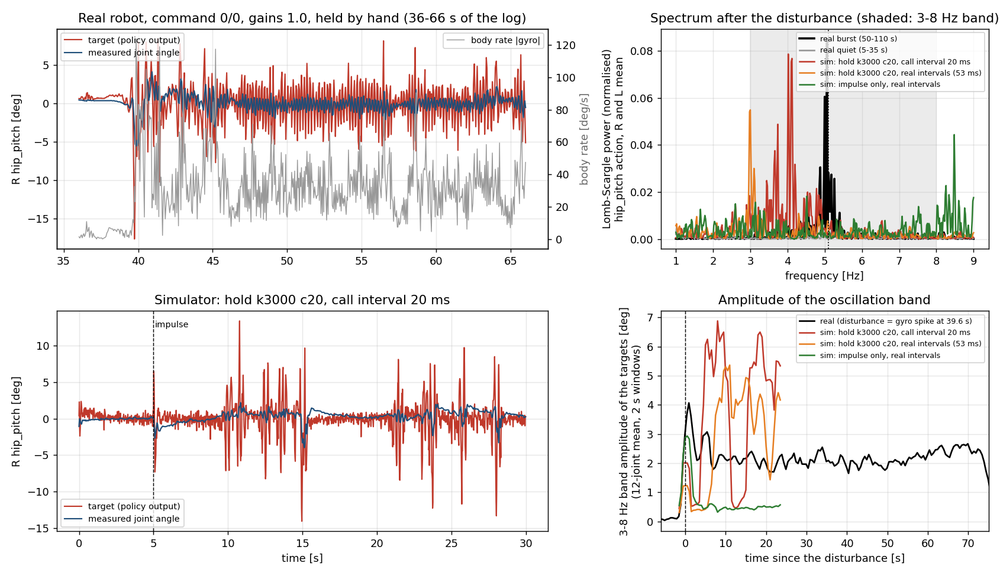

# 5 Hz 떨림 재현 시험 (단계 6, 2026-10-22)

**목적**: 실기 보행 policy 의 에피소드 5.1 Hz 떨림을 시뮬레이터에서 다시 만들 수 있는 변경을 찾는다. 한 번에 한 변수만 바꾼다.
**관련**: `docs/177_real_walk_sim2real_gap_study.md` §8, §9-5. `docs/sim2real/2026-10-22_sim_walk_reference.md`. `docs/sim2real/2026-10-21_generalized_walk_jitter_analysis.md`.
**환경**: 순정 mjlab `20f10e96` + 브랜치 `vibecoded-audit-20261012` 의 패키지. 이 PC 의 CPU 로 돌렸다 (3090 은 쓰지 않았다). Policy: `terrain10_2048_model_37400.pt`, 결정적 평균 행동. 명령 vx 0, wz 0. 평지.
**모든 수치는 시뮬레이터 값이다.** 실기 값은 "실기" 라고 적었다.

## 0. 결론 먼저

**5.1 Hz 떨림을 재현한 조건은 없다.** 가장 가까운 조건은 "손으로 잡기" 모형이다. 그러나 주파수가 낮고 (실제 호출 간격에서 3.0 Hz), 떨림이 짧게 끊어진다.

- **충격 하나 (T1) 는 5 Hz 를 만들지 못한다.** 몸 기울기 7.6°, 몸 각속도 128 deg/s 의 충격 (실기 7.8°, 124 deg/s) 을 주면 2 s 안에 가라앉는다. 가라앉은 뒤의 수준은 충격 전과 같다.
- **IMU 현실화 (T3), 구동기 지연 (T4), 연결봉 유연성 (T5), 관절 마찰 (추가 T6) 도 5 Hz 를 만들지 못한다.** 충격 뒤 3–8 Hz 띠 진폭은 0.45~0.64° 이고 (T4c 만 0.91°) 충격 전 0.52~0.70° 와 같은 수준이다. 구동기 토크 지연 10 ms 는 8 환경 중 4 환경을 넘어뜨린다.
- **손으로 잡기 (T2) 만 충격 뒤 오래 가는 떨림을 만든다.** 수평 스프링-댐퍼 k = 1000, 3000 N/m 에서 14 환경 중 6 환경과 9 환경이 떨린다 (진폭 2.3~3.3°). 주파수는 2.0~3.0 Hz 이다. 5.1 Hz 가 아니다.
- **호출 간격 20 ms 와 k = 3000 N/m 를 함께 쓰면 주파수가 4.1 Hz (3.1~4.6) 로 오른다.** 20 환경 중 12 환경이 4~6.5 Hz 선을 보인다. 관절/목표 진폭비 0.14, 지연 32 ms 이다 (실기 0.24, 58~120 ms). 호출 간격 31, 40, 52, 70 ms 에서는 2.7~3.2 Hz 이고 4~6.5 Hz 선이 0 환경이다. 실기는 31~53 ms 에서 5.1~5.7 Hz 이다. 그래서 이 결과를 재현이라 부르지 않는다.
- **게인 ×0.6 은 손으로 잡은 떨림을 줄인다 (진폭 35~57 % 감소). Kd ×1.5 는 조금 줄인다 (29 % 감소, k = 3000). 호출 간격 20 ms 는 없애지 못한다.** 실기 예측 (게인 0.6 은 없앤다, Kd ×1.5 는 약하게 한다) 과 방향이 같다. 간격 결과는 `--hz 50` 이 떨림을 없애 주지 않는다는 쪽이다. 단 재현이 불완전하므로 약한 증거이다.
- **새로 알게 된 것: 시뮬레이터의 서 있는 자세는 실기보다 10 배 넘게 떨린다.** 충격 전 3–8 Hz 띠 진폭이 시뮬레이터 0.56° 이고 실기 0.065° 이다. 원인을 찾지 못했다 (§5).



그림. 왼쪽 위: 실기 (진동 확인 기록) 의 오른 엉덩이 앞뒤 목표와 관절각, 몸 각속도. 왼쪽 아래: 시뮬레이터 (손 k = 3000 N/m, c = 20 N·s/m, 호출 간격 20 ms, 환경 0). 오른쪽 위: 충격 뒤 엉덩이 앞뒤 행동의 Lomb–Scargle 스펙트럼 (불균일 표본용 주파수 분석). 오른쪽 아래: 3–8 Hz 띠 진폭의 시간 변화.

## 1. 한 일

### 1.1 시험 환경

`tools/sim2real/walk/sim_walk_record.py` 의 시간 모형을 그대로 썼다. 한 환경 = 한 (조건, 반복) 이다. 한 번에 환경 100~200 개를 같이 돌렸다.
- 물리 걸음 5 ms. Policy 는 예정 시각이 지나면 부른다. 호출 사이에는 행동을 유지한다. 명령은 모터에 1 걸음 (5 ms) 늦게 닿는다.
- 호출 간격 기본값 = 실기 기록 열 `t` 의 차이 (중앙 53 ms). 환경마다 무작위 시작점에서 원형으로 읽는다.
- Kp, Kd 는 12 비트 MIT 양자화를 거친다. 관측의 관절각은 호출 시각보다 10 ms 오래된 값이다.
- 잡음, 물리 변수 무작위화, 밀기 이벤트는 끈다. 시작 자세는 학습 reset (관절 ±0.05 rad) 과 같다.
- 환경 8 개 × 30 s 가 기본이다. 중요한 조건은 시드 0, 1, 2 에서 12~20 환경으로 반복했다.

### 1.2 충격 보정

충격 = 5.0 s 에 몸통 (이 로봇은 다리만 있다. `base_link` 가 골반이다) 질량 중심 0.25 m 위에 앞쪽 (+x) 수평 힘을 준다. 힘과 지속 시간을 8 환경씩 훑었다 (`cal3`, 기본 조건, 8 s).

| 힘 [N] × 시간 [ms] | 최대 기울기 평균 (범위) [deg] | 최대 각속도 평균 (범위) [deg/s] |
|---|---|---|
| 70 × 90 | 8.5 (4.7~11.9) | 98 (83~127) |
| **80 × 80 (채택)** | **7.6 (5.5~10.8)** | **128 (103~208)** |
| 90 × 80 | 9.1 (4.6~13.2) | 136 (100~175) |
| 100 × 60 | 6.4 (4.6~8.3) | 143 (119~165) |
| 85 × 70 | 8.7 (4.7~14.6) | 144 (107~284) |
| 95 × 70 | 8.6 (5.8~13.6) | 138 (126~168) |
| 실기 (진동 확인 기록, 39.6 s 전후) | 7.8 | 124 (기록 최대 128) |

### 1.3 조건

모든 조건에 위 충격을 준다 (T0 만 예외). 조건 이름은 표와 `tools/sim2real/walk/s6_oscillation_lab.py` 의 `SETS` 에 같다.

| 묶음 | 바꾼 것 |
|---|---|
| T0 | 외란 없음 |
| T1 | 충격만 |
| T2 | 손으로 잡기: 몸통 질량 중심 0.1 m 위의 점과 고정된 세계 점 사이의 수평 (x, y) 스프링-댐퍼. k = 300, 1000, 3000 N/m. c = 20, 60 N·s/m. 고정점 = 첫 걸음에서 그 점이 있던 세계 위치. 따로: 몸무게 20 % 의 수직 위쪽 힘 (로봇 23.6 kg). 둘을 합친 조건 |
| T3 | IMU 자료 나이 10 ms (직렬 전송 약 9.6 ms). 자이로 크기 (세 축 합) 가 0.02 rad/s 보다 작은 상태가 0.2 s 넘게 이어지면 (0, 0, 0) 을 낸다. 둘을 합친 조건. 문턱 0.3 rad/s 변형 (T3d) |
| T4 | 모터 토크 1차 지연 2, 5, 10 ms. PD 가 읽는 관절각의 1차 지연 5 ms. 둘을 합친 조건 |
| T5 | 발목 연결봉 구속 (4 개) 의 시간 상수 0.02, 0.05 s (기본 0.002 s). 환경별 값이 들어간 것을 확인했다 |
| T6 (추가) | 관절 마찰 ×2, ×4 |

### 1.4 지표

실기와 시뮬레이터에 같은 코드 (`tools/sim2real/walk/s6_metrics.py`) 를 썼다.
- **3–8 Hz 띠 진폭**: 12 관절 목표값을 100 Hz 격자에 선형 보간한다. 4 차 Butterworth 대역 통과 (3–8 Hz, 영위상) 를 건다. 띠 전력 = 12 관절 평균 분산 [deg²]. 띠 진폭 = √(2 × 띠 전력). 사인파라면 진폭과 같다.
- **떨림 주파수**: 좌우 엉덩이 앞뒤 (또는 무릎, 엉덩이 좌우) 행동의 Lomb–Scargle 스펙트럼 봉우리, 1–9 Hz. 원래 시각을 그대로 쓴다 (보간 없음).
- **전/후**: 전 = 2.5~4.9 s. 후 = 7 s 부터 끝까지. 충격은 5.0~5.08 s 이다.
- **떨림 환경**: 후 띠 진폭 ≥ 1.0° 이고 전의 3 배 이상. **4–6.5 Hz 선**: 떨림 환경 가운데 엉덩이 앞뒤 행동 봉우리가 4–6.5 Hz.
- **끝까지 지속**: 2 s 창의 띠 진폭이 기록 끝까지 문턱 (전 진폭의 2 배, 최소 0.3°) 위에 있다. 그렇지 않으면 가라앉은 시각을 센다.
- **가동률**: 8 s 이후 띠 진폭 ≥ 1° 인 2 s 창의 비율 (환경 중앙값).
- **관절/목표, 지연**: 엉덩이 앞뒤 목표값 봉우리 주파수에서 사인 맞춤. 진폭비 = 관절 / 목표. 지연 = 관절 위상이 목표보다 늦은 시간.
- **넘어짐**: 종료 조건이 걸린 환경 수. 넘어진 환경은 그 시각 뒤를 뺀다.

## 2. 실기 기준 수치

진동 확인 기록 (`vx0gain1walkob(진동확인용)1021.csv`, 명령 0/0, 게인 1.0, 호출 간격 53 ms, 209 s). 같은 지표 코드로 다시 계산했다.

| 구간 | 3–8 Hz 띠 진폭 목표 / 관절각 [deg] | 띠 전력 목표 [deg²] | 엉덩이 앞뒤 행동 봉우리 | 관절/목표, 지연 (엉덩이 앞뒤) |
|---|---|---|---|---|
| 조용한 구간 5~35 s | 0.065 / 0.016 | 0.0021 | 선 없음 | - |
| 떨림 1 (50~110 s) | 2.15 / 0.54 | 2.32 | 5.06 Hz | 0.24, 60 ms |
| 떨림 2 (135~190 s) | 1.28 / 0.33 | 0.81 | 5.10 Hz | 0.24, 67 ms |

- 10 s 창 20 개 중 14 개가 4.5~6.0 Hz 선 (진폭 1° 이상), 4 개가 조용함, 2 개가 그 밖이다. 1~4.5 Hz 의 느린 떨림 창은 0 개다.
- **새로 확인한 것: 다른 실기 기록에도 1~3 Hz 의 느린 떨림이 있다.** 게인 0.6 실행 B (55 ms) 는 10 s 창 6 개 중 4 개가 1.2~4.5 Hz, 진폭 1.2~2.5° 이다. Kd ×1.5 는 첫 10 s 에 2.9 Hz, 2.2° 가 있고 50~80 s 에 4.7~5.0 Hz 선 3 개 창이 있다. 1020 기록 (31 ms) 은 8 개 창 중 6 개가 5.5~5.9 Hz 선이다. 게인 0.6 실행 A 는 4 개 창 모두 조용하지만 교란이 없었다 (감사 1 C10).
- 그래서 "게인 0.6 은 떨림을 없앤다" 는 말은 5 Hz 선에만 맞다. 게인 0.6 에서도 1~3 Hz 의 느린 떨림은 남는다.

## 3. 결과

### 3.1 조건표

각 행은 같은 이름의 조건을 시드와 배치를 넘어 합친 값이다 (환경 수가 다르다). 원자료: `docs/sim2real/data/2026-10-22_stage6_conditions.json` (요약), `docs/sim2real/data/2026-10-22_stage6_env_rows.json` (환경별), `docs/sim2real/data/2026-10-22_stage6_real_reference.json` (실기).

| 조건 | 환경 수 (넘어짐) | 띠 진폭 전→후 [deg] | 띠 전력 전→후 [deg²] | 떨림 환경 | 4–6.5 Hz 선 | 떨림 주파수 [Hz] 중앙값 (범위) | 끝까지 지속 | 가동률 [%] | 관절/목표, 지연 [ms] |
|---|---|---|---|---|---|---|---|---|---|
| **T0 기준 (외란 없음)** | | | | | | | | | |
| T0 baseline, no disturbance | 14 (0) | 0.56 → 0.55 | 0.16 → 0.15 | 0/14 | 0/14 | - | 0/14 | 0 | - |
| **T1 충격만** | | | | | | | | | |
| T1 impulse | 14 (2) | 0.64 → 0.52 | 0.21 → 0.14 | 0/12 | 0/12 | - | 0/12 | 0 | - |
| **T2 손으로 잡기 (충격 + 스프링-댐퍼 / 수직 지지)** | | | | | | | | | |
| T2 hold k300 c20 | 8 (0) | 0.54 → 0.95 | 0.14 → 0.45 | 0/8 | 0/8 | - | 3/8 | 15 | - |
| T2 hold k300 c60 | 8 (0) | 0.65 → 1.12 | 0.21 → 0.63 | 2/8 | 0/8 | 2.2 (2.1–2.2) | 2/8 | 20 | 0.79, 21 |
| T2 hold k1000 c20 | 14 (0) | 0.57 → 2.26 | 0.16 → 2.55 | 6/14 | 0/14 | 2.2 (2.0–2.3) | 9/14 | 38 | 0.66, 14 |
| T2 hold k1000 c60 | 8 (0) | 0.77 → 2.73 | 0.30 → 3.78 | 4/8 | 0/8 | 2.2 (2.1–2.3) | 5/8 | 61 | 0.69, 18 |
| T2 hold k3000 c20 | 14 (0) | 1.00 → 3.32 | 0.51 → 5.52 | 9/14 | 0/14 | 3.0 (2.7–3.0) | 11/14 | 85 | 0.34, 35 |
| T2 hold k3000 c60 | 8 (0) | 0.65 → 2.77 | 0.22 → 3.86 | 4/8 | 0/8 | 2.8 (2.2–3.5) | 5/8 | 67 | 0.34, 30 |
| T2 support 20% | 8 (0) | 0.47 → 0.37 | 0.11 → 0.07 | 0/8 | 0/8 | - | 0/8 | 0 | - |
| T2 hold k1000 c20 + support 20% | 8 (0) | 0.56 → 2.69 | 0.16 → 3.74 | 4/8 | 0/8 | 2.3 (2.2–2.3) | 6/8 | 68 | 0.57, 21 |
| **T3 IMU 현실화** | | | | | | | | | |
| T3a IMU age 10 ms | 8 (0) | 0.58 → 0.55 | 0.17 → 0.15 | 0/8 | 0/8 | - | 0/8 | 0 | - |
| T3b gyro still-zero (0.02 rad/s, 0.2 s) | 8 (1) | 0.60 → 0.55 | 0.18 → 0.15 | 0/7 | 0/7 | - | 0/7 | 0 | - |
| T3c IMU age 10 ms + still-zero | 8 (1) | 0.57 → 0.56 | 0.16 → 0.16 | 0/7 | 0/7 | - | 0/7 | 0 | - |
| T3d gyro still-zero (0.3 rad/s, 0.2 s) | 8 (2) | 0.56 → 0.52 | 0.16 → 0.13 | 0/6 | 0/6 | - | 0/6 | 0 | - |
| **T4 구동기 현실화** | | | | | | | | | |
| T4a torque lag 2 ms | 8 (1) | 0.61 → 0.58 | 0.19 → 0.17 | 0/7 | 0/7 | - | 0/7 | 0 | - |
| T4b torque lag 5 ms | 8 (0) | 0.61 → 0.55 | 0.19 → 0.15 | 1/8 | 0/8 | 1.9 (1.9–1.9) | 0/8 | 0 | 0.41, 100 |
| T4c torque lag 10 ms | 8 (4) | 0.83 → 0.91 | 0.34 → 0.41 | 0/4 | 0/4 | - | 0/4 | 7 | - |
| T4d position-measurement lag 5 ms | 8 (0) | 0.64 → 0.54 | 0.20 → 0.14 | 0/8 | 0/8 | - | 0/8 | 0 | - |
| T4e torque lag 5 ms + position lag 5 ms | 8 (0) | 0.65 → 0.64 | 0.21 → 0.21 | 0/8 | 0/8 | - | 0/8 | 4 | - |
| **T5 구조 유연성 (발목 연결봉 구속)** | | | | | | | | | |
| T5a ankle loop time const 0.02 s | 8 (1) | 0.68 → 0.55 | 0.23 → 0.15 | 0/7 | 0/7 | - | 0/7 | 0 | - |
| T5b ankle loop time const 0.05 s | 8 (0) | 0.70 → 0.53 | 0.25 → 0.14 | 0/8 | 0/8 | - | 0/8 | 0 | - |
| **T6 관절 마찰 (추가)** | | | | | | | | | |
| T6a joint friction x2 | 8 (0) | 0.55 → 0.50 | 0.15 → 0.12 | 0/8 | 0/8 | - | 0/8 | 0 | - |
| T6b joint friction x4 | 8 (0) | 0.52 → 0.45 | 0.13 → 0.10 | 0/8 | 0/8 | - | 0/8 | 0 | - |

- 같은 조건의 실기 값 (§2): 띠 진폭 0.07 → 2.15°, 띠 전력 0.0021 → 2.32 deg², 5.06 Hz 선, 관절/목표 0.24, 지연 60 ms, 끝까지 지속 (두 구간 76 s 와 62 s).
- 띠 진폭에 주의한다: 2~3 Hz 의 떨림은 3 Hz 경계에 번져 3–8 Hz 띠 진폭에 들어온다. 손으로 잡은 조건의 진폭 2~4° 는 이 번짐을 포함한다.

### 3.2 실기와 가장 가까운 시뮬레이터 비교

| 항목 | 실기 (떨림 1) | 시뮬레이터: 손 k = 3000, 간격 20 ms (20 환경) | 시뮬레이터: 손 k = 3000, 간격 53 ms (14 환경) |
|---|---|---|---|
| 엉덩이 앞뒤 행동 봉우리 | 5.06 Hz | 4.1 Hz (3.1~4.6) | 3.0 Hz (2.7~3.0) |
| 띠 진폭 전 → 후 | 0.07 → 2.15° | 0.45 → 3.54° | 1.00 → 3.32° |
| 띠 전력 전 → 후 | 0.0021 → 2.32 deg² | 0.10 → 6.29 deg² | 0.51 → 5.52 deg² |
| 관절/목표, 지연 | 0.24, 60 ms | 0.14, 32 ms | 0.34, 35 ms |
| 시작 | 외란 뒤 1 s 안 | 8 s 이후 처음 나타나는 시각이 충격 뒤 중앙 8 s (1 환경은 없음) | 충격 뒤 중앙 3.5 s |
| 지속 | 76 s 와 62 s 연속 | 한 환경에 1.5 번, 한 번이 중앙 6.2 s (최대 20 s). 가동률 49 % | 한 번이 중앙 11.8 s. 가동률 85 % |

- 시뮬레이터의 떨림은 충격이 일으킨 것이 아니다. 충격 뒤 아무 때나 시작하고 끊어졌다가 다시 시작한다. 실기는 외란 뒤 1 s 안에 시작해 70 s 가까이 이어졌다.
- 간격 20 ms 에서 관절/목표 0.14 는 "관절이 목표를 거의 따라가지 못한다" 는 실기 모습 (0.24) 과 같은 방향이다. 53 ms 에서는 0.34 이고 낮은 주파수에서 몸이 같이 흔들린다 (§4 의 2.7 Hz 모드).

### 3.3 게인, Kd, 호출 간격

실기 예측: 게인 0.6 은 5 Hz 선을 없앤다. Kd ×1.5 는 약하게 한다. 호출 간격은 `--hz 50` 이 고치는지 알려 준다. 반복은 T1–T5 가운데 떨림을 보인 T2 (손) 에 했고, 충격만 (T1) 에도 했다.

| 조건 | 충격만 (T1) | 손 k = 1000 | 손 k = 3000 |
|---|---|---|---|
| 기본 (실제 간격) 떨림 환경 / 띠 진폭 후 | 0/12, 0.52° | 6/14, 2.26° | 9/14, 3.32° |
| 게인 ×0.6 (발목 ×1) | 0/6, 0.53° | 0/12, 1.48° | 2/12, 1.44° |
| Kd ×1.5 | 0/6, 0.55° | 3/12, 1.53° | 7/12, 2.37° |
| 호출 간격 20 ms 고정 | 0/6, 0.34° | 5/12, 2.37° (4–6.5 Hz 선 2/12) | 17/20, 3.54° (4–6.5 Hz 선 12/20) |

- **게인 ×0.6**: 떨림 환경이 줄고 (k = 1000: 6/14 → 0/12, k = 3000: 9/14 → 2/12) 진폭이 35~57 % 줄어든다 (2.26 → 1.48°, 3.32 → 1.44°). 실기 예측과 방향이 같다. 단 k = 3000 에서 2/12 환경이 1.1 Hz 의 느린 흔들림을 보인다. 실기 게인 0.6 실행 B 의 1~3 Hz 와 닮았다.
- **Kd ×1.5**: k = 3000 에서 진폭이 3.32° → 2.37°, 떨림 환경이 9/14 → 7/12 로 약하다. k = 1000 에서 6/14 → 3/12. 실기도 "약하다" 였다. 주파수는 안 바뀐다 (2.9 Hz).
- **호출 간격 20 ms**: 떨림이 없어지지 않는다. 오히려 환경 수가 늘고 (k = 3000: 9/14 → 17/20) 주파수가 3.0 → 4.1 Hz 로 오른다. 그래서 이 모형에서 `--hz 50` 은 떨림을 고치지 않는다.
- **호출 간격 훑기** (k = 3000, c = 20, 8 환경): 20 ms 4.1 Hz (선 5/8), 31 ms 3.2 Hz, 40 ms 2.7 Hz, 52 ms 3.0 Hz, 70 ms 2.9 Hz (31 ms 이상은 4–6.5 Hz 선 0/8). 실기는 31 ms 5.7 Hz, 53 ms 5.1 Hz 이다. 31 ms 이상에서 간격이 바뀌어도 주파수가 거의 안 바뀌는 점 (2.7~3.2 Hz) 은 실기와 같다 (실기: 31 → 53 ms 에서 5.7 → 5.1 Hz, 10 % 변화). 값은 약 2 배 다르다.

### 3.4 닫힌 고리 주파수 응답 시험 (추가)

몸통에 3 N·m 사인 토크를 2~8 Hz 에 가했다 (3~15 s, 각 6 환경, 8~15 s 에서 측정, 로봇 앞뒤 축). 닫힌 고리가 5 Hz 에서 특별히 증폭하는지 본다.

| 주파수 [Hz] | 2 | 3 | 4 | 5 | 6 | 7 | 8 |
|---|---|---|---|---|---|---|---|
| 12 관절 목표 응답 진폭 [deg] | 0.47 | 0.41 | 0.42 | 0.56 | 1.22 | 1.13 | 1.17 |
| 몸 각속도 진폭 [deg/s] | 5.3 | 5.9 | 6.7 | 8.4 | 13.2 | 12.4 | 12.0 |

- 5 Hz 에 봉우리가 없다. 6~8 Hz 에서 응답이 두 배 커진다. 목표 응답 / 각속도 진폭은 0.06~0.10 deg/(deg/s) 로 거의 평평하다.
- 그러므로 시뮬레이터 닫힌 고리는 5 Hz 에서 공진하지 않는다. 5 Hz 떨림이 실기에서 나오려면 시뮬레이터에 없는 에너지 통로나 주파수 선택 (공진) 이 필요하다.

## 4. 해석

1. **충격 한 번이 5 Hz 상태로 넘기지 않는다.** 감사 1 의 N2 ("큰 교란 뒤 5 Hz 상태로 넘어가 머문다") 는 시뮬레이터의 충격 하나 (T1) 로는 나오지 않는다. IMU, 구동기, 연결봉, 마찰 변경을 더해도 안 나온다 (T3–T6).
2. **손으로 잡는 모형이 떨림을 만든다.** 시뮬레이터에서 오래 가는 떨림은 몸을 스프링으로 붙잡았을 때만 생겼다. k = 1000~30000 N/m, 고정점 높이 0, 0.1, 0.3 m, 수직 지지 20 % 합침에서 모두 1~3 Hz 의 떨림이 있다. k = 300 N/m 에서는 약하다 (c = 20: 0/8, c = 60: 2/8). 수직 지지 하나는 효과가 없다 (T2 지지 20 %: 0/8).
3. **두 가지 모드가 보인다.** (a) 약 2~3 Hz 이고 관절/목표 0.3~0.8: 관절이 목표를 따라가고 몸이 스프링 위에서 흔들린다. (b) 약 4 Hz 이고 관절/목표 0.14: 목표는 크게 흔들리고 관절은 거의 안 따라간다. 간격 20 ms 에서 (b) 가 많다 (k = 3000: 12/20). 실기 5 Hz 떨림은 (b) 와 비슷하다 (비 0.24, 목표 진폭 크다). 모드 (a) 는 실기 게인 0.6 실행 B 의 1~3 Hz 와 비슷하다.
4. **주파수가 안 맞는다.** (b) 는 20 ms 에서만 나오고 4.1 Hz 이다. 실제 호출 간격 (31~70 ms) 에서는 2.7~3.2 Hz 만 나온다. 이 모형에는 5 Hz 를 고르는 요소가 없다. 실기 5.1 Hz (53 ms), 5.7 Hz (31 ms) 와 간격 의존이 다르다.
5. **그러므로 이 시험은 "손으로 잡기" 가 떨림의 한 원인일 수 있음을 보이지만, 5.1 Hz 의 원인이 그것이라고 하지 않는다.** 실기에서 손으로 잡는 힘이 어떤 강성과 감쇠를 갖는지 모른다. 이 값이 모형 결과를 정한다.

## 5. 풀지 못한 것

1. **5.1 Hz 를 만드는 조건은 못 찾았다.** 시험하지 않은 후보: 손 모형 안의 회전 강성과 접촉 위치 (회전 스프링은 몸통 전체를 세우는 모형만 시험했고, k_r = 50, 200 N·m/rad 에서 떨림이 없었다. 800 은 수치가 발산했다), 정책 호출 시각의 지터, 발바닥 접촉 모형.
2. **시뮬레이터의 서 있는 떨림이 실기보다 10 배 크다.** 충격 전 3–8 Hz 띠 진폭 목표 0.56° (시뮬레이터) 대 0.065° (실기), 전력 0.16 대 0.0021 deg² (76 배). 발목 크랭크가 가장 크다 (목표 0.70~0.95° 대 실기 0.05~0.07°, 관절각 0.26~0.36° 대 0.02°). 몸 각속도는 시뮬레이터 8~9 deg/s (rms), 실기는 정확히 0 인 구간이 있다.
   - 원인이 자이로 입력이 아님을 확인했다: 자이로 입력을 0 으로 강제해도 진폭이 0.38~0.44° 로 남는다 (D0, 2/6 환경은 넘어짐).
   - 게인 ×0.6, Kd ×1.5, 관절각 나이 0 ms 는 효과가 없다 (D3~D5: 0.53~0.57°). 호출 간격 20 ms 는 0.56 → 0.35° 로 줄이지만 없애지 못한다 (D1).
   - 남은 후보는 발목 연결봉 구속의 고주파 흔들림이다. 확인하지 않았다.
3. **T3b (자이로 정지 0 출력, 문턱 0.02 rad/s) 는 시뮬레이터에서 작동하지 않는다.** 시뮬레이터 몸 각속도가 0.02 rad/s 아래로 0.2 s 머물지 않는다 (중앙 0.13 rad/s). T3d (문턱 0.3 rad/s) 는 호출의 24 % 에서 작동했다. 이 문턱은 실기 센서의 것이 아니다.
4. **T5 몸통 유연성 시험은 못 했다.** 모델이 다리만 있다. 골반과 몸통 사이 관절이 없다. 대신 발목 연결봉 구속의 시간 상수를 늘렸다 (T5a, T5b). 이것은 강성 [N/m] 이 아니다.
5. **밀기 (일정한 힘) 시험은 무효이다.** 40 N 과 80 N 의 일정한 앞쪽 힘은 모든 환경 (4 조건 × 8 = 32 개) 을 넘어뜨렸다. 더 작은 힘은 시험하지 않았다.
6. **충격 모양이 다르다.** 실기는 약 2 s 동안 기울고 (1.5° → 7.8°) 그 뒤 자이로가 튄다. 시뮬레이터는 80 ms 의 충격이다.
7. **표본이 작다.** 조건당 6~8 환경, 핵심 조건 12~20 환경. 시드는 0, 1, 2. 3 Hz 번짐이 띠 진폭에 섞인다.
8. **구동기 토크 지연 10 ms (T4c) 는 4/8 환경을 넘어뜨렸다.** 그 조건의 떨림 값은 4 환경만이다.

## 6. 다음 시험 제안 (실기)

- 같은 손 잡기 방식으로 `--hz 50` (호출 간격 20 ms) 기록을 만든다. 시뮬레이터 예측: 떨림이 남고 주파수가 오른다. 실기가 사라지면 이 모형은 틀린 것이다.
- 손을 탄성 끈 (강성을 아는 것) 으로 바꾼다. 그리고 같은 충격을 준다. 시뮬레이터 모형의 k 와 비교한다.
- 정책을 끄고 같은 게인의 PD 로 기본 자세를 잡은 채 로봇을 가볍게 친다 (docs/177 §9-5 가르는 실험). 5 Hz 에서 울리면 하드웨어 고유진동이다.
- 서 있는 조용한 구간의 자이로를 원시 패킷으로 기록한다. 정확한 0 이 센서의 0 출력인지 패킷 멈춤인지 가른다.

## 7. 재현

```bash
cd /home/syaro/MikuchanRemote/Human-Pygmalion
# 설치 (한 번): sim_walk_record.py 머리말과 같다. 순정 mjlab 과 브랜치 패키지를 worktree 로 받는다.
git worktree add --detach <dir>/gw_branch origin/vibecoded-audit-20261012
git -C mujoco-sim/mjlab worktree add --detach <dir>/stock_mjlab 20f10e96
LAB="tools/sim2real/walk/s6_oscillation_lab.py"
RUN="CUDA_VISIBLE_DEVICES= MUJOCO_GL=egl nice -n 10 mujoco-sim/mjlab/.venv/bin/python3"
COMMON="--branch-root <dir>/gw_branch/vibecoded-audit-20261012 --mjlab-src <dir>/stock_mjlab/src --real-timing-csv Expr_Data/vx0gain1walkob(진동확인용)1021.csv --seconds 30"
# (GPU/무거운 일 잠금: mkdir /home/syaro/pyg_fea/locks/gpu.lock 후 끝나면 rmdir)
(cd mujoco-sim/mjlab && $RUN ../../$LAB $COMMON --set MAIN   --reps 8 --seed 0 --out /path/main_s0)   # T0-T6, 184 환경, 약 32 분
(cd mujoco-sim/mjlab && $RUN ../../$LAB $COMMON --set BATCH2 --reps 6 --seed 0 --out /path/b2_s0)     # 진단과 손 모형, 132 환경, 약 23 분
(cd mujoco-sim/mjlab && $RUN ../../$LAB $COMMON --set BATCH3 --reps 6 --seed 1 --out /path/b3_s1)     # 시드 1 과 주파수 응답, 120 환경, 약 16 분
(cd mujoco-sim/mjlab && $RUN ../../$LAB $COMMON --set BATCH4 --reps 8 --seed 2 --out /path/b4_s2)     # 간격 훑기, 96 환경, 약 15 분
# 분석 (CPU, 환경 한 개당 약 1 s)
for f in main_s0 b2_s0 b3_s1 b4_s2; do mujoco-sim/mjlab/.venv/bin/python3 tools/sim2real/walk/s6_analyze.py --runs $f=/path/$f.npz --json /path/${f}_analysis.json; done
mujoco-sim/mjlab/.venv/bin/python3 tools/sim2real/walk/s6_collect.py --in /path/main_s0_analysis.json /path/b2_s0_analysis.json /path/b3_s1_analysis.json /path/b4_s2_analysis.json --out table.json --md table.md
mujoco-sim/mjlab/.venv/bin/python3 tools/sim2real/walk/s6_exc.py --npz /path/b3_s1.npz --json exc.json
mujoco-sim/mjlab/.venv/bin/python3 tools/sim2real/walk/s6_real_table.py --out docs/sim2real/data/2026-10-22_stage6_real_reference.json
mujoco-sim/mjlab/.venv/bin/python3 tools/sim2real/walk/s6_figure.py --real "Expr_Data/vx0gain1walkob(진동확인용)1021.csv" --sim "label=/path/b4_s2.npz|I hold k3000 c20 interval 20 ms|0" --out docs/sim2real/img/2026-10-22_stage6_5hz.png
```

- 원자료 (npz, 약 150 MB) 는 `mujoco-sim/mjlab/analysis/out/s6_5hz/` 에 있다. 저장소에 올리지 않았다.
- 새 조건은 `SETS` 에 한 줄을 더하거나 `--conditions-json` 으로 준다. 조건 변수의 뜻은 `s6_oscillation_lab.py` 머리말에 있다.
- 파일: `tools/sim2real/walk/s6_oscillation_lab.py` (시험대), `s6_metrics.py` (지표), `s6_analyze.py`, `s6_collect.py`, `s6_exc.py`, `s6_real_record.py`, `s6_real_table.py`, `s6_figure.py`.

## 8. 부록: 조건표 (나머지 반복·진단·손 모형 변형)

| 조건 | 환경 수 (넘어짐) | 띠 진폭 전→후 [deg] | 띠 전력 전→후 [deg²] | 떨림 환경 | 4–6.5 Hz 선 | 떨림 주파수 [Hz] 중앙값 (범위) | 끝까지 지속 | 가동률 [%] | 관절/목표, 지연 [ms] |
|---|---|---|---|---|---|---|---|---|---|
| **게인 · Kd · 간격 반복 (충격만)** | | | | | | | | | |
| T1 gains x0.6 (ankle x1) | 6 (0) | 0.71 → 0.53 | 0.26 → 0.14 | 0/6 | 0/6 | - | 0/6 | 0 | - |
| T1 Kd x1.5 | 6 (0) | 0.54 → 0.55 | 0.14 → 0.15 | 0/6 | 0/6 | - | 0/6 | 0 | - |
| T1 interval fixed 20 ms | 6 (0) | 0.67 → 0.34 | 0.22 → 0.06 | 0/6 | 0/6 | - | 0/6 | 0 | - |
| **게인 · Kd · 간격 반복 (손 k=1000 c=20)** | | | | | | | | | |
| T2 hold k1000 c20 | 14 (0) | 0.57 → 2.26 | 0.16 → 2.55 | 6/14 | 0/14 | 2.2 (2.0–2.3) | 9/14 | 38 | 0.66, 14 |
| H k1000 c20 gains x0.6 | 12 (0) | 0.72 → 1.48 | 0.26 → 1.10 | 0/12 | 0/12 | - | 4/12 | 33 | - |
| H k1000 c20 Kd x1.5 | 12 (0) | 0.62 → 1.53 | 0.19 → 1.22 | 3/12 | 0/12 | 2.1 (2.0–2.1) | 5/12 | 23 | 0.63, 50 |
| H k1000 c20 interval 20 ms | 12 (0) | 0.45 → 2.37 | 0.10 → 2.85 | 5/12 | 2/12 | 3.3 (2.7–4.7) | 7/12 | 39 | 0.18, 35 |
| **게인 · Kd · 간격 반복 (손 k=3000 c=20)** | | | | | | | | | |
| T2 hold k3000 c20 | 14 (0) | 1.00 → 3.32 | 0.51 → 5.52 | 9/14 | 0/14 | 3.0 (2.7–3.0) | 11/14 | 85 | 0.34, 35 |
| H k3000 c20 gains x0.6 | 12 (0) | 0.75 → 1.44 | 0.28 → 1.03 | 2/12 | 0/12 | 1.1 (1.0–1.1) | 6/12 | 27 | 1.10, 17 |
| H k3000 c20 Kd x1.5 | 12 (0) | 0.59 → 2.37 | 0.17 → 2.83 | 7/12 | 0/12 | 2.9 (2.7–3.0) | 8/12 | 56 | 0.22, 31 |
| H k3000 c20 interval 20 ms | 20 (0) | 0.45 → 3.54 | 0.10 → 6.29 | 17/20 | 12/20 | 4.1 (3.1–4.6) | 16/20 | 49 | 0.14, 32 |
| **호출 간격 훑기 (손 k=3000 c=20, 고정 간격)** | | | | | | | | | |
| H k3000 c20 interval 20 ms | 20 (0) | 0.45 → 3.54 | 0.10 → 6.29 | 17/20 | 12/20 | 4.1 (3.1–4.6) | 16/20 | 49 | 0.14, 32 |
| I hold k3000 c20 interval 31 ms | 8 (0) | 0.41 → 2.14 | 0.08 → 2.33 | 6/8 | 0/8 | 3.2 (3.0–3.5) | 5/8 | 40 | 0.42, 28 |
| I hold k3000 c20 interval 40 ms | 8 (0) | 0.55 → 2.00 | 0.15 → 2.00 | 4/8 | 0/8 | 2.7 (1.2–3.0) | 4/8 | 44 | 0.53, 39 |
| I hold k3000 c20 interval 52 ms | 8 (0) | 0.68 → 2.37 | 0.24 → 2.81 | 5/8 | 0/8 | 3.0 (2.1–3.1) | 6/8 | 54 | 0.37, 41 |
| I hold k3000 c20 interval 70 ms | 8 (1) | 0.97 → 3.22 | 0.48 → 5.19 | 4/8 | 0/8 | 2.9 (2.8–3.0) | 4/8 | 69 | 0.21, 60 |
| **손 모형의 다른 값 (실제 간격)** | | | | | | | | | |
| H k10000 c60 | 6 (0) | 0.58 → 2.27 | 0.17 → 2.59 | 4/6 | 0/6 | 1.4 (1.1–3.0) | 5/6 | 60 | 0.96, 26 |
| H k30000 c200 | 6 (0) | 0.50 → 2.26 | 0.13 → 2.58 | 3/6 | 0/6 | 2.0 (1.4–2.1) | 5/6 | 80 | 1.04, -18 |
| H k3000 c20 h0.0 | 6 (0) | 1.14 → 3.15 | 0.65 → 5.03 | 2/6 | 0/6 | 2.8 (2.7–2.9) | 4/6 | 83 | 0.36, 23 |
| H k3000 c20 h0.3 | 6 (0) | 0.53 → 2.53 | 0.14 → 3.21 | 3/6 | 0/6 | 3.0 (1.8–3.0) | 5/6 | 50 | 0.28, 50 |
| **손 모형 20 ms 간격, 감쇠 60** | | | | | | | | | |
| K hold k1000 c60 interval 20 ms | 8 (0) | 0.42 → 3.20 | 0.09 → 5.17 | 6/8 | 2/8 | 3.7 (2.6–4.3) | 6/8 | 71 | 0.16, 39 |
| K hold k3000 c60 interval 20 ms | 8 (0) | 0.37 → 4.27 | 0.07 → 9.12 | 6/8 | 3/8 | 3.5 (3.0–4.8) | 6/8 | 79 | 0.48, 19 |
| K hold k10000 c60 interval 20 ms | 8 (0) | 0.40 → 2.36 | 0.08 → 2.78 | 6/8 | 2/8 | 2.3 (1.0–4.8) | 5/8 | 80 | 1.29, -1 |
| **진단 (충격 없음)** | | | | | | | | | |
| D0 gyro input forced to 0 | 6 (2) | 0.38 → 0.44 | 0.07 → 0.10 | 0/4 | 0/4 | - | 0/4 | 0 | - |
| D1 interval fixed 20 ms | 6 (0) | 0.35 → 0.37 | 0.06 → 0.07 | 0/6 | 0/6 | - | 0/6 | 0 | - |
| D2 interval fixed 80 ms | 6 (1) | 0.76 → 0.78 | 0.29 → 0.30 | 0/5 | 0/5 | - | 0/5 | 7 | - |
| D3 gains x0.6 (ankle x1) | 6 (0) | 0.55 → 0.54 | 0.15 → 0.15 | 0/6 | 0/6 | - | 0/6 | 0 | - |
| D4 Kd x1.5 | 6 (0) | 0.53 → 0.53 | 0.14 → 0.14 | 0/6 | 0/6 | - | 0/6 | 0 | - |
| D5 joint-angle age 0 ms | 6 (0) | 0.67 → 0.57 | 0.22 → 0.16 | 0/6 | 0/6 | - | 0/6 | 0 | - |
| **몸통 비틀림 스프링 (손이 몸을 세워 잡음)** | | | | | | | | | |
| R torsion kr50 cr5 | 6 (0) | 0.55 → 0.48 | 0.15 → 0.12 | 0/6 | 0/6 | - | 0/6 | 0 | - |
| R torsion kr200 cr20 | 6 (0) | 0.48 → 0.46 | 0.12 → 0.11 | 0/6 | 0/6 | - | 0/6 | 0 | - |
| R torsion kr800 cr80 | 6 (6) | - → - | - → - | 0/0 | 0/0 | - | 0/0 | - | - |
| **일정한 힘으로 밀기 (스프링 없음)** | | | | | | | | | |
| P push 40 N, no spring, 20 ms | 8 (8) | - → - | - → - | 0/0 | 0/0 | - | 0/0 | - | - |
| P push 40 N, no spring, real intervals | 8 (8) | - → - | - → - | 0/0 | 0/0 | - | 0/0 | - | - |
| P push 80 N, no spring, 20 ms | 8 (8) | - → - | - → - | 0/0 | 0/0 | - | 0/0 | - | - |
| P push 80 N, no spring, real intervals | 8 (8) | - → - | - → - | 0/0 | 0/0 | - | 0/0 | - | - |
