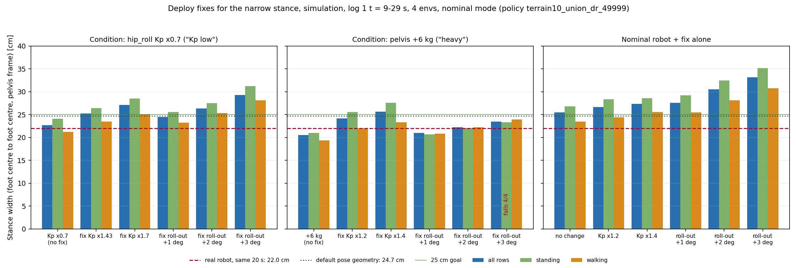

# 49999 정책의 좁은 스탠스: 배포 쪽 수정 두 가지의 시뮬레이터 시험

2026-10-30. 앞선 문서: `docs/sim2real/2026-10-30_union49999_stance_width.md` (이하 "폭 문서"). 정책은 `terrain10_union_dr_49999` 이다. 정책은 다시 학습하지 않았다. 이 문서는 배포 쪽 수정만 시험한다.

이 문서에서 "스탠스 폭" 은 두 발 중심 사이의 좌우 거리이다. 몸통(pelvis) 좌표계에서 정기구학(FK)으로 잰다. "목표 폭이 25 cm 이상" 은 전체 구간 폭이 25 cm 이상이라는 뜻이다. 걷기 폭도 같이 적는다.

## 0. 결론 먼저

1. **Kp 낮음 조건 (hip_roll Kp ×0.7): 시험한 수정 다섯 개가 모두 폭을 올린다. 넘어짐은 없다.** 전체 폭은 22.7 cm 에서 24.5~29.2 cm 로 올라간다. 25 cm 를 넘는 수정은 네 개이다 (Kp ×1.43, Kp ×1.7, roll-out +2°, roll-out +3°). roll-out +1° 는 24.5 cm 로 25 cm 에 못 미친다.
2. **무거움 조건 (몸통 +6 kg): Kp 를 올리는 수정만 폭을 올린다.** 몸통 +6 kg 의 전체 폭 20.5 cm 는 Kp ×1.2 에서 24.1 cm, Kp ×1.4 에서 25.7 cm 가 된다. Kp ×1.4 에서도 걷기 폭은 23.3 cm 이다. 넘어짐은 없다. hip_roll 토크 최대는 98 N·m 로 한계 120 N·m 의 82 % 이다.
3. **무거움 조건에서 roll-out 은 효과가 작고, +3° 는 4/4 넘어진다.** 전체 폭은 +1°, +2°, +3° 에서 21.0, 22.2, 23.5 cm 이다 (수정 없음 20.5 cm). roll-out +3° 의 4 개 환경은 모두 18.2~19.8 s 에 넘어진다. 이때 hip_roll 토크가 120 N·m 한계에 닿는다.
4. **공칭 로봇에서 수정은 폭을 넓힌다. 넘어짐은 없다.** Kp ×1.2, ×1.4 는 26.6, 27.3 cm 를 만든다 (기준 25.4 cm). roll-out +2°, +3° 는 30.5, 33.1 cm 를 만든다. roll-out +3° 의 서기 폭 35.2 cm 는 기준 26.8 cm 보다 8.4 cm 넓다.
5. **두 조건을 모두 25 cm 이상으로 올리는 수정은 Kp 를 올리는 것이다.** Kp 를 올리는 수정은 Kp 낮음 조건에서 ×1.43 (25.3 cm), 무거움 조건에서 ×1.4 (25.7 cm) 이다. 같은 수정을 공칭 로봇에 넣어도 넓어짐은 작다 (Kp ×1.4: 27.3 cm). roll-out 은 한 조건에서만 듣는다. 그러므로 실제 원인이 Kp 인지 질량인지 모르는 상태에서는 Kp 수정이 안전한 쪽이다.

## 1. 방법

폭 문서 §4 와 같다. 달라진 점만 적는다.

| 항목 | 내용 |
|---|---|
| 구간 | 실기 기록 1 (`1028_teleop_ob.csv`) 의 9~29 s, 20 s. 명령(vx, wz)을 그대로 넣는다. |
| 시뮬레이터 | 순정 mjlab `20f10e96` + `origin/generalized-union-dr` 의 `pygmalion_mjlab`. CPU. 평탄 바닥. 환경 4 개. 공칭 모드 (무작위화, 잡음, 지연 모두 끔). 밀기 끔. 시드 0. |
| 한 번의 실행 | `--variants` 로 변형 18 개를 한 프로세스에서 차례로 돌렸다. 변형 하나는 약 55 s 이다. |
| 조건 | "Kp 낮음" = hip_roll Kp ×0.7. "무거움" = 몸통 점질량 +6 kg. 폭 문서 §4 에서 실기에 맞은 두 단일 변경이다. |
| 수정 1: Kp 올리기 | hip_roll Kp 에 배수를 곱한다. Kd 는 그대로이다. |
| 수정 2: roll-out | 정책이 낸 행동을 목표 각도로 바꾼 **뒤에**, 오른쪽 hip_roll 목표에 +N°, 왼쪽 hip_roll 목표에 −N° 를 더한다 (오른쪽 + 와 왼쪽 − 가 바깥쪽, 폭 문서 §1). 정책이 받는 관측(관절각, 지난 행동)은 바꾸지 않는다. 구현은 `sim_stance_record.py` 의 `install_roll_offset` 이다. 인코더 영점 이동이 아니다. |
| 조합 규칙 | "+" 로 잇는다. 작업의 `pd_gains` 는 **기본 게인에 배수를 곱해 덮어쓴다** (쌓이지 않는다). 그래서 한 변형 안의 Kp 배수는 먼저 곱한 뒤 이벤트 하나로 쓴다 (Kp ×0.7 + Kp ×1.4 = ×0.98). 확인: Kp ×0.7 + Kp ×1.43 의 폭 25.3 cm 는 기준 25.4 cm 와 같다. |
| 부호 확인 | 공칭, 4 s 구간, 환경 1 개에서 roll-out +2° 가 목표를 오른 +2.0° / 왼 −2.0° 로 바꾸고 (다른 관절은 변하지 않음), 폭을 22.7 cm 에서 27.3 cm 로 늘렸다. 폭이 늘어나므로 부호가 맞다. |

"측정" 은 정책이 받은 각도(실기 로그에 남는 값)이다. roll-out 변형에서 기록된 목표는 모터에 보낸 값이다. 그 값에 ±N° 가 들어 있다.

## 2. 결과

그림: `docs/sim2real/img/2026-10-30_union49999_deploy_fix_sim.png`. 숫자: `docs/sim2real/data/2026-10-30_union49999_deploy_fix_sim.json`.



### 2-1. 폭 [cm] 과 넘어짐

넘어진 환경의 자료는 넘어지기 전 행만 쓴다. 기준 24.7 cm 는 기본 자세의 기하 폭이다.

| 구성 | 폭 전체 | 폭 서기 | 폭 걷기 | 걸음 폭 | 넘어짐 |
|---|---|---|---|---|---|
| **실기 (같은 20 s)** | **22.0** | **21.5** | **22.4** | **22.9** | — |
| *Kp 낮음 조건* | | | | | |
| Kp ×0.7 (수정 없음) | 22.7 | 24.1 | 21.2 | 19.9 | 0/4 |
| Kp ×0.7 + 수정 Kp ×1.43 (= ×1.0) | 25.3 | 26.4 | 23.4 | 21.8 | 0/4 |
| Kp ×0.7 + 수정 Kp ×1.7 (= ×1.19) | 27.1 | 28.5 | 25.1 | 23.7 | 0/4 |
| Kp ×0.7 + 수정 roll-out +1° | 24.5 | 25.6 | 23.2 | 21.9 | 0/4 |
| Kp ×0.7 + 수정 roll-out +2° | 26.4 | 27.5 | 25.3 | 24.2 | 0/4 |
| Kp ×0.7 + 수정 roll-out +3° | 29.2 | 31.2 | 28.1 | 27.0 | 0/4 |
| *무거움 조건* | | | | | |
| +6 kg (수정 없음) | 20.5 | 21.0 | 19.3 | 18.5 | 0/4 |
| +6 kg + 수정 Kp ×1.2 | 24.1 | 25.6 | 22.0 | 21.0 | 0/4 |
| +6 kg + 수정 Kp ×1.4 | 25.7 | 27.6 | 23.3 | 22.2 | 0/4 |
| +6 kg + 수정 roll-out +1° | 21.0 | 20.6 | 20.8 | 20.2 | 0/4 |
| +6 kg + 수정 roll-out +2° | 22.2 | 22.1 | 22.2 | 21.5 | 0/4 |
| +6 kg + 수정 roll-out +3° | 23.5 | 23.3 | 23.9 | 22.7 | **4/4** (18.2~19.8 s) |
| *공칭 로봇 (수정만)* | | | | | |
| 기준 (변경 없음) | 25.4 | 26.8 | 23.5 | 22.0 | 0/4 |
| 공칭 + Kp ×1.2 | 26.6 | 28.3 | 24.4 | 22.9 | 0/4 |
| 공칭 + Kp ×1.4 | 27.3 | 28.6 | 25.6 | 24.7 | 0/4 |
| 공칭 + roll-out +1° | 27.6 | 29.2 | 25.5 | 24.4 | 0/4 |
| 공칭 + roll-out +2° | 30.5 | 32.5 | 28.1 | 26.9 | 0/4 |
| 공칭 + roll-out +3° | 33.1 | 35.2 | 30.7 | 29.3 | 0/4 |

### 2-2. 각도, 크랭크 오차, 토크

벌림각은 오른쪽 +roll, 왼쪽 −roll 이다 (바깥이 +). 목표−측정은 hip_roll 의 roll 값 그대로이다 (오른쪽, 왼쪽 부호는 폭 문서 §3-2 와 같다). roll-out 변형의 목표−측정에는 ±N° 가 들어 있다. 정책 몫만 보면 roll-out +2° 에서 오른 / 왼이 공칭 +1.7 / −2.0°, Kp 낮음 +3.9 / −4.2°, 무거움 +4.5 / −4.0° 이다. 크랭크 오차는 전체 구간 평균 (목표−측정) 이다. 토크는 hip_roll 두 모터 절댓값을 환경 4 개에 걸쳐 모은 값이고 한계는 120 N·m 이다.

| 구성 | 벌림각 오른 / 왼 [°] | 목표−측정 오른 / 왼 [°] | 크랭크 A 오른 / 왼 [°] | 크랭크 B 오른 / 왼 [°] | hip_roll 토크 p95 / 최대 [N·m] |
|---|---|---|---|---|---|
| **실기 (같은 20 s)** | -1.6 / -0.4 | +7.4 / -4.0 | -7.2 / +2.8 | +5.4 / -4.0 | 기록 없음 |
| *Kp 낮음 조건* | | | | | |
| Kp ×0.7 (수정 없음) | -0.8 / -0.7 | +5.8 / -5.9 | -8.2 / +8.2 | +10.2 / -10.8 | 31 / 46 |
| Kp ×0.7 + 수정 Kp ×1.43 (= ×1.0) | +0.1 / +0.2 | +4.0 / -4.3 | -4.1 / +3.5 | +5.7 / -6.8 | 33 / 52 |
| Kp ×0.7 + 수정 Kp ×1.7 (= ×1.19) | +0.7 / +0.9 | +3.2 / -3.4 | -2.9 / +2.2 | +4.9 / -6.0 | 35 / 54 |
| Kp ×0.7 + 수정 roll-out +1° | -0.2 / +0.2 | +5.7 / -6.0 | -8.3 / +8.1 | +10.5 / -11.6 | 31 / 43 |
| Kp ×0.7 + 수정 roll-out +2° | +0.4 / +1.2 | +5.9 / -6.2 | -8.4 / +8.1 | +11.2 / -12.9 | 31 / 46 |
| Kp ×0.7 + 수정 roll-out +3° | +1.4 / +2.9 | +5.3 / -5.5 | -8.7 / +7.6 | +12.4 / -14.5 | 31 / 48 |
| *무거움 조건* | | | | | |
| +6 kg (수정 없음) | -2.0 / -0.6 | +6.4 / -6.0 | -12.4 / +10.5 | +13.8 / -14.5 | 52 / 84 |
| +6 kg + 수정 Kp ×1.2 | -0.5 / +0.4 | +4.8 / -4.8 | -7.9 / +6.8 | +10.3 / -11.1 | 51 / 86 |
| +6 kg + 수정 Kp ×1.4 | +0.2 / +0.8 | +3.8 / -3.9 | -5.4 / +4.5 | +7.8 / -8.8 | 51 / 98 |
| +6 kg + 수정 roll-out +1° | -2.2 / -0.2 | +6.5 / -5.9 | -13.1 / +10.0 | +14.0 / -14.7 | 53 / 93 |
| +6 kg + 수정 roll-out +2° | -1.6 / +0.4 | +6.5 / -6.0 | -12.6 / +9.8 | +14.0 / -15.2 | 54 / 85 |
| +6 kg + 수정 roll-out +3° | -1.0 / +0.8 | +6.5 / -5.8 | -12.6 / +9.0 | +14.0 / -15.3 | 56 / 120 |
| *공칭 로봇 (수정만)* | | | | | |
| 기준 (변경 없음) | +0.2 / +0.2 | +3.9 / -4.2 | -4.1 / +3.4 | +5.8 / -6.8 | 33 / 49 |
| 공칭 + Kp ×1.2 | +0.7 / +0.9 | +3.1 / -3.4 | -2.8 / +2.2 | +4.9 / -6.0 | 35 / 57 |
| 공칭 + Kp ×1.4 | +0.9 / +1.0 | +2.6 / -3.0 | -2.2 / +1.4 | +4.1 / -5.0 | 36 / 58 |
| 공칭 + roll-out +1° | +1.0 / +1.3 | +3.9 / -4.2 | -3.7 / +3.1 | +6.2 / -7.6 | 34 / 46 |
| 공칭 + roll-out +2° | +1.9 / +2.6 | +3.7 / -4.0 | -3.4 / +2.7 | +6.8 / -8.5 | 35 / 50 |
| 공칭 + roll-out +3° | +2.7 / +3.7 | +3.7 / -3.9 | -3.1 / +2.3 | +7.2 / -8.8 | 35 / 47 |

## 3. 수정별 판정

기준은 "전체 폭 25 cm 이상, 넘어짐 없음" 이다.

| 수정 | Kp 낮음 조건 | 무거움 조건 | 공칭 로봇에 넣으면 |
|---|---|---|---|
| Kp ×1.2 | — (시험 안 함. ×1.43 과 ×1.7 이 대신함) | 24.1 cm. **기준 미달**, 넘어짐 없음 | 26.6 cm, 넘어짐 없음 |
| Kp ×1.4 / ×1.43 | ×1.43: 25.3 cm. **충족** | ×1.4: 25.7 cm. **충족** (걷기 23.3 cm). 토크 최대 98 N·m | ×1.4: 27.3 cm, 넘어짐 없음. 넓어짐 1.9 cm |
| Kp ×1.7 (Kp 낮음 기준 ×1.19) | 27.1 cm. **충족** (걷기 25.1 cm) | — (시험 안 함) | — |
| roll-out +1° | 24.5 cm. 미달 | 21.0 cm. 미달 | 27.6 cm |
| roll-out +2° | 26.4 cm. **충족** (걷기 25.3 cm) | 22.2 cm. 미달 | 30.5 cm. 넓어짐 5.1 cm |
| roll-out +3° | 29.2 cm. **충족** | 23.5 cm. 미달, **4/4 넘어짐** (18.2~19.8 s) | 33.1 cm. 넘어짐 없음, 서기 35.2 cm |

- **Kp 올리기**는 두 조건에서 모두 충족한다. 단, 무거움 조건에서는 Kp ×1.4 가 필요하다. 이때 hip_roll 토크 최대는 98 N·m 로 한계에 22 N·m 남는다. 토크 최대는 몸통 +6 kg 만 있을 때 84 N·m 이고 공칭에서 49 N·m 이다.
- **roll-out** 은 Kp 낮음 조건에서만 충족한다. 이 조건에서는 +2° 면 된다.
- 무거움 조건의 roll-out 은 작게 듣는다. 정책이 일부를 되돌린다. roll-out +2° 에서 정책 몫의 오른 목표−측정은 몸통 +6 kg 만 있을 때의 +6.4° 에서 +4.5° 로 줄었다. 공칭 로봇에서는 정책 몫이 +3.9° 에서 +1.7° 로 줄고 폭은 크게 늘었다. 몸통 +6 kg 에서는 더한 2° 가 hip_roll 을 거의 움직이지 못한다. 측정 벌림각은 오른 −2.0° 에서 −1.6° 로 0.4° 만 바뀐다.
- 무거움 조건의 서기 폭은 roll-out +1°, +2°, +3° 에서 20.6, 22.1, 23.3 cm 이다. 수정 없음(21.0 cm)과 거의 같다.
- 크랭크 오차는 어느 수정도 실기에 맞추지 못한다. 실기 오른 크랭크 B 는 +5.4° 이다. 몸통 +6 kg 은 +13.8° 이고 Kp 를 올리면 +7.8° (Kp ×1.4) 까지 줄어든다. Kp 낮음 조건의 +10.2° 는 Kp ×1.43 에서 +5.7° 로 줄어든다. roll-out 은 크랭크 오차를 줄이지 않는다.

## 4. 한계

- **환경 4 개, 20 s 한 번이다.** 환경 사이 폭 차이는 폭 문서 §4 에서 0.1~0.6 cm 였다. 이 값보다 작은 차이는 읽지 않는다. 같은 설정을 다시 돌린 몸통 +6 kg 폭은 20.5 cm 로 폭 문서 §4 의 20.8 cm 와 0.3 cm 다르다. 기준 25.4 cm 와 Kp ×0.7 22.7 cm 는 폭 문서와 같다.
- **공칭 모드이다.** 지연, 잡음, 무작위화가 없다. 실기에서 Kp 를 올리면 지연과 모터 대역폭 때문에 떨림이 생길 수 있다. 이 시험은 그것을 보지 못한다. Kd 는 올리지 않았다. 떨림은 실기 또는 지연을 켠 시뮬레이터에서 확인해야 한다.
- **한 구간이다.** 서기와 걷기가 섞인 20 s 이다. 긴 서기, 큰 회전 명령, 거친 바닥에서의 폭과 넘어짐은 시험하지 않았다.
- **roll-out 의 상한.** 무거움 조건의 +3° 는 hip_roll 토크 한계(120 N·m)에 닿고 넘어진다. 실기 몸통 질량이 시뮬레이터 +6 kg 보다 무거우면 더 일찍 한계에 닿는다.
- **조건 두 개만 시험했다.** 둘 다 폭 문서에서 실기 폭에 맞은 단일 변경이다. 두 조건이 함께 있는 경우(Kp ×0.7 이고 +6 kg), 영점 오차, 좌우 비대칭(실기 오른 +7.4° 대 왼 −4.0°)은 넣지 않았다.
- **roll-out 은 실기의 안전 가드를 모른다.** 가드가 hip_roll 목표를 자르는지 확인하지 않았다 (docs/177).
- 실제 Kp 와 몸통 질량은 아직 모른다. 판정은 시뮬레이터에서 한 것이다. 실기 확인은 하지 않았다.

## 5. 재현

폭 문서 §8 의 작업 트리 설정과 같다. 작업 트리는 앞선 실행의 것을 다시 썼다.

```
CUDA_VISIBLE_DEVICES="" MUJOCO_GL=egl nice -n 10 mujoco-sim/mjlab/.venv/bin/python3 tools/sim2real/walk/sim_stance_record.py \
  --branch-root <dir>/union_branch/mjlab_policy --mjlab-src <dir>/stock_mjlab/src \
  --trace Expr_Data/huphy_main_90bbd1f/1028_teleop_ob.csv --name F --out <out> --seg 9:29 --num-envs 4 \
  --variants base,kpR_0.7,payload6,kpR_0.7+kpR_1.43,kpR_0.7+kpR_1.7,kpR_0.7+rollout1,kpR_0.7+rollout2,kpR_0.7+rollout3,payload6+kpR_1.2,payload6+kpR_1.4,payload6+rollout1,payload6+rollout2,payload6+rollout3,kpR_1.2,kpR_1.4,rollout1,rollout2,rollout3
mujoco-sim/mjlab/.venv/bin/python3 tools/sim2real/walk/deploy_fix_report.py --xml <union_branch>/mjlab_policy/pygmalion_mjlab/assets/pygmalion_legonly_ab.xml \
  --real-csv Expr_Data/huphy_main_90bbd1f/1028_teleop_ob.csv --sim-dir <out> --prefix F --out-json docs/sim2real/data/2026-10-30_union49999_deploy_fix_sim.json \
  --out-fig docs/sim2real/img/2026-10-30_union49999_deploy_fix_sim.png
```

도구: `tools/sim2real/walk/sim_stance_record.py` (조합 변형 "+" 와 `rolloutN` 추가), `tools/sim2real/walk/deploy_fix_report.py` (집계와 그림).
