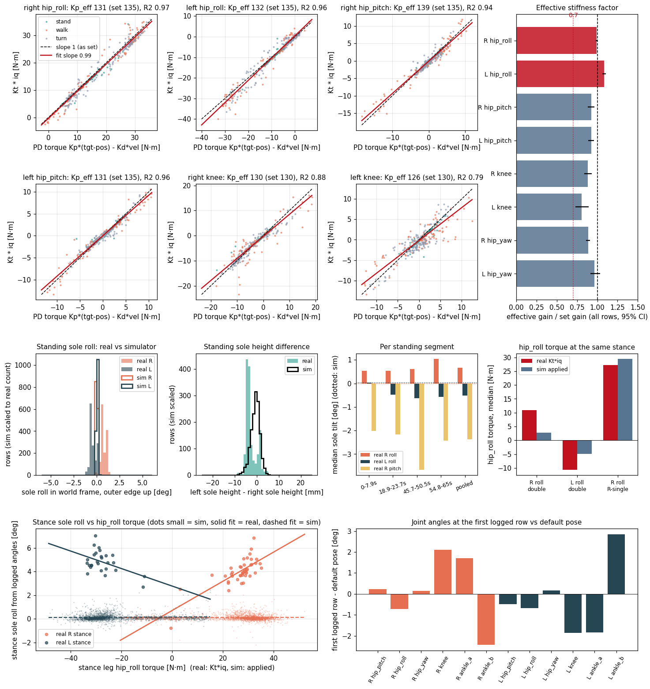

# 49999 정책 실기 기록 검사: hip_roll 실제 강성과 관절 영점 오차 (2026-10-30)

> 쓰기 규칙: ASD-STE100 을 한국어에 적용한다. 한 문장에 한 사실을 적는다. 숫자에는 단위를 붙인다.
> 이어지는 문서: `docs/178_union49999_narrow_stance_study.md` §4, `docs/sim2real/2026-10-30_union49999_stance_width.md` §3~§5.
> 자료: 실기 `Expr_Data/huphy_main_90bbd1f/1028_teleop_extra2_ob.csv` (65 s, 50 Hz, 모터 전류 `extra/*/iq` 포함). 시뮬레이터: 같은 명령 순서의 공칭(nominal) 재생 `nom_L2` (환경 8 개, 3249 걸음, 넘어짐 0).
> 도구: `tools/sim2real/walk/kp_zero_check.py`. 숫자 전부: `docs/sim2real/data/2026-10-30_union49999_kp_and_zero_check.json`.

## 0. 결론 먼저

1. **hip_roll 의 실제 강성은 설정값이다. 0.7 배가 아니다.** 모터 전류로 구한 유효 Kp 는 오른 131 N·m/rad, 왼 132 N·m/rad 이다. 설정은 135 이다. 설정 대비 비율은 0.99 와 1.08 이다. 대조 관절(hip_pitch, knee)은 0.81~0.93 이다. 그러므로 hip_roll 이 다른 관절보다 낮지 않다. 후보 "Kp ×0.7" 은 **모터 쪽에서는 기각**된다.
2. **서 있을 때 hip_roll 토크가 시뮬레이터의 2.2~3.9 배이다.** 두 발 서기에서 실기 +10.9 / −10.6 N·m, 시뮬레이터 +2.8 / −4.9 N·m 이다. 한 발 지지(걷기)에서는 같다 (27.2 대 29.5, −28.0 대 −27.7 N·m). hip_pitch 와 knee 의 서기 토크도 같다. 그러므로 "로봇 전체가 무겁다" 는 이 자료로 뒷받침되지 않는다. 서 있을 때 hip_roll 만 큰 토크를 쓴다.
3. **영점 오차의 증거는 약하다.** 서 있을 때 두 발바닥의 좌우 기울기 합(대칭 성분)은 +0.06° 이다 (영점 오차가 폭을 줄이는 방향의 성분). 구간마다 ±0.3° 흔들린다. 시뮬레이터의 방법 오차는 0.05° 이다. 대칭 성분 0.4° 는 폭 1.2 cm 에 해당한다. 설명해야 할 차이는 4.5~6.5 cm 이다. 그러므로 hip_roll 영점 오차는 서기 폭 차이의 원인이 될 수 없다.
4. **좌우 반대 성분 0.62° 와 높이 차 2.8 mm 가 있다.** 두 값은 월드 좌우축 회전 하나(0.6~0.7°)로 설명된다. 원인은 IMU 롤 장착각, 바닥 기울기, 양쪽 hip_roll 인코더가 같은 부호로 0.6° 어긋난 경우 중 하나이다. 이 성분은 발 폭을 바꾸지 않는다 (0.2 cm).
5. **새 발견이 하나 있다.** 걷기의 한 발 지지에서 지지 발바닥이 로그 각도 기준으로 바깥 가장자리 위로 3.9° (오른) / 4.8° (왼) 기울어 있다. 시뮬레이터는 0.08° 이다. IMU 는 원인이 아니다 (§4-3). 서기 자료는 hip_roll 의 선형 컴플라이언스를 배제한다. 원인은 발목·발 쪽일 수 있으며 확정하지 못했다.

### 0-1. 유효 강성 표 (전체 행, 모터 전류 기준)

| 관절 | 설정 Kp [N·m/rad] | 유효 Kp 오른 / 왼 | 설정 대비 오른 / 왼 (95 % 구간) | R² 오른 / 왼 |
|---|--:|--:|---|--:|
| **hip_roll** | 135 | **131 / 132** | **0.99 (0.98~1.00) / 1.08 (1.06~1.11)** | 0.98 / 0.98 |
| hip_pitch (대조) | 135 | 139 / 131 | 0.93 (0.88~0.97) / 0.92 (0.89~0.96) | 0.96 / 0.96 |
| knee (대조) | 130 | 130 / 126 | 0.88 (0.84~0.93) / 0.81 (0.73~0.89) | 0.91 / 0.86 |
| hip_yaw (추가 대조, RS03) | 75 | 69 / 72 | 0.89 (0.86~0.91) / 0.96 (0.91~1.03) | 0.96 / 0.93 |

- "유효 Kp" 는 `Kt·iq = Kp_eff·(tgt−pos) − Kd_eff·속도 + 상수` 의 회귀 기울기이다. "설정 대비 비율" 은 `Kt·iq` 를 설정 PD 토크 `Kp(tgt−pos) − Kd·속도` 에 회귀한 기울기이다.
- 정렬(§1)을 바꿔도 hip_roll 의 비율은 0.94~1.34 이다. 0.94 아래로 내려가지 않는다. 대조 관절은 0.66~1.18 이다.
- hip_roll 의 서기 / 걷기 / 회전 구간 유효 Kp: 오른 130 / 125 / 134, 왼 138 / 129 / 130 N·m/rad. 구간별 차이가 작다.
- 감쇠(Kd): hip_pitch 7.3 / 6.5, knee 7.4 / 7.0 N·m·s/rad (설정 6). hip_roll 은 속도가 작아 Kd 를 구할 수 없다.



## 1. 방법

### 1-1. 모터 전류 → 토크

| 항목 | 값 | 출처 |
|---|---|---|
| 모터 | hip_pitch, hip_roll, knee 는 RS04. hip_yaw, 발목은 RS03 | HUPHY `config/robot_v1.0.yaml` |
| 게인 | hip_pitch 135 / 6, hip_roll 135 / 6, knee 130 / 6 [N·m/rad, N·m·s/rad] | 같은 파일 |
| `iq` | 모터가 알려 주는 iq 필터값 (A). 토크를 만드는 q 축 전류 | HUPHY `robots/leg.py` `EXTRA_PARAMS` |
| 토크 상수 Kt | **1.485 N·m/A** (출력축, 감속비 9:1 포함) | RS04 매뉴얼: 정격 40 N·m / 정격 상전류 27 Apk = 1.48. 매뉴얼의 "토크 상수 2.1 N·m/Arms" 를 √2 로 나눈 값과 같다 |

- iq 가 실효값(Arms)이면 Kt 는 2.1 N·m/A 이다. 그러면 모든 기울기가 1.41 배가 된다. 관절 사이 비율은 변하지 않는다. 결론은 비율에 기대므로 Kt 에 의존하지 않는다.
- 기울기가 Kt = 1.485 에서 1 에 가깝다. 이것은 Kt 와 펌웨어 게인 적용이 함께 맞다는 뜻이다. 둘이 같이 어긋날 수도 있으나, 어긋남은 모든 관절에 똑같이 나타난다.
- iq 는 6 번째 행마다 새 값이 들어온다 (8.3 Hz, 행의 17 %). 사이의 5 행은 같은 값의 반복이다. **새 값이 들어온 행만 쓴다** (관절마다 542 행).
- pos 는 인코더 14 비트 (0.022° 단계)이다. 같은 값이 41 % 반복되지만, 이것은 양자화 때문이다. 멈춘 값이 아니다.
- 속도는 pos 의 4 행 중앙 차분이다 (시각 열 `t` 사용).
- **시간 정렬**: PD 토크를 다음 행의 pos 로 계산하고, 1 행 늦추고, 1 행 시간 상수로 평활한다 (`s=1, L=1, tf=1`). 이 설정은 **대조 관절(hip_pitch, knee 양쪽)의 R² 만으로** 고른 다음 hip_roll 에 그대로 썼다 (대조 R² 0.90). 모터 펌웨어가 20 ms 안에서 pos 를 계속 바꾸므로 정렬 오차가 생긴다. 이 오차는 기울기를 낮춘다.
- 신뢰 구간: 1 s 블록 부트스트랩 300 회.

### 1-2. 발바닥 기울기와 높이

- `stance_fk.py` 의 FK 에 로그 pos 12 개를 넣는다. 수동 발목 힌지와 막대는 닫힌 고리로 푼다.
- 월드 위 방향은 IMU 중력 관측 `obs/grav` 의 반대 방향이다. IMU 좌표계는 몸통 좌표계와 같다고 가정한다.
- 발 높이는 발 충돌 상자 모서리 중 위 방향으로 가장 낮은 점이다. 발바닥 기울기는 발 몸체 좌표축에서 구한다. 롤은 **바깥 가장자리가 위일 때 +** 이다 (오른 hip_roll + = 바깥 벌림이 발 바깥쪽을 올린다).
- 구간: cmd 가 0 (vx<0.05, |wz|<0.05)이고 관절 속도가 5°/s 미만이고 몸통 자이로(롤·피치)가 0.15 rad/s 미만인 행. 실기 1458 행이다. 그중 1450 행이 두 발 높이 차 8 mm 안이다 (두 발 지지).
- 시뮬레이터: 같은 구간 조건 + 접촉 센서가 두 발 모두 닿음. 8 환경 2211 행. 시뮬레이터의 발바닥은 실제로 평평하다. 이 값이 **방법 오차**이다.

## 2. A. 유효 강성

### 2-1. 결과

- hip_roll 의 모터 토크는 설정 PD 토크를 따른다 (R² 0.97~0.98). 기울기는 0.99 / 1.08 이다.
- 대조 관절도 같은 방식으로 0.8~0.93 이다. 대조 관절이 hip_roll 보다 낮다. 그러므로 낮은 기울기는 hip_roll 만의 성질이 아니라 이 방법의 공통 편향(정렬, 양자화)이다.
- hip_roll / hip_pitch 비율: 오른 1.06, 왼 1.17. 정렬 6 가지에서 0.94~1.34 이다. 0.7 근처가 나온 적은 없다.
- 서기 구간만 보아도 같다. 서기 평균 토크 비 (`평균 Kt·iq` / `평균 PD 토크`): hip_roll 0.97 / 1.03. 평균이라 시간 정렬에 둔감하다.

### 2-2. 이 결과가 말하는 것과 말하지 않는 것

- 말하는 것: **모터는 설정한 Kp 로 토크를 낸다.** 같은 pos 오차에 설정값의 토크를 낸다.
- 말하지 않는 것: **인코더 뒤쪽의 기계적 컴플라이언스(관절 쪽 처짐)는 이 시험에 보이지 않는다.** 모터 쪽 각도만 기록된다. 출력쪽이 더 처지면 실제 강성은 낮아진다. 컴플라이언스를 따로 시험한 결과는 §4-2 에 있다.

## 3. A3. hip_roll 토크: 실기 대 시뮬레이터 (같은 명령 순서)

| 상태 | 관절 | 실기 중앙값 오른 / 왼 [N·m] (구간 10~90 %) | 시뮬레이터 중앙값 오른 / 왼 [N·m] |
|---|---|---|---|
| 두 발 지지 서기 | hip_roll | **+10.9 (4.8~15.3) / −10.6 (−13.2~−5.8)** | +2.8 / −4.9 |
| 두 발 지지 서기 | hip_pitch | +0.6 / +1.4 | +0.6 / +0.6 |
| 두 발 지지 서기 | knee | −0.1 / +0.8 | −0.1 / +0.9 |
| 오른발 한 발 지지 (걷기) | hip_roll | +27.2 / −1.9 | +29.5 / −5.1 |
| 왼발 한 발 지지 (걷기) | hip_roll | +7.5 / −28.0 | +5.6 / −27.7 |
| 오른발 한 발 지지 | knee | −6.9 / −0.9 | −5.0 / +0.2 |
| 왼발 한 발 지지 | knee | −3.3 / +1.2 | −0.7 / +2.0 |

- 실기 행 수: 두 발 지지 240, 오른발 127, 왼발 65 (새 iq 행). 시뮬레이터는 환경 8 개의 모든 걸음 (4410~9161).
- 실기의 두 발 지지는 FK 높이 차 8 mm 안으로, 시뮬레이터는 접촉 센서로 가렸다. 오른발 / 왼발 한 발 지지도 같다.
- 실기의 두 발 서기에서 hip_roll 은 양쪽이 바깥 방향으로 약 11 N·m 를 낸다. 서기의 pos 오차 (+5.5° 와 −3.8°)와 맞는다 (135 N·m/rad × 5.5° = 13 N·m).
- 11 N·m 는 발 하나가 바닥을 옆으로 미는 힘 약 13 N (11 N·m ÷ 다리 길이 0.85 m)이다. 모델 질량 23.6 kg 에서 발 하나의 수직 힘은 약 116 N 이므로 마찰 계수 0.11 이면 버틴다. 이 토크는 몸 무게로 만들 수 없다. 발이 엉덩이보다 1 cm 안쪽에 서는 것이 만드는 토크는 약 1.2 N·m 이다 (116 N × 1 cm).
- 질량 후보(+4~6 kg)는 모델 질량 23.6 kg 의 17~25 % 이다. 질량 때문이라면 한 발 지지의 hip_roll 토크가 비슷하게 커져야 한다. 실기는 시뮬레이터보다 8 % 작다 (27.2 대 29.5). 다만 이 토크는 정책이 균형을 잡으려고 스스로 정하는 값이어서 질량의 깨끗한 척도가 아니다. 그러므로 이 시험은 질량 후보를 **약하게 불리하게** 하고, 기각하지는 못한다.
- 설명 후보 (확정하지 못함): 서 있을 때 발이 바닥에 걸려 정책의 바깥 목표를 따라가지 못하고 PD 가 오차를 쌓는다. 시뮬레이터는 발이 29 cm 까지 벌어져 오차가 작다. 이것이 서기 폭 차이 (22.5 대 29.1 cm)의 한 면이다. 바닥 마찰 계수를 모른다.

## 4. B. 영점 오차

### 4-1. 서 있을 때 발바닥 기울기와 높이 (실기 대 방법 오차)

| 구간 | 행 | 오른 롤 [°] | 왼 롤 [°] | 오른 피치 [°] | 왼 피치 [°] | 높이 차 L−R [mm] |
|---|--:|--:|--:|--:|--:|--:|
| 0~7.9 s | 366 | +0.53 | +0.03 | −2.02 | −1.81 | −4.1 |
| 18.9~23.7 s | 201 | +0.54 | −0.48 | −2.17 | −1.60 | −3.4 |
| 45.7~50.5 s | 224 | +0.60 | −0.63 | −3.66 | −1.69 | +1.3 |
| 54.8~65 s | 476 | +1.04 | −0.57 | −2.43 | −1.94 | −3.5 |
| **실기 전체 (중앙값)** | 1458 | **+0.67** | **−0.52** | **−2.38** | **−1.83** | **−3.4** |
| 시뮬레이터 (방법 오차) | 2211 | −0.01 | +0.04 | −0.34 | −0.49 | −0.6 |
| **실기 − 시뮬레이터** | | **+0.68** | **−0.56** | **−2.03** | **−1.34** | **−2.8** |

- 롤은 바깥 가장자리가 위일 때 + 이다. 피치는 발끝이 위일 때 + 이다. 높이 차는 왼 발바닥이 높을 때 + 이다.
- 높이 차의 전체 중앙값은 −3.4 mm 이고 시뮬레이터는 −0.6 mm 이다. 차이는 −2.8 mm 이다. 구간 중 45.7~50.5 s 만 부호가 반대이다 (+1.3 mm).
- 시뮬레이터의 방법 오차는 롤 0.05°, 높이 0.6 mm, 피치 0.4~0.5° 이다. 시뮬레이터 환경 8 개의 평균 롤은 모두 ±0.04° 안이다.
- 구간마다 롤이 ±0.3° 흔들린다. 서 있는 자세가 구간마다 다르기 때문이다. 이 값이 실기 측정의 불확실성이다.

### 4-2. 해석

| 성분 | 값 | 해석 |
|---|---|---|
| 대칭 롤 `(오른 + 왼) / 2` | **+0.06°** (구간 ±0.3°) | 양쪽 hip_roll (과 발목 롤)의 같은 방향 영점 오차. 폭을 바꾼다. **거의 0** |
| 좌우 반대 롤 `(오른 − 왼) / 2` | +0.62° | 월드 좌우축 회전 하나 |
| 높이 차 | −2.8 mm | 같은 회전의 값. 폭 × 회전 각도 = 0.23 m × 0.62° = 2.5 mm |
| 대칭 피치 | −1.7° | 양쪽 발끝이 아래. IMU 피치 장착각, 발목 크랭크 영점, 무릎·엉덩이 피치 영점 |

- **hip_roll 영점이 안쪽으로 2° 어긋났다면** 대칭 롤이 약 −2° 로 나와야 한다. 나온 값은 +0.06° 이다. 그러므로 안쪽 2° 는 기각된다.
- FK 로 대칭 성분을 영점 오차로 보고 보정한 폭은 22.59 cm 이다. 기록 폭은 22.77 cm 이다. 차이 0.2 cm 이다. 좌우 반대 성분까지 hip_roll 영점으로 보정해도 22.59 cm 이다 (한쪽은 바깥, 한쪽은 안쪽이어서 폭이 상쇄된다).
- 좌우 반대 롤 0.62°, 높이 차 2.8 mm 를 만드는 원인은 셋으로 가를 수 없다.
  1. IMU 롤 장착각 또는 바이어스 +0.6°.
  2. 바닥 기울기 0.6~0.7°.
  3. 양쪽 hip_roll 인코더가 같은 부호로 0.6° 어긋남.
- 서기 때 몸통 좌우 기울기는 IMU 로 0.86° 이다 (§0 의 지난 문서 값 0.94°). 시뮬레이터는 0.17° 이다. 이 값과 같은 크기이다.
- 대칭 피치 −1.7° 는 폭과 무관하다. 원인을 가르지 못했다.

### 4-3. 이 방법이 못 보는 것

- **보정 쌍**: hip_roll 이 +δ 어긋나고 발목 롤이 −δ 어긋나면 발바닥은 평평하게 보이지만 발 위치는 다리 길이 × δ 만큼 어긋난다. 발바닥 기울기는 같은 다리의 롤 축 영점 오차의 합만 본다.
- hip_yaw 영점: 발이 안쪽·바깥쪽으로 돌지만 발바닥 기울기와 높이는 변하지 않는다.
- 시뮬레이터의 방법 오차는 8 개 환경 같은 시나리오 한 번이다.

### 4-4. 로그 첫 행의 관절각 (기본 자세 대비)

로봇은 정책 시작 전에 기본 자세로 옮겨졌다. 첫 로그 행 (t = 0 s)의 pos 와 기본 자세의 차이는 다음과 같다.

| 관절 | 오른 pos | 기본 | 차이 [°] | 왼 pos | 기본 | 차이 [°] |
|---|--:|--:|--:|--:|--:|--:|
| hip_pitch | −9.79 | −10.03 | +0.23 | +9.53 | +10.03 | −0.50 |
| hip_roll | −0.71 | 0 | **−0.71** | −0.67 | 0 | **−0.67** |
| hip_yaw | +0.14 | 0 | +0.14 | +0.16 | 0 | +0.16 |
| knee | +22.17 | +20.05 | **+2.11** | −21.92 | −20.05 | **−1.87** |
| ankle_a (크랭크) | +9.95 | +8.25 | +1.70 | −10.08 | −8.24 | −1.83 |
| ankle_b (크랭크) | −10.87 | −8.43 | −2.44 | +11.26 | +8.42 | +2.85 |

- 기본 자세는 관측 `obs/q` 에서 거꾸로 구한 값이며 시뮬레이터의 `default_q12` 와 같다 (차 0.01° 안).
- 두 무릎이 모두 약 2° 더 굽어 있다. 두 발목 크랭크는 1.7~2.9° 어긋난다. 두 hip_roll 은 같은 부호(오른 안쪽, 왼 바깥쪽)로 0.7° 어긋난다.
- 이 차이가 영점 오차인지 정지 시 처짐인지 첫 행으로 가를 수 없다. 서 있는 구간의 무릎 토크가 거의 0 이다 (−0.1 / +0.8 N·m). 처짐이라면 2° × 130 = 4.8 N·m 가 필요하다. 처짐이 아닐 가능성이 높으나 정지 전 상태의 하중을 모른다.

## 5. 새 발견: 걷기 한 발 지지의 발바닥 기울기

| 항목 | 실기 | 시뮬레이터 |
|---|--:|--:|
| 오른발 지지, 오른 발바닥 롤 중앙값 | **+3.9°** (토크 +28 N·m, 44 행) | +0.08° |
| 왼발 지지, 왼 발바닥 롤 중앙값 | **+4.8°** (토크 −29 N·m, 27 행) | +0.08° |
| 토크와의 상관 | 오른 0.75, 왼 −0.47 (왼 토크가 음수이므로 같은 방향) | 0.03 |

- 한 발 지지에서 지지 발바닥이 로그 각도 기준으로 바깥 가장자리가 위로 4~5° 기울어 있다. 시뮬레이터의 지지 발바닥은 평평하다.
- 부호는 인코더가 모터 쪽에 있고 출력이 부하에 밀려 뒤처질 때(직렬 컴플라이언스)와 맞다. 인코더 각도가 실제 각도보다 바깥으로 앞선다.
- **IMU 는 원인이 아니다.** 걷기 세 구간에서 중력 벡터의 롤(0.4 Hz 고역 통과)과 자이로 적분의 비는 1.03 / 0.95 / 0.98 이고 상관은 0.96~0.98 이다. 걸음 대역에서 IMU 롤은 맞다. 몸통 롤의 표준편차가 0.7~0.8° 뿐이어서 4° 오차를 숨길 수 없다.
- **hip_roll 의 선형 컴플라이언스로는 설명되지 않는다.** 걷기에서 기울기 / 토크 = 0.14°/N·m (4° ÷ 28 N·m) 이다. 같은 값이면 서기의 11 N·m 에서 양쪽 +1.5° 가 나와야 한다. 서기의 대칭 롤은 +0.06° 이다. 서기가 컴플라이언스를 0.03°/N·m 아래 (직렬 강성 약 1900 N·m/rad 이상, 이때 총 강성 126 N·m/rad = 설정의 0.93 배)로 제한한다.
- 남는 후보: 발목 롤 쪽 컴플라이언스 (크랭크, 막대, 발바닥 고무), 발이 안쪽 가장자리로 실제로 기울어 선 경우. 이 시험은 위치를 가르지 못한다.
- 이 값이 발 폭에 주는 영향은 계산하지 않았다.

## 6. 한계

- 기록 한 개, 65 s. 서기 구간 4 개 (366, 201, 224, 476 행). 걷기 구간 3 개 (3.7~4.2 s). 한 발 지지의 새 iq 행은 오른 44, 왼 27 개뿐이다.
- iq 는 8.3 Hz 로 갱신되고 모터 안 필터를 거친다. 필터 시간 상수를 모른다. 정렬은 대조 관절의 R² 로 골랐다. 정렬에 따라 기울기가 대조 관절에서 0.66~1.18 로 움직인다. 비율(hip_roll / 대조)은 안정적이나 절대 기울기는 ±0.15 불확실하다.
- 마찰은 모른다. 모터 토크 = PD 토크가 맞아도 마찰이 있으면 토크와 관절 움직임의 관계가 바뀌지만, 이 시험은 모터 토크와 PD 토크를 비교하므로 마찰에 둔감하다.
- `tgt` 는 안전 가드 앞의 값이다 (docs/177). 가드가 hip_roll 을 바꾸었다면 회귀 기울기가 낮아진다. hip_roll 의 한계 (오른 −19.5~79.5°)에는 닿지 않았다 (tgt −7.4~+17.3°).
- Kt 는 매뉴얼 값에서 구했고 실측하지 않았다 (절대 토크 ±40 %). 관절 간 비율에는 영향이 없다.
- 시뮬레이터와 실기의 서기 자세가 다르다 (폭 22.8 대 28.2 cm). §3 의 토크 비교는 같은 자세의 비교가 아니다.
- 발바닥 기울기는 IMU 좌표계 = 몸통 좌표계 가정이다.

## 7. 풀리지 않은 것

1. 서기 때 실기 hip_roll 토크가 시뮬레이터의 2.2~3.9 배인 이유. 후보: 발과 바닥의 마찰, 서기 목표 오차. 실기 바닥 마찰 계수를 재야 한다.
2. 한 발 지지 때 발바닥 4~5° 기울기의 위치와 원인. 발목 크랭크 오차, 발 구조. 로봇을 한 발로 들어 올려 하중을 걸고, 발에 붙인 기울기 센서나 영상으로 발바닥 기울기를 재면 가른다.
3. 서기 폭이 시뮬레이터보다 5~6 cm 좁은 이유. hip_roll 모터 강성(§2)과 영점(§4)은 원인에서 빠진다. 남는 후보는 질량(§3 이 못 가름), 발과 바닥의 마찰, 위 2 번이다. 이 문서는 질량 후보를 배제하지 않는다.
4. 좌우 반대 롤 0.62° 의 원인 (IMU 장착각, 바닥, 인코더). 로봇을 수평 정반 위에 세우고 IMU 롤을 재면 가른다.
5. 영점 12 개의 실측. 보정 쌍(§4-3)은 이 방법으로 안 보인다. `docs/178` §5-1 의 줄자 시험이 필요하다.

## 8. 재현

```
S=<scratchpad>   # union_branch, stock_mjlab, out/sim 은 docs/sim2real/2026-10-30_union49999_stance_width.md §8 과 같다
CUDA_VISIBLE_DEVICES="" nice -n 10 mujoco-sim/mjlab/.venv/bin/python3 -I tools/sim2real/walk/kp_zero_check.py \
  --xml $S/union_branch/mjlab_policy/pygmalion_mjlab/assets/pygmalion_legonly_ab.xml \
  --real Expr_Data/huphy_main_90bbd1f/1028_teleop_extra2_ob.csv --sim-dir $S/out/sim --name nom_L2 \
  --out-json docs/sim2real/data/2026-10-30_union49999_kp_and_zero_check.json \
  --out-png docs/sim2real/img/2026-10-30_union49999_kp_and_zero_check.png
```

실행 약 1 분 (CPU 1 코어, FK 3250 행 + 시뮬레이터 CSV 8 개). 시뮬레이터 입력은 `nom_L2.npz` (토크 `tau`, 접촉 `foot_contact`) 와 `csv/nom_L2_env*.csv` 이다.
