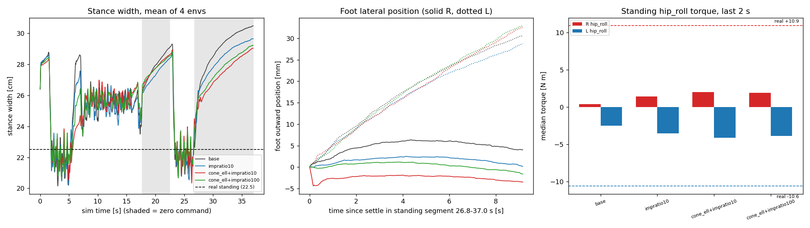

# 49999 정책: 시뮬레이터 접촉 크리프가 서기 폭을 넓히는가 (가설 시험)

> 쓰기 규칙: ASD-STE100 을 한국어에 적용한다. 한 문장에 한 사실을 적는다. 숫자에는 단위를 붙인다.
> 앞선 문서: `docs/sim2real/2026-10-30_union49999_stance_width.md` (§3 서기 폭 실기 22.5 cm, 시뮬 29.1 cm), `docs/sim2real/2026-10-30_union49999_kp_and_zero_check.md` (서기 hip_roll 토크 실기 +10.9 / −10.6, 시뮬 +2.8 / −4.9 N·m).
> 도구: `tools/sim2real/walk/sim_stance_record.py` (발 월드 위치 기록, 접촉 설정 기록, 변경 `cone_ell`, `impratio<f>`, `noslip<n>` 추가), `tools/sim2real/walk/contact_creep_analyze.py` (분석, 그림). 숫자 전부: `docs/sim2real/data/2026-10-30_union49999_sim_contact_creep.json`.

## 0. 결론 먼저

**가설은 기각된다.** 접촉 크리프를 줄여도 시뮬레이터는 22~24 cm 로 서지 않고, 서기 hip_roll 토크도 ±11 N·m 로 오르지 않는다.

1. **시뮬레이터의 발은 서 있는 동안 바깥으로 미끄러진다.** 왼발이 3.3~4.4 mm/s, 오른발이 0.0~0.9 mm/s 이다 (기준). 한 서기 구간(10.2 s)에서 왼발은 31 mm 바깥으로 간다. 두 발이 벌어진 합 35 mm 는 폭 증가 3.7 cm 와 같다.
2. **오른발 미끄러짐은 접촉 모델 크리프이다.** 마찰 원뿔을 타원(elliptic)으로 바꾸고 impratio 를 10 으로 올리면 오른발은 0.3 → −0.0 mm/s 가 된다.
3. **왼발 미끄러짐은 크리프가 아니다.** 변경 어느 것으로도 3.0~3.6 mm/s 에서 줄지 않는다. 이때 마찰 사용률(접선힘/수직힘)은 중앙값 0.08 로, 마찰 계수 0.6 의 한참 아래이다. 원인은 확인하지 못했다.
4. **폭은 바뀌지 않는다.** 10.2 s 서기 끝 2 s 의 폭은 기준 30.3 cm, 변경 28.8~29.5 cm 이다 (−0.8~−1.5 cm). 실기는 22.5 cm 이다. 서기 구간이 시작한 지 1 s 뒤의 폭이 이미 26~27 cm 이므로, 크리프가 만드는 부분은 1.3~3.7 cm 뿐이다.
5. **서기 hip_roll 토크는 실기에 가까워지지 않는다.** 서기 구간 중앙값이 오른 +1.3 → +2.4~3.3 N·m, 왼 −3.3 → −4.5~−5.5 N·m 이다. 실기는 +10.9 / −10.6 N·m 이다.
6. **noslip 은 이 시뮬레이터에서 돌릴 수 없다.** `mujoco_warp 3.10.0.1` 이 `noslip_iterations > 0` 에서 `NotImplementedError("noslip solver not implemented.")` 를 낸다. 학습도 같은 백엔드였으므로 학습 때 noslip 은 켤 수 없었고 꺼져 있었다.

그러므로 "실기에서만 서 있을 때 좁아짐" 이 시뮬레이터 접촉 크리프의 부산물이라는 설명은 이 시험으로 뒷받침되지 않는다. 학습 환경이 같은 크리프를 가졌는지는 학습 환경의 폭을 따로 재야 한다. 이 문서는 공칭(nominal) 설정만 재었다.



## 1. 방법

| 항목 | 내용 |
|---|---|
| 정책 | `terrain10_union_dr_49999`, `Pygmalion-Velocity-Generalized-Terrain10-UnionDR`, 순정 mjlab `20f10e96` + 가지의 `pygmalion_mjlab` (앞선 문서와 같다) |
| 명령 | **기록 2** `Expr_Data/huphy_main_90bbd1f/1028_teleop_extra2_ob.csv` 의 28~65 s (37 s, 1849 걸음). 시뮬 시각 = 기록 시각 − 28 s |
| 기록 선택 이유 | 기록 1 에는 걷기 뒤에 이어지는 0 명령 구간이 최대 7.0 s 이다. 요구 10 s 가 안 된다. 기록 2 의 54.8~65.0 s 가 10.2 s 이다 |
| 구간 | 걷기 28~34 s, 제자리 회전 34~45 s, **서기 1 = 기록 45.7~50.5 s (시뮬 17.7~22.5 s, 4.8 s)**, 걷기 50.5~54.8 s, **서기 2 = 기록 54.8~65.0 s (시뮬 26.8~37.0 s, 10.2 s)** |
| 설정 | 공칭 (무작위화·잡음·지연 끔), 환경 4 개, 평탄 바닥, 밀기 끔, CPU, 한 번에 한 프로세스 |
| 서기 구간 정의 | vx, wz 명령 절댓값이 모두 0.05 미만으로 3 s 이상 이어지는 구간. 앞 1 s 는 정착으로 버린다 |
| 폭 | 몸통 좌표계에서 두 발 중심(발 상자 3 개 중심 평균)의 좌우 거리 |
| 발 미끄러짐 | 발바닥 중심점(발 링크 좌표 (0.05, 0, −0.043) m)의 월드 위치를 서기 구간 시작(정착 뒤)의 몸통 방향 축에 투영한다. 바깥 = 오른발 −y, 왼발 +y. 속도 = 최소제곱 기울기 |
| 서기 토크 | 두 발이 모두 접촉한 걸음의 hip_roll 토크 중앙값, 정착 뒤 구간 전체 (앞선 문서의 +2.8 / −4.9 와 같은 방식) |

## 2. 접촉 설정 (컴파일된 모델, 환경 0, 학습 과제와 같은 설정)

| 항목 | 값 |
|---|---|
| 마찰 원뿔 | **pyramidal** (mjlab 기본) |
| impratio | **1.0** |
| noslip_iterations | **0** (모델에 넣어도 mujoco_warp 가 거부) |
| 풀이기 | Newton, 반복 10, 허용오차 1e-8, 적분기 implicitfast |
| 시간 간격 | 0.005 s 물리, 4 걸음에 한 번 정책 (0.02 s) |
| 발 충돌 상자 6 개 (`R/L_foot1~3_collision`) | 상자, condim 3, **priority 1**, 마찰 0.6 (미끄럼) / 0.005 (비틂) / 0.0001 (구름), solref (0.02, 1.0), solimp (0.9, 0.95, 0.001, 0.5, 2.0), margin 0, gap 0 |
| 바닥 (`terrain_0`, 상자) | condim 3, priority 0, 마찰 1.0 / 0.005 / 0.0001, solref (0.03, 1.0), solimp (0.9, 0.95, 0.003, 0.5, 2.0), margin 0, gap 0 |

- 발과 바닥의 priority 가 다르므로 **발 상자의 마찰·solref·solimp 가 접촉에 쓰인다** (마찰 0.6). 바닥 마찰 1.0 은 쓰이지 않는다.
- solref 시간 상수 0.02 s 는 물리 간격 0.005 s 의 4 배이다. 접촉이 부드럽다. 접선 방향도 마찰 원뿔의 정규화(impratio 1)로 부드럽다.
- 앞선 문서의 발 마찰 0.3 / 1.2 시험은 이 마찰 값만 바꾸었고 서기 폭을 바꾸지 못했다.

## 3. 발 미끄러짐 (기준 시뮬레이터, 서기 구간)

| 구간 | 발 | 바깥 순변위 [mm] | 바깥 속도 [mm/s] | 앞뒤 속도 [mm/s] | 접촉 끊김 걸음 비율 |
|---|---|--:|--:|--:|--:|
| 서기 1 (4.8 s) | 오른 | 3.5 ± 0.5 | 0.88 ± 0.21 | −3.7 | 0.16 |
| 서기 1 | 왼 | 17.0 ± 0.9 | 4.36 ± 0.19 | −3.5 | 0.16 |
| 서기 2 (10.2 s) | 오른 | 4.1 ± 2.5 | 0.29 ± 0.34 | −3.6 | 0.15 |
| 서기 2 | 왼 | **30.7 ± 10.4** | **3.26 ± 1.20** | −4.7 | 0.19 |

(± 는 환경 4 개 표준편차. 앞뒤 속도의 음수는 뒤쪽이다.)

- 폭 증가는 서기 1 에서 2.0 cm, 서기 2 에서 3.7 cm 이다. 두 발 바깥 순변위의 합은 서기 1 에서 2.0 cm, 서기 2 에서 3.5 cm 이다. **폭 증가는 발 미끄러짐으로 거의 다 설명된다.**
- **걸음(발 들기)과 미끄러짐의 구분**: 접촉이 끊긴 걸음이 15~19 % 있다. 그러나 끊김은 한 걸음(0.02 s)짜리이다 (평균 길이 0.023~0.025 s, 10 s 당 66~77 회). 발바닥이 뜨는 높이는 최대 1.1~4.9 mm 이다. **발을 드는 걸음은 없고, 접촉이 깜박이는 미세 떨림이다.**
- 기준에서 왼발의 바깥 속도는 접촉이 유지된 걸음 쌍에서 2.6~3.6 mm/s, 접촉이 끊긴 쌍에서 4.9~6.5 mm/s 이다. 둘 다 바깥으로 움직인다. 변경 시험에서도 접촉 유지 쌍의 속도는 2.3~2.9 mm/s 이다.
- 두 발은 뒤쪽으로도 3~5 mm/s 로 간다. 몸통의 월드 위치도 서기 동안 1~16 mm/s 로 움직인다 (환경마다 다르다). 이 뒤쪽 이동은 분석하지 않았다.
- 접촉 마찰 사용률 |접선힘|/수직힘 은 서기 2 에서 중앙값 0.07 (오른) / 0.08 (왼), 90 번째 백분위 0.18 / 0.21, 99 번째 백분위 0.25 / 0.26 이다. **마찰 원뿔 한계(0.6)에는 닿지 않는다. 정지마찰 영역에서 움직이는 것이다.**

## 4. 접촉 모델 변경 시험 (서기 2 = 10.2 s 기준, 환경 4 개)

| 변경 | 마찰 원뿔 / impratio | 걷기 폭 [cm] | 걸음 폭 [cm] | 서기 2 시작 → 끝 2 s 평균 폭 [cm] | 서기 1 끝 폭 [cm] | 서기 2 왼발 / 오른발 바깥 속도 [mm/s] | 서기 hip_roll 토크 오른 / 왼 [N·m] (서기 1, 서기 2) | 넘어짐 |
|---|---|--:|--:|---|--:|---|---|---|
| 기준 | pyramidal / 1 | 22.8 | 21.6 | 26.8 → **30.3** | 29.1 | 3.3 / 0.3 | +2.7 / −5.0, +1.3 / −3.3 | 0/4 |
| (a) noslip 10 | pyramidal / 1 | 실행 불가 | | | | | | `NotImplementedError` |
| (a′) impratio 10 | pyramidal / 10 | 22.7 | 21.8 | 26.5 → 29.5 | 28.4 | 3.0 / 0.0 | +3.5 / −5.8, +2.4 / −4.5 | 0/4 |
| (b) 타원 + impratio 10 | elliptic / 10 | 22.9 | 21.8 | 25.9 → 28.8 | 28.6 | 3.5 / −0.0 | +3.1 / −5.3, +3.3 / −5.5 | 0/4 |
| (c) 타원 + impratio 100 | elliptic / 100 | 23.0 | 21.9 | 26.0 → 29.0 | 28.5 | 3.6 / −0.2 | +3.0 / −5.3, +3.1 / −5.2 | 0/4 |
| **실기** | | 21.9 (기록 1) | 22.4 | 서기 끝 22.5 | | 실기 발 위치 없음 | +10.9 / −10.6 | |

- (a) noslip 과 (b) 의 합은 만들 수 없다. 대신 **(c) 타원 + impratio 100** 이 가장 강한 가능 조합이다. impratio 는 마찰 방향 임피던스를 올려 접선 크리프를 줄이는, noslip 의 대용 수단이다.
- 걷기 폭 (vx > 0.1 의 모든 걸음 평균)과 걸음 폭 (두 발이 앞뒤로 지나칠 때의 좌우 거리)은 변경 사이에 0.3 cm 안에서 같다. **걷기는 접촉 모델에 둔감하다.**
- 서기 2 끝의 폭은 기준보다 0.8~1.5 cm 작다. 서기 1 끝은 0.5~0.7 cm 작다. 기준 대비 변화가 있어도 실기 22.5 cm 와는 6.3~7.0 cm 차이가 남는다.
- 서기 2 시작 1 s 뒤의 폭이 25.9~26.8 cm 이다. **크리프가 시작되기 전에 이미 3.4~4.3 cm 넓다.**
- 서기 토크는 변경 간 차이가 0.5~2 N·m 이다. 실기 값과의 차이는 7~8 N·m 로 그대로이다.
- 4 개 환경이므로 서기 2 의 환경 사이 폭 표준편차는 0.2~1.1 cm 이다 (그림 가운데는 평균).
- 모든 시험에서 넘어짐은 없다.

## 5. 해석

- **크리프는 있다.** 기준의 오른발 0.3~0.9 mm/s 는 타원 원뿔과 높은 impratio 로 0 이 된다. 이것이 부드러운 접촉의 접선 크리프이다.
- **크리프를 없애도 폭이 좁아지지 않는다.** 왼발이 계속 바깥으로 간다. 이 이동은 접선 정규화가 아닌 다른 원인이 있다. 후보는 접촉이 깜박이는 한 걸음 떨림이 발을 바깥으로 밀어내는 막대 효과이다. 시험하지 않았다. 정책이 서서 만드는 hip_roll 바깥 지시(앞선 문서 §3-2, 서기 목표 오른 +2.5° / 왼 −3.4°)가 발을 계속 밀 수 있다.
- **서기 토크가 낮은 이유는 접촉이 아니다.** 시뮬레이터 hip_roll 토크 중앙값은 크리프를 없애도 +2~3 / −4~−5 N·m 이다. 실기의 선하중(preload)이 +10.9 / −10.6 N·m 로 크다. 이 차이는 접촉 모델 밖에서 온다 (질량 분포, 인코더 영점, 발목 컴플라이언스 후보. 앞선 문서 §7).
- **실기의 발이 미끄러지지 않는다는 것은 이 문서가 확인하지 못했다.** 실기 기록에는 발 월드 위치가 없다.

## 6. 풀리지 않은 것

- 왼발이 서 있는 동안 3~4 mm/s 로 바깥으로 가는 원인. 접촉 깜박임(10 s 당 66~77 회, 발바닥 1~5 mm 들림)이 후보이다. 이 깜박임이 정책의 떨림인지 접촉 풀이기의 떨림인지 가르지 못했다.
- noslip 을 직접 시험하지 못했다. mujoco_warp 에 구현이 없다. 순정 MuJoCo(CPU)로 같은 정책을 돌리는 경로는 이 환경에 없다.
- 학습 무작위화 켠 시뮬레이터와 학습 환경의 서기 폭은 이 시험에서 재지 않았다. 공칭 설정만 재었다.
- 환경 4 개, 명령 구간 한 개이다. 기록 1 은 서기 구간이 짧아(최대 7.0 s) 쓰지 않았다.
- 접촉 설정 표는 시험 모델에서 읽었다. 학습 때 모델이 같다는 근거는 같은 과제 설정이라는 점뿐이다.

## 7. 재현

```
SP=<scratch>
CUDA_VISIBLE_DEVICES="" MUJOCO_GL=egl nice -n 10 mujoco-sim/mjlab/.venv/bin/python3 tools/sim2real/walk/sim_stance_record.py \
  --branch-root $SP/union_branch/mjlab_policy --mjlab-src $SP/stock_mjlab/src \
  --trace Expr_Data/huphy_main_90bbd1f/1028_teleop_extra2_ob.csv --seg 28:65 --num-envs 4 --name cr \
  --variants base,impratio10,cone_ell+impratio10,cone_ell+impratio100,noslip10 --out $SP/out
mujoco-sim/mjlab/.venv/bin/python3 tools/sim2real/walk/contact_creep_analyze.py --sim-dir $SP/out --prefix cr \
  --variants base,impratio10,cone_ell+impratio10,cone_ell+impratio100 --out-json <json> --out-png <png>
```

실행 시간 (공용 CPU, 부하 평균 26): 기준 135 s, impratio 10 173 s, 타원 535~616 s.
