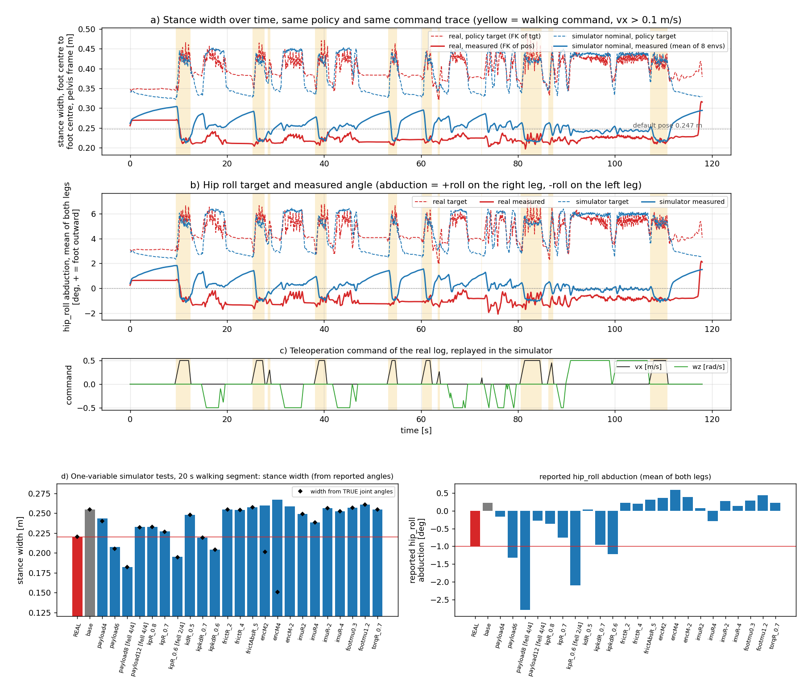

# 49999 정책의 스탠스 폭: 시뮬레이터에도 좁아짐이 있는가

2026-10-30. 대상: `origin/generalized-union-dr` 의 `terrain10_union_dr_49999` (체크포인트 `model_49999.pt`, `policy.onnx`). 과제 `Pygmalion-Velocity-Generalized-Terrain10-UnionDR`. 실기 기록: `Expr_Data/huphy_main_90bbd1f/1028_teleop_ob.csv` (118 s, 기록 1) 와 `1028_teleop_extra2_ob.csv` (65 s, 기록 2). 게이트웨이 설정: 게인 1.0, `--hz 50` (정책 간격 중앙값 20.0 ms), 명령 vx 0~0.5 m/s, wz −0.5~0.5 rad/s.

이 문서에서 "스탠스 폭" 은 **두 발 중심 사이의 좌우 거리**이다. 몸통(pelvis) 좌표계에서 잰다. 정기구학(FK)으로 구한다.

## 0. 결론 먼저

1. **같은 정책, 같은 명령으로 시뮬레이터를 돌리면 좁아짐이 이미 나온다.** 정책이 지시하는 폭은 실기 39.9 cm, 시뮬레이터 38.7 cm 로 같다. 실제 폭은 실기 22.5 cm, 시뮬레이터 25.8 cm 이다. 지시 대비 좁아짐은 실기 17.4 cm, 시뮬레이터 12.9 cm 이다. 시뮬레이터가 좁아짐의 약 74 % 를 이미 만든다 (기록 1, 전체 구간).
2. **걸을 때의 폭은 시뮬레이터와 같다.** 두 발이 앞뒤로 스칠 때의 좌우 거리(걸음 폭)는 실기 22.4 cm, 시뮬레이터 22.1 cm, 학습 무작위화 켠 시뮬레이터 22.7 cm 이다. 걷기 구간의 평균 폭은 실기 21.9 cm, 시뮬레이터 23.5 cm 이다.
3. **차이는 서 있을 때 생긴다.** 5 s 이상 서 있은 뒤의 폭은 실기 22.5 cm, 시뮬레이터 29.1 cm 이다. 시뮬레이터의 발은 서 있는 동안 바깥으로 천천히 벌어진다. 실기의 발은 벌어지지 않는다. 서기 구간 평균 폭은 실기 22.9 cm, 시뮬레이터 27.4 cm 이다.
4. **시뮬레이터를 실기처럼 좁게 만드는 단일 변경은 두 가지이다.** 엉덩이 좌우(hip_roll) Kp 를 0.7 배로 줄이거나 (135 → 약 95 N·m/rad), 몸통 점질량을 +4~6 kg 더하는 것이다. 둘 다 폭과 측정 각도를 실기 쪽으로 옮긴다. 마찰, 영점 오차(기록에 보이는 값), IMU 롤 장착각, 발 마찰, 토크 한계는 옮기지 못한다. 이 기록만으로는 Kp 와 질량을 가르지 못한다 (§5).
5. **영점 오차는 기록에 안 보이는 좁아짐을 만들 수 있다.** 엉덩이 좌우 영점이 2° 어긋나면 기록의 각도와 폭은 거의 그대로이고 실제 폭만 25.4 cm 에서 20.1 cm 로 줄어든다 (4° 면 15.0 cm). 실기 폭은 영점이 맞다는 가정 아래의 값이다.

## 1. 방향 부호 (바깥쪽이 어느 쪽인가)

**오른쪽 hip_roll 의 + 가 바깥쪽(벌림)이고, 왼쪽은 − 가 바깥쪽이다.** 근거는 두 가지이다.

- MJCF `pygmalion_legonly_ab.xml`: 두 다리 모두 축이 `-1 0 0` 이고, 오른쪽 범위는 −25~+85°, 왼쪽은 −85~+25° 이다. 큰 범위가 바깥쪽이다.
- FK 실측 (기본 자세에서 한쪽만 +10°): 오른발 y 가 −0.124 m → −0.270 m (몸통 좌표계 y 는 왼쪽이 +, 오른발은 이미 −쪽에 있으므로 바깥으로 14.6 cm). 왼쪽 +10° 는 왼발 y 를 +0.124 m → −0.023 m 로 보낸다 (안쪽으로 14.7 cm). 양쪽 ±5° 는 폭을 24.7 cm → 39.4 cm (바깥) 또는 10.1 cm (안쪽) 로 바꾼다.

그러므로 목표 오른 +5.1° / 왼 −4.1° 는 **바깥쪽 지시**이다. 측정 오른 −1.4° / 왼 +0.2° 는 **약간 안쪽**이다. 이 문서의 "벌림각" 은 오른쪽 +roll, 왼쪽 −roll 이다 (바깥이 +).

기하 값: 기본 자세 폭 24.7 cm. 발 상자 너비 10 cm. hip_roll 1° 마다 한 발이 약 1.5 cm 움직이고, 두 다리가 같이 1° 움직이면 폭이 2.9 cm 바뀐다.

## 2. 방법

| 항목 | 내용 |
|---|---|
| FK | `tools/sim2real/walk/stance_fk.py`. 모터 12 개 각도를 넣고, 수동 발목 힌지·막대는 닫힌 고리 4 개의 구속을 가우스-뉴턴으로 풀어 구한다 (`render_s2r_videos.py` 와 같은 방법, 잔차 최대 1e-9). 발 중심은 발 충돌 상자 3 개의 상자 중심, 안쪽 가장자리는 발바닥 근처 점의 안쪽 끝이다. |
| 구간 | 서기: vx<0.05 이고 abs(wz)<0.05. 걷기: vx>0.1. 회전: abs(wz)>0.1 이고 vx≤0.1. 기록 1 은 서기 2586 행, 걷기 1095 행, 회전 2041 행. |
| 걸음 폭 | 걷기 구간에서 두 발의 앞뒤 위치가 서로 지나치는 행(x_R − x_L 부호 변화)의 좌우 거리. 기록 1 에서 62 번. |
| 지지/유각 | 실기에는 접촉 신호가 없다. 발바닥 높이를 FK 와 중력 관측으로 구해 8 mm 넘게 낮은 쪽을 지지다리로 본다. 시뮬레이터에는 실제 접촉도 있어 둘을 비교했다. |
| 시뮬레이터 | 순정 mjlab `20f10e96` + 가지의 `pygmalion_mjlab`. CPU, 평탄 바닥 60×60 m, 평균 행동, 환경 8 개, 밀기 끔. 명령은 기록의 `obs/cmd/vx`, `obs/cmd/wz` 를 시간 순으로 넣는다 (`sim_stance_record.py`). 시작은 기본 자세, 관절 ±0.05 rad. |
| 공칭(nominal) | 무작위화·잡음·지연 모두 끔. |
| 학습 무작위화(DR) | 과제의 무작위화 전부 켬 (몸통 질량 U(−1, 8) kg, Kp·Kd ±20 %, IMU 장착각 ±2°, 관측 지연 0~40 ms, 행동 지연 0~20 ms, 수동 막대 마찰, 영점 ±0.015 rad, 초기 엉덩이 롤 섭동 포함). 밀기만 끔. |
| 정책 재생 | 기록의 44 입력 → `policy.onnx` / `model_49999.pt` 행동망 → 기록의 `act`. |

### 2-1. 정책이 맞는 망인가

**맞다.** 두 기록 모두에서 ONNX 출력과 기록된 `act` 의 최대 차이는 3.3e-5 / 3.4e-5 이다 (CSV 6 자리 반올림 수준). 체크포인트 행동망과 ONNX 의 차이는 8e-7 이다. `tgt = clip(기본 자세 + 0.25 × act)` 는 5e-5° 안에서 맞다. `last_act[t+1] = act[t]` 는 1e-7 안에서 맞다. `policy.onnx` sha256 은 `ac9a076e…` 로 `deploy.yaml` 과 같다. 입력 명령은 2 개(vx, wz)이다.

## 3. 실기와 시뮬레이터 비교 (기록 1, 같은 명령 순서)

그림: `docs/sim2real/img/2026-10-30_union49999_stance_width.png`.



### 3-1. 스탠스 폭 [cm] (FK, 몸통 좌표계)

| 구간 | 실기 측정 | 시뮬 공칭 측정 | 시뮬 DR 측정 | 실기 목표 | 시뮬 공칭 목표 | 시뮬 DR 목표 |
|---|---|---|---|---|---|---|
| 전체 | 22.5 | 25.8 | 25.1 | 39.9 | 38.7 | 39.4 |
| 서기 | 22.9 | 27.4 | 27.0 | 37.6 | 34.2 | 35.5 |
| 걷기 | 21.9 | 23.5 | 23.0 | 41.2 | 40.8 | 41.1 |
| 회전 | 22.5 | 25.0 | 23.8 | 42.1 | 43.3 | 43.7 |
| 걸음 폭 (걷기, 스칠 때) | 22.4 | 22.1 | 22.7 | 46.4 | 41.9 | — |
| 5 s 넘는 서기의 끝 2 s | 22.5 | 29.1 | — | — | — | — |

- 기록 2 도 같다. 전체 실기 22.9 / 공칭 26.0, 걷기 22.5 / 22.4, 걸음 폭 22.9 / 21.3 cm.
- 안쪽 가장자리 사이 간격 (발 사이 빈틈): 실기 12.2 cm, 시뮬 공칭 15.4 cm. 두 경우 모두 발이 닿지 않는다.
- DR 켠 환경 8 개의 전체 폭은 23.5~28.1 cm, 걷기 폭은 21.6~26.1 cm 이다. **실기 걷기 폭은 DR 범위 안**이고, 실기 전체 폭 22.5 cm 는 DR 범위(최소 23.5 cm) 밖이다.

### 3-2. hip_roll 각도 [deg] (평균, 기록 1)

| 구간 | 다리 | 실기 목표 / 측정 / 목표−측정 | 시뮬 공칭 목표 / 측정 / 목표−측정 | 시뮬 DR 측정 / 목표−측정 |
|---|---|---|---|---|
| 전체 | 오른 | +5.1 / −1.4 / **+6.5** | +4.2 / +0.4 / +3.9 | +0.1 / +4.3 |
| 전체 | 왼 | −4.1 / +0.2 / **−4.3** | −4.4 / −0.3 / −4.1 | −0.2 / −4.5 |
| 서기 | 오른 | +4.1 / −1.3 / **+5.5** | +2.5 / +0.8 / +1.7 | +0.6 / +2.2 |
| 서기 | 왼 | −3.6 / +0.2 / −3.8 | −3.4 / −0.9 / −2.5 | −0.9 / −3.2 |
| 걷기 | 오른 | +5.8 / −1.5 / **+7.3** | +4.8 / −0.6 / +5.4 | −0.9 / +5.7 |
| 걷기 | 왼 | −4.3 / +0.4 / −4.7 | −5.1 / +0.2 / −5.3 | +0.3 / −5.3 |

- **목표−측정이 시뮬레이터에도 3.9° / −4.1° 있다.** 옛 정책 37400 의 시뮬레이터 값(+5.6 / −5.5°)과 같은 종류의 평형이다. 실기만의 현상이 아니다.
- 실기는 오른쪽이 더 크다 (+6.5° 대 −4.3°). 시뮬레이터는 좌우 대칭이다 (+3.9° 대 −4.1°). **좌우 비대칭은 시뮬레이터에 없다.**
- 지지/유각 (걷기 구간, FK 로 추정한 같은 방법): 지지다리의 목표−측정은 실기 오른 +10.2° / 왼 −8.8°, 시뮬 오른 +10.6° / 왼 −11.4° 이다. 유각 다리는 실기 +4.3° / −1.3°, 시뮬 +1.8° / −1.7° 이다. 시뮬레이터의 실제 접촉으로 가르면 오른 지지 다리가 목표 +8.6° / 측정 +0.6° 이다. **지지 다리의 큰 오차는 두 쪽에서 같다.** 실기는 유각 오른 다리도 4.3° 가 남는다.
- 서기 때 차이가 가장 크다. 오른쪽 목표−측정이 실기 +5.5°, 시뮬 +1.7° 이다. 실기의 정책은 더 바깥(+4.1° 대 +2.5°)을 지시하고, 다리는 더 안쪽(−1.3° 대 +0.8°)에 있다.
- 시뮬레이터 hip_roll 토크: 서기 두 발 지지에서 오른 3.7 N·m, 왼 −5.8 N·m. 오른발 외다리 지지에서 오른 18.8 N·m. 최대 절댓값 54 N·m (한계 120 N·m 아래). 실기 토크는 기록에 없다.

### 3-3. 다른 관절의 정지 오차 (목표−측정 평균 [deg], 기록 1, 전체 구간)

| 관절 | 실기 | 시뮬 공칭 |
|---|---|---|
| 오른 hip_pitch / hip_yaw / 무릎 | +0.03 / +2.26 / −0.77 | +0.09 / +1.51 / −0.42 |
| 오른 크랭크 A / B | −6.37 / +4.84 | −3.94 / +5.80 |
| 왼 hip_pitch / hip_yaw / 무릎 | +0.15 / −1.54 / +0.28 | +0.07 / −1.44 / +0.29 |
| 왼 크랭크 A / B | +3.62 / −4.67 | +3.18 / −6.80 |

- hip_pitch, 무릎, 왼쪽 hip_yaw 는 1° 안에서 맞는다. 오른쪽 hip_yaw 가 +0.8°, 오른 크랭크 A 가 −2.4° 더 크다.
- 측정값(평균 각도)도 맞는다. 예: 오른 hip_pitch −10.2° 대 −10.9°, 오른 무릎 21.4° 대 22.1°.

## 4. 단일 변경 시험 (시뮬레이터, 공칭, 기록 1 의 9~29 s)

구간 9~29 s 는 걷기 명령 30 %, 회전 23 % 를 담는다. 환경 4 개, 각 시험은 변경 하나만 둔다. 변경은 과제의 무작위화 함수로 넣었다 (`sim_stance_record.py --variants`). "측정" 은 정책이 받은 각도(= 실기 로그에 남는 값)이다. 같은 구간의 실기 값은 폭 22.0 cm, 벌림각 오른 −1.6° / 왼 −0.4°, 목표−측정 +7.4° / −4.0° 이다.

| 변경 | 폭 [cm] | 측정 벌림각 오른 / 왼 [°] | 목표−측정 오른 / 왼 [°] | 넘어짐 | 실기 쪽으로? |
|---|---|---|---|---|---|
| **실기 (같은 20 s)** | **22.0** | **−1.6 / −0.4** | **+7.4 / −4.0** | — | — |
| 기준 (변경 없음) | 25.4 | +0.2 / +0.2 | +3.9 / −4.2 | 0/4 | — |
| 몸통 +4 kg | 24.3 | −0.5 / +0.1 | +4.8 / −4.8 | 0/4 | 조금 |
| 몸통 +6 kg (추가) | 20.8 | −2.0 / −0.6 | +6.4 / −6.0 | 0/4 | **예** |
| 몸통 +8 kg | 18.2 | −3.0 / −2.6 | +6.4 / −5.2 | **4/4** (7.3~10.8 s) | 넘어지기 전 값 |
| 몸통 +12 kg | 23.3 | +0.7 / −1.3 | +4.6 / −5.2 | **4/4** (2.0~2.5 s) | 자료 2 s, 무의미 |
| hip_roll Kp ×0.8 | 23.3 | −0.3 / −0.4 | +5.0 / −5.2 | 0/4 | 예 |
| hip_roll Kp ×0.7 (추가) | 22.7 | −0.8 / −0.7 | +5.8 / −5.9 | 0/4 | **예** |
| hip_roll Kp ×0.6 | 19.5 | −2.1 / −2.1 | +6.2 / −5.8 | 2/4 (4.6, 4.7 s) | 지나침 |
| hip_roll Kd ×0.5 | 24.8 | −0.1 / +0.1 | +4.0 / −4.3 | 0/4 | 거의 없음 |
| hip_roll Kp·Kd ×0.7 (추가) | 21.9 | −0.9 / −1.1 | +5.8 / −6.2 | 0/4 | **예** |
| hip_roll Kp·Kd ×0.6 | 20.4 | −1.2 / −1.2 | +6.5 / −6.8 | 0/4 | 예 (조금 지나침) |
| hip_roll 마찰 ×2 / ×4 | 25.5 / 25.4 | +0.2 / +0.3, +0.1 / +0.3 | +4.0 / −4.3 | 0/4 | 아니오 |
| hip_roll 마찰 5 N·m 고정 | 25.7 | +0.2 / +0.4 | +4.0 / −4.2 | 0/4 | 아니오 |
| 영점 2° (안쪽 방향, 측정 기준) | 26.0 (**실제 20.1**) | +0.4 / +0.3 (실제 −1.6 / −1.7) | +3.4 / −3.8 | 0/4 | 측정은 아니오, 실제 폭은 예 |
| 영점 4° (안쪽 방향) | 26.7 (**실제 15.0**) | +0.5 / +0.7 (실제 −3.5 / −3.3) | +3.0 / −3.5 | 0/4 | 측정은 아니오 |
| 영점 2° (반대 방향) | 25.8 (실제 31.6) | +0.2 / +0.6 (실제 +2.2 / +2.6) | +4.1 / −4.3 | 0/4 | 아니오 |
| IMU 롤 +2° / +4° | 24.9 / 23.8 | +0.8 / −0.7, +1.2 / −1.8 | +3.7 / −4.4, +3.7 / −4.9 | 0/4 | 한쪽만 |
| IMU 롤 −2° / −4° | 25.6 / 25.3 | −0.5 / +1.0, −1.3 / +1.6 | +4.2 / −4.2, +4.6 / −4.2 | 0/4 | 한쪽만 |
| 발 마찰 0.3 / 1.2 | 25.7 / 26.1 | +0.2 / +0.3, +0.3 / +0.6 | +3.9 / −4.1, +3.7 / −4.0 | 0/4 | 아니오 |
| hip_roll 토크 한계 ×0.7 | 25.4 | +0.2 / +0.2 | +3.9 / −4.2 | 0/4 | 아니오 (토크가 한계에 안 닿음) |

읽는 법과 한계:

- 영점 시험은 정책이 **영점이 어긋난 각도를 본다**는 가정이다. 시뮬레이터의 기본 영점 무작위화는 목표만 어긋나게 하고 관측은 어긋나지 않게 한다 (`joint_pos_rel` 의 `biased=False`). 이 시험은 관측도 어긋나게 바꿨다. 실기 영점 오차는 관측에도 보이므로 이 쪽이 실기에 가깝다.
- 환경 4 개, 20 s 한 번이다. 환경 사이 폭 표준편차는 0.1~0.6 cm 이고 Kp ×0.6 만 1.3 cm 이다.
- 몸통 +8 kg 부터는 공칭 시뮬레이터가 넘어진다. 넘어지기 전 자료만 쓴 값이다.
- 오른쪽이 더 큰 좌우 비대칭(실기 +7.4° 대 −4.0°)은 어느 변경도 만들지 못했다. IMU 롤은 벌림각을 오른 / 왼에 반대 부호로 옮기지만 목표−측정은 거의 안 바꾼다.
- 정책의 IMU 기울기 민감도는 작다. 서 있을 때 좌우 기울기를 1° 바꾸면 hip_roll 목표는 0.3~0.9° 바뀐다. 실기 서기 좌우 기울기 0.94° 는 시뮬레이터 0.17° 보다 크지만 이 크기로는 5° 오차를 설명하지 못한다.

## 5. 해석

- **정책은 폭 39~40 cm 를 지시한다.** 다리 hip_roll 이 +4~6° 바깥을 지시하기 때문이다. 이 값은 실기와 시뮬레이터에서 같다.
- **몸이 다리를 모으는 평형은 시뮬레이터에도 있다.** 외다리 지지에서 hip_roll 이 약 18 N·m 를 낸다. Kp 135 N·m/rad 에서 이 토크는 약 8° 의 오차이다. 그래서 목표가 +8.6° 여도 각도는 +0.6° 에 머문다.
- **실기에서 더 좁아지는 양은 서 있을 때 가장 크다.** 걸을 때는 거의 같다 (걸음 폭 22.4 cm 대 22.1 cm). 서 있을 때는 4.5~6.5 cm 차이가 난다.
- **원인 후보 둘은 기록으로 가를 수 없다.** hip_roll 의 실제 강성이 설정(135 N·m/rad)의 약 0.7 배이거나, 몸통이 모델보다 약 4~6 kg 무겁다. 두 변경 모두 폭 22~23 cm 와 목표−측정 +5.8° 부근을 만든다. 둘을 가르는 값은 아직 없다. 크랭크 오차는 두 변경 모두 실기보다 커진다 (오른 크랭크 B: 실기 5.4°, Kp ×0.7 에서 10.2°, 몸통 +6 kg 에서 13.8°, 기준 5.8°). 그러므로 **둘 중 어느 쪽도 실기를 다 설명하지 못한다.**
- **실제 질량과 실제 Kp 는 모른다.** 학습 무작위화는 몸통 +8 kg 까지를 덮지만, 공칭 시뮬레이터는 +8 kg 에서 7~11 s 안에 넘어진다. 무작위화의 다른 항목(Kp 등)이 이 넘어짐을 막는지는 확인하지 않았다.
- **서 있을 때 발이 벌어지지 않는 현상은 따로 설명이 필요하다.** 시뮬레이터에서 마찰(발 0.3 / 1.2, hip_roll 마찰 ×4) 은 서기 폭을 바꾸지 못했다 (서기 폭 26.4~27.3 cm). 실기 서기 폭 21.5 cm (같은 구간) 와 거리가 멀다. Kp ×0.7 은 서기 폭을 24.1 cm 로, 몸통 +6 kg 은 21.2 cm 로 낮춘다.

## 6. 발견 요약 (5 개)

1. 시뮬레이터에도 지시 대비 12.9 cm 좁아짐이 있다. 실기는 17.4 cm 이다.
2. 걸음 폭은 실기와 시뮬레이터가 같다 (22.4 / 22.1 / 22.7 cm). 서기 폭이 다르다 (22.9 / 27.4 cm).
3. 단일 변경 중 hip_roll Kp ×0.7, 몸통 +4~6 kg 이 폭과 측정 각도를 실기 쪽으로 옮긴다. 그 밖의 변경(마찰, 발 마찰, 토크 한계, IMU 롤)은 옮기지 못한다.
4. 영점이 어긋나면 로그에 안 보이고 실제 폭만 줄어든다 (2° 에 5.3 cm).
5. 정책 재생은 3e-5 안에서 일치한다. 실기에서 도는 망은 49999 가 맞다.

## 7. 풀리지 않은 것

- 실기 hip_roll 의 실제 Kp 와 몸통 질량을 모른다. 무게추 시험(docs/172)과 저울이 가른다.
- 실기 좌우 비대칭(오른 +6.5° 대 왼 −4.3°)을 어느 단일 변경도 만들지 못했다. 영점·질량 중심의 좌우 치우침·오른쪽 부품 마찰이 후보이다. 시험하지 않았다.
- 실기 서기 때 발이 벌어지지 않는 이유를 확인하지 못했다. 바닥 마찰은 시뮬레이터에서 효과가 없었다. 실기 바닥 마찰 계수를 모른다.
- 크랭크 오차(§5)는 두 후보 변경 모두 실기보다 크다. 두 변경을 합친 시험, 크랭크 마찰을 넣은 시험은 하지 않았다.
- 실기 `tgt` 는 안전 가드 앞의 값이다 (docs/177). hip_roll 에 가드가 작동했는지는 모른다.
- 단일 변경 시험은 환경 4 개·20 s 한 번이다. 영점·Kp 값은 설정만 바꿨고 최적값을 찾지 않았다.
- 폭은 영점이 맞다는 가정의 값이다 (결론 5).
- 지지/유각을 실기에서는 FK 높이로 추정했다. 시뮬레이터 접촉과 비교하면 오른 지지 오차가 8.0° 대 10.6° 로 다르다.

## 8. 재현

```
git worktree add --detach <dir>/union_branch origin/generalized-union-dr
git -C mujoco-sim/mjlab worktree add --detach <dir>/stock_mjlab 20f10e96
CUDA_VISIBLE_DEVICES="" MUJOCO_GL=egl nice -n 10 mujoco-sim/mjlab/.venv/bin/python3 tools/sim2real/walk/sim_stance_record.py \
  --branch-root <dir>/union_branch/mjlab_policy --mjlab-src <dir>/stock_mjlab/src \
  --trace Expr_Data/huphy_main_90bbd1f/1028_teleop_ob.csv --name nom_L1 --out <out> [--mode train] [--seg 9:29 --num-envs 4 --variants base,payload4,kpR_0.7,...]
mujoco-sim/mjlab/.venv/bin/python3 tools/sim2real/walk/stance_report.py --xml <union_branch>/mjlab_policy/pygmalion_mjlab/assets/pygmalion_legonly_ab.xml \
  --real-dir Expr_Data/huphy_main_90bbd1f --sim-dir <out> --out-json <json> --tmp <tmp>
mujoco-sim/mjlab/.venv/bin/python3 tools/sim2real/walk/stance_figure.py ...      # 그림
mujoco-sim/mjlab/.venv/bin/python3 tools/sim2real/walk/stance_policy_replay.py --ckpt-dir <...>/terrain10_union_dr_49999 --csv <기록>
```

도구: `stance_fk.py` (FK), `stance_analyze.py` (구간별 통계), `sim_stance_record.py` (시뮬레이터 재생과 단일 변경), `stance_report.py`, `stance_figure.py`, `stance_policy_replay.py`. 모두 `tools/sim2real/walk/` 에 있다. 시뮬레이터 실행 8 환경 공칭 기록 1 은 약 32 분 (공용 CPU, 다른 작업과 같이 돌아 느렸다). GPU(3090)는 22 GB / 24 GB 를 다른 사용자가 써서 쓰지 않았다.

## 9. 영상

두 영상은 기록된 상태를 재생한 것이다. 새로 시뮬레이션한 것이 아니다. 영상은 실시간이다 (25 fps = 50 Hz 기록 / 2). `ffprobe` 로 프레임 수 / fps = 영상 길이 = 자료 길이를 확인했다 (`docs/video/2026-10-30_u49999_render_report.json`).

공통 읽는 법:

- 카메라는 정면이다. 스탠스 폭은 좌우 방향이므로 정면에서 가장 잘 보인다. 몸통은 제자리에 고정했다. 몸통의 좌우·앞뒤 기울기는 쓰고, 방향(yaw)은 쓰지 않는다.
- **고스트(노란 반투명 다리)는 정책이 지시한 자세이다.** 같은 FK 풀이에 `tgt` (시뮬레이터는 처리된 행동) 를 넣어 그렸다. 불투명 다리는 실제로 도달한 자세이다. 두 다리가 갈라져 보이는 곳이 "지시한 폭"과 "실제 폭"의 차이이다.
- 바닥의 흰 선은 실제 발 중심 사이의 거리이다. 노란 선은 지시한 발 중심 사이의 거리이다.
- 실기 칸에는 "kinematic replay, no load data" 를 적었다. 실기에는 힘·토크 기록이 없어 하중 구와 지면 반력 화살표가 없다. 시뮬레이터 칸에는 둘 다 있다 (`render_s2r_videos.py` 와 같은 규칙).
- 폭 그래프 위의 가는 막대는 명령 구간이다. 파랑은 서기, 초록은 걷기, 보라는 회전이다 (§2 의 구간 정의).

### 9-1. `2026-10-30_u49999_stance_real_vs_sim.mp4` (기록 2 전체, 65 s)

![[2026-10-30_u49999_stance_real_vs_sim.mp4]]

왼쪽은 실기 기구학 재생이다. 오른쪽은 같은 명령 순서를 넣은 시뮬레이터 공칭 재생이다 (`nom_L2`, 환경 8 개 중 폭 평균이 중앙인 7 번). 아래 그래프 네 개는 폭 (실기·시뮬레이터·기본 24.7 cm), hip_roll 목표 대 측정 (실기, 시뮬레이터), 실기 hip_roll 모터 전류 iq 이다. iq 는 바깥쪽을 +로 맞췄다 (왼쪽 부호를 뒤집었다).

볼 곳:

- **서기 구간 18.9~23.7 s, 45.7~50.5 s, 54.8~65.0 s.** 고스트 다리는 몸 바깥으로 벌어져 있다. 실기의 실제 다리는 벌어지지 않는다. 실기 폭은 21.4 / 21.5 / 22.8 cm, 지시 폭은 39.9 / 37.8 / 38.3 cm 이다. 차이는 16~18 cm 이다.
- **같은 서기 구간의 시뮬레이터.** 실제 폭은 27.0 / 27.7 / 28.9 cm, 지시 폭은 34.2 / 33.9 / 33.3 cm 이다. 차이는 5~7 cm 이다. 시뮬레이터의 발은 서 있는 동안 천천히 벌어진다 (폭 그래프의 주황 선이 오른쪽으로 오른다). 실기의 초록 선은 평평하다.
- **hip_roll 그래프의 서기 구간.** 실기는 목표와 측정 사이에 4~5° 의 간격이 일정하게 남는다 (바깥 방향 목표−측정 평균: 오른 +4.9°, 왼 +3.9°). 시뮬레이터는 1.5° / 2.2° 이다.
- **전류 그래프의 서기 구간.** 다리가 움직이지 않는데도 hip_roll 전류가 일정하게 흐른다 (서기 평균 오른 7.7 A, 왼 6.5 A, 바깥 방향). 전류의 부호는 목표−측정 오차의 부호와 같다 (상관계수 0.58 / 0.39, 오른 / 왼). 전류를 토크로 바꾸는 계수는 이 문서에서 다루지 않았다.
- **걷기 구간 8.0~11.7 s, 29.2~33.4 s, 50.6~54.7 s.** 두 발이 번갈아 뜨고 폭이 흔들린다. 걷기 평균 폭은 실기 22.5 cm, 시뮬레이터 23.0 cm 로 같다. 실기와 시뮬레이터의 차이는 서기에서 생긴다.
- 맨 처음 서기 0~7.9 s 는 다르다. 실제 폭은 27.3 cm, 지시 폭은 34.4 cm 이다. 걷기 뒤의 서기 (21~23 cm) 보다 실제 폭이 넓고 지시 폭이 좁다. 좁아짐은 걸은 뒤에 시작한다.

### 9-2. `2026-10-30_u49999_stance_variants.mp4` (기록 1의 9~29 s, 20 s)

![[2026-10-30_u49999_stance_variants.mp4]]

2 × 3 칸이다. 왼쪽 위가 실기 재생이다. 나머지 네 칸은 시뮬레이터 공칭 재생이다. 변경은 위 칸부터 없음 (기준), hip_roll Kp ×0.7, 몸통 +6 kg, hip_roll 영점 2° (실제 기하) 이다. 오른쪽 아래 칸은 설명과 폭 그래프이다. 시뮬레이터 칸은 9 s 의 기본 자세에서 시작하고 같은 명령 순서를 받는다. 변경마다 환경 4 개를 돌렸고, 폭 평균이 중앙인 환경을 보였다. 영점 2° 칸의 고스트는 실제 기하에서 모터가 받는 지시 자세이다 (처리된 행동 − 인코더 편향).

볼 곳:

- **기록 1 의 서기 구간은 영상 3.5~5.8 s (기록 시간 12.5~14.8 s) 와 10.6~16.1 s (19.6~25.1 s) 이다.** 실기 폭은 21.2 / 21.1 cm, 지시 폭은 38.5 / 38.6 cm 이다.
- 구간 평균 폭은 실기 22.0 cm, 기준 25.4 cm, Kp ×0.7 22.6 cm, 몸통 +6 kg 21.1 cm, 영점 2° 20.1 cm 이다 (실제 기하. 로그에 남는 각도로 재면 26.0 cm). **Kp ×0.7 과 몸통 +6 kg 은 실기 폭을 재현한다.** 기준은 3.4 cm 넓다. 영점 2° 도 실제 폭은 좁지만 로그의 각도에는 안 보인다.
- 다섯 칸 모두 고스트는 폭 35~50 cm 로 벌어진다. 정책이 지시하는 폭은 변경과 무관하게 같다. 변경은 다리가 도달하는 폭만 바꾼다.
- 실기와 시뮬레이터 칸의 걷기 구간에서는 지지 다리가 고스트보다 훨씬 안쪽에 있다. 이것은 시뮬레이터 기준에도 있는 현상이다 (§3-2).

### 9-3. 만든 방법과 한계

- 도구: `tools/sim2real/walk/render_stance_videos.py` (`render_s2r_videos.py` 의 `Robot`, 하중 구, 화살표, 시간 그래프를 가져다 쓴다). CPU, `nice -n 10`, 한 번에 하나:
  ```
  CUDA_VISIBLE_DEVICES="" MUJOCO_GL=egl LD_PRELOAD=/usr/lib/x86_64-linux-gnu/libstdc++.so.6 nice -n 10 \
    mujoco-sim/mjlab/.venv/bin/python3 tools/sim2real/walk/render_stance_videos.py --video v1|v2 --sim-dir <npz 폴더>
  ```
- 입력 시뮬레이터 기록: `nom_L2` (v1), `ab_base`, `abx_kpR_0.7`, `abx_payload6`, `ab_encM2` (v2). §8 의 `sim_stance_record.py` 로 만든다. 용량 때문에 저장소에 넣지 않았다.
- **FK 가지 문제를 찾았다.** `stance_fk.series` 는 앞 행의 풀이에서 출발한다. 발목 고리는 풀이가 여러 개이다. 한 행이 풀리지 않으면 이후 모든 행이 틀린 가지에 머물 수 있다. 몸통 +6 kg 환경 1 의 지시 자세 시계열에서 이 일이 생겼고, 그 뒤 같은 객체로 잰 폭이 최대 1.9 cm 어긋났다 (평균 21.1 cm 대 20.4 cm). 영상 도구는 호출마다 기본 자세에서 시작하고, 풀리지 않거나 발목 힌지가 ±60° 를 넘는 행은 기본 자세에서 다시 푼다. 새 풀이는 시뮬레이터가 기록한 수동 발목 각도와 맞는다 (중앙값 오차 0.06°). §4 표의 몸통 +6 kg 폭 20.8 cm 는 이 방법으로 다시 재면 21.1 cm 이다. Kp ×0.7 은 22.7 cm 대 22.6 cm 이다. 결론(몸통 +6 kg 이 실기 쪽으로 옮긴다)은 같다. 표 전체를 다시 재지는 않았다.
- 몸통 높이는 시뮬레이터 칸은 기록값, 실기 칸은 "낮은 발이 바닥에 닿게" 로 정했다. 실기의 기울기는 중력 관측에서 구한 값이다.
- 영상의 폭 평균은 §3·§4 의 표와 같은 정의이지만 영상 도구가 새로 계산한 값이다. 기록 2 전체 실기 22.9 cm, 시뮬레이터 26.3 cm (§3 의 22.9 / 26.0 과 같은 크기이다).
