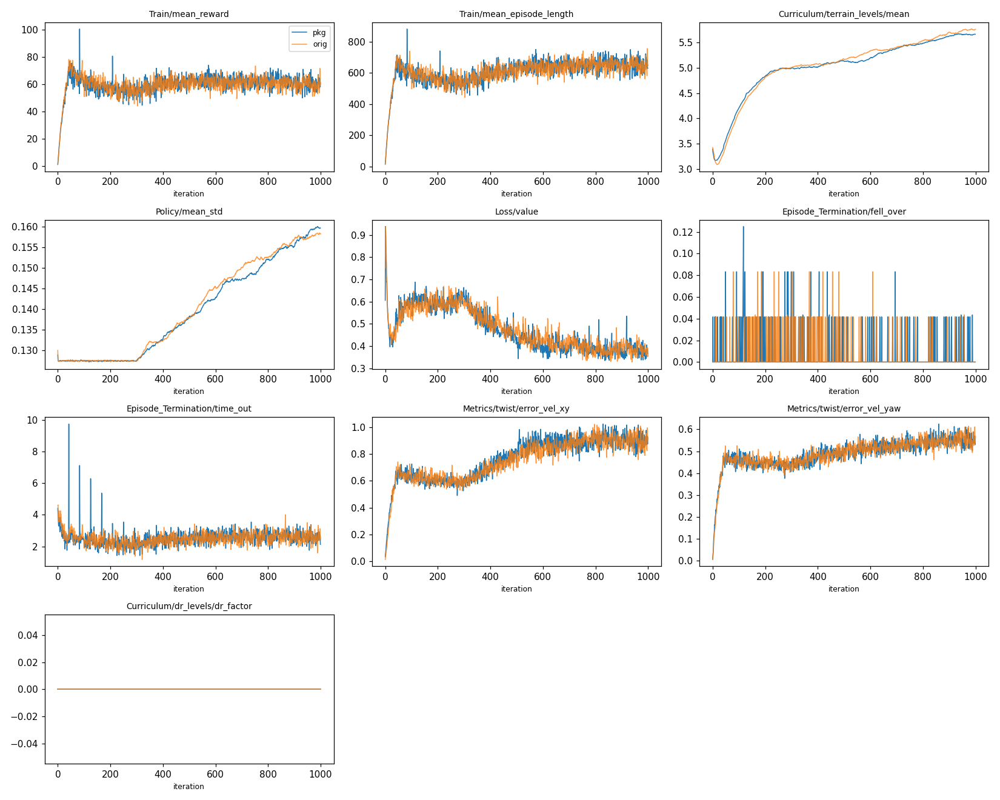
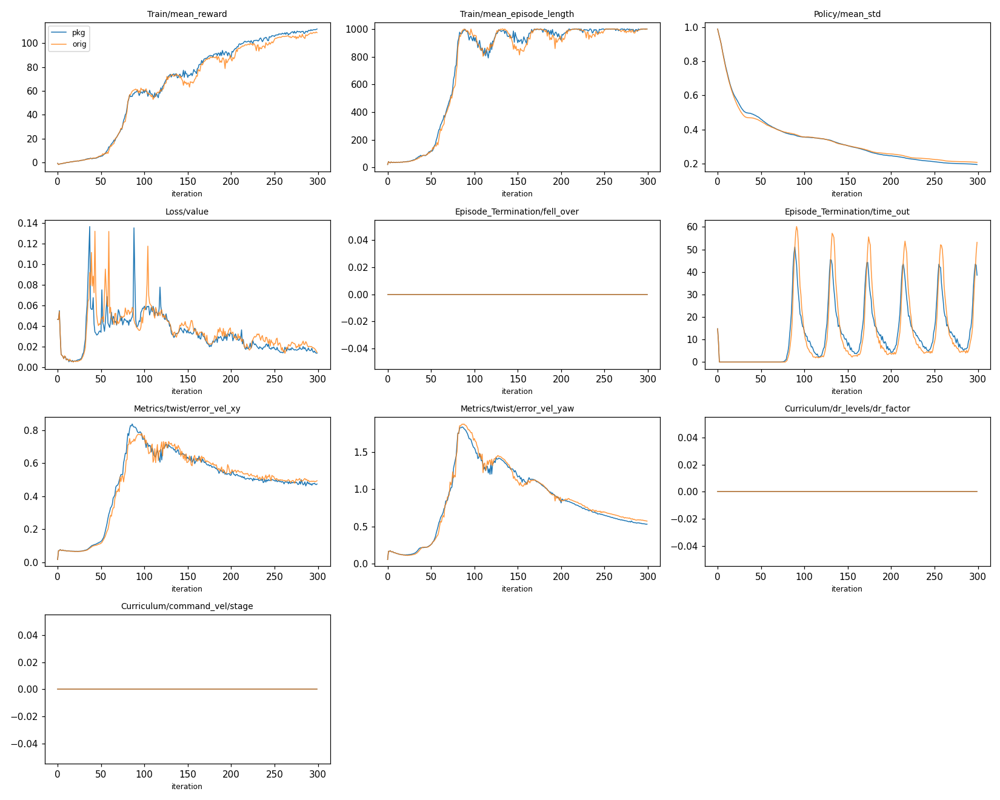
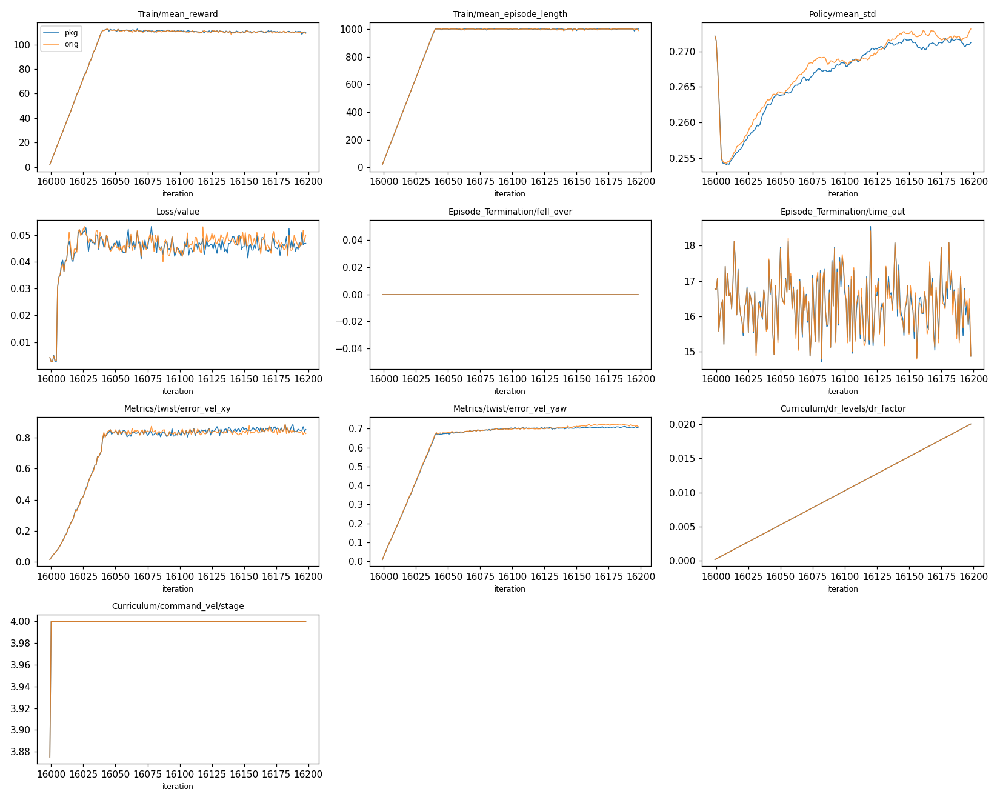

# vibecoded-audit-20261012 — 검토 요청

Pygmalion 하체 이족 로봇의 보행 RL 학습 환경과, 그것으로 만든 최신 policy 에 대한 **audit·검토 요청 자료**다.

## 0. 먼저 알아둘 것

- **이 학습 환경은 바이브코딩으로 만들었다.** 코드·설정·문서의 대부분을 AI coding agent (Claude Code) 가 작성했다. 사람은 방향과 결정만 정했다. 사람이 코드를 줄 단위로 검토한 적은 없다.
- 결정은 대부분 짧은 시행착오 학습의 결과로 내렸다. 값의 근거가 "그때 그렇게 해서 나아졌다" 수준인 것이 많다. Audit 문서는 근거가 없는 값을 "출처 없음" 으로 표시한다.
- 검토자가 **처음부터 다시 짤 것**을 전제로 한다. 그래서 이 폴더는 (1) 무엇을 했는지와 그 근거, (2) 다시 짠 결과를 비교할 기준 데이터, (3) 순정 mjlab 에서 그대로 돌려 볼 수 있는 재현본을 담는다.
- 원 학습 코드는 mjlab fork (upstream `20f10e96` 이후 137 commit, `PYG_*` 환경변수 flag 수십 개) 였다. 그대로 읽기 어렵기 때문에, 배포 policy 의 **세 학습 단계 (평지 P1 → 평지 P2 → rough) 를 flag 없는 task 패키지로 옮겨** 순정 mjlab 에서 같게 동작하는 것을 확인했다 (§4). Fork 가 mjlab 본체 27 개 파일을 고치고 설정을 환경변수에 흩어 둔 탓에 복사만으로는 순정 mjlab 에서 돌지 않는다 — 이것 자체가 검토 대상이다.

## 1. 검토해 주었으면 하는 것

중요한 순서. 번호는 audit 문서 [audit/README_ko.md](audit/README_ko.md) §6 의 finding ID 다.

1. **Sim-to-real 차이 (실기 실패 가능성).**
   - F1: 실기 문서상 gain (kp 10 / kd 1) 이 학습 gain (Kp 150~220) 의 1/15~1/22.
   - F2: Encoder zero offset 실측 최대 9.4°. DR 은 ±0.86° 뿐이다.
   - F3: Action latency, IMU bias, Kp/Kd·motor strength DR 이 없다.
   - F11: 실기 motor map 과 모델의 motor 종류가 다르다.
2. **Reward 설계.** 22 term 중 8 개가 fork 에서 추가한 것이다 (1 개는 weight 0, audit §1.6). 각 term 의 계산식은 §1.6.2 에 있다. 어느 것이 실제로 필요한지, 서로 상쇄하거나 hack 되는 조합이 없는지.
3. **근거 없는 값.** Observation noise, foot friction 범위, push 크기, mass DR 의 고정 floor, DR ramp 구간 (iter 2,000~8,000), rod hinge 의 armature·damping, contact solref/solimp. Audit 에서 "출처 없음" 으로 검색하면 나온다.
4. **로봇 모델.** Aluminium 부품 질량이 CAD 밀도 추정값이다 (F10). Ankle linkage 형상은 이전 CAD 판 기준이다 (F9). Passive ankle 마찰이 0 이다 (F8). 모델 생성 과정은 audit §4.
5. **학습 절차.** 평지 30,000 iter (2 단계) → rough 12,000 iter 로 이어 학습했다 (§3). 이 3 단계가 필요한지, 처음부터 한 번에 학습해도 되는지는 확인하지 않았다.
6. **Curriculum.** DR 은 성능을 보지 않고 iteration 수로만 올린다. Command curriculum 은 실질적으로 꺼져 있다. Terrain level 은 지형 능력이 아니라 규칙의 균형점을 보여 준다 (audit §2, F14).
7. **코드 품질.** `pygmalion_mjlab/mdp/*.py` 는 fork 의 함수를 그대로 옮긴 것이다 (쓰지 않는 인자, 실험 흔적 주석 포함).

## 2. 폴더 구성

| 경로 | 내용 | 다시 짤 때의 용도 |
|---|---|---|
| `audit/README_ko.md` | Audit 본문 (한국어, 최신). 환경·curriculum·DR·로봇 모델·Kp/Kd·reward 계산식·finding 20 개. 모든 사실에 출처 줄 번호 | 설계 근거와 약점 목록 |
| `audit/README.md` | 영어판 (이전판. reward 계산식 §1.6.2 와 curriculum §2 개정은 한국어판에만 있음) | |
| `audit/measurement_definitions_ko.md` | §3 성능 판정표의 각 항목을 어떻게 쟀는지 (환경·명령·창·식·문턱, 출처 줄 번호). 측정 도구는 넣지 않았다 | 다시 짠 policy 를 같은 기준으로 재기 |
| `pygmalion_mjlab/` | 배포 policy 의 세 학습 단계 task (`Pygmalion-Velocity-Flat-P1`, `-Flat-P2`, `-Rough-Box`) 를 순정 mjlab 용으로 옮긴 패키지. `env_cfg.py` 한 파일에 모든 override 와 단계별 차이가 있다 | 현재 설정을 한 곳에서 읽기 |
| `pygmalion_mjlab/assets/` | 로봇 MJCF (최신 하체 모델), STL 34 개, RS03·RS04 토크-속도 곡선 | 모델 그대로 재사용 가능 |
| `checkpoints/` | 평지 parent actor (warm start 원본), 배포 policy (.pt / .onnx) | 성능 비교 대상 |
| `reference/rough_main/` | 배포 policy 학습 run 의 `env.yaml`·`agent.yaml`·launch manifest·source snapshot·전체 학습 곡선 (`scalars.csv.gz`) | 설정·학습 곡선 비교 기준 |
| `reference/flat_p1/`, `flat_p2/` | Parent 평지 학습 2 단계의 같은 자료 | 앞 단계 설정 확인 |
| `fork/` | 원 fork 의 `src/` 변경 patch 와 launch/train script (fork commit 은 공개 remote 에 없음) | Audit 의 `MJ/...` 인용 확인 |
| `scripts/` | 학습·재생·영상·검증 script. 학습: `train_from_scratch.sh` (처음부터 세 단계), `train_continue.sh` (배포 policy 에서 이어서), `train_released.sh` (rough 단계만) | |
| `deploy/` | **실기 배포 안내** (§9): 배포 꾸러미 사본, 모터·게인 표, HUPHY `biped` 브랜치 안내, 2026-10-13 실기 시험 분석 문서 | 실기에 올릴 때 |

배포 (실기 inference) 꾸러미는 `deploy/asset/` 에 있다 (원본은 학습 저장소 `deploy_asset/pyg_rough_main_20261012/`). 실기용 observation·action 계약 (`deploy_contract.json`) 과 mjlab 대비 입출력 일치 검증 결과가 들어 있다.

## 3. 배포 policy 는 어떻게 만들어졌나

| 단계 | Run | Iter | 시작점 | 핵심 설정 | 기준 자료 |
|---|---|---|---|---|---|
| P1 평지 | `2026-10-01_17-15-50_legonly_ab_v11a_stand01_s43_p1` | 0~15,999 | 처음부터 | 평지, 16,384 env, command gate 실제로 동작 (iter 800·1,600·2,400·5,400 승급), DR 없음 | `reference/flat_p1/` |
| P2 평지 | `2026-10-02_23-52-14_legonly_ab_v11a_stand01_s43_p2` | 15,999~29,998 | P1 `model_15999` 에서 resume (actor·critic·optimizer 전부) | DR ramp iter 15,999→25,999, entropy coef 0.01→0.002 | `reference/flat_p2/` |
| Rough | `2026-10-11_23-35-20_rough_box_main_v11a` | 0~11,999 | P2 `model_29998` 의 **actor 만** | Box-only rough terrain, 4,096 env, critic warm-up 300, DR ramp iter 2,000→8,000, entropy 0.002 고정 | `reference/rough_main/` |

세 단계 모두 이 패키지의 task 로 재현한다 (`scripts/train_from_scratch.sh` 가 순서대로 실행). Rough 단계만 다시 돌리려면 `checkpoints/parent_flat_actor_model_29998.pt` (원 P2 의 끝 actor) 에서 시작하면 된다 (`scripts/train_released.sh`).

**배포 policy 의 성능** (원 fork 의 평가 도구로 측정, 학습 전에 고정한 기준 대비, 2026-10-12):

| 항목 | 기준 | 결과 | 판정 |
|---|---|---|---|
| 산길 182 m (실측 지형 mesh) | 4 조건 완주, 몸통 ≥ 0.7 m | 4/4 완주, 최저 0.79 m | 통과 |
| Box rough level 6 | 넘어짐 ≤ 10 %, 속도 오차 ≤ 0.25 | 0.4 %, 0.21 | 통과 |
| Box rough level 9 | 넘어짐 ≤ 20 % | 11.3 % | 통과 |
| 제자리 회전 | 4 seed 중앙값 ≥ 50 %, 반대 방향 ≤ 1/8 | 45 %, 한 seed 2/8 | 미달 |
| 걷기 속도 (명령 1.2 m/s) | 1.14~1.26 m/s | 1.32 | 미달 |
| 좌우 차 | ≤ 25 % | +18 % | 통과 |
| 똑바로 걷기 방향 틀어짐 | ≤ 15° | 8.6° | 통과 |
| 서기 | 발 뗀 시간 ≤ 2 %, 흘러감 ≤ 0.3 m | 1.3 %, 0.38 m | 미달 |
| 학습 건강 | 폭주·NaN 0 | 0 | 통과 |

이 평가 도구 (`terrain_eval`, `matched_set.sh`, 산길 주행) 는 fork 에 있고 이 폴더에는 넣지 않았다. 각 항목의 측정 방법 (환경, 명령 일정, 창, 식, 문턱, 확인하지 못한 부분) 은 [audit/measurement_definitions_ko.md](audit/measurement_definitions_ko.md) 에 있다. 측정 조건이 항목마다 다르다는 점에 주의 (예: 서기·회전은 DR 최대, 걷기는 DR 없음).

## 4. 이 폴더로 확인한 것과 하지 않은 것

| 확인 | 결과 |
|---|---|
| 이 폴더만으로 설치 (브랜치 commit 내용만 꺼내 새 venv 에 순정 mjlab + 패키지 설치) | stock `list-envs` 에 task 표시. `verify_config` MATCH |
| 설정 동일성: 세 단계 각각, 패키지가 만드는 env/agent 설정 vs 원 run 의 dump (`verify_config.py`) | 세 단계 모두 예상 밖 차이 0 건. 예상된 차이: mjlab API 필드 3 개, run bookkeeping, rough 의 command curriculum 제거와 entropy 표기, P2 의 command 범위 표기 (dump 시점 차이) |
| 동작 동일성: 같은 seed·명령으로 각 단계의 끝 policy 를 200 step (`rollout_trace.py`) | P1·P2·rough 모두 원 fork 코드와 observation·action·base 위치 **비트 단위 일치** (차이 0.0) |
| 순정 mjlab 에서 실제 학습 1,000 iter | 원 run 과 곡선 일치. 학습 시작 직후 command 크기 차이 하나 (§5) |
| **하지 않음:** 순정 mjlab 에서 12,000 iter 전체 재학습 | 약 18 시간. 1,000 iter 곡선 일치까지만 확인 |
| 처음부터 학습 경로의 짧은 실행 (P1 300 iter, P2 resume 200 iter, rough 20 iter) | 세 단계가 이어져 돌고, P1·P2 곡선이 원 run 의 같은 구간과 겹친다 (§5) |
| **하지 않음:** P1→P2→rough 42,000 iter 전체 재학습 | 수일. 단계별 설정 일치·비트 일치·짧은 학습까지만 확인 |
| **하지 않음:** 실기 | 실기 구동 기록 없음 |

## 5. 순정 mjlab 학습 확인 (1,000 iter)

<!-- TRAINING-RESULT -->
순정 mjlab `20f10e96` + 이 패키지로 `train_released.sh 1000 4096` 을 실행했다 (RTX 3090, 2026-10-12, 약 75 분). 원 run 의 첫 1,000 iter (`reference/rough_main/scalars.csv.gz`) 와 비교했다.



| 지표 (±25 iter 평균, pkg / orig) | iter 50 | 300 | 500 | 750 | 975 |
|---|---|---|---|---|---|
| mean reward | 63.9 / 66.6 | 55.0 / 55.3 | 62.5 / 61.8 | 61.7 / 62.3 | 60.2 / 59.6 |
| mean episode length | 599 / 619 | 538 / 540 | 632 / 624 | 644 / 656 | 646 / 645 |
| terrain level 평균 | 3.57 / 3.46 | 4.99 / 5.01 | 5.13 / 5.17 | 5.45 / 5.46 | 5.66 / 5.75 |
| action std | 0.127 / 0.127 | 0.128 / 0.128 | 0.138 / 0.138 | 0.149 / 0.152 | 0.159 / 0.158 |
| xy 속도 오차 | 0.62 / 0.62 | 0.60 / 0.59 | 0.82 / 0.78 | 0.88 / 0.90 | 0.90 / 0.89 |
| yaw 속도 오차 | 0.44 / 0.44 | 0.44 / 0.44 | 0.50 / 0.50 | 0.53 / 0.53 | 0.55 / 0.56 |

- 1,000 iter 전 구간에서 곡선이 겹친다. GPU 학습은 비트 단위로 결정적이지 않으므로 표본 단위 일치는 기대하지 않는다.
- **알려진 차이 하나: 학습 첫 3~8 초의 command 크기.** 원 run 은 gated curriculum 이 첫 reset 때 stage 1 이었다. 그래서 각 env 의 첫 command 를 stage 1 범위 (vx ±1.2, wz ±0.8, 평균 $\lVert c_{xy}
Vert$ 0.63 m/s) 에서 뽑았다. 이 패키지는 처음부터 최종 범위에서 뽑는다 (평균 1.17 m/s). 두 env 를 1,024 개씩 만들어 첫 reset 직후 command 를 비교해 확인했다. 첫 command resample (3~8 s) 이후에는 같다.
  - 영향: 정지 상태에서 큰 command 를 받은 env 가 iter 0 에 `stagnation` 으로 함께 종료된다 (pkg 12.2 / orig 0). 그 env 들이 동시에 다시 시작하므로 20 s 뒤 timeout 이 몰린다. 그래서 iter 42·84·126·168 에 time_out·reward·episode length 의 spike 가 있고, 점점 작아진다. 그 뒤 곡선에는 남지 않는다.
  - 고치지 않았다. 원 run 의 이 동작은 gate 를 끈 설정 (audit §2.3) 의 부산물이다.
- 1,000 iter checkpoint 시연 영상 (`record_video.py`, 120 s): 걷기·후진·옆걸음·회전 모두 동작. 종료 5 회 (low_base 3, stagnation 2). 아직 DR 이 시작되지 않은 iter 1,000 시점이다.
- 이 브랜치의 commit 내용만 꺼낸 새 사본으로 새 venv 에 설치해 `verify_config` (MATCH) 와 30 iter 학습 (warm start·critic warm-up 동작, 학습 영상 생성) 도 확인했다.

### 처음부터 학습 경로의 짧은 실행

`train_from_scratch.sh` 로 P1 을 처음부터 300 iter, P2 를 원 P1 `model_15999` 에서 resume 해 200 iter, rough 를 그 P2 에서 warm start 해 20 iter 돌려 원 run 의 같은 구간 곡선과 비교한다.

<!-- SCRATCH-RESULT -->
2026-10-12~13, RTX 3090, 이 브랜치 내용만으로 만든 새 사본 + 새 venv (순정 mjlab `20f10e96`). 원 run 의 같은 iteration 구간 (`reference/*/scalars.csv.gz`) 과 비교했다 (±25 iter 평균, pkg / orig).

**P1 처음부터 300 iter** (16,384 env):

| 지표 | iter 15 | 75 | 150 | 224 | 274 |
|---|---|---|---|---|---|
| mean reward | 1.15 / 1.14 | 34.7 / 34.9 | 76.8 / 73.6 | 100.6 / 96.5 | 108.9 / 105.8 |
| mean episode length | 49 / 47 | 609 / 592 | 959 / 937 | 987 / 972 | 997 / 992 |
| action std | 0.648 / 0.632 | 0.394 / 0.393 | 0.306 / 0.306 | 0.227 / 0.238 | 0.201 / 0.213 |
| xy 속도 오차 | 0.071 / 0.070 | 0.550 / 0.505 | 0.644 / 0.652 | 0.509 / 0.529 | 0.482 / 0.496 |
| command stage | 0 / 0 | 0 / 0 | 0 / 0 | 0 / 0 | 0 / 0 |



**P2 resume 200 iter** (원 P1 `model_15999` 에서, iter 15,999~16,198):

| 지표 | iter 16,009 | 16,049 | 16,099 | 16,148 | 16,173 |
|---|---|---|---|---|---|
| mean reward | 49.2 / 49.2 | 104.7 / 104.5 | 110.9 / 110.7 | 110.6 / 110.3 | 110.4 / 110.2 |
| action std | 0.258 / 0.259 | 0.263 / 0.264 | 0.268 / 0.269 | 0.271 / 0.272 | 0.271 / 0.272 |
| dr_factor | 0.002 / 0.002 | 0.005 / 0.005 | 0.010 / 0.010 | 0.015 / 0.015 | 0.018 / 0.018 |
| command stage | 3.997 / 3.997 | 4 / 4 | 4 / 4 | 4 / 4 | 4 / 4 |



**Rough 20 iter**: 위 P2 의 끝 checkpoint 에서 actor-only warm start, critic warm-up 이 동작하고 학습이 진행됨 (단계 연결 확인용).

- 세 단계가 `train_from_scratch.sh` 로 순서대로 이어진다 (P1 → P2 resume → rough warm start).
- P2 에서 env step counter 가 checkpoint 에서 복원되어 DR ramp (iter 15,999 기준) 와 entropy anneal 이 원 run 과 같은 값으로 진행한다. Command gate 는 원 run 처럼 첫 iteration 에 최종 stage 로 승급한다 (gate 상태는 checkpoint 에 없음).
- P1 의 command gate 승급 (원 run: iter 800·1,600·2,400·5,400) 은 300 iter 안에 일어나지 않으므로 이번에는 확인하지 않았다. Gate 함수는 원 fork 코드를 그대로 복사했다.

## 6. 설치

요구: Linux, NVIDIA GPU (CUDA), [uv](https://docs.astral.sh/uv/).

```bash
# 1) mjlab 을 기준 commit 으로 받는다
git clone https://github.com/mujocolab/mjlab.git
cd mjlab
git checkout 20f10e96
uv sync                     # torch, mujoco 3.10, mujoco-warp 3.10, rsl-rl-lib 5.4.0 등

# 2) 이 폴더를 mjlab 환경에 설치한다 (editable)
uv pip install -e /path/to/vibecoded-audit-20261012

# 3) 설치 확인
uv run list-envs | grep Pygmalion          # -> Pygmalion-Velocity-Rough-Box
```

`pyproject.toml` 이 `mjlab.tasks` entry point 를 등록한다. mjlab 이 시작할 때 이 패키지를 import 하므로 stock 명령 (`uv run train`, `uv run play`) 에서 task 를 바로 쓸 수 있다. mjlab 소스는 수정하지 않는다.

`scripts/*` 는 mjlab 환경의 python 으로 이 폴더에서 실행한다.

```bash
cd /path/to/vibecoded-audit-20261012
export MJLAB_PYTHON=/path/to/mjlab/.venv/bin/python
$MJLAB_PYTHON scripts/verify_config.py     # -> RESULT: MATCH
```

`scripts/rollout_trace.py` 만 `onnxruntime` 이 추가로 필요하다 (`uv pip install onnxruntime`).

## 7. 사용법

| 목적 | 명령 |
|---|---|
| 설정 검증 (원 run 의 `env.yaml`·`agent.yaml` 과 값 비교) | `$MJLAB_PYTHON scripts/verify_config.py` |
| **처음부터 학습** (P1 → P2 → rough, 학습 영상 포함) | `MJLAB_PYTHON=... bash scripts/train_from_scratch.sh` (단계 선택: `STAGES="p2 rough"`, 이어받을 run: `P1_RUN=`, `P2_RUN=`) |
| Rough 단계만 재학습 (원 P2 의 끝 actor 에서, 학습 영상 포함) | `bash scripts/train_released.sh 12000 4096 released` |
| **배포 policy 에서 이어서 학습** — 같은 설정으로 계속 (actor·critic·optimizer·iteration 11,999 모두 불러옴) | `bash scripts/train_continue.sh resume 4000 4096 continue` |
| **배포 policy 에서 이어서 학습** — 환경을 바꾼 뒤 (actor 만 불러오고 critic 300 update 먼저 적응) | `bash scripts/train_continue.sh warmstart 12000 4096 finetune --obs-delay 1 --act-delay 1 --gain-dr 0.8 1.2` |
| 짧은 확인 학습 | `bash scripts/train_released.sh 1000 4096 check` |
| Rough 단계만 warm start 없이 (배포 절차와 다름) | `uv run train Pygmalion-Velocity-Rough-Box --env.scene.num-envs 4096` (mjlab 폴더에서) |
| 학습 곡선을 원 run 과 비교 | `$MJLAB_PYTHON scripts/compare_curves.py logs/rsl_rl/pygmalion_velocity/<run> reference/rough_main/scalars.csv.gz --upto 1000 --png curves.png` |
| Policy 재생 (interactive viewer) | `$MJLAB_PYTHON scripts/play.py Pygmalion-Velocity-Rough-Box --checkpoint-file checkpoints/rough_main_model_11999.pt` |
| 시연 영상 (headless, 실시간 50 fps, 명령당 15 s) | `$MJLAB_PYTHON scripts/record_video.py --checkpoint checkpoints/rough_main_model_11999.pt --out demo.mp4` |
| 같은 seed 롤아웃 기록·비교 | `scripts/rollout_trace.py` (docstring 참고) |

선택 무작위화 `--obs-delay N`, `--act-delay N`, `--gain-dr LO HI` 는 기본이 꺼져 있다 (배포 policy 는 이것 없이 학습됨). 모든 학습 스크립트 뒤에 붙이면 된다 (`train_from_scratch.sh` 는 `TRAIN_EXTRA="..."`). 뜻과 실측 근거는 `deploy/README.md` §4. `train_continue.sh resume` 은 terrain curriculum level 은 복원하지 않는다 (0 부터 다시 오름).

모든 학습 스크립트는 `MJLAB_PYTHON` 을 쓴다. 로그는 `logs/rsl_rl/pygmalion_velocity/<날짜>_<run_name>/` (checkpoint, `params/`, `videos/train/`). `scripts/train.py` 의 나머지 인자는 mjlab `train` CLI 로 그대로 넘어간다.

**배포 policy 와 같은 절차** (`train_released.sh`):
1. Actor-only warm start: parent 에서 actor weight·action std·obs normalizer 만 불러온다. Critic·optimizer·iteration 은 새로 시작하고 env step counter 를 0 으로 되돌린다. Rough critic 입력 (height scan 포함) 이 parent 와 달라 critic 은 불러올 수 없다.
2. Critic warm-up 300 update: 처음 300 PPO update 동안 actor 를 update 직후 되돌려 critic 만 학습한다.
3. 이후 일반 PPO (4,096 env, seed 43, entropy_coef 0.002).

1·2 는 stock `train` 에 옵션이 없어 `scripts/train.py` 가 `MjlabOnPolicyRunner.learn` / `alg.update` 를 감싸 구현한다.

## 8. 원 학습 코드 (fork) 와 다른 점

아래 첫 command 범위 한 가지를 빼면 동작은 같고 표현만 다르다 (§4 에서 비트 단위 일치 확인).

| 항목 | fork | 이 패키지 | 같은 이유 |
|---|---|---|---|
| Command 범위 | Gated command curriculum. 첫 iteration 에 최종 stage 로 승급 (audit §2.3) | 최종 범위 (vx −2.0~2.5, vy ±1.0, wz ±1.0) 를 처음부터 사용 | 원 run 의 `Curriculum/command_vel/stage` 가 iter 1 부터 최종값 |
| Reward term 별 clamp | `RewardManager` 를 고쳐 term 별 ±50·dt | 각 reward 함수를 `clamped()` 로 감쌈 | 함수 출력 × weight × dt 순서와 nan→0 처리가 같다 |
| 첫 command 의 범위 | 첫 reset 때 stage 1 범위 (첫 3~8 s 만) | 처음부터 최종 범위 | **같지 않다.** 학습 초반 일시적 차이 (§5) |
| 평지 단계의 command 오차 지표 | fork 가 mjlab 의 `UniformVelocityCommand` 를 직접 고쳐 정상상태 오차 지표를 추가 (gate 가 읽음) | `mdp/commands.py` 의 하위 클래스 `MetricVelocityCommand` | 지표만 추가, command 추첨은 그대로 (P1·P2 비트 일치) |
| 평지 단계의 command gate, entropy anneal | fork curriculum 함수 / fork runner 수정 + `PYG_ENTROPY_*` | `mdp/curriculums.py` 의 `commands_vel_gated` (그대로 복사) / `scripts/train.py --entropy-anneal` | 같은 식, 같은 시점 (update 직전) |
| 그 밖의 fork core 변경 (box-only terrain, actor height scan 제거 등) | mjlab core 수정 + `PYG_*` flag | `env_cfg.py` 의 override | `verify_config` 로 값 일치 확인 |

로봇 모델은 최신 하체 모델 `LegOnly_prototype-tempmass-motormeasured-armfix_v30_proxyfix_loop` 이다. 공통 관절 24 개의 축·위치·범위가 최신 전신 모델 (`FullDoF_..._v30_proxyfix_shell_loop`) 과 같다 (2026-10-12 확인).

## 9. 실기 배포

실기에 올리는 데 필요한 것은 `deploy/README.md` 에 모았다. 요점은 다음과 같다.
- 로봇 쪽 코드는 HUPHY 저장소 **`biped` 브랜치**다. `main` 은 옛 단일다리 설정 (v0.5: 왼다리 Kp/Kd 비어 있음, 한계 null, RS02/RS00) 이다.
- 모터: hip pitch·roll·knee 는 RS04, hip yaw·발목 크랭크는 RS03. 학습 모델과 실기 설정이 같다 (2026-10-14 확인).
- 2026-10-13 실기 시험에서 IMU 투영 중력 x 부호가 시뮬레이션과 반대로 들어가는 것을 찾았다 (확인 중).
- 게인 배율 0.8 미만은 학습 범위 밖이다. `--hz 50` 으로 돌려야 한다.

